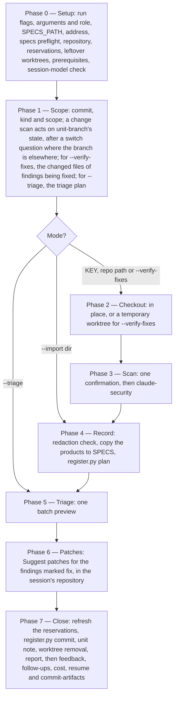
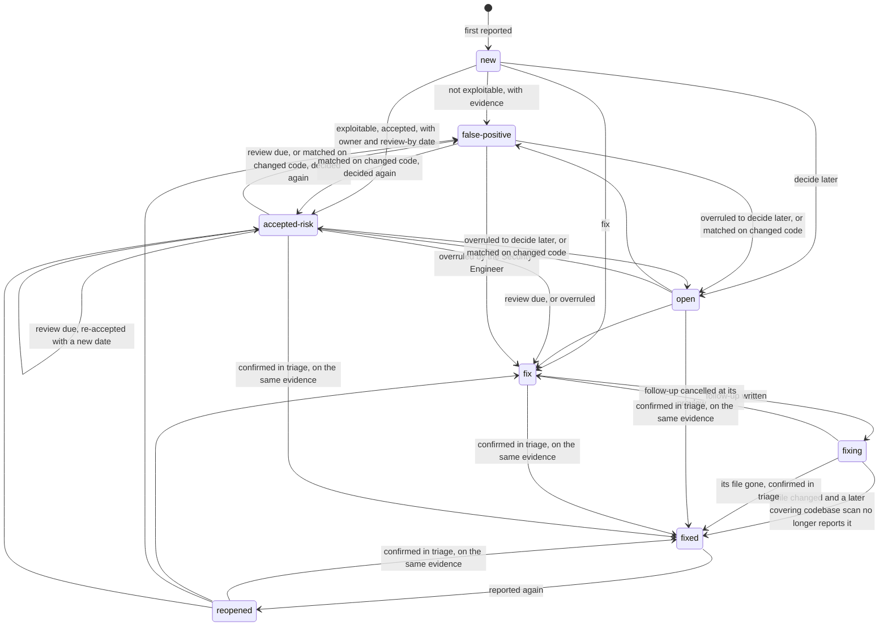

# `security-workflows`: record Claude Security scans in SPECS and route their fixes through `/implement` (sub-project A)

Date: 2026-10-15. Status: approved. Amended seven times.

1. **After the user's first review:**
   - effort defaults per scan kind;
   - `false-positive` separated from `accepted-risk`;
   - every risk re-checked.
2. **While planning, from the plugin's source and the gates:**
   - the scan roots (D5);
   - the covering-scan test;
   - the cost row;
   - `bounded.py`;
   - the selftest idiom;
   - D15.
3. **On the user's decisions about timing and roles:**
   - the scan runs before the merge, on the Epic's branch, and a fix joins that branch's open pull request (D17);
   - a Dev is never blocked: their decisions take effect at once, and the Security Engineer reviews afterwards (D9);
   - the register is bookkeeping, committed with the run's session files rather than handed off by pull request (D12).
4. **On the user's decision about `/conformance`:**
   - an Epic's `/conformance` returns to before the merge (D19), and the Dev runs it before the scan;
   - one shared rule, `unit-branch` (D18), finds an Epic's branch for `/implement`, the scan and `/conformance` alike.

   This folds the planned sub-project G into A.
5. **On review**, a few smaller corrections.
6. **After the spike** (plan Task 1, approved by the user):
   - the covering-scan test has two rules: a scope that names the file, or complete counts with `outside_components` 0;
   - `--effort low` is dropped, and a low-effort scan covers nothing;
   - `session-cost.py` reads a workflow's agents (D13).
7. **On the review of `register.py`** (plan Task 3):
   - closure evidence survives a squash merge and a deleted branch, through a *later* test that falls back to the merged test's subject leg, and a *changed* test on the file's recorded blob (D8 rule 2);
   - an `ID_VERSION` change is judged per finding (D8 rule 3);
   - a renumbering moves only the colliding record, and is reported once (D8 rule 5);
   - records name a finding by its `origin`, never by its number alone (D7).
8. **On the review of the `workflows-core` changes** (plan Task 4):
   - `unit-branch`'s merged state tests the branch's tip by content, against the commit the merge landed in, and reports `after_merge` for a branch that went on after its merge (D17, D18);
   - the register's derived files are unset `-merge`, so a session-branch merge keeps one rebuild whole (D12);
   - a keyless scan's cost entry is filed per code repository, never left pending (D13).

Branch: `iv-gu/security-workflows-scan`.

## Background

During an `/implement` run on the bookstore demo, Claude Code suggested a Claude Security scan. That suggestion almost certainly came from the Claude Security plugin's hook, which fires after `git push` and `gh pr create`; `/implement`'s finish step runs both. The hook prints: *"Claude Security: this branch changes … against main. For a security review, ask: 'scan this branch's changes against main with Claude Security'."*

**Claude Security** is two Anthropic products under one name:

- **The hosted product** (claude.ai/security). An Enterprise-only public beta that scans connected GitHub repositories, runs scheduled scans and uses Mythos. It grew out of the February 2026 "Claude Code Security" research preview.
- **The plugin**, `claude-security@claude-plugins-official`, version 0.12.0 as read from the official marketplace clone. It runs inside a Claude Code session on any paid plan or API account and adds one command, `/claude-security`, with three jobs: *Scan codebase*, *Scan changes* (a branch, a pull request or one commit) and *Suggest patches*. This spec builds on the plugin.

These are the plugin facts this design relies on, from its source and README:

- **Its output contract is promised stable.** Each scan writes `CLAUDE-SECURITY-<timestamp>/` at the scan root, with its own `.gitignore`. The folder holds:
  - `CLAUDE-SECURITY-RESULTS.md`;
  - `CLAUDE-SECURITY-RESULTS.jsonl`, one finding per line;
  - `CLAUDE-SECURITY-RESULTS.sarif`, SARIF 2.1.0, classified by CWE;
  - `CLAUDE-SECURITY-REVISION-<tag>.json`, the revision stamp.

  The stamp records `scan_id`, `mode` (`scan`, `changes` or `commit`), `scope`, `revision` (`commit`, `dirty`, …), `effort`, `verification.status`, and `run_shape.research_coverage`. That last field holds coverage **counts**, never the list of files read. `render_report.py` states: *"Filenames, JSONL field order, and verification.status semantics are stable across releases."*
- **Each finding carries an ID computed from its content.** A JSONL record is the plugin's `Finding` fields, then `claudeSecurityPluginFindingId`. That ID is `ID_VERSION:` (now `v3`) followed by a sha256 over the rule (the CWE category), the repository path and the normalised lines around the finding. It survives line shifts, and it changes when the code around the finding changes.
- **Effort sets how much work a scan does**, not how carefully any one agent reasons.
  - `low`: one researcher, no inventory, no threat model.
  - `medium`: the full workflow, which is an inventory, a threat model, one researcher per component and category, and one breadth sweep. The plugin calls it *"the calibrated default"*.
  - `high`: as `medium`, but up to 48 components, two researchers per cell and two sweeps.

  The verification panel stays at three voters at every tier. A `max` tier is accepted but not advertised. For a change, the tier sets how many researchers read the diff, and no tier maps the repository. The README advises: *"For a feature-sized change, choose `high` effort."*
- **A change scan reports only flaws the change takes part in.** In the README's words: *"It reports only flaws the change takes part in and leaves the rest to a scan of the codebase."*
- **Where it scans.**
  - *Scan changes* has no path argument. Its scan root is the repository the session is open in, so it diffs that repository's HEAD against a base.
  - *Scan codebase* takes a `[path]` argument, and a `--scope` whose entries `write_scan_meta.py` passes to `git ls-files` as pathspecs.
  - *Suggest patches* builds against the session's own repository at the scanned commit.
  - Its instructions say: *"When a commit is not checked out, never check it out or add a worktree yourself."*
- **Patches are never applied automatically.** *Suggest patches* writes `patches/F<n>.patch` with a note beside each, after an independent review that runs the project's tests where there are any. It skips, with a note, any finding whose code changed since the scan.
- **A model can invoke its skill.** `claude-security:claude-security` carries no `disable-model-invocation`. It skips its menu when the request names the job, and skips its one cost confirmation when the request already accepts the scan's time and token cost.
- **Its working agents inherit the session model.** These are `model: inherit`: `scan-researcher`, `scan-verifier`, `patch-generator`, `patch-verifier` and the `claude-security` agent. These are pinned to `sonnet`: `scan-inventory`, `scan-loader`, `scan-redactor` and `explore`. Its workflow passes no model, so a caller cannot redirect the inherit agents.
- **Redaction is best effort.** After writing its products, an agent replaces each credential value it finds with `[REDACTED]`. The README calls this *"a model's best effort, not a guarantee"*. When it fails, the skill tells the user in the session; no file records it.
- **It needs** `python3` 3.9 or newer, git for change scans and patches, and dynamic workflows, which are off by default on Pro and switched on in `/config`.
- **Its scans are nondeterministic.** Two scans of the same code can surface different findings.

**What the family has for security today** is scattered:

- `HIGH-RISK` classification forces Opus planning and review.
- `code-review` and `risk-planner` each have a Security section.
- `spec-reviewer` flags a missing security NFR as `MAJOR`.
- `specification-format` has a `Security / privacy` test-case category.
- `/vuln` remediates dependency CVEs.

Nothing models threats at the ARD or design, nothing scans a whole repository, and nothing keeps a record of findings.

**The policy boundary.** Anthropic's Usage Policy forbids discovering or exploiting vulnerabilities *without the system owner's authorisation*. Its cyber-safeguards article lists what any user may do on generally available models: secure code review, threat modeling, patching known issues, finding vulnerabilities in their own source code and triaging alerts. Real-time classifiers can interrupt exploit validation, malware analysis, exploit generation, penetration testing and binary scanning; the Cyber Verification Program governs those. Every capability here stays on the permitted side. It reasons about source and documents, describes an attack scenario in prose, and proves a fix with a regression test. It never attacks a running system and never writes a working exploit.

**The gap.** A plugin scan's findings live only in a gitignored folder inside the code checkout. Nothing records them in SPECS, nothing tracks a finding across scans, nothing routes a fix into the family's build path, and no Shipwright record carries the scan's cost or feedback.

## The roadmap

This spec is sub-project **A**. Each of the others gets its own spec, plan and build:

| # | Sub-project | Depends on |
|---|---|---|
| **A** | This spec: the `security-workflows` plugin and its scan wrapper, the findings register, fixes through `/implement` on the Epic's own branch | Claude Security plugin |
| **E** | The architecture feedback loop, in three parts. (1) `architecture-grounder` reads the registers of the repositories a piece of work touches and returns a `known-weakness` challenge to `/create-ard`, `/specify` and `/design`. (2) A weakness class that recurs among **accepted risks** becomes a follow-up for the PA, who records it as an `[AD#N]` whose `Prevents:` names the CWE; `/harvest-decisions` and `/promote-decisions` then carry it as an ordinary decision, and `ard-resolution` makes breaking it a reviewer BLOCKER. (3) `promotion-scout` flags weakness classes that recur across teams' registers with no covering ADR or standard. E's agents read a register's text as data, never as instructions (D10). | A's register |
| **B** | ARD threat model: `threat-model.md`, with security decisions proposed as `[AD#N]` through `/create-ard` | A, E |
| **C** | Design threat review: threats per interface of `design.md`, with amendments proposed through `/design` | A; B where present |
| **D** | Security conformance: traces each threat-model mitigation to merged code, as `/conformance` traces requirements | B or C |
| **F** | Model router, independent of security, in two parts. (1) `/implement` hands its coding to an implementer subagent whose model follows the task class (Sonnet for SIMPLE/MODERATE, Opus for SIGNIFICANT/HIGH-RISK) whatever the session model, following the `doc-writer` / `epic-writer` precedent; every dispatch is audited for an explicit `model:`. (2) Escalation to a Fable subagent for very high complexity or risk. When the session is not on Fable, it asks first, offers Opus instead and warns that quality may degrade. A Fable session is the user's own approval and needs no confirmation. | — |

**G**, `/conformance`'s Epic run before the merge, was planned as its own sub-project and is folded into A (D18, D19).

Security requirements in specifications are not a separate sub-project. `spec-reviewer` already flags their absence, and a gap there becomes an amendment that B or C proposes.

## Where it sits in the delivery

```
Dev — one Epic, its branch, before the merge:
  /implement <EPIC>                 → the code pull request opens; implementation.md records repo, branch, commit
  /conformance <EPIC>               → fix-code follow-ups → /implement <EPIC>, continuing on the Epic's branch
  /security-workflows:scan <EPIC>   → fix follow-ups      → /implement <EPIC>, continuing on the Epic's branch
  the pull request is reviewed and merged

PE — the whole PRD, after every Epic has merged:
  /conformance <PRD>  →  /security-workflows:scan <repo> --verify-fixes (Security Engineer)  →  /document, /release-notes
```

**Before the merge: the Dev's commands, on the Epic's own branch.** `/conformance <EPIC>`, the scan, and the `/implement` runs that fix what either finds all work for one Epic, on that Epic's branch, before the merge. Each fix joins the open pull request. The three commands find the branch with one shared rule, `unit-branch` (D18), which looks it up in `implementation.md` and never guesses it.

**Conformance runs before the scan.** A conformance fix is the larger, functional change, and a change scan then covers the whole branch diff, those fixes included. A security fix is guarded in turn by its own `/implement` run, whose Opus code review traces the spec's requirements against the change (`code-review` dimension 10).

**After the merge: the PE's settlement.** `/conformance <PRD>` stays merged-only. Merged pull requests are the Devs saying their Epics are done, and the PE settles the delivered whole on one consistent snapshot: every repository's default branch. `--verify-fixes` closes the security fixes on evidence (D8).

**Nothing waits on the Security Engineer.** The Dev's decisions take effect at once, and the Security Engineer reviews them in `--triage` whenever they get to it (D9).

## Goals

1. **A new plugin, `security-workflows`**, with one command, `/security-workflows:scan`. It runs the Claude Security plugin on the repository a PRD or Epic was implemented in, or on a repository path, and records what it finds in SPECS.
2. **A durable findings register per code repository**, `$SPECS_PATH/security/<repo-slug>/`. It tracks each finding across scans by the plugin's own finding ID. A finding has a lifecycle, and every status change has a recorded decision behind it.
3. **One batch triage at the end of the scan** decides each new finding's fate: fix, decide later, false positive, or accept the risk.
   - **A false positive** names the evidence that makes the finding unexploitable.
   - **An accepted risk** names an owner and a review-by date, and returns to triage once that date passes.
   - **A Dev's false positive or accepted risk takes effect at once**, and stays marked *awaiting security review* until the Security Engineer confirms or overrules it in `--triage`.
4. **Fixes go through `/implement` on the Epic's own branch**, starting from the plugin's verified patch. A security fix therefore gets the family's test baseline, Opus review and implementation record, in the pull request already under review.
5. **The Dev's checks all run before the merge, on one branch.** `/conformance <EPIC>` returns to before the merge, and `/implement`, the scan and `/conformance` find the Epic's branch with one shared rule.
6. **A finding is closed only on evidence.** Its file has changed, and a later codebase scan that covers the file no longer reports it. `--verify-fixes` runs that scan over just the affected files.
7. **`--import` records a report the user already produced** by running `/claude-security` directly, without paying for the scan again.
8. **Nobody waits.** Register changes are bookkeeping, committed and pushed with the run's session files. On a protected default branch they travel on the family's session branch instead.
9. **The scan's cost and the run's feedback land where every other run's do.**

## Non-goals

- **No scanner of the family's own.** Claude Security does the code-level work. `/security-review`, a single pass with no file output, is not used.
- **No audit of documents**: no threat model, ARD or design review. Those are B and C.
- **No architecture feedback loop.** That is E. A only prepares for it, by placing the register's format reference in `workflows-core`.
- **No change to how the family picks models.** That is F.
- **No integration with the hosted Claude Security product.**
- **The command never applies a patch itself.**
- **No exploit code, and nothing run against a deployed system.**
- **`dev-workflows` does not depend on `security-workflows`.** It offers the scan as a next step. `/implement` learns to continue on an Epic's branch (D17), and `/conformance`'s Epic run returns to before the merge (D19); both serve any follow-up, not only a security one.
- **No change to `/conformance`'s PRD run.** It stays merged-only.
- **No access control.** Who may confirm a decision is a matter of team practice. The register records who decided, in which role, and when.
- **No guarantee of completeness.** A scan can miss a real vulnerability, and no wrapper can change that (see Risks).

## Terms

- **Scan.** One run of the plugin's *Scan codebase* or *Scan changes* job, on one repository at one commit. Its revision stamp identifies it.
- **Codebase scan.** A *Scan codebase* run, either whole-repository or with a `--scope`.
- **Change scan.** A *Scan changes* run over a branch's diff.
- **Covering scan** (for a finding). A scan covers a finding's file when it is a **codebase** scan (`mode: scan`), `verification.status` is `verified`, `revision.dirty` is false, its effort is not `low`, and one of these holds:
  - **its scope names the file itself**, and its research coverage is absent or complete;
  - **its scope is the whole repository, or one of the file's parent directories**, and its research coverage is present and complete: `not_reached` 0, `unaccounted` 0, `outside_components` 0, `capped` false.

  The spike showed why the rule has two parts. Claude Security writes research coverage only where it keeps its component matrix. It never writes it for a low-effort scan, for a medium-effort scope of five files or fewer, or for a change. A `--verify-fixes` scan names the fixed files, so it is usually that small, and with one rule it could never close anything. `outside_components` counts the files no component read: the inventory's skipped areas, and root files no component claims. Without it, a whole-repository scan could close a finding in a file nobody read.

  **A change scan is never a covering scan**, because it reports only flaws the change takes part in. Its silence about an older finding in a file it touched is no evidence.
- **Plugin finding ID.** `claudeSecurityPluginFindingId`. Its `ID_VERSION:` prefix names the algorithm.
- **`[SEC#n]`.** The register's own permanent finding ID, in the family's bracketed form, numbered per repository.
- **Run record.** One file per run that changes the register, `security/<repo-slug>/runs/<seq>-<UTC>-<hash8>.json`. It holds the run's scan (if any), its matches, its decisions, its role, and the `[SEC#n]` it allocated.
- **Register.** `register.json`, plus `register.md` rendered from it. Both are rebuilt from the run records and scan folders by every run, and nothing reads them back.
- **Role.** `dev` for a run addressed by a key (the Dev's own pre-merge scan), and `sec` for any other run: a repository path, `--triage`, `--verify-fixes`, or an `--import` without a key.
- **Awaiting security review.** A `false-positive` or `accepted-risk` decided in a `dev` run. It is effective at once, and confirmed or overruled by a later `sec` run.
- **Unit note.** `_security.md` in a PRD or Epic folder: an append-only list of the scans run for that unit.

## Decisions

### D1. A new plugin, installed together with `workflows-core` and Claude Security

`plugins/security-workflows/` contains:

- `.claude-plugin/plugin.json`, with `"dependencies": ["workflows-core", "claude-security@claude-plugins-official"]` and no version constraint (see Risks).
- `commands/scan.md`.
- `scripts/register.py`, standard-library Python, with a `--selftest` that builds its fixtures at run time, as the family's other scripts do.
- `scripts/bounded.py`, a byte-identical copy of `workflows-core`'s. The command caps its `git fetch` with it, and CI fails a plugin that calls it without shipping the same copy.
- `docs/`, `README.md`, `LICENSE` and `CHANGELOG.md`.

There are no agents and no hooks: the orchestrator runs triage, and the plugin writes patches.

**Installing `security-workflows` installs both dependencies automatically.** Claude Code installs any missing declared dependency at `claude plugin install`, and again at `/reload-plugins`, at an auto-update of the marketplace, and at a re-run of the install. The two dependencies arrive by different routes:

- **`workflows-core`** is a bare name. It resolves in `security-workflows`' own marketplace and installs with no further configuration, exactly as `dev-workflows`, `product-workflows` and `docs-workflows` declare it in their `plugin.json`.
- **`claude-security@claude-plugins-official`** lives in another marketplace. Claude Code installs it only when the root marketplace allowlists that marketplace, so `.claude-plugin/marketplace.json` gains the plugin's entry and the top-level `"allowCrossMarketplaceDependenciesOn": ["claude-plugins-official"]`. Without that line, the install completes without Claude Security and `security-workflows` then fails to load.

If either dependency is later disabled or uninstalled, Claude Code disables `security-workflows` with its own error naming the dependency. As with the rest of the family, there is no degraded mode.

**Why not `dev-workflows`.** An unsatisfied dependency disables the plugin that named it, so anyone who removed or disabled Claude Security would lose `/design`, `/implement` and the rest. Every `dev-workflows` user would also inherit Claude Security's hooks, its `python3` requirement and its dynamic-workflows requirement. No other family plugin needs Claude Security.

### D2. The register format is a `workflows-core` reference

`plugins/workflows-core/references/security-register-format.md` is the single source of truth for the register's layout, fields, statuses, transitions, roles and rebuild rule.

It lives in `workflows-core` for two reasons. A reference does not cross a plugin boundary, and E's consumers (`architecture-grounder` and `promotion-scout`) are `workflows-core` agents.

`security-workflows` cites it as `workflows-core:security-register-format` through the `reference` loader skill, with the preamble the Internal reference convention requires. Reading `$SPECS_PATH/security/` needs no plugin dependency, since it is data in SPECS.

### D3. The command

```
/security-workflows:scan <KEY | repo-path> [--import <dir> | --triage | --verify-fixes] [--effort medium|high]
                         [--skip-costs] [--skip-feedback] [--enforce-model=<model>]
```

- **`<KEY>`** runs a change scan of the repository this session is open in, using the latest block naming it in the unit's `implementation.md` (D5). The run's role is `dev`.
- **`<repo-path>`** runs a whole-repository codebase scan of that repository. The role is `sec`.
- **`--import <dir>`** records an existing `CLAUDE-SECURITY-<timestamp>/` folder instead of scanning. With a `<KEY>`, it also writes that unit's note, and its role is `dev`; otherwise `sec`.
- **`--triage`** runs no scan. It triages three kinds of finding: those still `open`, the accepted risks past their review-by date, and the decisions awaiting security review. With a `<KEY>`, that means those raised for the unit; with a path, every one in the repository's register. The role is `sec`.
- **`--verify-fixes`** runs a codebase scan scoped to the files of the findings being fixed. These are the `fixing` findings whose file has changed on the default branch since they were last seen: those raised for the unit with a `<KEY>`, or every one in the register with a path. The scan runs at the default branch's head, so it can close them (D8). The role is `sec`.
- **`--effort`** overrides the default. The default depends on the scan:
  - **`high`** for a change scan, as the plugin's README advises for a feature-sized change. The diff bounds its cost.
  - **`medium`**, the plugin's calibrated default, for a whole-repository scan. There `high` multiplies the cost, the plugin itself offers a scoped scan on a large tree, and `high` can still be asked for.
  - **`medium`** for `--verify-fixes`. A scope of five files or fewer already runs the plugin's single-researcher shape.

  `low` and `max` are not exposed. A low-effort scan reads the target with one researcher and keeps no coverage account, so it could never close a fix; an imported one is recorded but covers nothing (*Terms*).
- **The run flags** are `workflows-core:run-flags`'s. `--enforce-model` reaches only the family's own dispatches. It cannot reach the plugin's inherit agents, and the run's routing record says so.

The command invokes the `workflows-core:model-routing` skill, for its routing record and the session-model check (D6). Like every other pipeline command, it dispatches `impl-maintenance`, or `defect-reporter` under `--skip-feedback`.

### D4. The phases



0. **Setup.**
   1. Strip the run flags.
   2. Parse the arguments, and set the run's role (D3).
   3. Require `$SPECS_PATH`, with `workflows-core:escalation-rules`' *Set / Cancel*.
   4. Resolve the address. A key goes through `resolve-address`. A path goes to its `<repo-slug>` under `workflows-core:components` §1.
   5. Run `specs-preflight` once the run key set is known. The set is empty for a path.
   6. **Reservations.** Run records other branches hold, and this checkout lacks, have taken their numbers already (D12). Fetch the remote's `session/*` branches, best effort. Copy the run records under `security/<repo-slug>/runs/` from every `session/*` ref other than the checkout's own into a scratch directory, for `register.py plan --reserve-dir`.
   7. **Leftover worktrees.** List the repository's worktrees under D5's fixed name prefix, run `git worktree prune` for any whose directory has vanished, and offer to remove the rest.
   8. **Prerequisites.** A `python3` older than 3.9 stops with the plugin's own message. A run that scans, with dynamic workflows switched off, stops naming the `/config` row.
   9. **The session-model check** (D6).
1. **Scope.**
   - **With a key, for a change scan** (none of `--import`, `--triage` and `--verify-fixes`), run `unit-branch` (D18) for the repository this session is open in, and act on its state as D5 says. `--triage` and `--verify-fixes` with a key never run it. A record that does not name that repository stops, naming the repositories it does name.
   - **With a path**, scan the whole repository at its current checkout. The plugin itself offers a focused area for a large repository.
   - **With `--verify-fixes`**, take the default branch's head and the files `register.py verify-scope` returns. An empty set stops, with nothing to verify.
2. **Checkout** (D5).
3. **Scan.**
   1. Ask one confirmation that covers the scan.
   2. Invoke `Skill(skill: "claude-security:claude-security", args: …)`. The args name the job: the change job against the block's `base` for a key; the codebase job, given the scan root's absolute path, for a path; and that job with a `--scope` naming the files, for `--verify-fixes`.
   3. The args also carry the effort (D3) and state that the user has already accepted the scan's time and token cost. The plugin therefore asks nothing more, except its own scope sub-menu on a whole-repository scan.
4. **Record.**
   1. **Check redaction first.** Where the plugin told the session that the report's files may still hold a credential value, stop and ask before anything is copied. The choices are **Stop to clean the files, then record them with `--import` (Recommended)** and **Record as they are**. On `--import`, the run cannot see the plugin's message, and it says so in one line.
   2. Otherwise, copy the scan's products into `$SPECS_PATH/security/<repo-slug>/scans/<UTC-timestamp>-<commit7>/`.
   3. Run `register.py plan` (D8). It reports the scan's findings as one of: new; reported again; possibly the same as an existing finding; or, for a covering scan, no longer reported.
5. **Triage** (D9).
6. **Patches** (D10). Only where findings are marked fix, and the scan ran in the repository this session is open in. This runs while the scanned commit is still checked out, because the plugin builds patches against it.
7. **Close.**
   1. **Refresh the reservations.** Fetch `origin`'s default branch and its `session/*` branches; this is fetch only, never a merge. Copy any run records they hold that this checkout lacks, and re-run `register.py plan` with them. The triage answers carry over unchanged, because they name findings by plugin ID or by an existing `[SEC#n]`.
   2. Run `register.py commit`, which writes the run record, the follow-up lines and the `fixing` decisions, then rebuilds the register.
   3. Hold the follow-up lines `commit` built (D10); the report lists them as pending, and step 7's tail emits them after it, as `followup-emission` §7 requires.
   4. With a key, append the unit note (D11).
   5. Remove any temporary worktree.
   6. Print the report.
   7. Run the family's emitter tail in its canonical order: feedback, follow-ups, cost, `resume.md`, then `commit-artifacts`. `commit-artifacts` commits the register with the run's other session files (D12).

### D5. Checkout

The plugin decides where it scans, and the command works within that:

- **A change scan runs on the repository this session is open in.** The plugin's change job takes no path; its scan root is the working directory's repository. A key run therefore scans that repository, the one `/implement` ran in, and finds the Epic's branch with `unit-branch` (D18):
  - **`checked-out`** (where `/implement` leaves the checkout): it scans the branch's **tip**, which review commits may have moved past the recorded commit. The stamp records the commit actually scanned, and the report notes where the tip differs from the recorded one.
  - **`local` or `remote`**, on a clean tree: it offers to switch, with `choices: ["Switch to <branch> (Recommended)", "Cancel"]`.
  - **`merged`**: it stops, because the Epic's change is on the default branch now. Scan the repository instead, or run `--verify-fixes`.
  - **`missing`**: it stops, suggesting `git fetch`.
  - Another repository the record names is scanned from that repository. The report names `/security-workflows:scan <KEY>` there, as `/implement` names a companion run.
- **A codebase scan takes a path.**
  - A whole-repository scan of a repo-path address runs on that path as it stands.
  - `--verify-fixes` runs on a temporary `git worktree` at the default branch's head, created with `mktemp -d -t security-workflows.<repo-slug>-<commit7>.XXXXXX`. Its fixed name prefix is what Phase 0's leftover check finds, and Phase 7 removes it on every path, failure included.
  - The user's checkout is never switched without the question above.
- **Patches need the session's repository too.** *Suggest patches* builds against the working directory's repository at the scanned commit. Phase 6 therefore asks for patches only where the scan ran there; elsewhere the follow-up says it has no patch.
- **A read-only mount** (`workflows-core:read-only-repos` §1) can take neither a worktree nor a switch. A run that needs either skips that repository, with its reason. If every repository is skipped, the run stops.

### D6. Which model the scan runs on

The plugin's working agents inherit the session model, and nothing inside a running command can change it. The scan's model is therefore an orchestrator-executed property in `classification.md` §9.1's sense, and it is handled like the family's other session-model gates:

| Session (`current_model`) | Phase 0 check | Phase 3 confirmation |
|---|---|---|
| Opus | none | the cost confirmation only |
| Sonnet (or below) | **asks**: "Claude Security's scan agents run on your session model, Sonnet, and may find fewer or weaker issues." Choices: **Cancel — rerun after `/model opus` (Recommended)** · **Scan on Sonnet anyway** | the cost confirmation |
| Fable | none: the user chose Fable, which approves its cost | the cost confirmation, plus one line saying Fable's safety filters will re-run some scan requests on Opus |

The scan never escalates to Fable, for three reasons:

- There is no evidence that Fable finds more than Opus.
- Anthropic's stronger security model is Mythos, in the hosted product.
- Fable's own cyber classifiers flag scan requests, which Claude Code then re-runs on Opus, so a Fable scan pays twice for those requests.

If a later plugin or Claude Code version lets a caller choose the plugin agents' model, the command passes Opus and drops the Sonnet question.

### D7. The register

The register lives at `$SPECS_PATH/security/<repo-slug>/`:

- **`scans/<UTC-timestamp>-<commit7>/`** holds the plugin's report, JSONL, SARIF, revision stamp and `patches/`, unchanged and never rewritten. The plugin's redaction is best effort; Phase 4 checks its outcome first.
- **`runs/<seq>-<UTC>-<hash8>.json`** holds one **run record** per run that changes the register: a scan, an import, a triage or a fix verification. A record holds:
  - `seq`, `at`, `by`, `kind` and `role`;
  - the scan folder, if any;
  - the `[SEC#n]` it allocated;
  - the confirmed possibly-same matches;
  - every decision, with its reason, evidence, owner, review-by date and links.

  Run records are written once and never edited.
- **`register.json`** is the folded state. `register.py` alone writes it, and every run rebuilds it from the run records, in `(seq, at, file name)` order, and the scan folders they name. **The run records and scan folders are the source of truth.** `register.json` and `register.md` are derived and never read back, so a stale or conflicted copy is harmless until the next run overwrites it.

  **Every status change is a decision in a run record, the automatic ones included** (a closure, a reopening, `fixing`), together with the `not_reported_by` entries and whether the scan was an ancestor. Those need git on the code repository when the run computes them. The replay needs none.
- **`register.md`** is rendered for people to read, and its first line says it is generated. It has six sections:
  - open findings, by severity;
  - findings being fixed;
  - **awaiting security review**;
  - the **risk register** (accepted risks, with owner and review-by date);
  - the **false-positive log** (each with its evidence);
  - fixed findings.

  After them it shows every finding's title as quoted scan output (D10).

Each finding records:

- `id` (`[SEC#n]`), `plugin_id` and `plugin_id_version`;
- `title`, `cwe` (the primary first), `severity` and `confidence`;
- `path` and `line`, plus `first_seen` and `last_seen` as `{scan, commit, date, blob, base}`: the commit's committer date, the git blob of the finding's file there, and the commit it shares with the default branch (the scan's `base`, from `git merge-base` with the default ref the command passes);
- `origin`, `<scan_id>:<plugin_id>` of the scan that first recorded it. It never changes, and run records name the finding by it, so a renumbering never redirects a decision;
- `reported_by[]` (scan ids) and `not_reported_by[]` (the covering scans that did not report it);
- `units[]`, the keys it was raised for;
- `status`, plus `owner` and `review_by` for an accepted risk, and `confirmed` for a false positive or an accepted risk;
- `history[]` of `{status, at, by, role, reason, evidence, run}`, where `by` is the git `user.name` of the specs repository;
- `links`: the follow-up line, the patch path, and the scan that fixed it.

### D8. Lifecycle



**The two closing judgements are different claims, recorded differently:**

- **`false-positive` claims "this is not exploitable."** Its reason must name the evidence: the `file:line` of the guard, check or encoding that defeats the plugin's exploit scenario. A human is overruling a finding that the plugin's three-voter panel confirmed, so the evidence is what makes the override checkable later. If the same plugin ID is reported again, the code is unchanged and the finding stays a false positive. A possibly-same match on changed code goes back to triage.
- **`accepted-risk` claims "this is exploitable, and we accept it."** It carries an **owner** (the person deciding) and a **review-by date** (default 90 days). When the date passes, the finding returns to triage as *review due*, so no risk stays accepted by default. Sub-project E learns from accepted risks, which are real weaknesses a decision should prevent next time. False positives teach it nothing.
- **Both, decided in a `dev` run, are awaiting security review** (`confirmed: false`). They take effect at once: a false positive is not fixed, and an accepted risk waits for its date. A `sec` run confirms either by re-asserting it, or overrules it.

`register.py` applies these rules deterministically:

1. **Matching.** A scan's finding matches a register finding whose `plugin_id` is equal, under the same `ID_VERSION`; it is the same finding, reported again. Otherwise, if a register finding with the same CWE in the same file lies within 10 lines, the scan's finding is reported as **possibly the same as `[SEC#n]`**, and triage asks. Candidates come only from the register. Otherwise the finding is new and takes the next `[SEC#n]`. Where two findings carry the reported plugin ID, after two branches each recorded it, both are reported again, so neither is judged absent.
2. **A finding is never closed on absence alone, and never by a change scan.**
   - **Automatic closure.** A `fixing` finding becomes `fixed` only when all of these hold:
     - a **covering scan** that is **later** than the finding's last sighting does not report it. Later means that its commit descends from `last_seen.commit`. For a finding raised for a unit, it may instead mean that the commit carries a squash of that unit's work: a commit whose subject holds `[<key>]` (D18's merged test, subject leg), dated no earlier than `last_seen.date`, not in the history of `last_seen.base`, and, where the last-seen commit is in the clone, not one of its ancestors. An earlier squash of the same unit is never later, whatever any clock said. A squash merge leaves the branch's commit outside the default branch's history, and a deleted branch leaves it outside clones that never fetched it;
     - it matches no possibly-same candidate in that scan;
     - its file has **changed** since: its blob at the scan's commit differs from `last_seen.blob`, or, where no blob was recorded, `git diff --quiet <last_seen>..<scan> -- <path>` fails.

     A finding whose last sighting the clone cannot place is **unverifiable** for that scan, and the scan records nothing about it.
   - **Proposed closure.** An `open`, `fix`, `reopened` or `accepted-risk` finding with the same evidence is proposed as fixed in triage, and changes only on a person's confirmation. So is a `fixing` finding that the scan is later than only through a squash, because a squash names the unit, not the fix: a squash of another part of the same unit can land after the branch was cut without holding the fix. Closure through ancestry stays automatic.
   - **No closure.** A finding absent while its file is unchanged gains a `not_reported_by` entry and nothing else.
   - **Change scans.** A change scan can add findings and re-report them, but it never adds a `not_reported_by` entry and never closes a finding.
   - **A file gone at the scan's commit.** An active finding whose file does not exist there (`git cat-file -e <scan>:<path>` fails) is proposed as fixed, whatever kind of scan ran. A moved file's finding comes back as a new one at its new path.
3. **A change of `ID_VERSION` is not a mass event.** When a scan's `ID_VERSION` differs from the one a finding was recorded under, plugin IDs are not compared. The scan's findings are matched by rule 1's possibly-same test instead, triage asks about each match. The scan neither closes such a finding nor adds a `not_reported_by` entry for it. Once a match is confirmed, the finding takes the new `plugin_id` and `plugin_id_version`. Findings already under the new version are judged as usual, so a version change never freezes the register.
4. **Ancestry governs evidence; record order governs numbering.** A scan whose commit is an ancestor of a scan already recorded is kept as history. It adds `reported_by` entries, but moves no `last_seen`, closes nothing and never reopens a later `fixed` (`git merge-base --is-ancestor`). A recorded commit the clone lacks is passed over, and the scan's own commit must be present. Numbers are allocated, and records replayed, in `(seq, at, file name)` order.
5. **Numbers stay unique across machines, and are never reused.** Numbering skips every number any record ever allocated, and every number allocated in a run record that another branch holds and this checkout lacks (D12). A scan that such a record already holds counts as recorded. Two runs can still record at the same moment, before either has pushed. On the rebuild that first sees both, the later record's colliding allocation moves to the lowest number above it that no record allocates and no earlier move has taken, so no third record moves and no later allocation moves it again, and its own decisions follow it. The run that first meets the move reports it, naming the record and the follow-up lines that cite the old number, and writes it into its own record, so it is reported once, from the number last reported. Two records that allocate one finding, through the same origin or the same plugin ID under one `ID_VERSION`, make one finding: the later allocation gives way the same way. That is the only way a `[SEC#n]` ever changes.
6. **Unverified scans.** A scan whose stamp shows it unverified, or shows uncommitted changes in the scanned tree, is recorded and flagged. It can add findings, but it can never close one.
7. **Idempotent.** Recording a scan already recorded (the same `scan_id`) changes nothing. A rebuild over the same records produces the same `register.json`, byte for byte, and `register.md` dates *review due* from the last run, never from the clock.

### D9. Triage

Triage is one batch preview. It covers:

- the new findings;
- the possibly-same matches;
- the findings proposed as fixed (rule 2), with any whose file is gone;
- the findings still `open` from earlier runs;
- the accepted risks whose review-by date has passed;
- in a `sec` run, the decisions awaiting security review.

Each row shows `[SEC#n]`, severity, CWE, `file:line` and a suggested decision:

- **fix** for CRITICAL and HIGH, **decide later** for the rest;
- **confirm fixed** for a proposed closure;
- the possibly-same question for a match;
- for a review-due risk or an awaiting-review decision, its current status, shown for re-decision.

The batch choice is **Accept the suggestions** · **Change some** · **Decide all later**. Possibly-same rows are always asked one by one, whatever the batch answer: `choices: ["Same finding", "A different finding"]`, with a runtime array of up to three `Same as [SEC#n]` options plus `A different finding` where there are several candidates.

*Change some* asks four findings to an `AskUserQuestion` call:

- **New, open or review-due rows:** `choices: ["Fix", "Decide later", "False positive (you'll be prompted for the evidence)", "Accept the risk (you'll be prompted for the reason)"]`.
  - **False positive** then asks for the evidence (`file:line` and one line of why).
  - **Accept the risk** asks for one line of why and the date: `choices: ["90 days (Recommended)", "30 days", "180 days"]`. A typed date is normalised to `YYYY-MM-DD`, or asked again.
- **Proposed closures:** `choices: ["Confirm fixed", "Keep it open"]`.
- **Awaiting-review rows, in a `sec` run:** `choices: ["Confirm", "Overrule — fix it", "Overrule — decide later"]`.

*Decide later* records no decision on an existing finding, and `open` on a new one. The owner of an accepted risk is the person deciding. A free-text answer is normalised into the options it answers, or the question is asked again; it is never written through as is (`workflows-core:escalation-rules` §0).

**A Dev is never blocked.** A `dev` run's *False positive* and *Accept the risk* are recorded with `confirmed: false`, and take effect at once. Nothing the Dev does waits for a `sec` run, and the Dev's pull request is reviewed and merged as usual. The Security Engineer confirms or overrules in `--triage`, whenever they get to it.

### D10. Fixes go through `/implement`, and text from the scan is data

**Patches.** For the findings marked fix, Phase 6 runs the plugin's *Suggest patches* job for exactly those findings, where the scan ran in the repository this session is open in. It copies the patches into the scan's `patches/` in SPECS.

**The follow-ups.** Phase 7's `register.py commit` allocates the final `[SEC#n]` numbers, then builds one line per `fix` decision and records the finding as `fixing`, with the line and the patch path as its links:

- **With a key,** the line is a follow-up in `workflows-core:followup-emission`'s form for a change another run makes:

  ``- [ ] Run `/dev-workflows:implement BOOK-2-01-02` from repository `bookstore`: fix [SEC#3] (CWE-862) at `ratings/…/RatingsController.java:88`, starting from `security/bookstore/scans/<id>/patches/F2.patch` — raised by /security-workflows:scan``

  The run emits it into the unit's `follow-ups.md`. `/implement`'s keyed run reads follow-ups back and takes their changes into its description; where the Epic's pull request is still open, it continues on that branch (D17).
- **With a path,** there is no unit to address. The line is an `/implement` prompt line, carried into the next-step offer.
- **A finding the plugin skipped** gets its line without a patch.
- **A line the follow-up preview cancels** returns its finding to `fix` through a second, small run record.

**Text written from scanned code never reaches an instruction.** A finding's title, description and exploit scenario are written by a model reading code that is not trusted. Follow-up lines and `/implement` prompts are therefore built **only from structured fields**:

- the `[SEC#n]`;
- the CWE number;
- a `path:line` of plain characters, or else a pointer to `register.md`;
- the patch path;
- the run's own literal wording.

They never carry a finding's free text. `register.md` puts free text under a heading that marks it as scan output, and sub-project E's agents read it as data.

The fix commit is linked when a covering codebase scan, usually `--verify-fixes`, moves the finding to `fixed`.

### D11. The unit note

`_security.md` in the PRD or Epic folder is append-only, like `implementation.md`. Each scan adds one block:

- the date, repository, commit, effort, kind and role;
- the counts by severity;
- the `[SEC#n]` raised, re-reported or closed;
- a link to the repository's `register.md`.

It is written only when the run resolved a key, and it is bookkeeping (D12).

### D12. The register is bookkeeping

**Committed with the run's session files.** The register's files (`scans/`, `runs/`, `register.json`, `register.md`) and the unit note are committed by `commit-artifacts`, with the rest of the run's session files, and pushed with them. They are never handed off by pull request. This works the same way as `implementation.md` and `follow-ups.md`, and for the same reason: a record of what a run did needs no review to exist, and must not wait on one.

**Two new path shapes.** `workflows-core:specs-repo-git` §2.1, the bounded write authority, gains:

- `<specs-root>/security/*/**`, the register: a directory shape, where `*` is the one-segment repository slug;
- `<specs-root>/{specs|specifications|vis}/**/_security.md`, the unit note: an appended single file.

`session-branch.py`'s copy of the classifier gains the same two, character for character, as its self-test requires. Its git attributes give `**/_security.md` the `union` merge driver. A scan folder and a run record need none, because each lives at a path no other run writes. The derived `register.json` and `register.md` are unset `-merge`: §8.2 merges with `-X ours`, which would otherwise splice two rebuilds into a register neither produced. Unset, a merge keeps this run's whole rebuild, and the next run rebuilds from every record anyway.

**A protected default branch.** Where the specs default branch takes no push, `specs-repo-git` §8's session-branch mode carries the register on the user's `session/<identity>` branch, and it reaches the default branch through that branch's pull request.

**Numbering across branches.**
- **Records not yet merged.** Other users' records can sit on their own session branches for a while. So Phase 0 copies the run records from every fetched `session/*` ref other than the checkout's own, and Phase 7 repeats that, adding `origin`'s default branch, just before it records. `register.py plan` numbers past them all.
- **A protected branch adds nothing more.** Records that have merged are on the default branch already.
- **The residual race** is two runs recording at the same moment, before either has pushed. D8 rule 5 settles it at the next rebuild.

**Nothing waits.** No run stops because another run's register changes are unmerged.

**No new branch prefix.** The register needs no `security/` branch prefix, no handoff question and no `require-on-main` gate. `register.py` replays the records it finds, and the preflight has already brought the checkout up to date.

### D13. Cost, feedback and the next-step offer

- **Cost.**
  - `cost-emission` §7 gains the row `/scan` → `**inferred**` / `**inferred**`, and the command passes `emit-cost` `command: /scan`, `phase: inferred`, `role: inferred`.
  - §7's inference rule resolves the phase to `security-audit`, and the role from the run's role (D3): `dev` for a key run without `--triage` or `--verify-fixes`, `sec` otherwise. That is how `/conformance` resolves its role from where its folder sits.
  - Check 8 matches only bare `/name` rows, which is why the row reads `/scan`, as `/release-notes` stands for `/docs-workflows:release-notes`.
  - A key run files its entry under the unit's folder, as every keyed run does. A keyless run, on a repository path, never acquires a key, so it never waits in §9's pending queue. It files per code repository under `$SPECS_PATH/security/<repo-slug>/`, through §8's second rung, as the keyless docs runs file per docs repository.
  - `command-namespaces.json` gains `"security-workflows": ["scan"]`.
  - The `roles-and-phases` pages describe the `sec` role and the `security-audit` phase.
  - The cost line covers the plugin's agents. The spike showed that `session-cost.py` did not count them: a `Workflow` run's agents write their transcripts under `subagents/workflows/<run-id>/`, which it did not read. Fixing it is part of A, because a cost line that leaves out the most expensive part is wrong, not merely partial. In the spike, five agents and ~1.73M tokens went uncounted.
- **Feedback.** `impl-maintenance`, or `defect-reporter` under `--skip-feedback`, as in every pipeline command.
- **The offers along the Dev's steps.** `workflows-core:next-phase-offer` changes three lines:
  - **`/implement`** offers `/dev-workflows:conformance <EPIC>` right away, before the merge, then `/security-workflows:scan <EPIC>`, from the repository that run branched. It sits beside the `docs-workflows` commands that `/implement` already offers without depending on that plugin.
  - **`/conformance <EPIC>`**, with no fix-code decision, offers the scan.
  - **The scan** offers `/implement` for its fixes, then the pull request's review and merge.
- **The scan's own next step.**
  - `/dev-workflows:implement` where findings went to fix: with a key, `/dev-workflows:implement <KEY>`, which continues on the Epic's branch; with a path, the prompt lines.
  - `--verify-fixes` where findings are `fixing` and their pull request has merged.
  - `--triage` where accepted risks are past their review-by date, or decisions await security review.
  - `/security-workflows:scan <KEY>` from each other repository the record names.
  - Otherwise, nothing.
- **The plugin's own push tip** keeps firing. The `security-workflows` docs say that a report made from that tip can be recorded with `--import`.

### D14. Documentation and diagrams

**The new plugin's docs tree.** The plugin is added to `check-docs.sh`'s `PLUGIN_RELS` and `COST_PLUGIN_RELS`, and its docs tree holds:

- `docs/README.md`, the index;
- `getting-started.md`, which may name the `shipwright` marketplace (check 10 exempts this one page; `claude-plugins-official` is not one of check 10's tokens at all);
- `workflow.md`, with a mermaid overview:
  - `/implement` upstream;
  - the scan, and Claude Security as an external node;
  - the SPECS outputs;
  - the fix loop back to `/implement` on the Epic's branch;
  - `--verify-fixes` closing fixes;
- `roles-and-phases.md`, with the Dev and the Security Engineer;
- `commands/scan.md`, with D4's flowchart;
- `reference/security-register.md`, with D8's state diagram, the false-positive / accepted-risk distinction, and *awaiting security review*;
- `reference/environment.md` and `reference/session-cost.md`, and whatever else the docs gate requires of a plugin with no agents and no hooks.

**`workflows-core/docs/family-map.md`:**

- A legend entry and a new class, `sec`, in teal (`fill:#ccfbf1,stroke:#0f766e,color:#134e4a`), since red is the ▶ start outline.
- A **Security Engineer — audit** lane holding the Security Engineer's own runs of `/security-workflows:scan` (a repository, `--verify-fixes`, `--triage`). The Dev's pre-merge Epic scan is drawn in the Dev's lane, in the teal class, since each lane is a role.
- The Dev's edge to the Epic's conformance changes to `implement -->|"Epic: the Dev, before its pull request merges"| conformanceepic`.
- `conformanceepic -.->|"action: then the security scan, still before the merge"| secscan` and `secscan -.->|"fix — a follow-up + patch, on the Epic's branch"| implement`.
- The *Reading it* bullet on `/conformance` says the Dev checks an Epic before its pull request merges.
- A *Reading it* bullet: on an Epic, the Dev runs the scan, offered after the Epic's `/conformance` traced the branch, before the merge; the Security Engineer runs it on a repository, `--verify-fixes` and `--triage`; it reads code through Claude Security, a plugin outside the family; a Dev's decisions never wait on the Security Engineer.
- The opening sentence and the *The detail, per plugin* list name the fifth plugin.

**Elsewhere:**

- `workflows-core/docs/workflow.md` ("every command of the four plugins").
- `dev-workflows/docs/workflow.md`, which gains the scan beside its `docs-workflows` node.
- `dev-workflows/docs/commands/implement.md`, which gains D17's question.
- The root `README.md`, and `CLAUDE.md`'s *Active plugins* section.
- A new `.claude/rules/security-workflows.md`, with its workflow-map line.
- A claim sweep (`.claude/rules/claim-sweep.md`) for every statement that the family has four plugins, that `specs-repo-git` §2.1 has eight shapes, or that the roles are a fixed set, with literal before-and-after counts across refinement 4's scope.

### D15. Containers

**The `ai-containers` launchers install no Shipwright plugin.** Plugins live in each user's group-mounted `~/.claude`. So nothing is added there: installing `security-workflows` brings Claude Security with it (D1).

**A headless Chromium runs Angular's Karma tests**, so a patch to a `web/` component can be verified. The container is aarch64 on Ubuntu 24.04. Google Chrome has no arm64 Linux package there, and the apt `chromium` is a snap stub. So the browser comes from Playwright:

- `sandbox.conf`'s `playwright=ON` bakes its OS dependencies and raises `/dev/shm` to 1 GB.
- `npx playwright install chromium` downloads the browser into the group-mounted `~/.cache/ms-playwright`.
- `container.env`'s `CHROME_BIN` points at a wrapper in that cache, which adds `--headless=new --no-sandbox --disable-dev-shm-usage`.

The user enabled the first and third on 2026-10-15. The end-to-end task downloads the browser and writes the wrapper. Without the browser, a `web/` patch carries the plugin's own "reviewed without tests" note.

### D16. Gates

- `register.py --selftest` runs in `.github/workflows/validate-catalog.yml`, as a step of its own beside the family's other script self-tests.
- `session-branch.py --selftest` already runs there, and it holds its classifier copy equal to §2.1's.
- The CI step that holds every plugin's `bounded.py` equal to `workflows-core`'s covers the new copy unchanged.
- `check-id-grammar.sh` learns `[SEC#n]`, if it keeps a prefix list.
- `validate-catalog.py`, the mermaid gate, `check-docs.sh` and `claude plugin validate` run as usual.
- `validate-catalog.py` neither checks `dependencies` nor rejects unknown top-level `marketplace.json` keys, and Claude Code's documentation lists `allowCrossMarketplaceDependenciesOn` as a valid field.

### D17. `/implement` continues on the Epic's branch while its pull request is open

Today `/implement`'s branch step cuts a new branch whenever HEAD is not on the default branch and carries commits it lacks. Where HEAD is on the default branch, it cuts one without asking. A fix for an Epic whose pull request is open would therefore open a second pull request carrying the first one's commits, or, from `main`, a branch without the Epic's code at all.

The change: on a keyed run, `/implement` runs `unit-branch` (D18) for its repository and unit first, and acts on its state:

- **`checked-out`:** the question gains a first option.

  `choices: ["Continue on <branch> — the work joins its open pull request (Recommended)", "Branch from current position", "Branch from default branch — fresh start", "Cancel"]`
- **`local` or `remote`**, on a clean tree, wherever HEAD stands:

  `choices: ["Switch to <branch> and continue — the work joins its open pull request (Recommended)", "Branch from current position", "Branch from default branch — fresh start", "Cancel"]`

  Where HEAD is on the default branch, *Branch from current position* is the same as the fresh start, and the array drops it.
- **`merged`, with HEAD on the unit's branch:** the pull request has merged, so a branch from here would carry its merged commits into a second one. The question recommends the fresh start:

  `choices: ["Branch from default branch — fresh start (Recommended)", "Branch from current position", "Cancel"]`
- **`merged` elsewhere, `missing` or `none`:** nothing changes from today.
- **`checked-out`, `local` or `remote` with `after_merge`** (D18): the pull request has merged and the branch has gone on since. No pull request is open for the work to join, so the question is today's three-option one.

**Before the question,** a keyed run fetches `origin`, best effort, because `unit-branch` reads local refs. Where `gh` can probe, it also runs `code-handoff` §2.6's read-only open-pull-request probe. It says so where `<branch>` has none, so the label's "open pull request" is never taken on trust. Untracked files never suppress the switch. A tree with tracked changes asks first, `choices: ["Stop so I can commit or stash first (Recommended)", "Cut a fresh branch here"]`, after saying what cutting would do. A branch that went on after its merge (`after_merge`) keeps today's question, with a line saying a branch from there also carries the merged commits.

**Continuing, or switching and continuing,** skips step 5's branch creation, so the run commits on `<branch>`. `dev-workflows:code-handoff` already treats a branch with an open pull request as ordinary: §2.6 probes for one first, the push updates it, and §3.1's *pushed to existing PR* row reports it. A run that finishes blocked turns that pull request back to a draft and comments the blocking banner on it, whether it opened a pull request or only pushed, since D17 makes an open pull request the usual target of a follow-up. The run appends its own `implementation.md` block, naming the same branch and the new commit.

It serves any follow-up, from `/conformance` or the scan alike. Nothing else in `/implement` changes.

### D18. `unit-branch`: one rule for an Epic's branch

`/implement` (D17), the scan (D5) and `/conformance`'s Epic run (D19) all need the same answer: which branch is this unit's in this repository, and what state is it in. They get it from one new entry point in `workflows-core:implementation-format`, `unit-branch`.

The answer is never guessed. The branch is the one named by the latest block for this repository in the unit's `implementation.md`, which every `/implement` run writes. It returns one state:

| State | When |
|---|---|
| `none` | The unit's `implementation.md` has no block for this repository |
| `merged` | The block passes the **merged test** at a default-branch commit M, and the branch, where it still resolves, adds nothing to M or to the default branch's head (`git merge-tree --write-tree` prints that commit's own tree); or neither leg passes, but the branch resolves and adds nothing to the default branch's head |
| `checked-out` | HEAD is the branch |
| `local` | The branch exists locally, and HEAD is elsewhere |
| `remote` | The branch exists only as `origin/<branch>` |
| `missing` | None of the above: the branch is gone, or was never pushed from this machine |

It also returns `branch`, `base`, the recorded `commit`, and the branch's current `tip` where it resolves. **Consumers use the tip.** Review commits move it past the recorded commit, which is normal, not an error.

**The merged test moves here from `/conformance`**, with its substance intact:
- the block's commit is an ancestor of the default branch; or
- a default-branch commit made no earlier than the block carries `[<key>]` as a whole token in its subject, which a squash keeps.

`/conformance` cites it instead of keeping its own copy, for its PRD run as well as its Epic run. That leaves one definition of "merged" in the family.

M is `<ref>` where the ancestry leg passed, and the newest `[<key>]`-subject commit where only the subject leg did. Where neither leg passes but the branch resolves, a tip that adds nothing to the default branch's head also reads `merged`: the work reached it under a subject that lost the key. The content test has three outcomes: it adds nothing, it adds work, or it compared nothing (an older git, or a shallow clone whose histories do not meet), where the merged test alone decides. On a read-only mount it runs against a scratch object directory, writing nothing to the clone. A shallow clone is a stated residual, and a consumer says so. Where the explicit branch fetch finds `origin` lacks the branch, the stale tracking ref is removed, as `--prune` would. The tip test matters after a squash or a rebase, which leave the branch's own commits outside the default branch: without it, a Dev's surviving local branch would read as an open pull request. A content test reads a squash whose context shifted as merged, where patch-id tests do not. Where the local branch is an ancestor of `origin/<branch>`, the remote one is tested, so a stale local branch reads merged too. A rebase whose review line the default branch later rewrote reads as `after_merge`, which only costs the Dev a new branch. So does a stale local branch whose `origin/<branch>` is gone, where review commits only `origin` held changed what the branch wrote: the shape cannot be told apart, and it too only costs a new branch. Where the local branch is behind `origin/<branch>`, the tip is `origin`'s. A consumer that reads at a ref reads it, and one that works in the branch fast-forwards the branch to it first, saying so. Commits made on the branch after its pull request merged make it read unmerged again. The output's `after_merge` is true exactly then: the merged test passed, and the tip adds work. A consumer that needs to know whether a pull request is still open reads it (D17).

### D19. `/conformance`'s Epic run returns to before the merge

`dev-workflows` 4.26.0 made an Epic's `/conformance` merged-only, because the Epic's branch looked hard to find. With `unit-branch` it is a lookup, and with D17 a fix joins the open pull request. So the Epic run returns to what it was designed as: the Dev's check, before the merge, as one of the Dev's steps.

**What the Epic run traces, per repository, by `unit-branch`'s state:**

| State | Traced |
|---|---|
| `checked-out` or `local` | `<branch>`'s tip, read at the ref with no checkout |
| `remote` | `origin/<branch>` |
| `merged` | the default branch, as today |
| `missing` | it asks: stop until the branch is found (recommended, printing `CONFORMANCE_BRANCH_MISSING` with `git fetch` and `/implement` as remedies), trace the default branch there, or cancel. A squash whose subject lost the key, after its branch was deleted, otherwise left the Epic run stuck for good, while the PRD run already asks |
| `none` | where every repository the record names is `none` — the record holds no `/implement` block at all — it stops with `CONFORMANCE_NOT_IMPLEMENTED`; a single repository without a block, named only as a `target:`, is traced at the default branch, as before |

**What stays the same.**
- The record, the walk, the effects and the handoff are unchanged.
- The PRD run is unchanged and merged-only, with its question for an Epic not shown merged.
- A Dev decision taken before the merge can go stale once review changes the code. The PRD run already re-checks every Dev entry against the merged code and flags it stale (the conformance design's D3 and D11). That re-check is what makes a pre-merge Epic run safe.

**The internal editions** carry the merged-only Epic run too, defined there by the work item's status. Porting this change is a separate step, after A.

## Worked example

The findings below are illustrative; the spike produces real ones.

On the bookstore demo, the Dev's `/implement BOOK-2-01-02` (storefront ratings) opens its pull request and offers `/dev-workflows:conformance BOOK-2-01-02`, then the scan. The Dev runs the conformance check first. `unit-branch` finds the Epic's branch `checked-out`, so the check traces its tip, finds nothing to fix, and offers `/security-workflows:scan BOOK-2-01-02`. The Dev runs the scan in an Opus session.

1. **Setup and scope.** Phase 0 resolves `BOOK-2-01-02` to `…/PRD-BOOK-2-01-verified-ratings/EPIC-BOOK-2-01-02-storefront-ratings/`. It reserves the numbers in a teammate's unmerged session branch, and finds no leftover worktree. Phase 1 reads that folder's `implementation.md` block for `bookstore`: branch `feat/BOOK-2-01-02-storefront-ratings`, base `master`, commit `eb694d0`. The role is `dev`.
2. **Checkout.** The session is open in `/workspace/bookstore`, still on that branch, where `/implement` left it. `unit-branch` says `checked-out`, so Phase 2 scans the branch's tip in place.
3. **Scan and record.** After one confirmation, Phase 3 scans the branch's changes against `master` at `high`, the default for a change. The redaction check passes, and Phase 4 copies the products to `security/bookstore/scans/20261016T091200Z-eb694d0/`. `register.py plan` reports two new findings:
   - HIGH, CWE-862: a rating deleted without an owner check;
   - LOW, CWE-79: a comment rendered unescaped in an admin view.
4. **Triage.** It suggests fix for the first and decide later for the second. The Dev changes the second to *False positive*, with this evidence: "`web/src/app/admin/comments.component.html:12` renders the comment through Angular interpolation, which escapes it".
5. **Patches.** Phase 6 gets `F1.patch` from the plugin.
6. **Close.** Phase 7 fast-forwards SPECS, and `register.py commit` records `[SEC#1]` (`fixing`, with its follow-up line and patch) and `[SEC#2]` (`false-positive`, awaiting security review). The run emits the follow-up into the Epic's `follow-ups.md`, and appends `_security.md`. `commit-artifacts` commits and pushes the register with the session files. The run offers `/dev-workflows:implement BOOK-2-01-02`.
7. **The fix.** That run reads the follow-up back. HEAD is the Epic's branch, so it asks D17's question, and the Dev continues on `feat/BOOK-2-01-02-storefront-ratings`. It takes `F1.patch` as its starting point and goes through its own baseline and Opus review. Its push updates the open pull request, which is reviewed and merged as usual. Nobody waited for the Security Engineer.
8. **Verification.** After the merge, the PE's `/conformance BOOK-2` settles the whole PRD on the default branches, the fix included. `/security-workflows:scan /workspace/bookstore --verify-fixes` runs a codebase scan scoped to the changed file, at `medium`, in a temporary worktree at `master`'s head. The scan covers the file and does not report `[SEC#1]`, and the file has changed since `eb694d0`, so `[SEC#1]` becomes `fixed`, linked to the fix commit.
9. **The review.** The Security Engineer's `--triage` shows `[SEC#2]` awaiting security review, and confirms it. It moves to the false-positive log as confirmed.

## Verification

**The spike runs first** (plan task 1, throwaway). It is a codebase scan of a couple of BOOK-2-01-02's files, run from the planning session on an Opus model. The scan is given the absolute path of a temporary worktree of `/workspace/bookstore` at `eb694d0`, runs at `low` effort to keep it cheap, and writes nothing to SPECS. It settles items 2–6 and 8, and item 1 for the codebase job. Item 1's change-scan form and item 7 need a session open in the code repository, so the end-to-end run settles them first, before its other steps. The eight items are:

1. **Running the plugin's skill from inside a command.** Its workflow and questions run, and control returns to the command afterwards. If not, Phase 3 asks the user to run `/claude-security` and continues as `--import`, which needs nothing new.
2. **`claudeSecurityPluginFindingId` is in the JSONL.** The source already settles this; the spike confirms it on real output.
3. **`session-cost.py` counts the plugin's workflow agents.** If not, fixing it joins A (D13).
4. **A scoped codebase scan of five files or fewer** (the single-researcher shape) **records `run_shape.research_coverage` complete.** If it records none, a `--verify-fixes` scan covers exactly the files it was scoped to, provided it is verified and clean, and the format reference says so.
5. **A `--scope` entry may be a file.** If not, `--verify-fixes` scopes to each file's directory, and its cost confirmation says so.
6. **Where a failed redaction shows.** The source writes it to no file: the skill tells the user that the files may still hold a credential. Phase 4 reads that from the plugin's report to the session.
7. ***Suggest patches* with an `F<n>` selection, from inside the command**, writes `patches/F<n>.patch` into the report's folder.
8. **A codebase scan given an absolute path to another checkout** (a worktree) scans that path. If not, `--verify-fixes` runs in the session's repository instead, on a clean tree at the default branch's head, behind D5's switch question.

The spike needs Claude Security installed in the session, and a `git fetch` in `/workspace/bookstore`, whose `origin/master` is behind its remote.

**The spike's results (2026-10-15).** It found one finding, MEDIUM, CWE-359, verified with all three panel votes, in 321 s.
- **Items 1, 2, 5, 6 and 8 held.**
  - The skill ends by offering to suggest fixes, and Phase 3 skips that offer.
  - `ID_VERSION` is `v3`.
  - A scoped scan can report a finding outside its scope, because its researcher follows the data flow.
- **Item 3 failed.** The fix is in D13.
- **Item 4 failed.** The stamp's `research_coverage` was `null`, and the covering-scan test (*Terms*) now has two rules.

**Then:**

- **`register.py` tests**, with fixture JSONL, stamps and run records for every D8 rule and every D9 role case:
  - new; reported again; possibly the same, both confirmed and rejected;
  - missing with the file unchanged; a change scan that touches a finding's file and never closes it;
  - `fixing` → `fixed`; `open` → `fixed` on confirmation; reopened; a file gone;
  - a false positive reported again unchanged; an accepted risk past its review-by date;
  - an `ID_VERSION` change that closes nothing; an unverified scan; an ancestor import;
  - repeated import; `rebuild` byte for byte;
  - reserved records from another branch;
  - two records allocating one number, renumbered once and reported;
  - a Dev's decision awaiting review, and a Security Engineer's confirmation;
  - follow-up lines written at commit and carrying no free text from a finding.
- **`session-branch.py --selftest`** with the two new shapes and the new attribute.
- **The gates, run as one `&&` chain** and judged by the chain's own exit code.
- **A clean install** in a scratch Claude Code configuration with neither `workflows-core` nor Claude Security installed. `claude plugin install security-workflows@shipwright` must bring in both, and the plugin must load.
- **An end-to-end run on the bookstore demo**, with `SPECS_PATH=/workspace/bookstore-specs`, covering:
  - the key, path, `--import`, `--triage` and `--verify-fixes` routes;
  - D17's continue-on-branch question, and its switch-and-continue form from `main`;
  - D19's pre-merge Epic `/conformance` on the Epic's branch, then the PRD run after the merge;
  - two scans recorded from two clones before either pushed.

## Risks

| Risk | Mitigation | Residual |
|---|---|---|
| **A scan misses a real vulnerability.** Scans are nondeterministic, and no tool finds everything. | Change scans default to `high`, and `--verify-fixes` and whole-repository scans revisit code. The plugin's own advice applies: run it alongside static analysis, dependency scanning and code review, not instead of them. | **Inherent.** The register records what was found, never that nothing else is there, and its docs say so. |
| **A finding looks fixed when it is not.** | D8 rule 2: only a covering **codebase** scan closes a finding, only once its file has changed, and never on absence alone. A scan covers a file only where its scope names that file, or where its counts show every file in its target read. Change scans, low-effort scans and unverified scans close nothing. | A codebase scan that misses a finding the code still has is the row above. |
| **The plugin changes how it computes finding IDs.** | D8 rule 3: on a new `ID_VERSION`, findings are matched as possibly the same, confirmed in triage, and nothing is closed. | One triage pass with more questions than usual. |
| **The plugin's output format changes.** It is pre-1.0 and updates itself. | No version pin, because a pin would disable `security-workflows` whenever the plugin moved past it. `register.py` checks every field it reads and stops with `SCAN_PRODUCTS_UNREADABLE`, naming the field, where one is missing. The plugin promises stable filenames, JSONL field order and `verification.status`. | Scans stop until `register.py` is updated: a loud failure, never a wrong register. |
| **Two runs number the same finding.** | Phase 0 reserves the numbers in other users' unmerged session branches. Phase 7 refreshes the reservations from `origin`'s default branch and session branches, and re-plans before recording. | Two runs recording at the same moment: D8 rule 5 moves the later number once and reports it, naming the follow-up lines that cite the old one. |
| **A Dev waves through a real risk in their own pull request.** | Their *False positive* or *Accept the risk* is recorded as awaiting security review, listed in `register.md` and in every `sec` run's triage, and the Security Engineer confirms or overrules it. | Until that review, the risk is accepted. That is the price of never blocking a Dev, and the register shows it plainly. |
| **Text planted in scanned code.** A finding's text is written from code that is not trusted. | D10: follow-ups and `/implement` prompts carry structured fields only. `register.md` quotes free text as scan output. E's agents read it as data. | People reading `register.md` still read model-written text, which is quoted and labelled. |
| **Secrets copied into SPECS.** The plugin's redaction is best effort. | Phase 4 stops before copying when the plugin reports a redaction failure, and the user cleans the files and records them with `--import`. SPECS repositories are private for real products. | A credential the redaction missed *without* reporting a failure. Treat SPECS access accordingly; the docs say so. |
| **A protected specs default branch.** | `specs-repo-git` §8's session-branch mode carries the register on the user's session branch. `_security.md` merges with the `union` driver. Every run rebuilds the derived files. | The register reaches the default branch only when the session branch's pull request merges. The reservations cover the wait. |
| **An accepted risk is forgotten.** | It must have an owner and a review-by date. Past that date it returns to triage, and the next-step offer names it. | None beyond someone ignoring the offer. |
| **Cost.** | One confirmation per scan. The effort defaults are set per scan kind. `--verify-fixes` scans only changed files, and `--import` avoids paying twice. | A whole-repository `high` scan is expensive by choice. |
| **A pre-merge Epic conformance decision goes stale** once review changes the code. | The PRD run re-checks every Dev entry against the merged code and flags it stale (D19). | — |
| **Invoking the skill from inside the command may not return control.** | The spike tests it, with `--import` as the fallback. | — |
| **The plugin's agents may be under-counted in cost.** | The spike tests it, and A fixes `session-cost.py` if so. | — |
| **A leftover worktree after a crash.** | A fixed name prefix, a pointer in `resume.md`, and Phase 0's leftover-worktree check. | — |
| **Two reminders after a push.** The plugin's push tip and `/implement`'s offer both appear. | The docs say a report made from the tip is recorded with `--import`. | Cosmetic. |
