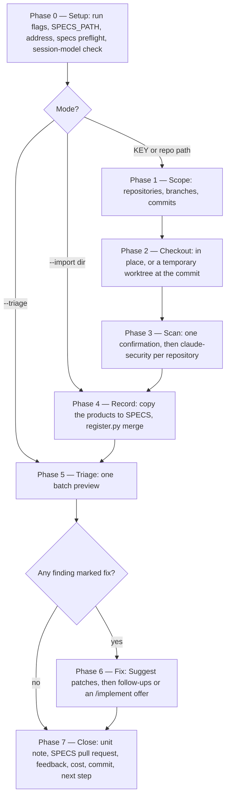
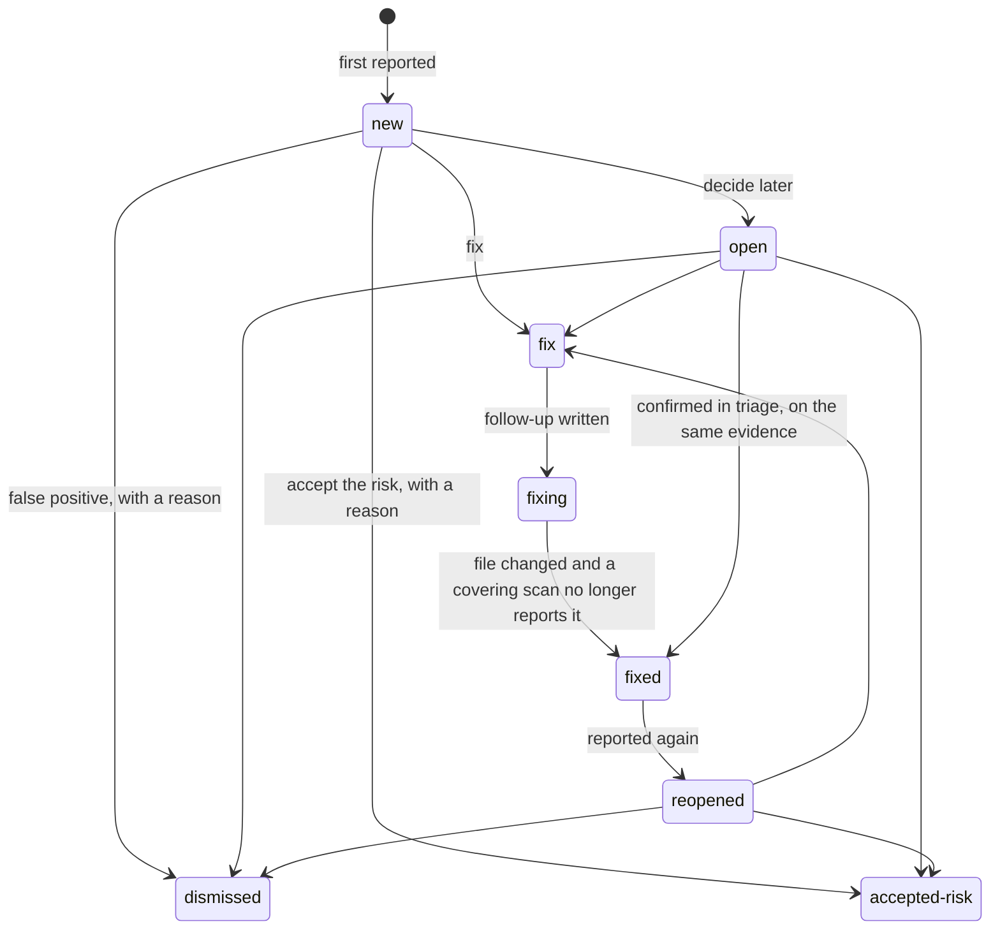

# `security-workflows`: record Claude Security scans in SPECS and route their fixes through `/implement` (sub-project A)

Date: 2026-10-15. Status: design approved in conversation, section by section; spec awaiting review. Branch: `iv-gu/security-workflows-scan`.

## Background

During an `/implement` run on the bookstore demo, Claude Code suggested a Claude Security scan. That suggestion almost certainly came from the Claude Security plugin's hook, which fires after `git push` and `gh pr create` (both run by `/implement`'s finish step). It prints: *"Claude Security: this branch changes … against main. For a security review, ask: 'scan this branch's changes against main with Claude Security'."*

**Claude Security** is two Anthropic products under one name:

- **The hosted product** (claude.ai/security) is an Enterprise-only public beta. It scans connected GitHub repositories, runs scheduled scans, and uses Mythos. It grew out of the February 2026 "Claude Code Security" research preview.
- **The plugin**, `claude-security@claude-plugins-official`, version 0.12.0 as read from the official marketplace clone. It runs inside a Claude Code session on any paid plan or API account. It adds one command, `/claude-security`, with three jobs: *Scan codebase*, *Scan changes* (a branch, a pull request or one commit), and *Suggest patches*. This spec builds on the plugin.

What the plugin's source fixes, and this design relies on:

- **Its output contract is promised stable.** Each scan writes `CLAUDE-SECURITY-<timestamp>/` in the scanned checkout, with its own `.gitignore`. Inside are `CLAUDE-SECURITY-RESULTS.md`, `CLAUDE-SECURITY-RESULTS.jsonl` (one finding per line), `CLAUDE-SECURITY-RESULTS.sarif` (SARIF 2.1.0, CWE-classified), and `CLAUDE-SECURITY-REVISION-<commit>.json`, the revision stamp. The stamp records the scanned commit, the effort, whether uncommitted changes were in the tree, how thoroughly the run was verified, and a coverage record. `render_report.py` states: *"Filenames, JSONL field order, and verification.status semantics are stable across releases."*
- **Each finding carries a content-derived ID.** `claudeSecurityPluginFindingId` is `ID_VERSION:` followed by a sha256 over the rule (CWE category), the repository path, and the normalised lines around the finding. It survives line shifts and changes when the code around the finding changes. It is confirmed in the SARIF output and expected in the JSONL; the spike confirms the JSONL.
- **Patches are never applied.** *Suggest patches* writes `patches/F<n>.patch` with a note beside each, after an independent review that runs the project's tests where there are any. A finding whose code changed since the scan is skipped with a note.
- **Its skill can be invoked by a model.** `claude-security:claude-security` carries no `disable-model-invocation`. When the request names the job, it skips its menu. It skips its one cost confirmation when the request already accepts the scan's time and token cost.
- **Its working agents inherit the session model.** `scan-researcher`, `scan-verifier`, `patch-generator`, `patch-verifier` and the `claude-security` agent are `model: inherit`. `scan-inventory`, `scan-loader`, `scan-redactor` and `explore` are pinned to `sonnet`. Its workflow passes no model, so a caller cannot redirect the inherit agents.
- **It needs** `python3` 3.9 or newer, git for change scans and patches, and dynamic workflows, which are off by default on Pro and switched on in `/config`.
- **It scans the checkout as it stands.** A change scan diffs HEAD against a base. Its instructions say: *"When a commit is not checked out, never check it out or add a worktree yourself."*
- **Scans are nondeterministic.** Its own documentation says two scans of the same code can surface different findings.

**What the family has for security today** is scattered. `HIGH-RISK` classification forces Opus planning and review. `code-review` and `risk-planner` each have a Security section. `spec-reviewer` flags a missing security NFR as `MAJOR`. `specification-format` has a `Security / privacy` test-case category. `/vuln` remediates dependency CVEs. Nothing models threats at the ARD or design, nothing scans a whole repository, and nothing keeps a record of findings.

**The policy boundary.** Anthropic's Usage Policy forbids discovering or exploiting vulnerabilities *without the system owner's authorisation*. Its cyber-safeguards article lists what any user may do on generally available models: secure code review, threat modeling, patching known issues, finding vulnerabilities in their own source code, and triaging alerts. Exploit validation, malware analysis, exploit generation, penetration testing and binary scanning can be interrupted by real-time classifiers; the Cyber Verification Program governs those. Every capability here stays on the permitted side: it reasons about source and documents, describes an attack scenario in prose, and proves a fix with a regression test. It never attacks a running system and never writes a working exploit.

**The gap.** A plugin scan's findings live only in a gitignored folder inside the code checkout. Nothing records them in SPECS, nothing tracks a finding across scans, nothing routes a fix into the family's build path, and the scan's cost and feedback land in no Shipwright record.

## The roadmap

This spec is sub-project **A**. The rest are designed separately, each with its own spec, plan and build:

| # | Sub-project | Depends on |
|---|---|---|
| **A** | This spec: the `security-workflows` plugin and its scan wrapper, the findings register, fixes through `/implement` | Claude Security plugin |
| **E** | The architecture feedback loop. (1) `architecture-grounder` reads the registers of the repositories a piece of work touches and returns a `known-weakness` challenge to `/create-ard`, `/specify` and `/design`. (2) A weakness class that recurs becomes a follow-up for the PA, who records it as an `[AD#N]` whose `Prevents:` names the CWE. `/harvest-decisions` and `/promote-decisions` then carry it as an ordinary decision, and `ard-resolution` makes breaking it a reviewer BLOCKER. (3) `promotion-scout` flags weakness classes that recur across teams' registers with no covering ADR or standard. | A's register |
| **B** | ARD threat model: `threat-model.md`, with security decisions proposed as `[AD#N]` through `/create-ard` | A, E |
| **C** | Design threat review: threats per interface of `design.md`, with amendments proposed through `/design` | A; B where present |
| **D** | Security conformance: traces each threat-model mitigation to merged code, as `/conformance` traces requirements | B or C |
| **F** | Model router, independent of security. (1) `/implement` hands its coding to an implementer subagent whose model follows the task class (Sonnet for SIMPLE/MODERATE, Opus for SIGNIFICANT/HIGH-RISK) whatever the session model, following the `doc-writer` / `epic-writer` precedent; every dispatch is audited for an explicit `model:`. (2) Escalation to a Fable subagent for very high complexity or risk, with a confirmation when the session is not on Fable that offers Opus instead and warns that quality may degrade. A Fable session is the user's own approval and needs no confirmation. | — |

Security requirements in specifications are no separate sub-project: `spec-reviewer` already flags their absence, and a gap there becomes an amendment B or C proposes.

## Goals

1. A new plugin, `security-workflows`, with one command, `/security-workflows:scan`, that runs the Claude Security plugin on the repositories of a PRD or Epic, or on one repository, and records what it finds in SPECS.
2. A durable **findings register** per code repository, `$SPECS_PATH/security/<repo-slug>/`. It tracks each finding across scans by the plugin's own finding ID, with a lifecycle and a recorded decision behind every status change.
3. Every new finding's fate is decided in **one batch triage** at the end of the scan: fix, decide later, dismiss as a false positive, or accept the risk. A dismissal or an accepted risk carries a reason. `--triage` returns to findings left undecided, without a scan.
4. **Fixes go through `/implement`**, with the plugin's verified patch as the starting point, so a security fix gets the family's test baseline, Opus review, implementation record and pull request.
5. **`--import`** records a report the user already produced by running `/claude-security` directly, without paying for the scan again.
6. The scan's cost and the run's feedback land where every other run's do.

## Non-goals

- **No scanner of the family's own.** Claude Security does the code-level work; `/security-review`, a single pass with no file output, is not used.
- **No audit of documents**: no threat model, ARD or design review. Those are B and C.
- **No architecture feedback loop.** That is E, which A only prepares for by placing the register's format reference in `workflows-core`.
- **No change to how the family picks models.** That is F.
- **No integration with the hosted Claude Security product.**
- **The command never applies a patch itself.**
- **No exploit code, and nothing run against a deployed system.**
- **`dev-workflows` does not depend on `security-workflows`.** It only offers the scan as a next step.

## Terms

- **Scan.** One run of the plugin's *Scan codebase* or *Scan changes* job on one repository at one commit. It is identified by its revision stamp.
- **Covering scan** (for a finding). A scan whose coverage record lists the finding's file as examined. For a full scan, that means the files its research read; for a change scan, the changed files.
- **Plugin finding ID.** `claudeSecurityPluginFindingId`, the plugin's content-derived identity for a finding.
- **`[SEC#n]`.** The register's own permanent, per-repository finding ID in the family's bracketed form. It is never reused.
- **Register.** `register.json`, plus `register.md` rendered from it, under `$SPECS_PATH/security/<repo-slug>/`.
- **Unit note.** `_security.md` in a PRD or Epic folder: an append-only list of the scans run for that unit.

## Decisions

### D1. A new plugin, with Claude Security as a declared dependency

`plugins/security-workflows/` contains:

- `.claude-plugin/plugin.json`, with `"dependencies": ["workflows-core", "claude-security@claude-plugins-official"]` and no version constraint (see Risks).
- `commands/scan.md`.
- `scripts/register.py`, standard-library Python, with its tests.
- `docs/`, `README.md`, `LICENSE` and `CHANGELOG.md`.

There are no agents and no hooks. The orchestrator runs triage; the plugin writes patches.

`.claude-plugin/marketplace.json` gains the plugin's entry and the top-level `"allowCrossMarketplaceDependenciesOn": ["claude-plugins-official"]`. Claude Code then installs Claude Security with the plugin. Without that line the install completes without the dependency, and the plugin fails to load.

**Why not `dev-workflows`.** An unsatisfied dependency disables the plugin that named it. Anyone who removed or disabled Claude Security would lose `/design`, `/implement` and the rest. Every `dev-workflows` user would also get Claude Security's hooks, its `python3` requirement, and its dynamic-workflows requirement. No other family plugin needs Claude Security.

### D2. The register format is a `workflows-core` reference

`plugins/workflows-core/references/security-register-format.md` is the single source of truth for the register's layout, fields, statuses and transitions. It lives in `workflows-core` because a reference does not cross a plugin boundary, and E's consumers (`architecture-grounder`, `promotion-scout`) are `workflows-core` agents. `security-workflows` cites it as `workflows-core:security-register-format` through the `reference` loader skill, with the preamble the Internal reference convention requires. Reading `$SPECS_PATH/security/` needs no plugin dependency: it is data in SPECS.

### D3. The command

```
/security-workflows:scan <KEY | repo-path> [--import <dir>] [--triage] [--effort low|medium|high]
                         [--skip-costs] [--skip-feedback] [--enforce-model=<model>]
```

- **`<KEY>`** scans the repositories the unit's `implementation.md` records. **`<repo-path>`** scans that one repository.
- **`--import <dir>`** records an existing `CLAUDE-SECURITY-<timestamp>/` folder instead of scanning. With a `<KEY>`, it also writes that unit's note.
- **`--triage`** runs no scan. It triages the findings still `open`: those raised for the unit with a `<KEY>`, or every one in the repository's register with a path.
- **`--effort`** passes through to the plugin. Its default is the plugin's, `medium`.
- **The run flags** are `workflows-core:run-flags`'s. `--enforce-model` reaches the family's own dispatches only. It cannot reach the plugin's inherit agents, and the run's routing record says so.

The command invokes the `workflows-core:model-routing` skill, for its routing record and the session-model check (D6). It dispatches `impl-maintenance`, or `defect-reporter` under `--skip-feedback`, like every other pipeline command.

### D4. The phases



0. **Setup.** Strip the run flags. Require `$SPECS_PATH`, with `workflows-core:escalation-rules`' *Set / Cancel*.

   Resolve the address. A key goes through `resolve-address`. A path goes to its `<repo-slug>` under `workflows-core:components` §1.

   Run `specs-preflight` once the run key set is known. It is empty for a path.

   Run `require-on-main` over the documents the run reads: on a key, the unit's `implementation.md`; on every run, each in-scope repository's `register.json`, where an absent register is a first scan and falls back under §3.4's row F.

   Check the prerequisites. `python3` older than 3.9 stops with the plugin's own message. Dynamic workflows switched off stops, naming the `/config` row.

   Run the session-model check (D6).
1. **Scope.** With a key, read each `repo`, `branch` and `commit` from `implementation.md`, using `workflows-core:implementation-format` §4's read. A key with no blocks stops and suggests scanning a repository path. With a path, the scope is the whole repository at its current checkout; the plugin offers a focused area for a large repository itself.
2. **Checkout** (D5).
3. **Scan.** Ask one confirmation that covers every repository in scope (D6). Then, per repository, invoke `Skill(skill: "claude-security:claude-security", args: …)`. With a key, the args name the change job against the default branch; with a path, the codebase job. Either way they carry the effort and state that the user has accepted the scan's time and token cost, so the plugin asks nothing further except its own scope sub-menu on a full scan.
4. **Record.** Copy the scan's products into `$SPECS_PATH/security/<repo-slug>/scans/<UTC-timestamp>-<commit7>/`. Then run `register.py merge`, which reports the scan's findings as new, reported again, possibly the same as an existing finding, or not reported by a covering scan (D8).
5. **Triage** (D9).
6. **Fix** (D10). This runs while the Phase 2 checkout still stands, because the plugin builds patches against the scanned commit.
7. **Close.**
   - With a key, append the unit note (D11).
   - Hand off `security/<repo-slug>/` and the unit note by pull request (D12).
   - Remove any temporary worktree.
   - Run feedback, follow-ups, cost, `resume.md` and `commit-artifacts`, in the family's canonical emitter order.
   - Print the `Specs repo:` and `Phase handoff:` lines, then the next step.

### D5. Checkout

The plugin scans whatever is checked out and never moves the checkout itself, so the command provides the checkout:

- **The repository is already at the recorded commit** (with a key) or is the path given: scan in place.
- **Otherwise:** add a temporary `git worktree` at the recorded commit, after a `git fetch` where the commit is absent locally, and scan there. The user's own checkout is never switched. The worktree's path is written into `resume.md`, so a run that dies leaves a pointer to it, and Phase 7 removes it on every path, failure included.
- **A read-only mount** (`workflows-core:read-only-repos` §1) that is not at the commit is skipped, with its reason. If every repository is skipped, the run stops.

### D6. Which model the scan runs on

The plugin's working agents inherit the session model, and nothing inside a running command can change it. The scan's model is therefore an orchestrator-executed property in `classification.md` §9.1's sense, handled like the family's other session-model gates:

| Session (`current_model`) | Phase 0 check | Phase 3 confirmation |
|---|---|---|
| Opus | none | the cost confirmation only |
| Sonnet (or below) | **asks**: "Claude Security's scan agents run on your session model, Sonnet, and may find fewer or weaker issues." Choices: **Cancel — rerun after `/model opus` (Recommended)** · **Scan on Sonnet anyway** | the cost confirmation |
| Fable | none: the user chose Fable, which approves its cost | the cost confirmation, plus one line saying Fable's safety filters will re-run some scan requests on Opus |

The scan never escalates to Fable. There is no evidence Fable finds more than Opus. Anthropic's stronger security model is Mythos, in the hosted product. And Fable's own cyber classifiers flag scan requests, which Claude Code then re-runs on Opus, so a Fable scan pays twice for those requests. If a later plugin or Claude Code version lets a caller choose the plugin agents' model, the command passes Opus and drops the Sonnet question.

### D7. The register

The register lives at `$SPECS_PATH/security/<repo-slug>/`:

- **`register.json`** is the source of truth. Only `register.py` reads and writes it.
- **`register.md`** is rendered from it for people to read. It is never edited by hand; a hand edit is overwritten by the next render, and the rendered file says so in its first line.
- **`scans/<UTC-timestamp>-<commit7>/`** holds the plugin's report, JSONL, SARIF, revision stamp and `patches/`, unchanged. The plugin already withholds secrets from these products.

Each finding records:

- `id` (`[SEC#n]`) and `plugin_id` (the plugin finding ID).
- `title`, `cwe` (the primary first), `severity` and `confidence`.
- `path` and `line`, plus `first_seen` and `last_seen` as `{scan, commit}`.
- `reported_by[]` (scan ids) and `not_reported_by[]` (covering scans that did not report it).
- `units[]`, the keys it was raised for.
- `status` and `history[]`. Each entry has `{status, at, by, reason, scan}`, where `by` is the git `user.name` of the specs repository.
- `links`: the follow-up line, the patch path and the fix commit.

### D8. Lifecycle



`register.py` applies these rules deterministically:

1. **Matching.** A scan's finding matches a register finding when its plugin ID equals the finding's `plugin_id`; it is the same finding, reported again. Otherwise, when a register finding of the same CWE in the same file lies within 10 lines of the scan finding's line, the scan finding is reported as **possibly the same as `[SEC#n]`**, and triage asks. Candidates come only from the register. Otherwise the finding is new and takes the next `[SEC#n]`.
2. **A missing finding is never closed on absence alone.** A `fixing` finding becomes `fixed` only when a covering scan at a commit descending from its `last_seen.commit` does not report it, matches no possibly-same candidate, and its file has changed between those two commits (`git diff --quiet <last_seen>..<scan> -- <path>` fails). An `open` finding with the same evidence is proposed as fixed in triage and changes only on the user's confirmation. A finding absent with its file unchanged just gains a `not_reported_by` entry.
3. **Order is by commit ancestry, never by date.** A scan whose commit is an ancestor of a scan already recorded is kept as history. It adds `reported_by` entries but never reopens a later `fixed` (`git merge-base --is-ancestor`).
4. **Unverified scans.** A scan whose stamp shows unverified, or uncommitted changes in the scanned tree, is recorded and flagged. It can add findings, but it can never move a finding to `fixed`.
5. **Idempotent.** Merging a scan already recorded (same stamp) changes nothing.

### D9. Triage

Triage is one batch preview. It covers the new findings, the possibly-same matches, the `open` findings proposed as fixed, and the findings still `open` from earlier scans. Each row shows `[SEC#n]`, severity, CWE, `file:line` and a suggested decision: **fix** for CRITICAL and HIGH, **decide later** for the rest, and the possibly-same question for a match.

The batch choice is **Accept the suggestions** · **Change some** · **Decide all later**. *Change some* asks per finding, four findings to an `AskUserQuestion` call, with exactly four options: **Fix** · **Decide later** · **Dismiss — false positive** · **Accept the risk**. A dismissal and an accepted risk then ask for a one-line reason, which is recorded. A free-text answer is normalised into those four or asked again, never written through (`workflows-core:escalation-rules` §0).

### D10. Fixes go through `/implement`

For the findings marked fix, Phase 6 runs the plugin's *Suggest patches* job for exactly those findings, in the Phase 2 checkout. It copies the patches into the scan's `patches/` in SPECS.

- **With a key,** it writes one follow-up per finding into the unit's `follow-ups.md`, in `workflows-core:followup-emission`'s form for a change another run makes. For example:

  ``- [ ] Run `/dev-workflows:implement BOOK-2-01-02` from repository `bookstore`: fix [SEC#3] (CWE-862) at `ratings/…/RatingsController.java:88`, starting from `security/bookstore/scans/<id>/patches/F2.patch` — raised by /security-workflows:scan``

  `/implement`'s keyed run already reads back follow-ups addressed to its repository and takes their changes into its description. Nothing in `dev-workflows` changes for this.
- **With a path,** there is no unit to address. The next-step offer is `/dev-workflows:implement` with a prompt naming each finding and its patch.
- **A finding the plugin skipped** gets its follow-up without a patch, with the plugin's reason recorded on the finding.

The status moves to `fixing` once the follow-up or offer is written. The fix commit is linked when the next covering scan moves the finding to `fixed`, from `git log` over the file between the two commits.

### D11. The unit note

`_security.md` in the PRD or Epic folder is append-only, like `implementation.md`. It has one block per scan:

- the date, repository, commit, effort and mode (scan or import)
- the counts by severity
- the `[SEC#n]` raised or re-reported
- a link to the repository's `register.md`

It is written only when the run resolved a key.

### D12. Handing off to SPECS

The register, the scan products and the unit note are deliverables. They go through `workflows-core:phase-handoff`'s `handoff-to-main` on a new **`security/`** branch prefix, behind its §4.3 consent choice, as `/conformance` hands off `_conformance.md`. This makes the prefix authority twelve prefixes, not eleven: `phase-handoff` §1 rule 3, `specs-repo-git` §2's disposition, `.claude/rules/workflows-core-git.md` and every other copy of the regex and the count change together.

The follow-ups, cost and feedback use the bounded shapes `specs-repo-git` §2.1 already has; no new bookkeeping shape is added. A keyless run's cost and feedback go to `dev-workflows-cost/` and `dev-workflows-feedback/`, as every keyless run's do.

### D13. Cost, feedback and the next-step offer

- **Cost.** `cost-emission` §7 gains the row `/security-workflows:scan` → phase `security-audit`, role `sec`. `roles-and-phases` pages describe the new role. The cost line covers the plugin's agents once the spike confirms `session-cost.py` counts them; if it does not, fixing `session-cost.py` is part of A, since a cost line that leaves out the most expensive part is wrong, not merely partial.
- **Feedback.** `impl-maintenance`, or `defect-reporter` under `--skip-feedback`, as in every pipeline command.
- **The `/implement` offer.** `workflows-core:next-phase-offer` adds `/security-workflows:scan <KEY>` to what `/implement` offers once its pull request is open, beside the `docs-workflows` commands it already offers without depending on that plugin.
- **The scan's own next step** is `/dev-workflows:implement` where findings went to fix, and otherwise nothing.
- **The plugin's own push tip** keeps firing. The `security-workflows` docs say a report made from that tip can be recorded with `--import`.

### D14. Documentation and diagrams

**The new plugin's docs tree**, added to `check-docs.sh`'s `PLUGIN_RELS` and `COST_PLUGIN_RELS`:

- `docs/README.md`, the index.
- `getting-started.md`, which names the dependency's marketplace; check 10's exception is verified to cover a plugin's own `getting-started.md` before the page is written.
- `workflow.md`, with a mermaid overview: `/implement` upstream, the scan, Claude Security as an external node, the SPECS outputs, and the fix loop back to `/implement`.
- `roles-and-phases.md`.
- `commands/scan.md`, with D4's flowchart.
- `reference/security-register.md`, with D8's state diagram.
- `reference/environment.md`, `reference/references.md` and whatever else the docs gate requires of a plugin carrying no agents and no hooks.

**`workflows-core/docs/family-map.md`:**

- A legend entry and a new class, `sec`, in teal (`fill:#ccfbf1,stroke:#0f766e,color:#134e4a`), since red is the ▶ start outline.
- A **Security Engineer — audit** lane holding `/security-workflows:scan`.
- `implement -.->|"action: offered once the PR is open"| secscan` and `secscan -.->|"fix — a follow-up + patch"| implement`.
- A *Reading it* bullet: the scan is only ever offered, never automatic, and it reads code through Claude Security, a plugin outside the family.
- The opening sentence and *The detail, per plugin* list name the fifth plugin.

**Elsewhere:**

- `workflows-core/docs/workflow.md` ("every command of the four plugins") and `dev-workflows/docs/workflow.md`, which gains the scan beside its `docs-workflows` node.
- The root `README.md`, `CLAUDE.md`'s *Active plugins* section, and a new `.claude/rules/security-workflows.md` with its workflow map line.
- A claim sweep (`.claude/rules/claim-sweep.md`) for every statement that the family has four plugins, eleven branch prefixes, or a fixed set of roles, with literal before-and-after counts across refinement 4's scope.

### D15. Containers

The `ai-containers` launchers install `claude-security@claude-plugins-official` and `security-workflows`, as a separate pull request in that repository.

A headless Chromium serves Angular's Karma tests, so a patch to a `web/` component can be verified. The container is aarch64 on Ubuntu 24.04, where Google Chrome has no arm64 Linux package and the apt `chromium` is a snap stub, so it comes from `npx playwright install --with-deps chromium`, with `CHROME_BIN` pointing at it. If Chromium's sandbox fails under the container's seccomp profile, `CHROME_BIN` points at a wrapper that adds `--no-sandbox`. Without it, a `web/` patch carries the plugin's own "reviewed without tests" note.

### D16. Gates

- `register.py`'s `unittest` suite runs in `.github/workflows/validate-catalog.yml`.
- `check-id-grammar.sh` learns `[SEC#n]` if it keeps a prefix list.
- `validate-catalog.py`, the mermaid gate, `check-docs.sh` and `claude plugin validate` run as usual.
- `validate-catalog.py` neither checks `dependencies` nor rejects unknown top-level `marketplace.json` keys; Claude Code's documentation lists `allowCrossMarketplaceDependenciesOn` as a valid field.

## Worked example

The findings below are illustrative; the spike produces real ones.

On the bookstore demo, the Dev's `/implement BOOK-2-01-02` (storefront ratings) opens its pull request and offers `/security-workflows:scan BOOK-2-01-02`. The Dev runs it in an Opus session.

1. **Setup and scope.** Phase 0 resolves `BOOK-2-01-02` to `…/PRD-BOOK-2-01-verified-ratings/EPIC-BOOK-2-01-02-storefront-ratings/`. Phase 1 reads that folder's one `implementation.md` block: repository `bookstore`, branch `feat/BOOK-2-01-02-storefront-ratings`, commit `eb694d0`.
2. **Checkout.** The Dev's checkout is on `master`, so Phase 2 adds a worktree at `eb694d0`.
3. **Scan and record.** After one confirmation, Phase 3 scans the branch's changes against `master` at medium effort. Phase 4 copies the products to `security/bookstore/scans/20261016T091200Z-eb694d0/`. `register.py` reports two new findings: `[SEC#1]`, HIGH, CWE-862, a rating deleted without an owner check; and `[SEC#2]`, LOW, CWE-79, a comment rendered unescaped in an admin view.
4. **Triage.** It suggests fix for `[SEC#1]` and decide later for `[SEC#2]`. The Dev accepts the suggestions.
5. **Fix.** Phase 6 gets `F1.patch` from the plugin and writes the follow-up into the Epic's `follow-ups.md`.
6. **Close.** Phase 7 appends `_security.md`, hands off `security/bookstore/` and the note on `security/BOOK-2-01-02-…`, removes the worktree, and offers `/dev-workflows:implement BOOK-2-01-02`.
7. **The fix.** That run reads the follow-up back, takes `F1.patch` as its starting point, and goes through its own baseline, Opus review and pull request.
8. **The rescan.** After the merge, a `/security-workflows:scan bookstore` full scan covers the file, doesn't report `[SEC#1]`, and finds the file changed since `eb694d0`. `[SEC#1]` becomes `fixed`, linked to the fix commit. `[SEC#2]` is still `open`, and the Dev dismisses it in triage: "admin view renders through the template's auto-escaping; finding is a false positive".

## Verification

**The spike runs first** (plan task 1, throwaway). It is a change scan of BOOK-2-01-02 at `low` effort on an Opus session, in a worktree, writing nothing to SPECS. It settles four things before anything else is built:

1. **Running the plugin's skill from inside a command:** its workflow and questions run, and control returns to the command afterwards. If not, Phase 3 asks the user to run `/claude-security` and continues as `--import`, which needs nothing new.
2. **`claudeSecurityPluginFindingId` is in the JSONL.** If not, `register.py` reads it from the SARIF.
3. **`session-cost.py` counts the plugin's workflow agents.** If not, fixing it joins A (D13).
4. **The revision stamp's coverage record names the examined files,** with which fields for a full scan and which for a change scan, as D8's *covering scan* needs. If not, rule 2 falls back to "the scan's mode and scope include the file", and the reference says so.

It needs Claude Security installed in the session and a `git fetch` in `/workspace/bookstore`, whose `origin/master` is behind its remote.

**Then:**

- **`register.py` tests,** with fixture JSONL and stamps for every D8 case: new, reported again, possibly-same (confirmed and rejected), missing with the file unchanged, `fixing` → `fixed`, `open` → `fixed` on confirmation, reopened, the unverified scan, an ancestor import, repeated import, and `[SEC#n]` never reused.
- **The gates as one `&&` chain,** read by its own exit code.
- **An end-to-end run on the bookstore demo,** with `SPECS_PATH=/workspace/bookstore-specs`, covering the key, path, `--import` and `--triage` routes.

## Risks

- **The plugin is pre-1.0 and auto-updates.** A version constraint would disable `security-workflows` whenever the plugin moved outside the range, so none is set. Instead, `register.py` validates every field it reads and stops with `SCAN_PRODUCTS_UNREADABLE`, naming the field, where one is missing. The plugin's own stability promise covers filenames, JSONL field order and `verification.status`.
- **Nondeterministic scans.** D8's rules 1 and 2 keep a missed finding from looking fixed and a shifted finding from looking new.
- **Cost.** One confirmation covers every repository. `--effort` and the plugin's own scoping bound a scan, and `--import` avoids paying twice.
- **Invoking the skill from inside the command may not return control.** The spike tests it, and `--import` is the fallback.
- **The cost of the plugin's agents may be under-counted.** The spike tests it, and A fixes it if so.
- **Two scans' pull requests editing one register.** `require-on-main` on `register.json` stops a run whose branch holds a stale copy (row B′). Because `register.py` is deterministic and idempotent, re-running the scan's record step on the merged default branch reproduces the merge.
- **Disclosure.** SPECS repositories are private for real products. The bookstore demo's public SPECS are intended.
- **Two reminders after a push.** The plugin's own push tip and `/implement`'s offer both appear. The docs say `--import` records a report made from the tip.
