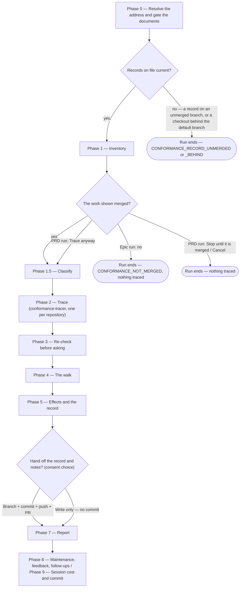

# /conformance

Checks what shipped against what was specified — every requirement of an Epic or a PRD, traced against each repository's default branch once the work has merged — and has a person settle each discrepancy: fix the code, amend the document, or accept it as shipped. It needs no documentation repository, changes no code, and rewrites no requirement.

## Who runs it

The role follows the address:

- **An Epic** — the [dev](../roles-and-phases.md#dev--build-verify-and-deliver) who implemented it runs `/conformance <EPIC-KEY>` **once its pull request has merged** — in each repository, the one the latest `/implement` run recorded there. The Dev's decisions are recorded as `proposed`: they record what the Dev found and thought, and the PE makes the final call.
- **A PRD** — the PE runs `/conformance <PRD-KEY>` **once every Epic is done and its pull request merged**, closing the implementation phase the PE opened with `/product-workflows:epics` and `/product-workflows:specify`. The PE's decisions are `final`, and the PE rules on every decision a Dev recorded.

Cost-attribution phase: [conformance](../roles-and-phases.md#conformance).

## Synopsis

```
/conformance <EPIC-KEY | PRD-KEY> [--skip-costs] [--skip-feedback] [--enforce-model=<model>]
```

Type it as `/dev-workflows:conformance`. It takes one address, resolved against `$SPECS_PATH`: an `EPIC-` folder is an Epic run, a `PRD-` folder (a BRD-route slice included) a PRD run. A `BRD-` container is refused with `CONFORMANCE_BRD_NOT_SLICED`, which names its slices; no address, or one that is not a key, stops with `CONFORMANCE_NEEDS_KEY`.

## How it runs



## What it reads, and the code it checks

**Requirements.** On an Epic run: the Epic's `specification.md` (each `[Uxx]` and `[Uxx]/[ACxx]`), the acceptance criteria and `## Contract` lines of its `epic.md`, and the `Rule` of each applicable `[AD#n]` in the ARD. The Epic's `design.md` is context for the walk, never traced. On a PRD run: every live `[AC#n]` and `[FR#n]` of `prd.md`, and each live `[US#n]` with no criteria beneath it; the PRD-level spec; and the Epics' requirements, as below. Test cases (`[TCxx]`), use cases (`[UC#n]`) and success metrics (`[SM#n]`, `[SMC#n]`) are not traced: no commit can show any of them either way. Where nothing at all is left to trace, the run stops with `CONFORMANCE_NO_REQUIREMENTS`, naming what each document lacked, rather than write a record that says nothing.

**Code — merged only.** Both runs read each repository's default branch, which is what shipped, at a ref, and never switch a branch. Work counts as merged in a repository where the commit of the latest `/implement` run `implementation.md` records for it is in the default branch's history, or where a default-branch commit made after that run carries the unit's key in its subject, which a squash keeps:

- **An Epic run** traces merged code only. Where the pull request of the latest `/implement` run `implementation.md` records for a repository has not merged — or the record holds no `/implement` run at all — it stops with `CONFORMANCE_NOT_MERGED` before writing anything, naming each repository and branch, and saying where a branch was never pushed or is gone without merging. Merge each, then re-run. Where that repository's clone was read as last fetched — a read-only mount, or a fetch that failed — the stop says so instead, since the pull request may have merged since: fetch the clone, then re-run. A repository with no clone is not tested, and the report names it as not traced.
- **A PRD run** first confirms every Epic merged, in every repository it touched, by the same test, and asks before tracing where one is not shown merged.

Before reading, it fetches each writable clone's remote refs (never switching or pulling), and on a read-only mount prints the age of any ref older than fourteen days. A repository with no clone under `$REPOS_PATH`, or a clone whose default branch cannot be resolved, is named, and its requirements are listed as not traced; where no repository of the run has a clone with a default branch to read, the run stops with `CONFORMANCE_NO_CODE` instead, naming each with what would fix it, and writes no record. The specifications, designs and other documents it reads are gated onto the specs repo's default branch first, before anything is read, and so is the ARD: the run stops while it sits on an unmerged branch.

Each requirement is traced where its code can live: an Epic's in its target repository and in any other repository its implementation record names, a `## Contract` line on a PRD run on both sides, and a PRD-level requirement, which names no repository, in every one. A contract line is satisfied only where both sides satisfy it, a side through any of its Epic's repositories; any other requirement is satisfied where one repository satisfies it and none contradicts it, so a repository that does not implement it is no discrepancy.

**The records on file, checked first.** Before Phase 1 reads a requirement, asks a question or scans a clone, every run checks the record of the Epic or PRD it checks — and, on a PRD run, each Epic's record — against the default branch and every `conformance/` branch, after fetching those branches from the specs repo's remote, best-effort and refs only, pruning any the remote deleted. Where an unmerged `conformance/` branch other than the one your checkout stands on carries a version of the unit's record the default branch does not hold — the record of a run whose pull request is still open, say a Dev's re-check after a fix — it stops with `CONFORMANCE_RECORD_UNMERGED`, naming the branch. Where that branch is the unit's own: merge its pull request, switch `$SPECS_PATH` to it to resume that run, or discard that record by deleting the branch both on the remote — close its pull request and delete the branch there, or `git -C "$SPECS_PATH" push origin --delete <branch>` — and locally, `git -C "$SPECS_PATH" branch -D <branch>`, since the run reads local branches as well as remote ones and a branch left on the remote comes back with the next fetch; then re-run. Deleting it is also how to clear one whose pull request has merged already or was closed without merging. Where it is another run's branch — a PRD run's that marked the Epic's entries superseded, say — merge it, or, where its pull request has merged already or was closed without merging, delete it on the remote and locally the same way. A branch does not count where the default branch's history has ever held its copy of the record — merged by a merge, a squash or a rebase, even where the default branch changed other lines beside it — or where it only inherited the record from the default branch. A squash or rebase whose merge combined the record with another change to it — a conflict resolution, or a clean merge beside a nearby edit of the record — lands a copy the branch never held, so that merged branch still counts until you delete it, and so does one closed without merging. On a PRD run such a branch is no newer record: answer *Use the merged record instead* (or, where there is none, *Trace this Epic in full instead*) and delete it. On a PRD run, a Dev's unmerged record of an Epic stops nothing: the run asks whether to read it from its branch, beside or in place of a merged one. Where your checkout lacks a record the default branch holds, or holds an older copy that predates its last change, it stops with `CONFORMANCE_RECORD_BEHIND`. On another branch — a stale `design/` or `ready/` branch the preflight kept you on, which only the default branch's catch-up would have refreshed — switch to the default branch, or merge the default branch into it; on the default branch itself, behind its remote because a guard kept the preflight from catching it up, run `git -C "$SPECS_PATH" pull --ff-only`; then re-run. A checkout on your own `conformance/` branch, whose newer record is built on the merged one, is a resumed run and goes on. Where a PRD folder holds two Epic folders asserting one key, it stops with `CONFORMANCE_EPIC_FOLDERS`, naming them, for you to merge. Carrying on past any of these would number decisions over ones already taken, rule on a Dev's old entries, and queue follow-ups twice.

**A PRD run does not re-trace every Epic.** It traces the PRD-level requirements in full, and any Epic with no record. For each Epic, a record a Dev left on an unmerged `conformance/` branch — pushed from the Dev's own clone included — is offered to read from there, beside an older merged one or where there is none. While such a branch is open, the run writes nothing into that Epic's record, whichever copy it read: an entry the PE overrules is named in the report, and the PRD's own record keeps the ruling, which a later PRD run applies once no `conformance/` branch carries that Epic's record — and only to an entry naming the same requirement, since a record discarded unmerged frees its numbers for reuse. A follow-up is withdrawn all the same wherever your checkout's `follow-ups.md` holds it; a line your checkout does not hold yet is ticked by a later PRD run once your checkout holds it. Either way the PRD's record carries the line as `withdraws:`, so `/implement` never builds it wherever it turns up, a Dev's branch or a session branch included — as long as the PRD's record is on the default branch or in your working copy. For an Epic with a record, it re-checks each of the Dev's entries against the merged code: an *amend* or *accept* the code now satisfies is flagged *stale* — how a Dev who fixed the code later without updating the decision is caught — and a *fix the code* the merged code satisfies is *fixed*, listed and resolved without asking. A requirement the Epic run found satisfied, which the record lists with its evidence, is re-traced only where the code at that evidence has changed since. A re-run of either kind asks only about what is new.

Before tracing, every run prints how many requirements it will trace across how many repositories.

## The walk

Every discrepancy the re-check confirms is put to you, one question at a time, with no answer recommended — which one is right is the question itself:

- **Fix the code** — the document is right. A follow-up task goes to the Epic's folder in the form the next `/implement` of that Epic reads back on its own. On an Epic run it goes out at once. On a PRD run, a PRD-level requirement no Epic covers needs an Epic to carry the fix, and you are asked which; only a PRD with no Epics takes the task in its own folder, for `/implement <PRD-KEY>`.
- **Amend the document** — the code is right. On a PRD run the run adds a note under `## Engineering review` on the spec, PRD, `epic.md` or ARD, recommending the command that changes it. On an Epic run it is recorded as a proposal only, for the PE.
- **Accept as shipped** — the difference stands, recorded with your rationale.

On a PRD run, the Dev's decisions where the implementation won come first, then the Dev's *fix the code* decisions, then anything no Epic recorded. Overruling a Dev decision marks it superseded in the Epic's record and withdraws its follow-up — while an unmerged branch carries that Epic's newer record, the mark waits for a later PRD run, as above, and so does a follow-up your checkout does not hold yet; confirming a *fix the code* whose follow-up is no longer open — done, or cancelled at the Epic run's preview — queues it again. A *fix the code* whose requirement has since been withdrawn, or whose text is gone from its document, has its follow-up withdrawn by any run that re-checks it and can reach the line.

## What it produces

- `_conformance.md` in the checked folder: the default-branch commit it checked in each repository, the counts by verdict, and one `[DD#n]` entry per discrepancy with its decision and status. Its ids are permanent, and a re-run asks only about what is new, marking an entry resolved once the code satisfies it.
- Follow-up tasks for *fix the code*, and `## Engineering review` notes for *amend the document* on a PRD run.
- A handoff of the record and the notes on a `conformance/` branch, behind the usual consent choice.

## Gates

No agent decides anything. Each discrepancy a tracer reports is re-checked at the location it cites before you see it; one that does not hold is dropped, with the reason in the report. One the re-check can settle neither way — a "satisfied" without evidence among them — is unverified: listed in the report and the record with what would settle it, never put to you, and traced again in full by the next run. The documents it reads must be on the specs repo's default branch.

## Cost

Each run is charged to phase `conformance`, with the role taken from the folder: `dev` for an Epic run, `pe` for a PRD run, and `pe` too for a `BRD-` container it refuses. `--skip-costs` (or `WORKFLOWS_SKIP_COSTS`) skips the cost entry; see [Session cost](../reference/session-cost.md).

## Session feedback

The maintenance phase runs as on `/ready`, and its plugin-facing lessons are persisted as feedback. `--skip-feedback` (or `WORKFLOWS_SKIP_FEEDBACK`) narrows it to bug capture only; see [Session feedback](../reference/session-feedback.md).

## Example

The pull request from `/implement BOOK-1-02` merges, and the Dev runs `/conformance BOOK-1-02`. The spec says a restock notice fires within one minute; the merged code schedules it every five. The Dev chooses *Fix the code*: `[DD#1]` is recorded as proposed, and the follow-up is read back by the next `/implement BOOK-1-02`; once that fix has merged, a re-run marks `[DD#1]` resolved. Once every Epic of `BOOK-1` has merged, the PE runs `/conformance BOOK-1`: overrules one Dev decision, marks a stale one resolved, and settles a PRD-level gap by amending the PRD.

## See also

- [`/implement`](implement.md) — offers this command as its next step after an Epic, to run once its pull request has merged.
- [`/ready`](ready.md) — the readiness gate before implementation; this command is the check after it.
- [Follow-up tasks](../reference/follow-ups.md) — where *fix the code* follow-ups land, and how a withdrawn one is marked.
- [Roles and phases](../roles-and-phases.md) — the Dev's Epic run and the PE's PRD run.
