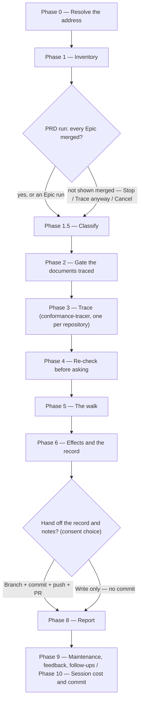

# /conformance

Checks what shipped against what was specified — every requirement of an Epic or a PRD, traced against the code — and has a person settle each discrepancy: fix the code, amend the document, or accept it as shipped. It needs no documentation repository, changes no code, and rewrites no requirement.

## Who runs it

The role follows the address:

- **An Epic** — the [dev](../roles-and-phases.md#dev--build-verify-and-deliver) who implemented it runs `/conformance <EPIC-KEY>` after `/implement`, **while the pull request is still open**. The Dev's decisions are recorded as `proposed`: they record what the Dev found and thought, and the PE makes the final call.
- **A PRD** — the PE runs `/conformance <PRD-KEY>` **once every Epic is done and its pull request merged**, closing the implementation phase the PE opened with `/product-workflows:epics` and `/product-workflows:specify`. The PE's decisions are `final`, and the PE rules on every decision a Dev recorded.

Cost-attribution phase: [conformance](../roles-and-phases.md#conformance).

## Synopsis

```
/conformance <EPIC-KEY | PRD-KEY> [--skip-costs] [--skip-feedback] [--enforce-model=<model>]
```

Type it as `/dev-workflows:conformance`. It takes one address, resolved against `$SPECS_PATH`: an `EPIC-` folder is an Epic run, a `PRD-` folder (a BRD-route slice included) a PRD run. A `BRD-` container is refused with `CONFORMANCE_BRD_NOT_SLICED`, which names its slices; no address, or one that is not a key, stops with `CONFORMANCE_NEEDS_KEY`.

## How it runs



## What it reads, and the code it checks

**Requirements.** On an Epic run: the Epic's `specification.md` (each `[Uxx]` and `[Uxx]/[ACxx]`), the acceptance criteria and `## Contract` lines of its `epic.md`, and the `Rule` of each applicable `[AD#n]` in the ARD. On a PRD run: every live `[AC#n]` and `[FR#n]` of `prd.md`, and each live `[US#n]` with no criteria beneath it; the PRD-level spec; and the Epics' requirements, as below. Test cases (`[TCxx]`), use cases (`[UC#n]`) and success metrics (`[SM#n]`, `[SMC#n]`) are not traced: no commit can show any of them either way.

**Code.** It reads code at a ref and never switches a branch:

- **An Epic run** checks the Epic's own branch — the branch its latest `/implement` run recorded in `implementation.md` for each repository, at its current tip, so review fixes pushed later are included. Where that branch is gone because it merged, it checks the default branch; where it is gone without merging, it stops with `CONFORMANCE_NO_CODE`.
- **A PRD run** checks each repository's default branch. First it confirms every Epic merged — its recorded commit is in the branch's history, or a default-branch commit's subject carries the Epic's key, which a squash keeps — and asks before tracing where one is not shown merged.

**A PRD run does not re-trace every Epic.** It traces the PRD-level requirements in full, and any Epic with no record. For an Epic with a record, it re-checks each of the Dev's entries against the merged code — flagging one *stale* where the code now satisfies the requirement, which is how a Dev who fixed the code later without updating the decision is caught — and re-traces a requirement the Epic run found satisfied only where the code at its evidence has changed since.

Before tracing, every run prints how many requirements it will trace across how many repositories.

## The walk

Every discrepancy the re-check confirms is put to you, one question at a time, with no answer recommended — which one is right is the question itself:

- **Fix the code** — the document is right. A follow-up task goes to the Epic's folder in the form the next `/implement` of that Epic reads back on its own. On an Epic run it goes out at once.
- **Amend the document** — the code is right. On a PRD run the run adds a note under `## Engineering review` on the spec, PRD, `epic.md` or ARD, recommending the command that changes it. On an Epic run it is recorded as a proposal only, for the PE.
- **Accept as shipped** — the difference stands, recorded with your rationale.

On a PRD run, the Dev's decisions where the implementation won come first, then the Dev's *fix the code* decisions, then anything no Epic recorded. Overruling a Dev decision marks it superseded in the Epic's record and withdraws its follow-up.

## What it produces

- `_conformance.md` in the checked folder: the code it checked, the counts by verdict, and one `[DD#n]` entry per discrepancy with its decision and status. Its ids are permanent, and a re-run asks only about what is new, marking an entry resolved once the code satisfies it.
- Follow-up tasks for *fix the code*, and `## Engineering review` notes for *amend the document* on a PRD run.
- A handoff of the record and the notes on a `conformance/` branch, behind the usual consent choice.

## Gates

No agent decides anything. Each discrepancy a tracer reports is re-checked at the location it cites before you see it; one that does not hold is dropped, with the reason in the report, and a "satisfied" without evidence is shown as unverified. The documents it traces must be on the specs repo's default branch.

## Cost

Each run is charged to phase `conformance`, with the role taken from the folder: `dev` for an Epic run, `pe` for a PRD run. `--skip-costs` (or `WORKFLOWS_SKIP_COSTS`) skips the cost entry; see [Session cost](../reference/session-cost.md).

## Session feedback

The maintenance phase runs as on `/ready`, and its plugin-facing lessons are persisted as feedback. `--skip-feedback` (or `WORKFLOWS_SKIP_FEEDBACK`) narrows it to bug capture only; see [Session feedback](../reference/session-feedback.md).

## Example

The Dev finishes `/implement BOOK-1-02`, its pull request open, and runs `/conformance BOOK-1-02`. The spec says a restock notice fires within one minute; the branch schedules it every five. The Dev chooses *Fix the code*: `[DD#1]` is recorded as proposed, and the follow-up is read back by the next `/implement BOOK-1-02`, after which a re-run marks `[DD#1]` resolved. Once every Epic of `BOOK-1` has merged, the PE runs `/conformance BOOK-1`: overrules one Dev decision, marks a stale one resolved, and settles a PRD-level gap by amending the PRD.

## See also

- [`/implement`](implement.md) — offers this command as its next step after an Epic.
- [`/ready`](ready.md) — the readiness gate before implementation; this command closes it.
- [Follow-up tasks](../reference/follow-ups.md) — where *fix the code* follow-ups land, and how a withdrawn one is marked.
- [Roles and phases](../roles-and-phases.md) — the Dev's Epic run and the PE's PRD run.
