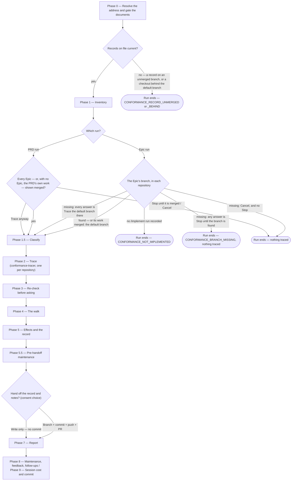

# /conformance

Checks what was built against what was specified — every requirement of an Epic or a PRD, a threat model's mitigations among them, traced against the Epic's branch — before its pull request merges, or after it where the branch has gone on since — or each repository's default branch once the work has merged — and has a person settle each discrepancy: fix the code, amend the document, or accept it as shipped, never on a threat mitigation or on an ARD Rule an unused threat model may rest on. It needs no documentation repository, changes no code, rewrites no requirement, and writes nothing into a threat model or a design.

## Who runs it

The role follows the address:

- **An Epic** — the [dev](../roles-and-phases.md#dev--build-verify-and-deliver) who implemented it runs `/conformance <EPIC-KEY>` **after `/implement`, before its pull request merges**, on the Epic's branch — in each repository, the one the latest `/implement` run recorded there. A fix it finds goes back to `/implement`, which continues on that branch, so the fix joins the open pull request. The Dev's decisions are recorded as `proposed`: they record what the Dev found and thought, and the PE makes the final call.
- **A PRD** — the PE runs `/conformance <PRD-KEY>` **once every Epic is done and its pull request merged**, closing the implementation phase the PE opened with `/product-workflows:epics` and `/product-workflows:specify`. The PE's decisions are `final`, and the PE rules on every decision a Dev recorded.

Cost-attribution phase: [conformance](../roles-and-phases.md#conformance).

## Synopsis

```
/conformance <EPIC-KEY | PRD-KEY | @<path>> [--skip-costs] [--skip-feedback] [--enforce-model=<model>]
```

Type it as `/dev-workflows:conformance`. It takes one address, resolved against `$SPECS_PATH` — a key, or an `@<path>` naming the folder under `$SPECS_PATH/specifications/`, which takes the key the folder's own document asserts and is the way through a key that matches more than one folder: an `EPIC-` folder is an Epic run, a `PRD-` folder (a BRD-route slice included) a PRD run. A `BRD-` container is refused with `CONFORMANCE_BRD_NOT_SLICED`, which names its slices; no address, or one that is not a key or such a folder, stops with `CONFORMANCE_NEEDS_KEY`, and an `@<path>` beside a second address with `CONFORMANCE_TWO_ADDRESSES`.

## How it runs



## What it reads, and the code it checks

**Requirements.** On an Epic run: the Epic's `specification.md` (each `[Uxx]` and `[Uxx]/[ACxx]`), the acceptance criteria and `## Contract` lines of its `epic.md`, and the `Rule` of each applicable `[AD#n]` in the ARD — a decision of an area file such as `ard-payments.md` named by its file, so two files' decisions of one number are two requirements. An older record's entry that names `ard.md` for a number the folder's `ard.md` has never held is read as the decision of the one area file that holds that number, and is orphaned where none or several do. The Epic's `design.md` is context for the walk, and where it holds a [threat review](design.md#the-threat-review), the Rule of each live entry mitigated by one — a `[DT#N]` — is a requirement too (*Threat models and mitigations*, below). On a PRD run: every live `[AC#n]` and `[FR#n]` of `prd.md`, and each live `[US#n]` with no criteria beneath it; the PRD-level spec; the `[DT#N]` Rules of the PRD folder's `design.md`, read only where the PRD folder's own threat model stands; and the Epics' requirements, as below. Test cases (`[TCxx]`), use cases (`[UC#n]`) and success metrics (`[SM#n]`, `[SMC#n]`) are not traced: no commit can show any of them either way. Where nothing at all is left to trace, the run stops with `CONFORMANCE_NO_REQUIREMENTS`, naming what each document lacked, rather than write a record that says nothing.

**Code — the Epic's branch, or the default branch.** Neither run switches a branch: each reads its code at a ref. Whether work has merged in a repository is read from the latest `/implement` run `implementation.md` records there. The Epic run takes the answer of the unit's branch lookup; the PRD run takes the merged test, fetching each Epic's branch first as the Epic run does. The two agree on whether work merged: the merged test reads the branch's content as well as its history — a commit carrying the unit's key counts only where the branch's own work is in it, so a teammate's commit following the convention does not mark an open pull request merged — where your clone holds the recorded commit or the branch: it looks along the branch's own commits, from the recorded work up and at most twenty, for the one the merge was made from, and a conflict with the default branch does not count. The key alone still counts where your clone holds neither, where your git is too old to compare (before 2.38) or a comparison could not be made, as in a shallow clone, and where a conflict is all a pushed local branch can show once the host deleted its remote copy; the report's *Scope* then says the merge rests on the commit subject — and a squash whose subject lost the key counts where the branch survives and the default branch already holds everything it adds.

- **An Epic run** finds, in each repository its implementation record names, the branch the latest `/implement` run recorded there — fetching that branch by name first, so a single-branch clone sees it too, and dropping a tracking ref whose branch `origin` no longer has — and traces that branch's tip, read on `origin` where your local copy is behind it, so you can run it before the pull request merges. Once that work has merged, it traces the default branch instead; where the branch went on after its merge, it traces the branch and the report says so. Where the record holds no `/implement` run at all, it stops with `CONFORMANCE_NOT_IMPLEMENTED` before writing anything. Where a recorded branch is neither shown merged nor found in the clone or on `origin`, it asks about each such repository in turn, saying on the question what it already knows — that the branch was never pushed, that `origin` does not have it, or that the clone was read as last fetched. You either stop, with `CONFORMANCE_BRANCH_MISSING` — fetch the branch where the clone was read as last fetched, push it from the clone that committed it where it was never pushed, or re-run `/implement` where its pull request closed without merging — or trace the default branch there, where you know its pull request merged under a subject that lost the key; the run goes on only if every answer is the second. A default branch traced that way on a clone read as last fetched is named as such in the report, with its age. A repository with no clone is not traced, and the report names it.
- **A PRD run** first confirms every Epic merged — or, on a PRD with no Epic, its own work — in every repository it touched, by the same test, and asks before tracing any of that work — an Epic's or the PRD's own — not shown merged. Its Epics are listed on the default branch as well as in your checkout, so an Epic that merged after your checkout's branch was cut stops the run at the document gate, naming the merge, rather than being left out unseen.

Before reading, it fetches each writable clone's remote refs (never switching or pulling), and on a read-only mount prints the age of any ref older than fourteen days. In a shallow clone, on either run, the report warns that merged work may read as unmerged, since its merge can lie beyond the clone's depth; the run never deepens the clone. A repository with no clone under `$REPOS_PATH`, or a clone whose default branch cannot be resolved, is named, and its requirements are listed as not traced; where no repository of the run has a clone with a default branch to read, the run stops with `CONFORMANCE_NO_CODE` instead, naming each with what would fix it, and writes no record. The specifications, designs and other documents it reads are gated onto the specs repo's default branch first, before anything is read — save a threat model, which is read only as the default branch holds it, with no gate (below) — and so is the ARD: the run stops while it sits on an unmerged branch (`CONFORMANCE_ARD_NOT_ON_MAIN`, naming the branch and any pull request), save the one resolution a PRD with no Epic folder makes for its threat model, which stops nothing (below).

Each requirement is traced where its code can live: an Epic's in its target repository and in any other repository its implementation record names, a `## Contract` line on a PRD run on both sides, and a PRD-level requirement, which names no repository, in every one. A contract line is satisfied only where both sides satisfy it, a side through any of its Epic's repositories; a side no code could show, or none of whose repositories was traced, leaves the line not-checkable unless another side has a discrepancy. Any other requirement is satisfied where one repository satisfies it and none contradicts it, so a repository that does not implement it is no discrepancy.

**A sibling Epic's part, on an Epic run.** A PRD-level `[AD#n]` Rule can bind any component of its PRD, a `## Contract` line has a side on another Epic's component, and a design's `[DT#N]` Rule can name another component in its Where, so each can ask for something a sibling Epic — another Epic of the same PRD, with a target other than this Epic's — builds, on its own branch: the ratings service's half of a rule whose storefront half this Epic builds, say. On an Epic run each is traced without a sibling Epic's part: a part on a sibling Epic's component — read off each Epic's `target:` — is that Epic's, never a discrepancy here and never put to you, and the record names that Epic beside the requirement. An `[AD#n]` Rule that binds only components other than this Epic's — a sibling's, or one no Epic targets, such as a service the PRD only calls — is not checkable on an Epic run: the report names each component it binds, and the sibling Epic that targets it where one does, and the PRD run traces it in full. A contract line always has this Epic's own side to check. An Epic with no `target:` has nothing to tell its part by, and its run traces every part. A PRD run traces every part.

**Threat models and mitigations.** The run looks for a `threat-model.md` at known paths only — on an Epic run the Epic folder's and the PRD folder's, on a PRD run the PRD folder's and each Epic folder's — and reads each only as the specs repo's default branch holds it, with no gate, so an architect's change still in progress can neither hide a threat that has landed nor accept its risk. A model only your checkout holds is not read, and one line names it: `Threats: <path> is not on the default branch — not read`. In a specs folder that is no git repository there is no other copy, and the file is read as it stands. A file at a known path whose `kind:` is not `threat-model` is no model. The run reads a model and never writes into it, and from each it takes the live threats that land on the unit: on an Epic with a `target:`, a threat of the PRD folder's model lands only where its Where names that target or a contract row the target produces or consumes; otherwise every live threat lands. A stale threat is taken whatever its Where, and so is one not written in the model's form, and one a live entry of a design the run reads answers. Where no model stands at a known path and no design the run reads holds a threat review, none of this happens: nothing is loaded or printed, and the record carries no `Threats:` line.

- **A mitigation** is each `[DT#N]` Rule above, and each `[AD#n]` Rule that a live, non-stale threat landing on the unit names in its `Mitigated by`, joined on the folder, the ARD file and the number together — never on the number alone; a pair that joins no one requirement leaves that part of its threat `not checked`. A mitigation is traced in full on every run, a PRD run included, whatever an Epic's record lists as satisfied. Where its Rule is carried out by code that must be reached — a check, a filter, a handler — the tracer names each call site that reaches it, and one the run finds nothing calls is `partial`, *the check is not called*; a `[DT#N]` Rule the code satisfies but whose test no traced repository holds is `partial`, *the test is missing*.
- **A model the run cannot use** — no ARD resolves for its folder, no component set resolves, the Epic's target is not in the set, or its ARD fails the resolution below — is named, `Threats: <path> not used — <why>`, and none of its threats is listed. Since one of its threats may rest on any `[AD#n]` Rule of that folder's ARD files, or of the PRD-level ARD it inherits, none of those Rules is offered *Accept as shipped*, and the walk opens with `Threats: no accept is offered on <n> architecture Rule(s) — a threat model the run could not use may rest on them`.
- **On a PRD with no Epic folder** whose own model the run reads, it resolves the PRD's ARD for that model, and where that finds one on the default branch, its decisions are traced as requirements too. That is the one ARD resolution of the run that stops nothing: where the ARD is on an unmerged branch, your checkout's copy differs from the default branch's, or the gate would stop on it any other way, the model is left unused, one line says why, no repair is offered, and the run goes on.
- **The PRD folder's `design.md`**, on a PRD run, is gated and read only where the PRD folder's own threat model stands on the default branch — or, in a specs folder that is no git repository, in the folder. There, a PRD-level design on an unmerged branch stops the run, as an Epic's does; where no such model stands, that design is neither gated nor read.
- **A `workflows-core` too old to say which threats land on a unit** — or whose threat-model format will not load — makes the run print `Threats: not traced — update workflows-core`, where it has a model or a design's threat review to read. It then reads no model and traces no `[DT#N]` Rule, treats each landed model as one it cannot use, so no accept is offered on its folder's ARD Rules, and carries each `[DT#N]` entry on file forward as it stands. The record's `Threats:` line reads `not traced — update workflows-core`, which, on a PRD's record, keeps `/ready`'s *Delivery verified* stage unreached until you update `workflows-core` and run this again.

**The branch the specs checkout stands on, checked before the records.** Once the address resolves, the specs-repo preflight has run and the folder is placed — so a BRD container or an Epic with several folders is refused first — before the documents are gated or the records below checked, the run checks that branch. Where it is a plugin branch the default branch has moved past under the address's top-level folder in `specifications/` — the PRD folder, or the `BRD-` folder above a slice — a document there added, changed or removed since that branch was cut, session files aside, it stops, naming the paths and what to run: merge the default branch in, where this run builds on that branch — its own `conformance/` branch, or an earlier phase's open branch it stacks on — or switch to the default branch, where it does not. Where the `conformance/` branch this run's handoff would reuse is open and has changed something under that folder, it asks first whether to switch to that branch and continue there — resuming the run that branch holds — or stop until its pull request is merged, or closed and the branch deleted.

**The records on file, checked first.** Before Phase 1 reads a requirement, asks a question or scans a clone, every run checks the record of the Epic or PRD it checks — and, on a PRD run, each Epic's record — against the default branch and every `conformance/` branch, after fetching those branches from the specs repo's remote, best-effort and refs only, pruning any the remote deleted. Where an unmerged `conformance/` branch other than the one your checkout stands on carries a version of the unit's record the default branch does not hold — the record of a run whose pull request is still open, say a Dev's re-check after a fix — it stops with `CONFORMANCE_RECORD_UNMERGED`, naming the branch. Where that branch is the unit's own: merge its pull request, switch `$SPECS_PATH` to it to resume that run, or discard that record by deleting the branch both on the remote — close its pull request and delete the branch there, or `git -C "$SPECS_PATH" push origin --delete <branch>` — and locally, `git -C "$SPECS_PATH" branch -D <branch>`, since the run reads local branches as well as remote ones and a branch left on the remote comes back with the next fetch; then re-run. Deleting it is also how to clear one whose pull request has merged already or was closed without merging. Where it is another run's branch — a PRD run's that marked the Epic's entries superseded, say — merge it, or, where its pull request has merged already or was closed without merging, delete it on the remote and locally the same way. A branch does not count where the default branch's history has ever held its copy of the record — merged by a merge, a squash or a rebase, even where the default branch changed other lines beside it — or where it only inherited the record from the default branch. A squash or rebase whose merge combined the record with another change to it — a conflict resolution, or a clean merge beside a nearby edit of the record — lands a copy the branch never held, so that merged branch still counts until you delete it, and so does one closed without merging. On a PRD run such a branch is no newer record: answer *Use the merged record instead* (or, where there is none, *Trace this Epic in full instead*) and delete it. On a PRD run, a Dev's unmerged record of an Epic stops nothing: the run asks whether to read it from its branch, beside or in place of a merged one. Where your checkout lacks a record the default branch holds, or holds an older copy that predates its last change, it stops with `CONFORMANCE_RECORD_BEHIND`. On another branch — a stale `design/` or `ready/` branch the preflight kept you on, which only the default branch's catch-up would have refreshed — switch to the default branch, or merge the default branch into it; on the default branch itself, behind its remote because a guard kept the preflight from catching it up, run `git -C "$SPECS_PATH" pull --ff-only --no-rebase origin <default>`, `<default>` being the default branch's name; then re-run. A checkout on your own `conformance/` branch, whose newer record is built on the merged one, is a resumed run and goes on. Where a PRD folder holds two Epic folders asserting one key, it stops with `CONFORMANCE_EPIC_FOLDERS`, naming them, for you to merge. Carrying on past any of these would number decisions over ones already taken, rule on a Dev's old entries, and queue follow-ups twice.

**A PRD run does not re-trace every Epic.** It traces the PRD-level requirements in full, and any Epic with no record. For each Epic, a record a Dev left on an unmerged `conformance/` branch — pushed from the Dev's own clone included — is offered to read from there, beside an older merged one or where there is none. While such a branch is open, the run writes nothing into that Epic's record, whichever copy it read: an entry the PE overrules is named in the report, and the PRD's own record keeps the ruling, which a later PRD run applies once no `conformance/` branch carries that Epic's record — and only to an entry naming the same requirement, since a record discarded unmerged frees its numbers for reuse. A follow-up is withdrawn all the same wherever your checkout's `follow-ups.md` holds it; a line your checkout does not hold yet is ticked by a later PRD run once your checkout holds it. Either way the PRD's record carries the line as `withdraws:`, so `/implement` never builds it wherever it turns up, a Dev's branch or a session branch included — as long as the PRD's record is on the default branch or in your working copy. For an Epic with a record, it re-checks each of the Dev's entries against the merged code: an *amend* or *accept* the code now satisfies is flagged *stale* — how a Dev who fixed the code later without updating the decision is caught — and a *fix the code* the merged code satisfies is *fixed*, listed and resolved without asking. A requirement the Epic run found satisfied, which the record lists with its evidence, is re-traced only where the code at that evidence has changed since, or where the commit the Epic run traced — its branch's tip, before the merge — is not in your clone; a threat mitigation is the exception, traced in full on every PRD run whatever the Epic's record lists. A re-run of either kind asks only about what is new, and about an *accept* on file on what is now a threat mitigation, or on an ARD Rule an unused threat model may rest on, which it puts to you again (*The walk*, below).

Before tracing, every run prints how many requirements it will trace across how many repositories. Each repository's tracer writes its verdicts to a file the run reads, and on a large run takes its requirements from a file too; every verdict cites the exact line, or a tight range of the lines it relied on, never an approximate one, which is what lets the re-check, the drift check and the grouping above read it.

**A current chain under the documents, or your say-so.** Before it reads a requirement, the run checks the lineage of each document it traces up the chain. Where one was built from a document that has since changed, or carries no lineage record yet, it shows what moved and asks whether to revise the highest stale document first or proceed; *proceed* is recorded in `_conformance.md`, so the next run does not ask again about the same version.

## The walk

Every discrepancy the re-check confirms is put to you, with no answer recommended — which one is right is the question itself. Questions come up to four at a time, as one prompt, and you give your reason in the answer's notes or as text beside your choice; the run asks for a reason separately only where you accept a difference as shipped, or on a PRD run overrule a Dev's decision, and gave none. Discrepancies whose evidence shares one location — the same line of the same file at the same commit, or overlapping ranges of lines in one file — one cause restated in several requirements — are grouped and asked once, naming that location; a discrepancy joins one group at most, and a group is never a chain of overlaps that share no location: one answer decides them all, and a *fix the code* for the group queues one follow-up rather than one per requirement. You can split a group to decide each of its requirements on its own; either way the record keeps one entry per requirement, each naming the shared cause. A discrepancy with a Dev's decision on it is always asked on its own, and so is a threat mitigation. The three answers, for anything but a mitigation (below):

- **Fix the code** — the document is right. A follow-up task goes to the Epic's folder in the form the next `/implement` of that Epic reads back on its own. On an Epic run it goes out at once. On a PRD run, a PRD-level requirement — a mitigation keyed to the PRD among them — needs an Epic to carry the fix: the PRD's only Epic, or the one Epic whose `## Covers` lists it — or lists the user story it sits under — where exactly one does, and otherwise you are asked which, each Epic that lists it marked; only a PRD with no Epics takes the task in its own folder, for `/implement <PRD-KEY>`.
- **Amend the document** — the code is right. On a PRD run the run adds a note under `## Engineering review` on the spec, PRD, `epic.md` or the ARD file holding the decision, recommending the command that changes it. On an Epic run it is recorded as a proposal only, for the PE. A design's `[DT#N]` Rule takes no note on either run: the design is the Dev's, and the run recommends [`/design`](design.md) to revise it.
- **Accept as shipped** — the difference stands, recorded with your rationale. Never offered on a threat mitigation or on an ARD Rule an unused threat model may rest on.

On a PRD run, the Dev's decisions where the implementation won come first, then the Dev's *fix the code* decisions, then anything no Epic recorded. Overruling a Dev decision marks it superseded in the Epic's record and withdraws its follow-up — while an unmerged branch carries that Epic's newer record, the mark waits for a later PRD run, as above, and so does a follow-up your checkout does not hold yet; confirming a *fix the code* whose follow-up is no longer open — done, cancelled at the Epic run's preview, or one the PRD's own record withdraws — queues it again, while one your checkout does not hold yet but the Dev's unmerged `conformance/` branch does is left to arrive with that branch, and named in the report beside it. One only a session branch holds is one the run cannot see, so it is queued again, and the two stand side by side once that branch merges. A *fix the code* whose requirement has since been withdrawn, or whose text is gone from its document, has its follow-up withdrawn by any run that re-checks it and can reach the line.

**A threat mitigation is never accepted here.** A mitigation (*Threat models and mitigations*, above), and each ARD Rule a threat model the run could not use may rest on, is asked on its own, its question saying which it is, and is offered no *Accept as shipped*: only the architect accepts a risk, in the threat model. You choose *Fix the code* or *Amend the document*. On a PRD run, a Dev's *fix the code* or *amend the document* on one is offered for you to confirm, beside the other; a Dev's *accept* — or any decision on file that is neither of those two — can only be overruled, to fix the code or to amend the document; a *stale* Dev entry that amended can be marked resolved or kept, and a *stale* one that accepted can only be marked resolved. A typed answer that would accept is asked again, the question then saying that only the architect accepts a risk. An *accept* the unit's own record already holds on either, while its discrepancy persists, is put to you again, its earlier decision shown, and keeps its `[DD#n]`; one in an entry that only lists a Dev's is not put again, and on a mitigation holds its threat `open`. *Cancel* there, as anywhere in the walk, ends the run and writes nothing, so the record on file stands. *Amend the document* is no way out either: an amended mitigation keeps its threat `open` until the document changes.

## Where each threat stands

On a run that traced threats, each threat it took from a model, and each live entry of a design's threat review that counts toward none of them, has one state, worked out from what this run traced and re-read — never asked about, and never carried from a record. A threat takes the first that holds of `unreadable`, `stale`, then `accepted` or `review due`, and otherwise the worst of its parts, `open` before `unanswered` before `not checked` before `verified`. **Dev** means the Dev's [`/design`](design.md) of the folder named, and **architect** the architect's `/product-workflows:create-ard`.

| State | What it means | Who acts |
|---|---|---|
| `verified` | Each mitigation its `Mitigated by` names, and, for a part deferred to design, at least one design Rule answering it, was traced and re-read as satisfied in this run, and none is open. | — |
| `open` | A mitigation it rests on is a discrepancy or unverified, or has an entry not resolved, whatever it decided: an amended one stays `open` until its document changes. | *Fix the code*'s `/implement`; this command again, for one unverified; Dev, for an amended `[DT#N]`; architect, for an ARD Rule not being fixed. |
| `not checked` | A mitigation it rests on is untraced, no code can show it, or, on an Epic run, is satisfied save a sibling's part or is an ARD Rule binding only other components; or a pair joins no requirement. | On an Epic run, the PE's PRD run; on a PRD run, no command. |
| `unanswered — returned to the architect` | A design returned the deferred threat to the architect. | Architect. |
| `unanswered — answered elsewhere — not verified on this run` | On an Epic run, its design says another design answers it, which only the PRD run can check. | The PE's PRD run. |
| `unanswered — no design takes it` | A design says the threat is not its own, and no design answers it with a Rule. | Architect. |
| `unanswered — no design answers it` | No design's entry answers it; each design read with no threat review — declined or never offered — is named on its line. | Dev. |
| `accepted` | The architect accepted the risk in the model, and its review date is not earlier than the run's date. | — |
| `review due` | Accepted, but its review date is earlier than the run's date, missing, or not a date. | Architect. |
| `stale` | It fails the model's check: a component no longer in the set, a contract row gone, or a decision it names missing or no longer live. | Architect. |
| `unreadable` | It is not written in the model's form: a field missing or repeated, its Where, its Disposition, or an id heading two threats. | Architect; Dev, for a design's entry. |

A design's entry that counts toward no threat taken — it answers none, its threat is in a model the run did not read, or that threat is not live or has no part deferred to design — stands on a line of its own, with why: its Rule's state where it has one, `unanswered — returned to the architect` where it returns its threat, `not checked — not this design's` where it says the threat is not its own, and `unreadable` otherwise.

**Three states have no exit yet.** A threat returned to the architect, a deferred threat no design takes, and a threat `open` on an architecture decision the team will not build — its discrepancy settled otherwise than by fixing the code — each goes to the architect, but no command yet re-disposes a live threat that is not stale. The report's line for each ends: `No command re-disposes a live threat that is not stale yet: the architect waits for the intake of returned threats, or, for a threat open on a decision, supersedes that decision.` That intake is not built yet. The run stops on none of them. Of all the states, only an `open` count above zero on a PRD's record keeps `/ready`'s optional *Delivery verified* stage unreached, as `not traced — update workflows-core` does: `unanswered`, `review due`, `stale` and the rest are no fact about delivery, and hold nothing there.

**What `verified` does not claim.** It means each mitigation's lines were found by the tracer, held to the checks below on what a tracer returns, and re-read by the run itself in this run: the code at its evidence does what the Rule states, a call site in the product's own code — not a test, a comment or a string — calls it where the Rule is carried out by code that must be reached, and, for a design's Rule, a test asserts it and is not skipped. It does not claim that anything reaches that call site in turn, that the code runs in production, that the attack fails, or that a Rule is enough to stop it — a Rule the Dev wrote included: whether a mitigation is enough is for the reviewers of the model and of the design, and what the code still lets through is the security scan's to find. The tracer reads code with tools, and one steered by what it reads can cite real code that is wired but ineffective; the run's guarantee is that each mitigation was located and re-read, and nothing stronger.

The report's `### Threats` gives the record's `Threats:` line, then each threat and design entry not `verified` or `accepted`, each with its owner's route. The handoff's pull request names each of them too, by its key and id, its state and its reason — never its title or any other text taken from a model, a design or a tracer.

## What it produces

- `_conformance.md` in the checked folder: the ref and commit it checked in each repository — the Epic's branch where an Epic run traced it, and otherwise the default branch — and two coverage lines, each reading `none` where it names nothing: `Not traced:`, naming each document holding requirements — `prd.md`, an `epic.md` or a specification, or an ARD file whose name the run refused, one holding a character other than a letter, a digit, `.`, `_` or `-` — that the run could not read, marked as leaving its requirements uncounted — never a design or a threat model, which the `Threats:` line names — and each repository with no clone or no default branch, with the count of requirements it left untraced; and `Not shown merged:`, naming each unit a PRD run traced under *Trace anyway* — each Epic, or the PRD itself where it has no Epic folder; on an Epic run that line always reads `none`. The record also carries an `At:` line, under its `Run:` line, giving the moment the run started, to the second in UTC. A run that has lost track of that moment by the time it writes the record leaves the line out rather than write a later one, and the record is then compared by its date. The record then holds the counts by verdict, the satisfied requirements with their evidence, the unverified ones with what would settle them, a `## Not checkable` list naming each requirement no code could show and why, and one `[DD#n]` entry per discrepancy with its decision and status. A later PRD run traces in full each requirement an Epic's record lists as not checkable. Its ids are permanent, and a re-run asks only about what is new — and again about an *accept* on what is now a threat mitigation, or on an ARD Rule an unused threat model may rest on — marking an entry resolved once the code satisfies it, and rewrites both coverage lines.
- Where the run had a threat model or a design's threat review to read, the record also carries a `Threats:` line after the counts by verdict and a `## Threats` section before the entries; a record from a run with neither carries no such line or section. The line counts the threats and stand-alone design entries in each of the eight states, zero included — `<n> verified · <n> open · <n> not checked · <n> unanswered · <n> accepted · <n> review due · <n> stale · <n> unreadable` — and, after ` — not read:`, names each model the run could not use, with why, each only your checkout holds, and each design the document gate found absent beside a model it read; or it reads, whole, `not traced — update workflows-core`. The section names the models read, then gives one line per threat and per stand-alone entry: its key and id, title, state and reason, with a threat's mitigations and their verdicts, and why an entry stands alone. Both are rewritten whole on every run, and no run reads them back, so no record — hand-edited, carried on a Dev's branch, or written before threats were traced — makes a threat `verified`.
- The record is read by this command's own later runs, by `/implement`, which never builds a follow-up the PRD's record withdraws, and by three more commands. [`/dev-workflows:ready`](ready.md) reads the PRD folder's record from the specs repo's default branch, never your working copy. A PRD at *Implementation* reaches the optional *Delivery verified* stage where that record is settled. Settled means a PRD run's record with both coverage lines reading `none`, nothing unverified, every entry final or resolved, and no *fix the code* entry unresolved. Two kinds of entry are let off. An entry that only lists a Dev's entry from an Epic's record, without ruling on it, may stay a proposal where its requirement was withdrawn or is gone from its document, since it then keeps the Dev's proposal for good. And a *fix the code* entry whose requirement was withdrawn or is gone from its document does not count as unresolved. Settled also means no work implemented after the record. `/ready` judges that against the implementation records of the PRD and of its Epics: by the moment each carries where both carry one, the record's moment being its `At:` line, and by their dates otherwise. And settled means no open threat and no threats not traced: where the record carries a `Threats:` line, that line counts no threat `open` and does not read `not traced — update workflows-core`, and a line `/ready` cannot read, or more than one, counts against the record, as does a `## Threats` section with no `Threats:` line; a record with neither the line nor that section passes. Anything short of a settled record is a note in `/ready`'s report, never a finding. `/docs-workflows:document` takes the decision an open entry holds on a discrepancy it still finds in the code, in place of asking you again: *fix the code* leaves the claim out, *amend the document* or *accept* documents what the code does, and its report names each entry it took. `/docs-workflows:release-notes` follows the open entries in its note: it leaves out a claim whose entry says *fix the code*, and describes what shipped where it says *amend the document* or *accept*. Neither takes or reports an entry on a design's `[DT#N]` Rule: that is a threat mitigation the design settles, never a documentation decision.
- Follow-up tasks for *fix the code*, and `## Engineering review` notes for *amend the document* on a PRD run, save on a design's `[DT#N]` Rule, which takes none.
- A handoff of the record and the notes on a `conformance/` branch, behind the usual consent choice, with each edit Phase 5.5's maintenance agents made to a file that stood committed and clean before them; declining leaves all of them written and uncommitted, which the terminal commit of the run's session files never stages. On a PRD run whose record withdraws follow-ups, the choice first says how many: `/implement` on another clone skips them only once the record is on the default branch, so declining keeps them in your working copy alone. Every PRD run's choice also says that `/ready` reads the record only on the default branch, so after a decline its delivery check reads whatever record the default branch holds — none, or the one this run replaces — until this one merges. Where the record has a `Threats:` line, the handoff's pull request carries it, what it did not read given as a number, and names each threat and stand-alone entry not `verified` or `accepted` (*Where each threat stands*, above).

## Gates

No agent decides anything. Each discrepancy a tracer reports is re-checked at the location it cites before you see it; one that does not hold is dropped, with the reason in the report, and on an Epic run one that rests on a sibling Epic's part is judged again without it. One the re-check can settle neither way — a "satisfied" without evidence among them — is unverified: listed in the report and the record with what would settle it, never put to you, and traced again in full by the next run.

A threat mitigation is held to more, before any of a tracer's text is shown, printed or written. Where the run hands any, a tracer's section headed for no requirement it was handed is dropped, and the run prints how many it dropped. A mitigation returned in two sections, or in a section holding a field twice, or left with no section, is unverified, and so is one whose section holds a security finding id or a path into a findings register that neither its tracer's handoff nor the code it traced holds — none of that section's text is shown. And each mitigation the run would take as satisfied, whatever its tracer returned, is re-read by the run itself at its evidence, its call sites and its test, and is unverified where that read does not confirm them (*What `verified` does not claim*, above).

The documents it reads must be on the specs repo's default branch, and a threat model is read only as that branch holds it, save in a specs folder that is no git repository.

## Cost

Each run is charged to phase `conformance`, with the role taken from the folder: `dev` for an Epic run, `pe` for a PRD run, and `pe` too for a `BRD-` container it refuses. `--skip-costs` (or `WORKFLOWS_SKIP_COSTS`) skips the cost entry; see [Session cost](../reference/session-cost.md).

## Session feedback

Maintenance runs as on `/ready`, on both sides of the handoff. Before it, in Phase 5.5, a documentation agent may update an existing page directly inside the checked folder — never the record or any other artifact a command of the family writes — and an instructions agent that folder's existing `CLAUDE.md`; each path is checked against what its agent may edit, the edits it hands off are printed above the consent choice and ride the same commit, or stay uncommitted with the record where you decline, a path outside that set is named in the report as left uncommitted, and an edit the specs repository's top-level `CLAUDE.md` or your `~/.claude/CLAUDE.md` needs is only proposed. As on `/ready`, both agents are told the checked folder by name and that the session's working directory may be a code repository they never edit, and the run reads the checked folder's uncommitted state, and that of the session's own repository where that is not the specs repository, before and after the agents, each read taken by the plugin's own `tree-snapshot.py` script, which names every path exactly as git holds it; where it cannot read a tree, none of the agents' edits there is handed off, and the report says so. An edit to a file that already held uncommitted changes, and a file an agent created, are reported rather than handed off, as is any change in the session's repository and any in the checked folder no agent reported; nothing is reverted. After it, in Phase 8, a knowledge-base agent writes only under `~/.claude/memory/`, and `impl-maintenance`'s plugin-facing lessons are persisted as feedback. `--skip-feedback` (or `WORKFLOWS_SKIP_FEEDBACK`) narrows that feedback to bug capture only; see [Session feedback](../reference/session-feedback.md).

## Example

`/implement ACME-77-01` opens its pull request, and the Dev runs `/conformance ACME-77-01`, which traces the Epic's branch. The spec says a restock notice fires within one minute; the branch schedules it every five. The Dev chooses *Fix the code*: `[DD#1]` is recorded as proposed, and the follow-up is read back by the next `/implement ACME-77-01`, which continues on the Epic's branch, so the fix joins the open pull request; a re-run then marks `[DD#1]` resolved, and the pull request goes to review. Once every Epic of `ACME-77` has merged, the PE runs `/conformance ACME-77`: overrules one Dev decision, marks a stale one resolved, and settles a PRD-level gap by amending the PRD.

## See also

- [Workflow overview](../workflow.md) — where this command sits among the plugin's others.
- [`/implement`](implement.md) — offers this command as its next step after an Epic, to run before its pull request merges, on the Epic's branch.
- [`/design`](design.md#the-threat-review) — the threat review whose `[DT#N]` Rules this command traces, and where the Dev revises one.
- [`/ready`](ready.md) — the readiness gate before implementation; this command is the check after it, and a PRD run's record, once settled and on the default branch, is what `/ready` reads for the optional *Delivery verified* stage.
- The `document-lineage` reference (shipped in `workflows-core`, listed on its References page) — the upstream check run on the documents traced, and where a *proceed* is recorded.
- [Follow-up tasks](../reference/follow-ups.md) — where *fix the code* follow-ups land, and how a withdrawn one is marked.
- [Roles and phases](../roles-and-phases.md) — the Dev's Epic run and the PE's PRD run.
