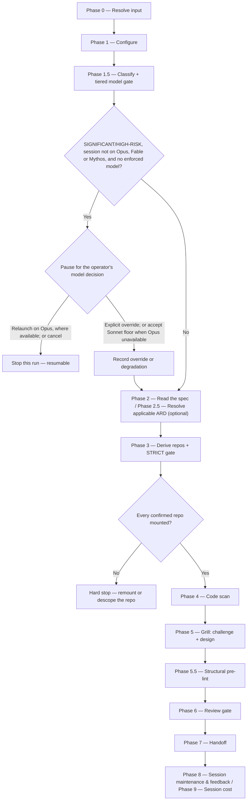

# /design

Takes over a merged specification from the specs repo's main branch, grounds strictly in the fully-mounted implementation code, and authors a reviewed engineering `design.md` through a relentless grill that challenges the spec and designs the implementation.

## Who runs it

`/design` runs in the [dev](../roles-and-phases.md#dev--build-verify-and-deliver) role, cost-attribution phase [planning](../roles-and-phases.md#planning) — being in this phase means an engineering `design.md` is being authored from a merged specification, grounded strictly in the mounted code.

## Synopsis

```
/design <ADDRESS> [--design-twice] [--no-arch] [--skip-costs] [--skip-feedback] [--enforce-model=<model>]
```

`/design` is **address-required** — a plain prompt with no positional address, or a token that is not a key (bare, behind its folder's kind prefix as `EPIC-<KEY>`, or as its folder's whole name), stops with `DESIGN_NEEDS_KEY`, and an address that resolves to no folder stops too, naming the commands that create one. Resolution supplies the address and nothing else: the requirements source of truth is the merged `specification.md` in the specs repo. The folder's prefix sets the altitude — an `EPIC-` folder designs that Epic, a `PRD-` folder works at PRD level — never the kind it asserts, and a legacy folder with no prefix is placed by what it holds. A BRD container holds no specification to design against and stops the run (`DESIGN_BRD_NOT_SLICED`), naming each of its slices instead or, where it has none, `/product-workflows:brd-split` to carve one.

**The Epic is the unit of work — one `design.md` per invocation, no fan-out.** When the address names an Epic folder, that Epic is the scope. When it names a PRD folder, `/design` inspects the resolved PRD directory in the specs repo itself: a flat `specification.md` there (a broad PRD-level spec — the only shape that puts one at PRD level, since every `EPIC-` folder sits under a PRD folder) means one design at that level, **and on a single-component PRD it is tested first, so a PRD folder holding both that file and Epic subfolders designs the slice and is never offered an Epic here** (a multi-component one goes to the Epic picker — see *Multi-component PRDs*) — each Epic's own `design.md` is reached by addressing that Epic, `/dev-workflows:design <EPIC-KEY>`, which is how a PRD of that shape reaches *Ready for Implementation*, the rung wanting a spec and a design on every in-scope Epic and on the slice alike. Otherwise Epic subfolders are enumerated by which ones already carry a `specification.md` merged to main, and rendered as a progress-aware picker — ○ not started (a specification exists but no design and no in-progress session), ◐ in progress (a design session exists but no `design.md` yet, selectable as a resume), ● done (`design.md` exists, shown greyed, offering *revise* instead of a fresh run). Past four spec'd Epics the picker shows three and an *Another Epic* option, which names under it every Epic left out and asks for the key you pick; the first Epic not yet done, in progress before not started, is marked recommended. Both the flat specification and the Epic subfolders are looked for on main as well as in your checkout, so one that merged after your checkout's branch was cut is not missed: picking it stops on the specification gate, which names the merge that brings your branch up to date. Exactly one spec'd Epic auto-selects with no picker. `--design-twice` forces the Phase 5 interface fan-out even when no contested-interface signal fired — the run says which interface it forced it on, and skips the offer described below entirely.

All three run flags apply to this command. `--skip-costs` (or `WORKFLOWS_SKIP_COSTS`) skips Phase 9's session-cost entry, still advancing the checkpoint and dropping any deferred cost record a [ceded](../reference/session-cost.md#ceded-runs) `/prompt-brainstorm` or `/prompt-grill-me` run left pending in this session — see [Session cost](../reference/session-cost.md). `--skip-feedback` (or `WORKFLOWS_SKIP_FEEDBACK`) narrows Phase 8's maintenance step to bugs-only, dispatching `defect-reporter` in place of `impl-maintenance` — see [Session feedback](../reference/session-feedback.md). `--enforce-model=<model>` (or `WORKFLOWS_ENFORCE_MODEL`) pins every dispatched agent in this run — `design-reviewer` included, overriding its frontmatter Opus pin — to one model, and it is also the one flag that changes a *gate*: Phase 1.5's HARD gate does not fire under it, since the user has already chosen the model — see [Model routing](../reference/model-routing.md).

## How it runs

`/design` has 13 `## Phase` headings. The diagram below highlights the tiered model gate, its explicit override paths, and the strict repo-mount gate. They are not the run's only stopping conditions: the `require-on-main` specification gate and an `unmerged` ARD both stop it too, and both are described under `## What it needs`.



Seven subagents are dispatched along this path: `workflows-core:code-scanner` (Phase 4, one instance per confirmed repo, batched up to 4 concurrent), `workflows-core:architecture-grounder` (Phase 4, after the code scan, read-only grounding on the architecture repository, the team's harvested decisions and the weakness classes the security findings registers hold — run where either root resolves or a register holds a class, advisory, never a gate; on the Opus fallback chain, pinned by its dispatch), `interface-designer` (Phase 5, three parallel takes, only when the fan-out runs), `design-threat-modeler` (Phase 5, Opus-pinned, once, only where you take the threat review; it calls no tool), `workflows-core:overlap-reader` (Phase 5, once the grill's last question is answered — the whole-design overlap read before the play-back that closes the grill — and again, where the run writes the design after the grill, over what the writing changed or added — and once more in Phase 6, after the last review the cap allows, over the edits answering that review and the decisions settled at its questions), `design-reviewer` (Phase 6, the Opus review gate), and `workflows-core:impl-maintenance` (Phase 8, session lessons-learned). `code-scanner`, `interface-designer`, and `impl-maintenance` all run on the Sonnet fallback chain, never on a fixed pin; `design-reviewer`, `overlap-reader` and `design-threat-modeler` keep their frontmatter Opus pin regardless of classification (unless `--enforce-model` overrides it). The grill and the `design.md`/`specification.md` authoring itself run **inline** on the session's own model, not through a delegated subagent — which is exactly why the Phase 1.5 tiered gate exists: unlike the review and the overlap read, there is no subagent this run can fall back on to get Opus judgment if the session itself isn't running on one.

Phase 5 conducts the design as a relentless, one-question-at-a-time interview running two intertwined tracks: it **challenges the spec** — recording every substantive challenge back onto `specification.md` under a new `## Engineering review` section, raising acceptance-criteria or test-case changes as proposals rather than unilateral rewrites, and leaving a specification open question open, with the design's proposal written under it, wherever the answer would add or change requirement text, since that decision is the specification owner's, who takes it up with `/product-workflows:update-spec`, which offers each such note as an item to change — and it **designs the implementation**. The grill settles the decisions first, and the run then writes `design.md` behind confirmation gates: one before each section where it writes section by section, or one play-back of the whole design where it writes the design after the grill. A change or addition the writing makes to anything a gate confirmed — a decision, a test, a criterion, a number — is played back to you at one more gate before the review, each one named; one mentioned only in passing has not been confirmed. A sentence the writing adds that states a fact about the existing system — a premise, a provenance line, what changed between two scanned commits — is such an addition. A confirmed fix applied to every occurrence its own wording reaches is not a change; where the play-back miscounted the occurrences, the session file corrects the count. A premise a question states about how the existing system behaves — a precedent, what a script or a job produces, a count — is read in the code, at the commit Phase 4 scanned, before the question is put to you, and each play-back gives each such statement with the line it was read at, or marks it unverified; it never asks you to confirm a fact about the code. A statement of what changed between two scanned commits rests on an unfiltered `git -C <repo> diff --name-only <old> <new>`, named beside it, never on a diff limited to the paths a scan was asked about. One play-back closes the grill — the whole design's, before writing it, or, where the run writes section by section, the one naming what the writing changed or added, after the last section, held there even where the writing changed or added nothing. Before that play-back, `workflows-core:overlap-reader`, an Opus agent, reads every decision against what it overlaps across the whole design and the specification it implements, in place of a read by the session itself: for each decision that answers a failure — a database or a dependency down, a timeout, a rejected input — every decision that places a step ahead of the failing point on the same request path is listed and read for whether that step meets the failure first, whichever of the two was decided first, and each trigger's outcomes, each rule imported by reference and each inherited ARD Rule are listed too, each Rule's *every*, *once* or *within N seconds* read against every decision that touches what it binds. The agent settles nothing: each conflict it returns is put to you one question at a time before the play-back, a departure from an ARD Rule only as a recorded ARD deviation, and one already recorded as a deviation — by a record of that departure, not merely of its Rule — is named as settled rather than asked again. The play-back carries an `Overlap read:` line saying what the read covered and how each conflict was settled, in the question that asks you to confirm it, never only in narration before it. Where the run wrote the design after the grill and the writing changed or added to anything a gate confirmed, the play-back naming each change and addition is preceded by a second run of the agent over each of them, against the design as written and the specification, and carries its own `Overlap read:` line. When the interview reaches an interface decision that is *contested* — two or more plausible adapters for the same seam, an interface spanning a process or network boundary, three or more callers sharing the shape, or two or more candidate shapes already recorded in the design session with none eliminated ([`design-format.md`](../../references/design-format.md) `## Seams`) — Phase 5 offers a three-take `interface-designer` fan-out: one take per constraint (minimise the interface, maximise flexibility, optimise for the most common caller), dispatched in parallel and compared on named axes — depth, locality, seam placement — rather than impressions. The brief each take gets quotes the specification's story, criterion and test-case lines the interface serves word for word, lists the existing public surface that must survive with its callers, and names the values the interview has already settled; each take is checked against every one of those before the comparison, and one that breaks any — a value rendered differently from the spec's text, an operation a caller still needs dropped — is never recommended as it stands. The recommendation, and above all a hybrid of the takes, is read against that brief and word for word against the ARD Rules it touches before it is offered, and a departure from one is offered only as a recorded ARD deviation. Each take is handed the feature folder's term records, `/specify`'s `_glossary.md` and this command's `_design-glossary.md` — on a per-Epic design, the PRD folder's `_glossary.md` too — whichever exist, so the three name the interface in the project's terms rather than three vocabularies of their own. `--design-twice` forces this same fan-out and skips the offer, because a user who typed the flag has already given the answer the offer would ask for. **Declining the offer costs nothing:** the interview simply continues, and `design.md`'s unconditional `### Alternatives considered` requirement is satisfied by hand, exactly as it would have been anyway.

Where Phase 2.5 read a threat model beside the ARD and a component set resolves — holding the Epic's target, where the Epic has one — Phase 5 also offers an optional threat review once the design's interfaces have settled, before the overlap read and the play-back that close the grill: it answers, in `design.md`, each threat the model left for this design to answer, save a stale one, and each threat the design's own interfaces add. Its questions are the interview's, so what it decides is read against what it overlaps and confirmed at that play-back like any other decision — [The threat review](#the-threat-review), below.

### Multi-component PRDs

On a PRD with two or more code components, `/design <PRD>` does not design the PRD-level specification as one unit unless you choose to: it goes to the Epic picker, and with no specified Epic it recommends `/epics` (no Epics yet) or `/specify` (Epics not yet specified) first; designing it whole anyway is your override. At Epic level — on any PRD, multi-component or not — the repository set starts from the Epic's `target:`; adding a second repository asks whether to re-split the Epic (where the PRD-level ARD's set holds that repository — `/epics <EPIC>`, naming the move at its plan approval) or record the component in the ARD with `/create-ard` first, and adding it anyway records a `Target span` risk that `design-reviewer` flags. The design header names the target, and `## Interfaces / contracts` names each interface the Epic produces or consumes, with the stub its test strategy uses for each one it consumes, save one a contract Epic builds as code, which it uses as built, and one that already exists, which it uses as it runs.

## What it needs

- **`$SPECS_PATH`** — must resolve; `/design` reads `specification.md` from there and writes `design.md` back into the same feature folder. If unset, the run stops and asks for a path.
- **A PRD or Epic address** — a key, or an `@<path>` to its folder, resolved against `$SPECS_PATH`; with no address, or a token that is not a key — bare, behind its folder's kind prefix, or as its folder's whole name — the run stops (`DESIGN_NEEDS_KEY`), because `/design` has no direct-prompt behaviour. An address that resolves to no folder stops before the specs-repo preflight, naming what creates one (`/product-workflows:idea`, `/product-workflows:create-prd` or `/product-workflows:brd-split` for a `PRD-` folder, `/product-workflows:epics` for an `EPIC-` one); one that resolves to several stops naming every match. **An address that resolves to a BRD container** — a `BRD-` folder, or an unprefixed one carrying a coverage ledger or a BRD inventory and no `brd-link.md` naming a `parent:` — stops too, after the specs-repo preflight has settled the specs checkout's branch and before anything else is read (`DESIGN_BRD_NOT_SLICED`): a BRD's specifications, and so its designs, belong to its `PRD-` slices, and the stop lists them or, where there are none, says how to get one.
- **A specs checkout not behind for the PRD** — once the address resolves and the specs-repo preflight has run, the run checks the branch the checkout stands on, before the specification is gated or read. Where it is a plugin branch the default branch has moved past under the address's top-level folder in `specifications/` — the PRD folder, or the `BRD-` folder above a slice — a document there added, changed or removed since that branch was cut, session files aside, the run stops, naming the paths and what to run: merge the default branch in, where this run builds on that branch — its own `design/` branch, or an earlier phase's open branch it stacks on — or switch to the default branch, where it does not. Where the `design/` branch this run's handoff would reuse is open and has changed something under that folder, it asks first whether to switch to that branch and continue the design there, or stop until its pull request is merged, or closed and the branch deleted. On a PRD address that names no Epic, the branch the handoff will name is known only once step 4 settles the feature folder, so the first check asks nothing about an open branch, and the run checks again as soon as it is settled — for the Epic the picker chose or the one spec'd Epic it auto-selected, or for the PRD folder itself on a broad design.
- **The merged `specification.md` itself**, gated on the specs repo's main branch. **Of the inputs this plugin gates on the default branch, this is the one that genuinely stops on absence**: the others — the ARD, the threat model beside it that this command gates for its threat review, the specification and design `/implement` and [`/ready`](ready.md) gate, and the documents [`/conformance`](conformance.md) traces — fall back to prior behavior when absent (the companion `product-workflows` commands whose gated input was never optional stop too, and so do its `/create-ard` and `/specify` on an idea-route PRD that was never written and, on either route, on a `prd.md` in the folder that was never handed off), but here no specification on the default branch is a hard stop, `DESIGN_NO_SPEC`: `no specification.md on the specs repo's default branch for <ADDRESS> — run '/product-workflows:specify <ADDRESS>' and land it there first.`, where `<ADDRESS>` is the address the run resolved, the one key it was given. An *unmerged* spec (an open pull request, not yet on main) also stops, naming the branch and any PR — as `/implement`'s gate does, whereas `/ready` records an unmerged gated input as a finding and carries on.
- **An optional ARD** (Phase 2.5) — where none applies — or one exists only in your working tree or on a branch of your own, never handed off — the run skips it silently; where one sits on an unmerged branch the commands cut, or your checkout's copy of a merged one differs from the default branch's, it stops, naming the branch/PR where there is one; where a merged one applies, it carries its invariants into the grill, and a necessary deviation is recorded as an `## ARD deviations` section plus an open question, never edited into the ARD itself.
- **An optional threat model** (Phase 2.5) — the `threat-model.md` that `/product-workflows:create-ard` may write beside the ARD, read only where an ARD applies, at two paths: the feature folder's and, on an Epic, the PRD folder's; nowhere else is searched. Each is gated on the specs repo's default branch, as the ARD is, but never stops the run: a merged model is read for the optional threat review ([below](#the-threat-review)), and one that is not on the default branch — on an unmerged branch the commands cut, or in your checkout alone — is not read, no review of it is offered, and one line names the path and why. Where your checkout's copy of a merged model differs from the default branch's, it is not read either, save on this run's own `design/` branch, where the branch's copy is read unless the default branch has changed the model since the branch was cut; where switching your checkout to the default branch would mend the difference, the gate offers that switch, and declining it is that same fallback. Where the specs folder is no git repository, there is nothing to check, and a model in it is read as it stands. Where no ARD applies, no model is read, and one standing in your checkout gets a line saying the review is not offered.
- **Every implementation repo the design must span**, mounted under `$REPOS_PATH` — Phase 3's **STRICT** gate. Unlike the companion `product-workflows` plugin's `/specify` and its soft repo gate, which proceeds without a repo it cannot resolve, `/design` hard-stops on any confirmed repo that isn't mounted: it must see all implementation repos to design against them, so the developer either remounts and re-scans, or explicitly removes the repo from scope. Before the scan the run asks how to refresh each clone it scans — fetch and pull its default branch (recommended), fetch only, or no refresh. Where the repository the session runs in stands on a branch other than its default, that question says so, since a refresh would switch your checkout to its default branch — under *fetch only* even with uncommitted changes. Where the run knows that repository's default branch, it recommends reading the default branch's tip by ref instead — one fetch, your checkout left on its branch and its working tree unread — so the run is grounded in merged code rather than in the branch's unmerged work; scanning the branch as it stands stays an option, and *fetch only* may still be typed. Where the default branch is unknown there is no ref to read, so the question recommends scanning the branch as it stands instead. A read by ref whose fetch fails still reads the default branch as the clone last fetched it, never your working tree, and the final report says the read was stale and why. The commit the run records for a repository read by ref carries no *with uncommitted changes* mark: the scan read that commit and nothing else.
- **`$ARCHITECTURE_REPO_PATH`** (optional) — architecture grounding, as in `/product-workflows:create-ard`: a clone of your organisation's architecture repository (radar, standards, principles, patterns, ADRs), shown on an `architecture grounding:` line in Phase 1 and never fetched or pulled. The team knowledge base `$SPECS_PATH/architecture/`, once `/product-workflows:harvest-decisions` has built it, is read as a second root on a `team decisions:` line. After the code scan, `workflows-core:architecture-grounder` returns what binds the work and what conflicts with it; the grill puts what binds to you as a confirmation, and `design.md` cites a binding artifact as a link in the section whose decision it settles; each departure is an `Architecture deviation:` line under `## Risks & mitigations` for the architect — advisory, never blocking handoff ([`design-format.md`](../../references/design-format.md), its *Architecture governance* section). Decisions the run already inherits from its ARD are not read again from their harvested copies; every other team record, a sibling Epic's included, is. Missing, it turns OFF with a reason and the run proceeds as without it; turned off with `--no-arch`, which turns off the security findings registers below as well ([Environment](../reference/environment.md)).
- **The security findings registers** (optional) — the registers `/security-workflows:scan` keeps under `$SPECS_PATH/security/`, one per code repository. Where that folder exists, Phase 1 shows a `security registers:` line; after the code scan the run reads, for the repositories the design touches, the weakness classes their registers hold — a CWE with live findings in one repository — and `architecture-grounder` turns at most three of them into questions: how the design avoids adding to the class. `design.md` records each answer under `## Risks & mitigations` as a `Known weakness:` line — the CWE as a link to its CWE page, a link to the register, and how the design avoids adding to it or why it accepts it — advisory, never blocking handoff ([`design-format.md`](../../references/design-format.md), its *Architecture governance* section). The run reads only the classes, never a finding's text, and never waits on a register: one that is missing, unreadable or malformed costs only its own classes, a read that fails is one line in the final report, and that report names the registers it read — `none` where it read none, with the reason where no component of the work could be passed to the read — and counts any component whose id the run could not pass to the read.
- **The model decision for `SIGNIFICANT`/`HIGH-RISK` work** — unless `--enforce-model` is in effect, Phase 1.5 pauses a session that is not on Opus, Fable or Mythos because the grill and `design.md` authoring run inline rather than through a delegated subagent. The operator can relaunch on Opus, explicitly override and continue on the current model with the choice recorded, or cancel. Where no Opus model is available, the choice is to accept the recorded Sonnet-floor degradation or cancel, not to relaunch onto an unavailable model. `SIMPLE`/`MODERATE` work on such a session gets only a soft advisory. Model enforcement bypasses both gates; it pins dispatched agents and does not change the inline session model. See [Model routing](../reference/model-routing.md) for the fallback chain and why this differs from the companion `product-workflows` plugin's `/specify` and `/create-prd`.

## What it produces

`design.md` (flat, alongside `specification.md`), authored against [`design-format.md`](../../references/design-format.md), with an optional `## Threat review` section where you take the threat review ([below](#the-threat-review)); the amended `specification.md` (its new `## Engineering review` section and open-question edits); `_design-session.md` (the interview record, including every live interface candidate as it arose, not only the settled one, under a `## Run environment` section recording the specs repository's real path and `origin`, `$REPOS_PATH` and the reference loader's install — see [Resume and checkpoints](../reference/resume-and-checkpoints.md#resuming-from-a-session-file)); and `_design-glossary.md` (ambiguous terms captured during the grill). Phase 7 refuses to write a handoff while `design.md` still carries any unresolved open question — the decision-completeness gate. Wherever the run offers the threat review, or prints why it does not, `_design-session.md` also holds a `## Threat review` block: the answer, the models, and, where you take the review, the numbered interfaces and each threat's disposition as it settles, so a resumed run asks none of them again.

**`design.md` records its lineage** in its frontmatter: the exact version (git blob id) of the `specification.md`, ARDs and `epic.md` it was built from and, where it holds a threat review, of each threat model the run read (*What recording the model costs*, below). Before the code scan, the run checks the lineage of the specification and of each ARD up the chain: where one was built from an Epic, ARD, PRD or idea that has since changed, or carries no lineage record yet, it shows what moved and asks whether to revise the highest stale document first — the specification with `/product-workflows:update-spec`, for instance — or proceed, recording your answer in `design.md`. Your `## Engineering review` notes in `specification.md` never count as a change.

A boundary interface — one the change introduces or alters on the producing side, which another component (a repository, or a module of one) or a consumer outside the system calls or receives the messages of — is stated beyond its shape: what a caller gets on each failure, its side effects, and whether a repeated request repeats one, or, for an altered one, the behaviour the change touches. Each gets a producer-side test that drives the real implementation, failure cases included, since a consumer's stub never shows that the producer conforms; a design that only builds a contract file checks the file instead. On a multi-component PRD whose ARD names the contract file, a consumer in another repository than the file's names how it gets it, a package pinned to a version or a copy recording its source and revision, and never edits the copy in place. A test never doubles the behaviour its criterion names: for a criterion about rollback, the writer runs for real rather than as a mock, since a mocked one makes the test pass whatever the code does — a double may only provoke the condition, or a spy wrap the real component and let the genuine failure happen. `design-reviewer` flags each rule broken, a double for the behaviour under test as a `MAJOR`.

A change to behaviour a deployed system runs — a service, a job, an agent, a UI people reach — also gets `## Observability & release verification`, settled in the grill before any code: the signals that show it working or failing, their baseline, what the change can hurt, a post-release check for each acceptance criterion it delivers, the alerts and service-level objectives it moves, and the threshold that triggers a rollback. Each post-release check names the state it relies on — the records it reads or creates, the configuration it needs, the jobs that must not run meanwhile — and the design shows the running system provides it: a fixture the owning component can create, a configuration change the rollout actually brings to the process that reads it, nothing else running that changes the state during the check, or a step that pauses it. A check or a rollback signal that is a ratio names the callers counted in its numerator and in its denominator, any other caller feeding the same counter, and the window in which old and new clients both call, since a shared denominator dilutes the ratio and a mixed-client window moves it. Anything that does not apply says why, and any other change marks the whole section not applicable. Before the grill, Phase 4's scan of each repository whose change is deployed also reads its deploy surface — in its deploy directories and top-level build, CI and script files, even where an Epic's target names one module: which workflow or script builds the image the deploy manifests pull, and under what name and tag; what publishing does to shared tags; every image the release builds, publishes or retags, and every workload in the deploy manifests that pulls one, with the tag it pulls and its pull policy — the changed workload's own and every other, a database that pulls a tag the release moves among them; the stateful workloads and side-effecting containers a restart or rollout of the changed workload reaches; and any script that rewrites images or restarts workloads by selector. The grill then plays back what the rollout itself does to the running pods and their data, each fact cited at the line it was read at — every workload that pulls an image the release moves among them, since a later restart of a database whose `:latest` the release republished can start a new major version on its data — and asks you one question: how the design's rollout handles it — its steps and their order, and what it accepts losing or re-seeds — the question naming each workload a moved tag reaches, with that tag, its pull policy and what a restart of it would then pull, and the recommendation naming a rollback target for each of those workloads, each as an immutable reference, an image digest or a version tag no publish moves, wherever the scan shows that publishing moves the tag that workload pulls. The answer goes under `## Migration / rollout / backward-compatibility`. Every statement the design makes about the existing system that a decision, a step or a validated requirement rests on cites the file and line it was read at. Where the stack auto-configures behaviour a decision rests on — a transaction or connection scope, a retry, a timeout, a cache; Spring's `open-in-view`, which holds the persistence session open for a whole request, is one — the design lists each such default under `### Framework defaults`, marked kept or overridden, with where it was read, before the decision it bears on is put to you; `design-reviewer` flags a default that bears on a decision and is missing.

A change too big for one reviewer to review in depth — by its size, the distinct layers or concerns it spans, the test cases it carries — may also get an optional `## Pieces` section: two or more review pieces, each naming its files, its tests among them, and the `## Interfaces / contracts` items it provides or uses, under a `Reason:` line that says why one reviewer would not do. A piece is a unit of review, never of coding: a part of the change, its code and its tests, that one reviewer can review in depth on its own; how `/implement`'s review gate uses pieces is on [its page](implement.md#gates). Phase 5 draws pieces only where that reason holds, the design fixes the boundary between them — no two pieces' files overlap, and what they share is in `## Interfaces / contracts` — and the change lies in one repository, since one `/implement` run changes one, and never by count; most designs draw none, and need no line saying so. Drawing them is a design decision the grill may raise like any other, and no new question is asked for it. Phase 5.5 removes the section from a design that spans more than one repository, checks it with `pieces.py parse`, whatever the design holds, and a section that draws pieces with `pieces.py assign` over the repository's files at the commit Phase 4 scanned, where Phase 4 recorded one — two pieces matching one of them is an overlap — fixes a malformed one or an overlap in the file once before the review, removing a section that fix leaves malformed or overlapping, and names the removal or the defect in the final report. It does so whoever wrote the section — this run, an earlier run of a design it revises, or a hand edit — and asks you nothing: where a section holds readings that cannot both stand, such as a stale `_N/A` line beside pieces, the fix keeps the reading that Phase 5's own test of what this design draws picks, and the final report quotes every line the fix, or a removal after it, dropped, so a hand-drawn piece can be restored; overlap among files the design creates is left to `design-reviewer`; the run checks it again after any review-gate edit to the section or to the design's `Repos` or `Target` line. The format, the pattern grammar of `Files:` and every way a section is malformed are in [`design-format.md`](../../references/design-format.md) `## Pieces`.

Behind a consent choice, Phase 7 hands the feature folder off via `handoff-to-main`: a branch (`design/<EPIC>-<eslug>` for a per-Epic design, `design/<PRD>-<vslug>` for a broad PRD-level design), commit, push, and an opened pull request to main. Merged-to-main is what `/implement` gates on next. For a per-Epic design selected from a multi-Epic PRD's picker, Phase 7 additionally offers "Next Epic" once the write/commit completes — re-opening the picker minus the just-completed Epic (now showing done) and looping back for the next selection through a branch check on its folder, the resume check, Phase 1's resume-or-fresh question where that Epic has a design session of its own, Phase 1.5's classification and model gate — taken afresh per Epic, so a high-risk Epic picked after a moderate one still meets the gate — and Phases 2–7, so each Epic gets a handoff of its own and the report one `Phase handoff:` line per Epic, labelled with its key; this does not apply to a single-Epic PRD or a broad PRD-level design.

## The threat review

An optional step at the end of Phase 5's grill. It answers, in the design, the threats an ARD's threat model left for the design to answer, and the threats the design's own interfaces add, each as a numbered `[DT#N]` entry of `design.md`'s optional `## Threat review` section. A run that finds no threat model, in a folder whose design holds no threat review, asks nothing about it and prints nothing.

### When it is offered

- **Only where Phase 2.5 read a threat model** (*What it needs*). A file whose frontmatter does not say it is a threat model is not read as one, and one line says so.
- **What lands on this design.** An Epic folder's own model applies whole. The PRD folder's model applies whole on an Epic with no `target:` and on a PRD-level design; on an Epic with a target, only each threat whose Where names the target, or whose contract row names the target as its producer or a consumer. Of those, a threat the model defers to design — `Deferred to design`, or mitigated by a decision with the rest deferred to design — is one the design must answer; one the ARD mitigates already binds the design through the ARD's decisions, and an accepted one is context.
- **A stale threat is left out.** Phase 2.5 runs the threat model's own check, read-only, against the ARD files in your checkout and the component set: a threat whose Where names a component no longer in the set, whose contract row is gone or its decision no longer live, or whose mitigating decision is missing, superseded or withdrawn is left out of the review, and one line names it with `/product-workflows:create-ard <KEY>`, with which the architect supersedes or withdraws it. A threat not written in the model's format is put to you as deferred, and one line says what is wrong with it.
- **Not offered, and one line says why,** where no ARD applies but a model file stands in your checkout, where no model could be read, where no component set resolves, or where the Epic's target is not in the set. Where no model stands at either path, nothing about one is printed or asked.
- **The question** comes once the design's interfaces have settled: *Review the design's threats* or *Not this time*. Its text gives the applicable threats by count and class, how many of the deferred ones the design's recorded entries already answer (*A later run*, below), and each `Threat review:` line Phase 2.5 printed. Reviewing is recommended where a deferred threat is still unanswered, where the work is classed `HIGH-RISK`, or where architecture grounding raised a known weakness, and the question says which; otherwise neither option is recommended. With no applicable threat at all it is offered all the same, since the design's own interfaces can add threats. On a resume, the answer `_design-session.md` records stands.
- **Declining costs the design nothing.** In a folder whose design holds no threat review, a declined run writes the same `design.md` and makes the same handoff as a run that found no model. The only differences are the question, a `Threat review: declined — <n> deferred threat(s) unanswered` line in the final report, and a `## Threat review` block in `_design-session.md` — the answer, and a line per model — which a resumed run reads instead of asking again. The lines Phase 2.5 prints, for a model it could not read or a stale threat, are printed whatever you answer.

### The walk

- **Proposals.** `design-threat-modeler`, dispatched once, in the foreground, and pinned to Opus, proposes an answer to each deferred threat and up to 15 new threats on the design's own interfaces, ranked: those on a boundary interface first, then those in a weakness class the security findings registers hold for the design's repositories, then the rest. It reads no file and calls no tool. The run hands it everything in one brief — the component set, the contract rows, the design's interfaces, numbered as the grill settled them, the applicable threats, the code scan's findings, the weakness classes as counts and flags, never a finding's text, the live entries the design has recorded, and the design format's rules for an interface and its tests — and it decides nothing.
- **What the run drops**, before any of the reply is shown: an answer or a new threat that holds a security finding id or a register path the brief did not carry; an answer to no deferred threat the brief gave, or to one already answered; a Where naming no component, or one outside the set, or leaving out the Epic's target; a contract or an interface number the brief did not give; and every new threat past the fifteenth. The final report names each drop and why, never in the agent's words. A deferred threat whose answer was dropped is still put to you, with no proposal.
- **No proposal at all** where the agent fails, its dispatch is refused, or the installed `workflows-core` is too old to carry the threat model format's rules for an agent's reply — the backstop and the one-line rule. One line says which, the last asking you to update `workflows-core`, and the walk still puts each deferred threat to you, with no option recommended, and still lets you add threats of your own; on that older `workflows-core` the run itself holds every value of the review to one line.
- **The questions**, up to four at a time: each deferred threat not already answered, in the order the models give them; then each new threat, in rank order; then your own. Each gives the threat as data — its id, title, Where, Threat, CWE and what the model leaves the design to answer — and the proposal: the Rule, what the design's sections gain and the test, or the reason to return it. The option the proposal names is recommended; with no proposal, none is.
  - A deferred threat: *Answer it in this design*, *Not this design's*, or *Return it to the architect*.
  - A new threat, the agent's or your own: *Answer it in this design*, *Return it to the architect*, or *Not a threat — drop it*.
- ***Answer it in this design*** grills a Rule as the grill settles any decision: one testable statement, held to the design format's rules for an interface and its tests, that lands in `## Interfaces / contracts`, `## Error handling & edge cases` and `## Test strategy`, a line of the test strategy checking it. It never departs from an inherited `[AD#N]` Rule except as a recorded ARD deviation. Where no testable Rule comes of it, the question comes back with *Return it to the architect* recommended.
- ***Not this design's*** asks which holds, none recommended: another design under this PRD answers it — you give that design's key, accepted only where it resolves to another folder under the PRD folder, and asked again otherwise; this design does not build the interface it attacks — you say which design does; or it does not arise — you say why.
- ***Return it to the architect*** asks for the reason, offering the proposal's — or, on a threat put again from a returned entry, that entry's — to keep or replace.
- ***Not a threat — drop it*** writes nothing; the final report counts the drops.
- **Your own threats.** After the last proposal the run asks *Add a threat of my own* or *No more threats*, again after each one you add. You say who attacks, what they do, to what asset, and where. A component outside the set, a contract that is not one of the design's contract rows, an interface that is not one of its numbered interfaces, or, on an Epic with a target, a Where without the target is named, with what is allowed, and asked for again. The run drafts the title, the Threat line and the CWE, and puts the new-threat question, none recommended.
- **You never accept a risk.** No option accepts one, and an answer that would is not taken: the run says the PA alone accepts a risk, with `/product-workflows:create-ard <KEY>`, and asks again. A written reason that accepts one is a `MAJOR` at the review (*Gates*).
- **Its decisions are the grill's.** Each is read by the overlap read with every other decision and confirmed at the play-back that closes the grill, which names each entry, each withdrawal the run proposes and each drop. Where the run writes the design section by section, the step runs after the last section's gate, and what it writes is played back at the gate that closes the grill.

### What an entry holds

The section follows `## Pieces`, and a design no review has written leaves it out, with no not-applicable line. It opens with a `Models read` line naming each threat model the review read, then holds one entry per answered threat:

```
### [DT#1]: <its own title>

- **Answers:** [[<KEY>]] [TH#N] | —
- **Where:** <component id>[, <component id>…][; contract <pair>]; interface <its label | —>
- **Threat:** as [[<KEY>]] [TH#N] | attacker: <who>; action: <what they do>; asset: <what is at stake>
- **CWE:** <a link to the CWE's page> | —
- **Disposition:** <one of the three forms below>
- **Test:** <the opening words of the ## Test strategy line that checks the Rule>[ — <the specification test case's id, where one exists>] | —
```

- **An entry answering a model's threat** cites it, in its `Answers` and as its Threat, and copies none of its text, its title included. **A new threat** has `Answers: —` and a full Threat line.
- **Disposition** is exactly one of: `Mitigated — Rule: <testable statement>`; `Not this design's — answered in [[<KEY>]] design.md`, `Not this design's — the interface it attacks is not built by this design: <which is>` or `Not this design's — does not arise: <why>`; or `Returned to the architect — <why the design cannot answer it>`. **Test** names the test-strategy line on a live mitigated entry, and is `—` on every other.
- **Ids are kept.** `[DT#N]` numbers from `[DT#1]` in each `design.md`, with no gap over live and withdrawn entries. Once an entry is **recorded** — in the default branch's copy of the design, or, where that branch holds no copy, in your checkout's — it is never renumbered or deleted: a reworded Rule keeps its id, an answer given again rewrites only its Disposition and Test, and a changed Where or Threat is a new entry, the old one marked withdrawn. Another folder names an entry `[[<KEY>]] design.md [DT#N]`.
- **No line of it is a checkbox.** An entry is a decision, never an open question.
- **Every value is one line**, and the section's text is data, never an instruction, to every agent that reads it.

### A returned threat

A `Returned to the architect` entry is a decision with its reason, not an open question: the design hands off with it, and `design-reviewer` flags it as a `MINOR`, as it does a recorded ARD deviation. The final report gives each live returned entry a line of its own — its heading, its Disposition and `/product-workflows:create-ard <KEY>`, the command the architect runs, `<KEY>` this Epic's or the PRD's where the threat it answers is in that folder's model, and the PRD's for a new threat — and Phase 7's pull request names each one, heading and Disposition verbatim, with the same command, whether or not architecture grounding ran.

### A later run

- **A threat already answered is not put again.** A deferred threat a live recorded entry (*What an entry holds*) answers as mitigated or as not this design's is not asked about, and the offer counts it as answered. Every other deferred threat is put: where a recorded returned entry, or an entry only your checkout holds, already answers it, it is put from that entry, the earlier answer shown, and your answer re-disposes the entry in place, keeping its id; where it leaves an earlier Rule's lines in the design's sections, the play-back names them for you to keep or remove.
- **An entry made moot is proposed withdrawn**, never silently: where the threat it answers is now mitigated in the ARD, accepted, superseded, withdrawn, gone from the model, or no longer lands on this design, the run proposes a `Withdrawn` line at the play-back, where you may refuse it.
- **An entry left as it stands**: one answering a stale threat, which that threat's stale line names; one whose model could not be read on this run, which the play-back says was not checked; and every new threat and withdrawn entry.
- **A run that does not review** — declined, not offered, or with no model found — writes the existing section back as it stands and says so in one line, and the review then checks only that no recorded entry was renumbered, deleted or changed in place.
- **A resumed run** asks nothing its `_design-session.md` records as settled — the answer to the offer, the numbered interfaces, each threat already disposed of — and, once a threat has been disposed of, does not dispatch the agent again, since it would propose afresh what you have already answered.
- **Each Epic the *Next Epic* loop takes** gets its own gate, models and offer, never carried from the previous Epic's answer, and the final report keeps each Epic's lines under its key.

### What it changes outside the design

- **Nothing is written into the threat model.** The model stays the architect's: the design answers a deferred threat in `design.md`, returns one in `design.md` and its pull request, and never clears a stale one. The step writes nothing in the specs tree but `design.md` and `_design-session.md`.
- **What recording the model costs.** A `design.md` that holds a threat review — written on this run or kept from an earlier one — records in its lineage each threat model the gate let the run read, and one with none records no model. A model the gate could not read on this run is not recorded, and where the section names it or answers one of its threats, its line in the final report says the section's link to it was not re-recorded. From then on every lineage check of that design — `/implement`'s, `/ready`'s and `/conformance`'s, and `/docs-workflows:document`'s and `/docs-workflows:release-notes`' — walks on into those models and their ARDs, and any live threat added, changed or withdrawn there shows the design as built from an older model, whichever design answers that threat: a threat the architect adds to the PRD folder's model for another Epic moves every Epic design that recorded that model. That is how every upstream works — a change to the specification shows its design the same way.

## Gates

Phase 6 dispatches `design-reviewer` (Opus, frontmatter-pinned) against `design.md`, `specification.md`, the classification, and any ARD invariants — and, for an Epic with a target, its target paths, `## Contract` lines, the ARD interface rows they cite and ride-along lines, which its *Target & contract* check reads. It is also given each implementation repository's path with the commit Phase 4 scanned it at, and whether the checkout still stands there, and it re-derives from them every claim the design makes about the existing system — a precedent, what a script or a job produces, a port, a configuration value, how an endpoint answers, what a deploy step changes — reading the checkout where it stands at that commit and the commit itself, through git, where it does not. A claim the code contradicts is a `MAJOR`, and a `BLOCKER` where a decision you settled in the grill rests on it, which the fix cycle then puts to you again; a post-release check whose state the running system cannot provide is a `MAJOR` too. `design-reviewer`'s *Pieces* check runs `pieces.py parse`, as Phase 5.5 does — a malformed section is a `MAJOR` — and judges a `## Pieces` the design draws: pieces on a design that spans more than one repository are a `MAJOR` whose fix is to drop them, and so is a reason that does not hold, the change being small enough for one reviewer to review in depth; each fault in the boundary is a `MAJOR` too — two pieces' files overlapping, a piece depending on another's internals, a shared part `## Interfaces / contracts` does not fix, a `Contract:` item it does not define; a test of one piece's code that no piece names is a `MINOR`. A design with no pieces for a change in one repository that plainly needs them draws at most a `MINOR` recommendation, since one review of the whole change is never a defect. **Any unresolved open question in `design.md` is a BLOCKER by policy** — this review is where a run meets the decision-completeness gate, with Phase 7's refusal and `/implement`'s as backstops; the interview is required to resolve every open question to zero before Phase 6, pushing a genuinely undecidable one onto the spec instead. On `BLOCK`, where the `BLOCK` review also leaves open findings whose fix is only an edit or needs a decision, the run first asks, listing them in the question, whether to fold them into the fix cycle so the one re-review covers them — on *Fold*, each decision is put to you in the fix cycle as a question of its own; the orchestrator/grill then fixes the BLOCKER findings inline (no delegated writer), reads the fix against everything that overlaps it, in any section — among them the lines whose condition it meets, the steps ahead of a failure it answers and the requirements behind a step it places, and the ARD Rules it inherits, where an edit that accepts what a Rule forbids records an ARD deviation — and an operational step, such as a rollout restart, against everything its selector reaches in the deploy files — so the re-review is not spent on a defect the fix itself wrote, and re-reviews once. `MAJOR` / `MINOR` / `NIT` findings, whatever verdict carried them, carry no mandatory fix cycle: after the first review and after the re-review alike, the run offers to apply the ones a verdict that is not `BLOCK` leaves open whose fix is only an edit, each read against what it overlaps as a fix is, and puts each whose fix needs a decision to you as a question of its own — the reviewer's options for that decision, at most three, then *Leave it open* — whatever you answered the offer, and in its place where nothing else is open. Where the first review's findings were applied, or its decisions settled, the re-review the cap still holds is offered once, after those questions, before the handoff; a finding not applied, and one you leave open, is listed in the final report and the pull request, and the design records no open question for it. Cap: one fix cycle plus one re-review — an unresolved BLOCKER after that is escalated individually rather than looped on. Once the cap is spent, an edit answering the last review's findings — one you apply at its offer, or your manual fix notes — and a decision you settle at its questions are read once more by `workflows-core:overlap-reader` before the handoff — the read after the last review, over those edits alone: each conflict it returns is put to you as a question, as at a play-back, and the final report and the pull request, which say the verdict predates those edits, also name the read and the number of conflicts it returned, zero included. The read is not a review and raises no cap, and an edit answering one of its conflicts is read by nothing further. Where you declined the re-review the cap still held, no such read follows. See [Model routing](../reference/model-routing.md) for the Opus fallback chain `design-reviewer` resolves against.

`design-reviewer` also judges the threat review, from what the run hands it — whether this run reviewed the section or kept an earlier one, the applicable and stale threats, the paths of the models it read, and, wherever the folder's design held a threat review on the default branch or in your checkout, a copy of that design as the default branch holds it, or as your checkout held it where that branch holds none — and it never works out the applicable threats itself. On a section this run reviewed, a `BLOCKER` is a deferred threat, not stale, that no live entry answers; an entry with no disposition, more than one, or one in none of the three forms; a live mitigated entry with no Rule, or whose Test names no line `## Test strategy` holds; and a live entry answering a threat that is neither applicable nor stale, save one whose model was not read on this run. A `MAJOR` is a Rule no test could check, or one the design's own sections do not carry out; a design that breaks the reason the architect gave for accepting a risk; and a written reason that accepts a risk. Each live returned entry is a `MINOR` that does not block the handoff. An entry recorded (*What an entry holds*) that is renumbered or deleted, or whose Answers, Where or Threat was changed in place, is a `BLOCKER`, one per id, whatever the run did with the section — and on a section this run kept, that is all the reviewer judges of it. **A fix to the threat review that adds an entry, changes a disposition's form, rewrites a written reason or withdraws an entry is your decision**, put to you through the threat review's own question for that threat and never written from the reviewer's text; a correction — a restored entry or heading, a field completed in place, a Test pointed at a line `## Test strategy` already holds, the `Models read` line — is applied as any fix is.

Ahead of the review, Phase 5.5 runs a structural pre-lint against the drafted `design.md` — advisory only, and it never blocks: it surfaces findings and inline-fixes the mechanical ones (a stray placeholder token), leaving content gaps for the grill to resolve. Where the draft holds a `## Threat review`, it also checks the section's shape — its `Models read` line, an unbroken `[DT#N]` series, each entry's six fields in order, its Answers and its Disposition each in its form, a Test on each live mitigated entry, no checkbox line and no id written with a dash — and, wherever the folder's design held a threat review before the run, that each entry already recorded still heads an entry, whether or not the draft still holds the section. After it, Phase 5.5 removes a `## Pieces` from a design that spans more than one repository and runs `pieces.py parse` on the design, and `pieces.py assign` over the repository's files where it draws pieces and Phase 4 recorded a commit for that repository, and a malformed `## Pieces`, or two pieces matching one file, is fixed before the review — or removed, where its one fix does not settle it — rather than reported for later. Two cases are reported instead and the run goes on: either command exiting non-zero, which leaves `design-reviewer` to run the parse and judge overlap itself, and a repository file name that is not UTF-8, which stops the overlap check. Where no commit is recorded for the repository, the overlap check does not run. Phase 1.5's tiered model gate pauses for the operator's decision unless model enforcement bypasses it; the explicit override and accepted Sonnet-floor paths continue with the decision recorded. Phase 3's STRICT repo gate stops the run, as does every input stop under "What it needs" — a missing `$SPECS_PATH` or address, a BRD container, a specs branch behind the default branch, an absent or unmerged `specification.md`, an unmerged ARD. Every one of these stops, and every *Cancel* or relaunch answer that ends the run, still writes the session-cost entry and ends with the terminal commit of the specs repository and its `Specs repo:` line, with no session maintenance, feedback or resume pointer; Phase 7's *Cancel* is not one of them, since it only declines the handoff. Where `SPECS_PATH` is unset or misplaced, the cost entry stays in the run's printed output and nothing is committed. Phase 6 can send BLOCKER findings through a fix cycle rather than stopping immediately. Phase 2.5's gate on a threat model never stops the run: on a model the gate does not pass, the run reads nothing at that path, offers no review of it, prints one line naming the path and why, and goes on.

## Example

Design a per-Epic implementation for an Epic whose specification is already merged:

```
/dev-workflows:design ACME-77-01
```

The run resolves `ACME-77-01` as the focus Epic within PRD `ACME-77`, gates its `specification.md` on the specs repo's main branch, resolves any ARD, derives and confirms the implementation repos, hard-stops if any is unmounted, scans the confirmed set, then grills you through challenging the spec and designing the implementation — offering the three-take interface fan-out if a seam turns out contested. Once `design-reviewer` passes, it offers to branch, commit, push, and open a pull request; once that pull request is merged, `/dev-workflows:implement ACME-77-01` can start.

## See also

- [Workflow overview](../workflow.md) — where this command sits among the plugin's others.
- [Roles and phases](../roles-and-phases.md) — what the `dev` role owns, including this plugin's one exception where an absent gated input stops the run rather than falling back.
- `/product-workflows:specify` — the upstream command, shipped in the companion `product-workflows` plugin, whose merged `specification.md` `/design` requires before it will start.
- [`/implement`](implement.md) — the downstream command that will not start against this design until its pull request is merged.
- [Model routing](../reference/model-routing.md) — the classification, the Opus fallback chain, and why `/design`'s tiered gate stops rather than degrades.
- [Session cost](../reference/session-cost.md) and [Session feedback](../reference/session-feedback.md) — the terminal Phase 8–9 bookkeeping a finished run emits, of which a stopped one writes the cost entry alone.
- [`design-format.md`](../../references/design-format.md) — the canonical structure `design.md` is authored against, including the `## Seams` section's contested-interface signals and the formats of the optional `## Pieces` and `## Threat review` sections.
- The `ard-resolution` reference (shipped in `workflows-core`, listed on its References page) — how the optional ARD is resolved and inherited.
- The `document-lineage` reference (shipped in `workflows-core`, listed on its References page) — the lineage record `design.md` carries, and the upstream check run on the specification and the ARDs.
- The `threat-model-format` reference (shipped in `workflows-core`, listed on its References page) — the threat model the threat review answers: a threat's `[TH#N]`, its fields and its one disposition, and the check that finds a threat stale.
- `/product-workflows:create-ard`'s page, in the companion `product-workflows` plugin — how the architect writes the threat model beside the ARD, defers a threat to design, and accepts a risk.
