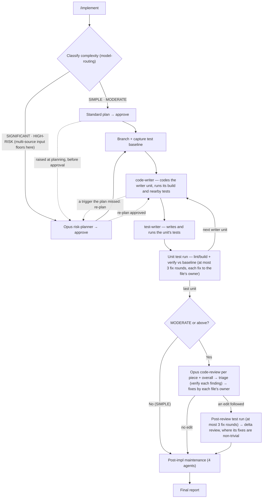

# /implement

Classifies a task's risk, creates a branch, plans the change, has it built and tested by one code writer and one test writer — one pair for the whole change, unless its design gives each piece writers of its own — runs the tests, reviews it with Opus on all but `SIMPLE` work, and performs post-session maintenance.

## Who runs it

`/implement` runs in the [dev](../roles-and-phases.md#dev--build-verify-and-deliver) role, cost-attribution phase [implementation](../roles-and-phases.md#implementation) — being in this phase means code is actually being written, tested, and reviewed.

## Synopsis

```
/implement <ADDRESS> | <prompt> [@file…] [@spec-folder] [@repo…] [--no-commit] [--skip-costs] [--skip-feedback] [--enforce-model=<model>]
```

`$ARGUMENTS` resolves to one of two modes: **keyed** when a positional address is present — a `<KEY>`, or an `@<path>` naming a folder in the specs tree — and **direct** otherwise (free-text or `@file`). The keyed branch resolves through `workflows-core:addressing` §3, the same entry point `/document` uses.

`/implement` implements **one Epic per run**. When the resolved item already names a focus Epic (a bare Epic key — the folder's `EPIC-` prefix sets the altitude, never the kind it asserts, and a legacy folder with no prefix is placed by what it holds; no second positional is accepted), that Epic is the scope. A BRD container holds no Epic to implement and stops the run (`IMPLEMENT_BRD_NOT_SLICED`), naming each of its slices instead or, where it has none, `/product-workflows:brd-split` to carve one. That stop, and the folder read below, are taken only after the specs-repo preflight has settled the specs checkout's branch, so a stale plugin branch cannot hide a slice, an Epic or its artifacts. On a run carrying `specs_git: misrooted` (a misplaced `$SPECS_PATH`) the preflight switches no branch; it names a stale one it stays on, and that branch can still hide them. When the PRD is bare, a cheap folder read classifies it (on a multi-component PRD the flat-specification cases below never arise — see *Multi-component PRDs*): a PRD with exactly one Epic sets that Epic as the scope automatically, unless the PRD folder also holds a flat `specification.md` — a broad PRD-level slice, which `/design` designs as one unit — in which case it asks which of the two to implement, with no recommendation; a PRD with two or more Epics renders a **progress-aware picker** — each row showing the Epic's own artifacts (`specification.md` but no `design.md` → ○ not started; `design.md` present but no block in `implementation.md` → ◐ in progress, selectable and where the default cursor lands, since a merged design is exactly what this command wants; an `implementation.md` holding at least one block (a file holding only its heading records nothing) → ● done, greyed and not default-selectable, and selecting it offers to implement again), plus, **on the same condition as the one-Epic case above — only where the PRD folder also holds a flat `specification.md`** — the explicit choice to implement one broad PRD-level slice instead, since without that file the slice is a unit nothing specified: with it, that choice counts against the prompt's four options, so the array names at most two Epics and lets you type the key of any other; without it, the array names at most three and lets you type any other; a PRD with no Epics offers to split with `/product-workflows:epics` first, or to implement a broad PRD-level slice. Selecting an Epic scopes that run only — there is no "next Epic" loop, because code-writing is heavy and branchy enough that each run targets one Epic.

All three run flags apply to this command. `--skip-costs` (or `WORKFLOWS_SKIP_COSTS`) skips Phase 7's session-cost entry, still advancing the checkpoint and dropping any deferred cost record a ceded `/prompt-brainstorm` or `/prompt-grill-me` run left pending in this session (`workflows-core:run-flags` §5 step 3) — see [Session cost](../reference/session-cost.md). `--skip-feedback` (or `WORKFLOWS_SKIP_FEEDBACK`) narrows Phase 4's maintenance step to bugs-only, dispatching `defect-reporter` in place of Agent 4 (`impl-maintenance`) — see [Session feedback](../reference/session-feedback.md). `--enforce-model=<model>` (or `WORKFLOWS_ENFORCE_MODEL`) pins every dispatched agent in this run — `risk-planner` and `code-review` included, overriding their frontmatter Opus pin — to one model, bypassing the fallback chains `model-routing/classification` §2 and §2.1 otherwise select, and the coding model `code-writer` and `test-writer` otherwise run on — see [Model routing](../reference/model-routing.md). In direct mode, the free-text `<prompt>` is protected the same way: a run flag forms a leading run — mixed, in any order, with this command's own `--no-commit`, an address/key and any `@path` token (`workflows-core:run-flags` §3 step 1) — before the prompt begins, or a trailing run at the very end, which may carry `--no-commit` and `@path` tokens too; a run flag in either position is stripped, one written inside the prompt itself is kept as prompt text.

## How it runs

`/implement` has 20 `## Phase` headings. Rather than walk every one, the diagram below deliberately names none of them: it compresses the whole run into its two real decision points, the loop over the writer units, and the dotted edges a change of class takes, instead of naming each phase.



`IN` covers Phase 0 through Phase 1.8 — the session-model gate (*Gates*, below), loading and classifying the input, the Phase 0.5 readiness pre-flight, clarification (which, on a keyed run, first resolves the applicable ARD; then, on every run, settles the working tree and the branch — Phase 1.4, below — before it looks in the inputs, the code, the repository's own docs, `git log` and the ARD's rules, and asks only what would change the result), and, only when the input is multi-source, the Phase 1.6 floor at SIGNIFICANT and the Phase 1.7 fan-out scan it triggers; then Phase 1.8 reads the design's pieces (*Who writes the code and the tests*, below). `BR` covers Pre-Phase 3 (branch creation, from wherever Phase 1.4 left you, or none where the run continues on the unit's own branch) and Pre-Phase 3.5 (test-baseline capture) together — the baseline is always captured after the branch is settled — cut, or continued — and before any file is edited, on either path. **Phase 1.4 is why the plan reads the tree it will change**: the clean-tree check and the branch question come before the run's first read of the code, so a stash, a switch to the unit's own branch and a fresh start's move onto the default branch are all made before the look, the scan, the exploration and the planner read anything — and where any of those moves would change a spec file the run has read from inside the repository, the run stops instead, naming the file; where the move was the switch to the unit's own branch or its fast-forward, switching to that branch yourself and re-running continues on it with no move. Every stop from there until the code is committed names any stash it made and the branch you stand on. The plan follows the class as it stands when the run plans — Phase 1.5's, as the multi-source floor or a down-classification accepted at plan approval left it, or raised before any file is written when Phase 2A's plan shows a classification trigger (such as more than 3–5 non-test files, authentication, a schema or migration, or a public contract — the dotted `P1` → `P2` edge); after a down-classification you accepted at plan approval, only a trigger a later revision adds raises it. A run that meets such a trigger while implementing, one its approved plan did not state (one of the concrete triggers the [classification policy](../reference/model-routing.md) lists, not its catch-all of unclear requirements, large unknowns or otherwise high blast radius, whose unknowns are asked about instead), re-plans upward: `risk-planner` plans the rest with the diff so far, and once you approve, the run goes on under both plans without re-branching or re-capturing the baseline, taking again each writer unit that holds a Step of the re-plan — its code writer, its test writer where it has run, and its test run (the dotted `CW` → `P2` → `CW` edges); cancelling that re-plan commits the work (unless `--no-commit`), and any pull request the run opens is a draft. That happens once per run: once the run's one re-plan is spent — at a down-classification you accept there, or by a Revise after a blocked step — a later trigger is put to you instead, to continue at the run's current class (without the review on a `SIMPLE` run; with it, but no re-plan, on a `MODERATE` one) or to stop, which commits the work as cancelling the re-plan does. `CW`, `TW` and `TS` are Phase 3 and Phase 3.5, taken once per writer unit, one unit at a time (*Who writes the code and the tests*, below): `CW` is the unit's `code-writer`, `TW` its `test-writer`, and `TS` its test run — lint/build, the `test-baseliner` verify against the captured baseline, and the fix rounds, whose every fix goes to the writer that owns the failing file — the next unit starting only once that test run is green or settled. A recorded test skip still runs lint/build and is reported, as described under Gates below. `M` is the class once the last unit's test run is done: a `SIMPLE` run is not reviewed, and every other run goes to `RV`, Phase 3.6 — one Opus `code-review` per piece, then one over the whole change where there are two or more pieces, none of them told a test result; triage; and each fix sent to the writer that owns its file — with no `risk-planner` dispatched for a `MODERATE` run. `PT` is Phase 3.5 again, at its `post-review` stage, run only where an edit followed the units' test runs, then the review of its fixes' delta. `MT` is Phase 4's four maintenance agents. `RP` is the Phase 5 Final Report — folded into it is Phase 4.5 (a silent no-op unless the review escalated spec/design conformance notes onto a spec/design in the specs repository, a note written into this repository's own spec riding on the code commit instead; otherwise its handoff outcome line appears in the report's own `### Spec/design conformance` section), which runs between Phase 4 and `RP` and is not separately pictured. Two more phases sit in the same gap and are likewise not pictured: Phase 4.6, the code-repo handoff that commits the work and — behind a consent choice — pushes it and opens a pull request, and Phase 4.7, which appends this run's refs to `implementation.md` on a keyed run — in the folder of the unit it implemented: the Epic's, whether you named the Epic or the picker chose it, or the PRD folder's for a broad PRD-level slice. Two further terminal phases run after `RP`: Phase 6 (follow-up tasks, written into the same unit's folder as Phase 4.7's record) and Phase 7 (session cost, plus the terminal artifact commit).

Seven named subagents are dispatched: `workflows-core:code-scanner` (Phase 1.7, only when the input is multi-source — one `code-scanner` per repo, capped at 4 concurrent, plus a seeded round 2 for any theme round 1 left inconclusive), `risk-planner` (Phase 2B, `SIGNIFICANT`/`HIGH-RISK` only), `test-baseliner` (captured in Pre-Phase 3.5, verified again at every test run in Phase 3.5), `code-writer` and `test-writer` (Phase 3, one of each per writer unit, each reached again for every fix in a file it owns, from a test run or a review), `code-review` (Phase 3.6, one per piece of the design and, on two or more pieces, one over the whole change, which a `MODERATE` run passes too), and `workflows-core:impl-maintenance` (Phase 4). `code-writer` and `test-writer` run on the run's coding model (*Who writes the code and the tests*, below); `risk-planner` and `code-review` keep their frontmatter Opus pin regardless of classification; the other three run at the caller's `detection_model` — the Sonnet chain; `--enforce-model` overrides all seven. `review-fixer`, which `/vuln` and `/upgrade` dispatch, is not among them: each fix here is made by the writer that owns its file. Beyond those seven, general-purpose agents are dispatched too: a read-only codebase-exploration subagent at Phase 2A (none where a down-classification you accepted at Phase 2B sent the run there, its exploration being already written) and at Phase 2B only where no exploration this run made (Phase 1.7's, Phase 2A's or an earlier pass of Phase 2B's own) has written the codebase summary, on the same Sonnet chain; and Phase 4 dispatches three general-purpose agents (a documentation review, a knowledge-base review, and an instructions review) alongside `impl-maintenance` — all four in a single message, independent of each other.

### Who writes the code and the tests

The orchestrator — the session you run the command in — writes no source code and no test in Phases 3, 3.5 and 3.6: one `code-writer` and one `test-writer` write them for each **writer unit**. Phase 1.8 reads the units off the `## Pieces` section of the in-scope `design.md` (the design format in [References](../reference/references.md)): each piece there is a unit of review, with its files, the pieces it builds after and the contract it provides or uses, and by default one writer unit holds every piece — `Writers: one`. Only a design that reads `Writers: per piece — <reason>`, for an Epic too big for one writer to hold well, gives each piece writers of its own, the units then taken in the order the pieces build in. A direct run, a companion run, a run with no in-scope design and a design with no `## Pieces` section are one piece and one unit; a malformed section — no `Writers:` line, a piece with no files, a file two pieces both match, an unknown or circular `Builds after:` — is put to you before any plan is written: treat it as one piece (recommended), or stop with nothing written. Where there are two or more pieces, each plan Step names the piece it belongs to, and the unit holding that piece codes it; a Step that edits a file already in your repository that no piece names says so in the plan, and approving the plan moves that file into the Step's piece.

Each unit is taken whole, one at a time: its code writer codes every Step of the unit in one dispatch, runs the build and the tests near its change — the tests of each package or module directory it touched — and fixes what it broke before it returns; then its test writer writes the unit's tests and runs them; then the orchestrator runs the unit's test run (*Gates*, below), and the next unit starts only once that run is green or you settled it. A helper two or more Steps need is a Step of its own in the plan, and a code writer reuses a helper an earlier writer wrote rather than copying it — where reuse needs a change outside its own files, it writes its own and names the copy, which the review is told about. What the orchestrator still does there itself is mechanical: a plan's `git bisect` step, run first from the clean tree; a security scan's patch applied; a `[DEBUG-xxxx]` probe stripped before the review diffs; the diffs captured; a conformance note written onto a spec; and the test run's checks — the lint, the build, a check a writer left to it, and on a bug fix the red-capability check and the repro's re-run.

**A writer is reached again, not replaced.** A writer keeps its whole context once it has returned, so every later request for its unit — your answer to its question, a fix round, a review's fixes, an updated request after a re-plan — is a message to that same agent (`SendMessage`), which carries on from what it already knows. Where reaching it fails, or its reply carries no status, a fresh agent of the same kind is dispatched with the same request, that writer's earlier reports and the diff so far, and the report's *Assumptions & limitations* says so; so it is where a class change has moved the coding model, since an agent keeps the model it was dispatched on. A code writer that runs short of room before every Step is coded returns what it has done, and a fresh one — a continuation, never a resume — codes the rest from its report and the diff so far.

`code-writer` and `test-writer` run on the run's coding model, `implementation_model`, which the class decides: `SIMPLE` work is coded and tested on the session's own model; from `MODERATE` up, on the session's model where that is an Opus or Fable model, and otherwise on the first available model of the Opus [fallback chain](../reference/model-routing.md#the-fallback-chain) — so a Sonnet session's `MODERATE` code and tests are written on Opus wherever one is reachable. `--enforce-model` overrides both. A class change mid-run — a raise, or a down-classification you accept — moves every later request to the new class's model; work already done stays as it is.

**The code writer** owns every file of its unit save the test files, and edits no test file at all: a Step that writes a test is left to the test writer, and an existing test that fails because the specification changes what it asserts, or how it calls the code, is reported and left as it is. It runs, through the run lock, the repository's build, the tests near its change and any check a Step names — no test at all where the run records a test skip (*Gates*, below) — and fixes what it broke, in up to three attempts — never by editing a test; and it runs the repository's own install, code-generation or formatting command where a plan step names one: an install with no dependency's install-time code, then each of the project's own install scripts the plugin runs beside a build, right after the install and before the build; a formatter only on the paths it changed, where the command takes paths — one that cannot be limited so is not run at all, and the report names it for you to run. A file it must edit outside its unit — another unit's, or a file already in your repository that no piece names — is a question it returns: the orchestrator moves another unit's file into this unit and records the move, and asks you about the other kind, whether to move it in or to stop. On a bug fix it runs the repro, the build the repro needs and its probes only in a scratch checkout of the code as it was, never in your working tree. It never asks you anything and writes no git state: it returns one of four statuses, which the orchestrator acts on.

- **`done`** — the unit is coded, and its test writer goes next; where a Step was not reached, a continuation codes the rest first.
- **`needs_decision`** — a question nothing the run can read settles, whose answer you would notice in the result: the orchestrator asks it, with `code-writer`'s own options, and sends your answer to the same writer, which codes the rest of the unit with it; the Opus review of a reviewed run is then handed it as your ruling, so the choice is not reported as a departure from the plan.
- **`trigger`** — on a `SIMPLE` or `MODERATE` run, a classification trigger the approved plan did not state: the run re-plans upward, once per run, as described above.
- **`blocked`** — a step cannot be coded as the plan writes it, because something the plan names is not so — a file, function, route, field or interface the tree does not hold, or holds otherwise — or an install it names fails, or, on a bug fix, the repro a step names does not go red on the code as it was (run up to ten times where the plan records a reproduction rate below 100%, and never a block where you chose to proceed without a repro). The run says what blocked and what is already coded, and asks whether to **Revise the plan** — you are then asked what to change — or to **Stop here**, the work so far committed through Phase 4.6 (left uncommitted under `--no-commit`, which the question says). Revising is the run's one re-plan: on `SIGNIFICANT` or `HIGH-RISK` work `risk-planner` re-plans with what blocked; on `SIMPLE` or `MODERATE` work the plan is revised and its class re-tested — a classification trigger the revised plan shows raises the class and hands the re-plan to `risk-planner` — and is put to you for approval again. Where the run's one re-plan is already spent, it stops without asking, the work committed as on **Stop here**; where `code-writer` could not read an input the run handed it, the run stops, since that is a defect of the command and not of the plan.

A writer's return the run cannot read is met by one fresh dispatch of the same request. A second in a row leaves that writer's part of a test run's fix round made, with nothing to fold — the next round, within the three, reaches it again — and otherwise stops the run, naming the writer, save a code writer's while it codes its unit, which is treated as `blocked`.

**The test writer** owns every test file the run writes or changes — the new tests, on a bug fix the regression test, and an existing test the specification changes — and no other file. It writes from what the change is meant to do — the specification's acceptance criteria and test cases, the design's interfaces and the plan, or, with no specification, the task and the plan — and reads the code only for its names, signatures and locations, never to learn what it does, so a test checks the requirement rather than restating the code; on a bug fix its request carries the diagnosis and the repro. It writes into every suite the unit's changed files fall in, then compiles and runs the tests it wrote, through the run lock, fixing its own errors up to three times for each, and never weakens a test to turn it green: where a test written from its source fails because the code does otherwise, it keeps the test and reports the disagreement, and the orchestrator rules on it against the specification and the design — the test holds and the code changes, or the code holds and the test changes — asking you where neither settles it; the change the ruling names goes to its owner in the unit's fix rounds whether or not anything fails, and the review is told the ruling, never a test result. It updates an existing test the code writer reported where its source says that behaviour changed. It never asks you anything and writes no git state, and an input it could not read stops the run, as the code writer's does. Where the run records a test skip (*Gates*, below), it runs none of the tests it writes, and where the repository has no test framework at all it writes none.

### The run-state file

`/implement` keeps every fact a later phase, a stop or the final report reads in one file, so that a compaction of the session loses none of it: `$(git rev-parse --git-path dev-workflows/implement-run.json)` in the code repository — inside its git directory, one per worktree and never staged, so no diff or commit carries it. Phase 1.4 opens by creating it from the facts the run holds by then, every other key taking the default `scripts/run-state.py` gives it — a slip in what the run hands the script is corrected and the call made once more — and moving aside unread any file an earlier run left there, as `implement-run.json.stale-<UTC stamp>`, at most one such file kept and named in the report's *Assumptions & limitations*. Every fact is written into it the moment the run learns it, through that script, which refuses a key the file does not hold and replaces the file whole on every write; every phase from Phase 1.5 to Phase 7 opens by reading it, and acts on what it holds rather than on what the session remembers — the pieces and the writer units among it, each writer's agent id, model and report files, each test run's fix rounds, and each review's diff, return and verdict, so a compaction loses no writer the run must reach again; the plan you are asked to approve and each review's return are written to temp files it names before the question or the triage, so a compaction while either waits loses neither. The file and the temp files it names are removed once — as the run's last action before its terminal specs-repo commit, or by a stop once its message is out, which keeps a file it named as unreadable for you to look at. Where the run cannot reach the file at all, it stops, naming the error, and leaves the work uncommitted: the commit keeps your own uncommitted files out by what that file records, so the stop names every changed file, yours and the run's alike, for you to sort. Run one `/implement` at a time in a working tree: two runs there already collide on its files, and on this one.

### The run lock

`scripts/run-lock.py` lets one build or test command at a time run in a work tree, and every build, test or install command the run makes in your work tree goes through it — the dependency install before a bug run's repro, a bisect's tests, each writer's build, tests and tool runs, `test-baseliner`'s suites at the capture and at every verify, and the orchestrator's own checks, a scratch checkout's run among them — save `risk-planner`'s repro on the working tree before the first edit, which runs while nothing else does; so none overlaps another, though the writers already run one after another and the reviewers only read. The call: `python3 "${CLAUDE_PLUGIN_ROOT}/scripts/run-lock.py" -- <command> [args…]`, run from inside the work tree, takes an exclusive `fcntl.flock` on `$(git rev-parse --git-path dev-workflows/run.lock)` as git names it in the outermost work tree — inside a submodule, its superproject's, and so on to the top, so a suite inside a submodule shares the superproject's lock; inside the git directory, one per worktree, never staged — waits while another holder has it, printing one `run-lock: waiting for <lock path>` line to stderr — a signal then ends the wait with a `run-lock: interrupted while waiting for <lock path>` line, and any after it is ignored — runs the command with the caller's stdin, stdout, stderr and working directory, and lets go when the command has ended — on any exit not after a signal the script passed on, a normal exit or a leader killed by a signal that did not come through the script, that is the command itself (the group leader), so a daemon the build leaves in its group does not hold the lock. The kernel releases the lock when its holder dies, so none goes stale. A SIGTERM, SIGHUP, SIGINT or SIGQUIT sent to the script while the leader runs is passed on to the command's process group as it arrives, and the lock is then kept until the whole group is gone: the script waits for the leader with no time limit, then up to 2 seconds for the rest of the group, then sends it a SIGKILL; it exits `128` plus the last signal passed on, and says which it passed on. Not every one is passed on: one that arrives once the script holds the leader's exit status, during that grace too, is ignored; of those that arrive before the command has started, only the last is kept, and passed on once the command starts, or dropped where it cannot be started; and one the group's kill refuses, the group already gone, is not counted as passed on. A signal the script does not catch, SIGKILL above all, sent to the script alone frees the lock while the command runs. The command has a session of its own, so a Ctrl-Z stops only the script. Exit codes: the command's own; `126` it could not be run; `127` it was not found; `128` plus N for a signal N that ended it, was sent to the script and passed on, or interrupted the wait for the lock; `2` a call without `--` or without a command after it; `4` the lock could not be taken — a directory outside a git work tree, a lock file that cannot be made or opened, or a filesystem that refuses `flock`. Every exit of the script's own prints a stderr line starting `run-lock:`, and the exit code alone does not tell them from the command's, since a test runner may itself exit `2` or `4`. Where `fcntl` is missing it says so on stderr and runs the command unlocked.

### Multi-component PRDs

On a keyed run for an Epic carrying a `target:`, Phase 1 checks that the target is in this repository, on any PRD. Every keyed run first reads back the open follow-ups addressed to this repository and this unit — a change a run of the unit in another repository found this one needs — from the unit's `follow-ups.md` as checked out and as on the specs repo's default branch, prints them, and adds their changes to the description. A follow-up `/security-workflows:scan` wrote names its finding's patch by a path in the specs repository: the run reads the patch there — or its copy on the specs repo's default branch, where the checkout lacks it — and hands it to the planner as the fix's starting point — never the fix as given: the run reads each patch against the unit's specification, ARD and design before it plans, and a patch that falls short of one is a question it asks or settles there, as the plan then checks it like any other change. Before any other edit, on the branch it settled, it checks each task's patch with `git apply --check`, in task order, applying each that still applies before it checks the next: where one does, that fix starts by applying it and goes on through the run's own tests and review; where one does not — the code moved since the scan, or an earlier patch changed the lines it touches — or the patch could not be read, the run says so in its report's *Assumptions & limitations* and derives that fix afresh from the finding. A copy it read from the default branch into a temporary file is removed once its patch is applied or refused. Wherever the run names a security finding other than the one its own task carries — in the plan, the review, the report, the pull request or a follow-up — it names it with its status in the repository's findings register: a false positive with who decided it and the evidence, an accepted risk with its owner and review date, and one the register does not hold, or a register it cannot read, as such. It never writes a follow-up asking to fix a finding the register rules a false positive or an accepted risk; where its review disputes that ruling, the report says so, and who can decide it again, by what the register records. A decision still awaiting security review, or an accepted risk past its review date, is one `/security-workflows:scan`'s `--triage` lists, and the report names that run — given the unit's key only where the finding was raised for the unit, since a keyed `--triage` lists no other, and otherwise this repository's path. A confirmed accepted risk comes back to `--triage` only after its review date, which the report gives with its owner; and no mode lists a confirmed false positive again — only a later scan's possibly-same finding that a person matches to it reopens one — so the report names who decided it, to raise the dispute with. A keyed run whose only work is those follow-ups — it carries no prose or spec file of its own, and a run of the unit from this repository is already recorded — scans the code for the follow-ups' changes alone, still reading the unit's folder as their context. A task a PRD run of `/conformance` ruled out is not one of them: where the PRD's `_conformance.md`, as checked out or on the default branch, carries its exact line as `withdraws:`, the run prints it as overruled or withdrawn and builds none of it — the ruling may predate the line's arrival from a Dev's branch or a session branch. Run from a repository other than the Epic's target, a run that finds one recommends a **companion run**: it implements only those changes, since the Epic's own change is already in its target's repository, so it does not scan for, plan or review against the Epic's requirements, and its pull request names the change it completes; the next step tells you to tick each task a run answered — a companion run's, or any whose changes joined a run's description — once its change merges. A follow-up that names a repository its run was not given — save one named for the Epic's target — may name this one under another name, so the run prints those too and asks, recommending nothing where a printed name is a known repository's or this repository is itself one of the PRD's components. With no such follow-up it recommends stopping and running the Epic in its target's repository. Either question also offers to implement the whole Epic here anyway. On a PRD with two or more code components it also checks that the ARD's `## Contracts`, the PRD-level specification, and the Epic's own specification and design are on the specs repo's default branch; that the Epic carries a target from the PRD's set; and that its `## Contract` agrees with the ARD — every new or changed interface it consumes is produced by some Epic, every one it produces is its target's, every `[AD#N]` it cites is an interface, and it depends on each producer of what it consumes. A gap asks whether to stop and run the missing step first (recommended) or to continue, and continuing names the gap under the pull request's *Merge danger*. Addressed by its PRD, a multi-component PRD's flat specification is offered as a slice to implement only where the PRD has no Epic yet, and then not as the recommended choice.

## What it needs

- **The resolved input itself** — classified in Phase 0: free-text prose plus any `@path` tokens, each classified by inspection, with a key or specs folder resolved against `$SPECS_PATH` through `resolve-address`. A key that resolves to no folder stops the run, offering to re-enter it or cancel — it never falls through to a direct-prompt run. A key given while `$SPECS_PATH` is unset stops before it is resolved, naming the variable and offering to set it or cancel, since there is no tree to find it in; an `@<path>` address names its folder directly and runs without the variable. Run it from inside the repository it is to change: it changes the repository it is run from, and started outside every git work tree it stops straight after reading its run flags — before it resolves an address, touches the specs repository or asks which Epic — showing git's error where git gave one. Run from inside the specs repository itself — the repository whose top level `$SPECS_PATH` is — a run given a key or a specs folder stops once the address resolves, before it touches the specs repository, telling you to run it from the code repository; a direct run there goes on, with one line saying it branches and changes the specs repository, its session files included, which are committed on that branch and go out only when it is pushed: with the code at the push choice for those its commit takes, and when you push the branch for the rest; a run that stops before it cuts its branch commits them on the branch it then stands on, the default branch after a fresh start, which the run's closing commit pushes. Where the specs repository's default branch takes no push, they go to your session branch instead, never onto the run's branch. The directory you run it from lies in that code repository and is never read as a spec folder itself, so a `prompt.md` or `*-design.md` file in it is read only when you name it: by file, or, below the repository's top level, by naming the directory (`@.`), which is then classified like any other `@path` — a folder holding those files is read as a spec folder. An `@path` at a repository's top level is read as a code repository, with a notice where it also holds `prompt.md` or `*-design.md` files (name those by file to read them). A path that does not exist, or a directory or file of no recognized kind, is named as each input is classified, and an unreadable file stops the run, both before the specs-repo preflight. A direct run with no description — no prose, and no spec file or spec folder named — stops there too, listing the forms a description takes (a key among them) and any `prompt.md` or `*-design.md` file in the directory you ran it from. If the primary description is a design doc (`/design`'s output) carrying unresolved open questions, `/implement` refuses to proceed by default — a design must be decision-complete before implementation; overriding is logged in the Final Report. A `specification.md`-level open question is exempt: it is the spec's own — one the design phase answers, or one it leaves open for the specification's owner with its proposal written under it — and a design may legitimately carry a spec that still has some.
- **Specs, for keyed runs.** When Phase 0's address resolution finds no `specs` at all, `/implement` prompts for one rather than planning blind. Direct-mode runs are exempt — the prompt or spec file supplied is the instruction.
- **Any in-scope `specification.md`/`design.md`, gated on `$SPECS_PATH`'s main** (Phase 0). An *unmerged* one (an open pull request, not yet on main) is a hard stop, naming `$SPECS_PATH` explicitly since `/implement` stands in a code repo, not the specs repo. An **absent** one is not a stop at all — the run behaves exactly as it did before this gate existed (on a multi-component PRD, Phase 1 asks about a missing Epic specification or design, offering to continue — see *Multi-component PRDs*), and a direct-prompt run, which resolves no in-scope spec, is unaffected either way. This is the reverse of `/design`'s `specification.md`, which stops on absence (see the [`/design`](design.md) page).
- **The multi-source rule** (Phase 1.6): more than one distinct code repo (counted by top level, so an `@path` whose top level is already counted adds none), or any folder input (a specs folder or a spec/design folder), floors classification at `SIGNIFICANT` — overridable at plan approval — and triggers the Phase 1.7 fan-out scan in place of the single Explore subagent. The run changes code only in the repository you run it from: every other code repository it is given is read-only context, and the changes one of them needs become one follow-up for that repository — shared with any other whose `origin` URL ends in the same name: a task Phase 6 files on a keyed run that finishes (a direct run lists it in its report), named in the stop message on one that stops after plan approval. Where the plan changes no file in this repository at all, the run asks, in place of plan approval, whether to revise the plan or stop with nothing written, naming the run each other repository needs. **A referenced directory that is missing, or that is neither a recognized folder type nor a git repo, is always surfaced to the user immediately and never silently skipped** — the run asks whether to continue without it or stop.
- **An optional ARD** (resolved at the start of Phase 1's clarification, which reads its rules; Phase 1.8, keyed runs only) — `status: none` skips; `status: unmerged` stops, naming `$SPECS_PATH` explicitly; `status: found` carries its invariants as implementation guardrails, passed to `code-review` as `applicable_ard` on every reviewed run — `MODERATE` and up (guidance only on `SIMPLE`, which has no review gate).
- **A clean working tree**, or explicit consent to stash or proceed dirty, before the run first reads the code (Phase 1.4), ahead of the feature branch Pre-Phase 3 creates or the unit's own it continues on (on a dirty tree, a file of yours the run then changes is committed whole, your earlier changes with it; a stash sets aside your tracked changes except in the specs the run reads — its spec files, and any specs folder inside the repository — which it names, and leaves your untracked files where they are) — never implemented directly on the default branch. A run that stashed names the stash wherever it ends: in the stop's own message, or in the `Code repo:` line, under `--no-commit` too; a stop also names the branch you stand on, since the run may have switched it before planning. Just before the baseline the run reads the tree again, and a file that turned dirty while the plan was reviewed — one you edited, or one a repro wrote — is treated as yours, kept out of the run's commit unless the run then changes it, and named in the report; a file of yours that was dirty already is taken as it stands then, so an edit you made to it while the plan was reviewed stays out of the commit too.

## What it produces

Code changes on a feature branch — a fresh one, named per the target repo's own documented convention, or `<prefix>/<key>-<slug>` as the fallback, or the unit's own, where the run continues on it (below) — **committed** in Phase 4.6 without asking, then pushed and opened as a pull request behind a three-option consent choice (push + PR recommended, push only, or neither). The one question before the commit is a possible secret: the lines it adds are scanned first, and where the scan finds a token, key or password it cannot dismiss as a placeholder, it shows you where — never the value — and asks whether to stop and leave the work uncommitted so you can remove it, or commit it as not secret. The commit subject ends with `[<key>]` — the key of the unit the run implemented, which the branch name carries too: the Epic's wherever it implements an Epic, even one the picker or the one-Epic path chose under a PRD address, and the PRD's for a broad PRD-level slice — and carries a `Work-Item:` trailer where that unit's folder has one, which is what lets `/document` and `/release-notes` find the work later. A run whose review or tests did not clear is committed like any other, and still *offered* for push and pull request under the same consent choice — a failed gate never downgrades what you are offered. What changes is the pull request itself: where one is opened it is a draft whose body leads with a DO-NOT-MERGE line naming the blocking fact, and where the push updates one already open — after either push answer, wherever `gh` can find it — the run turns that one back into a draft and posts that line on it as a comment. `--no-commit` skips the phase entirely and leaves everything in the working tree.

**Continuing on the unit's own branch.** Before it first reads the code, a keyed run in a repository whose default branch it can resolve fetches the remote's refs, and the branch the latest block of the unit's `implementation.md` records for this repository by name, so a single-branch clone sees it too — where a fetch fails or times out, it says so and reads them as last fetched — and looks that branch up. Where the remote no longer has the branch, the run removes a tracking ref still standing for it, as a pruning fetch would, and says so. In a shallow clone it warns that a merged branch may read as open, and it never deepens the clone; where it could not compare the branch's tip with the default branch, it says the merge state rests on the record's merge test alone. Where that branch's pull request has not merged and you stand on it, carrying commits the default branch lacks, the run asks whether to **Continue on this branch** (recommended), to branch from where you stand, to branch from the default branch, or to cancel, the question naming the branch and saying the work joins its open pull request. Where you stand anywhere else — the branch being a local one, or only the remote's — and you have no uncommitted changes to tracked files (untracked files do not count), it asks the same with **Switch and continue** first — on the default branch without the option to branch from where you stand, which would be the same fresh start. With uncommitted changes to tracked files it does not offer the switch: it says why, and asks whether to stop so you can commit or stash first (recommended) or to cut a fresh branch here — one without the unit's commits, whose pull request would be a second one. Before either question it asks the host, where `gh` can, whether the branch has an open pull request, and where it has none the question says so instead: continuing commits on the branch, and the run then offers to open one. A local copy behind the remote's is fast-forwarded first, and the run says so. Continuing cuts no branch: a push updates the branch's pull request where one is open, and the run's record names the same branch. A follow-up for an Epic whose pull request is open (a security fix from `/security-workflows:scan`, or any other) joins that pull request instead of opening a second one. Where that pull request has already merged and you still stand on its branch, the run recommends a fresh start from the default branch instead, since a branch cut from where you stand would carry the merged commits into a second pull request. Where the branch has gone on since the merge, the usual question stays (below), recommending to branch from where you stand — which keeps the work added since — where every commit you stand on carries the unit's key; the run says first that such a branch also carries the merged commits.

**Where you stand, and a fresh start.** Where you stand anywhere but the default branch, carrying commits it lacks, and no question about the unit's own branch takes its place, the run lists those commits and asks whether to branch from where you stand, to branch from the default branch — a fresh start — or to cancel. A direct run recommends branching from where you stand. A keyed run recommends it only where every listed commit's subject ends with the unit's own `[<key>]`, the commit convention the run itself writes; where any does not — another unit's work, say, or a commit made by hand — or the commits could not be read, it recommends the fresh start, naming the commits that lack the key, since a branch cut from them would carry that work into this unit's pull request. A fresh start fetches nothing and never moves your local default branch. Where your local copy is strictly behind the remote's, holding nothing the remote's lacks — as the clone last fetched it, which a keyed run has just refreshed — the run puts HEAD on the remote's commit, detached, and cuts its branch from there, so the code is written against the current base; it does the same, without asking, where you already stand on that local copy, or on a branch or commit that holds nothing of its own and is behind the remote's default, such as an old merged branch; and a stop before the branch is cut names that detached commit. Where your local copy holds commits the remote's lacks, the run starts from your local copy, and the report's *Branch* section says how many commits it is ahead of the remote's and behind it — as it does in the specs repository itself where your local copy is only behind, since a detached HEAD there could leave the run's session-file commit on no branch.

Four Phase 4 maintenance outputs, always collected together: a documentation update (or an explicit "no update required"), knowledge-base entries (one per lesson, each titled by its own lesson), an instructions (`CLAUDE.md`) update, and an `impl-maintenance` Lessons Learned report. On a reviewed run — `MODERATE` and up — with a spec/design in scope, save a companion run (*Multi-component PRDs*, above), unresolved `missing`/`contradicts` findings from `code-review`'s conformance dimension are escalated as open-question notes written back onto the source `specification.md`/`design.md` where it lies in the specs repository or this one, a spec anywhere else having its gap reported instead (Phase 3.6 step 4), committed with the code where it lies in this repository (Phase 4.6), and, where it lies in the specs repository, handed off behind a consent choice onto its main branch (Phase 4.5), save on a direct run from inside the specs repository, where that repository is this one and the note is committed with the code — on a run that finishes; one that stops after the review names any such note in its stop message, uncommitted in the specs repository unless that repository is the one the run changes, where the stop commits it with the code — Phase 4.5 being a silent no-op when nothing was escalated into the specs repository, which covers every `SIMPLE` run and every run with no spec/design in scope.

A structured Phase 5 Final Report (classification, branch, files changed, review verdict and triage, spec/design conformance, deferred items, next step); Phase 6 follow-up tasks for any qualifying manual or out-of-scope items; and Phase 7's session-cost entry plus the terminal commit of `$SPECS_PATH`'s bounded session-artifact paths — never the code repo this run just changed.

## Gates

**The session-model gate comes first.** Straight after the run flags are stripped and the rules its question follows are loaded — before the run reads an address, the specs repository or any code, and on every run whatever its class — `/implement` checks the model the session runs on. Its orchestration — the classification, the routing of every dispatch, the review gate and the phase order — runs on that model, which nothing inside a running command can change, and a session below Opus has been seen to classify its way past the review gate. On an Opus or Fable session it says nothing. On any other it asks whether to stop and relaunch on Opus with `claude --model opus` (recommended) — which stops with nothing written and nothing switched — or to go on anyway on the session's model, recorded in the final report's `### Assumptions & limitations` and under the pull request's *Merge danger*. Where no Opus model is reachable there is nothing to relaunch onto: the choice is to proceed on the Sonnet floor, recorded the same way, or cancel. Under `--enforce-model` nothing is asked, as no Opus-session gate in the family fires under it ([Model routing](../reference/model-routing.md#enforcing-one-model)).

Pre-Phase 3.5 captures a test baseline **before any source file is edited**, at every class. **The tests then run before the review**: each writer unit's code writer runs the build and the tests near its change as it codes, its test writer runs the tests it wrote, and the unit's test run follows; on `MODERATE`, `SIGNIFICANT` and `HIGH-RISK` work the Opus `code-review` comes once every unit's test run is green or settled — `SIMPLE` work is not reviewed — and an edit the review leads to is followed by the test run again. Every build, test or install command goes through the run lock but one, the planner's repro before the first edit (below), which runs while nothing else does — so none runs beside another in your working tree. On bug work the diagnosis keeps its own places. On `SIGNIFICANT` or `HIGH-RISK` bug work, before the first edit the planner's repro runs on your working tree — where a lockfile git tracks (npm's, pnpm's or yarn's) has no dependencies installed beside it, the run first asks whether to install them — those missing, and no others, exactly as the lockfile pins them, running no dependency's install-time code, and stopping before it plans where the install changed a tracked file — or to plan without them, the planner then told a repro that needs them cannot run; and a bisect, which moves `HEAD`, runs first, before any edit. From the first edit on, the repro, the build it needs and every probe run only in a scratch checkout of the code as it was, outside the repository and removed whatever it exits with — the code writer's, on every dispatch from its first — save the repro's re-run against the change, which runs on your working tree at the last unit's test run; a probe never runs in your working tree. On `SIMPLE` and `MODERATE` bug work no planner runs, so there is no planner's repro: the code writer runs the plan's repro steps, and every probe a plan step places, in the scratch checkout of `HEAD`, and a repro step that does not go red there is `blocked`, as *Who writes the code and the tests* says. The regression test is the test writer's, and at the unit's test run, at every class of bug work, the orchestrator copies it into a scratch checkout of the code as it was, where it must fail on its assertion of the bug — a check that fails on anything but that assertion is reported as inconclusive — the run's verify, or, where the test lies outside every suite the baseline holds, the test run's own run of it, being the check that it passes; the repro's re-run against the change comes at the last unit's test run, once the whole change is coded. A plan step that runs a test this run writes is left to the orchestrator, which runs it at the unit's test run: on bug work, one that expects that test to fail as the red-capability check; on work that is not a bug fix, as any other test, expected to pass, the report saying once that its failure before the change was not confirmed.

**The review** is one Opus `code-review` per piece of the design, dispatched together since reviewers only read, then — on a run of two or more pieces — one overall review, handed the piece reviews, for what none of them can see: where the pieces meet, duplicated helpers, inconsistent conventions and the shared contract; a run of one piece gets one review. **No review is told a test result** — no brief carries a test, build or lint outcome, a writer's checks or a verify report — so a green run softens none. The review diffs hold every tracked file the change touched and every untracked file a writer reported, any `[DEBUG-xxxx]` probe stripped first; an untracked file the run made that no writer reported, such as a build output, enters no diff: the review of the whole change is given its path so the reviewer can open it, and the report names it as committed with the change. Between the review and any fix, the orchestrator runs its own finding triage (`workflows-core:finding-triage`) — each finding verified at the location it names and kept, marked unverified (recorded with what would settle it) or dismissed (with a reason that disposes of that finding's own claim); only survivors are fixed, and unverified and dismissed findings never reach a writer. **Each finding is fixed by the writer that owns the file its fix lands in**, reached again: a test file's by the test writer, any other by its unit's code writer. A finding that spans two writers' files goes to the one whose file keeps the fix, which the orchestrator chooses, and one a writer defers because it lands in a file it does not own goes once to that file's owner. A file no unit holds is moved into one first — a file the change created without asking, one your repository already held only on your answer, which may instead leave the finding deferred, the question saying where leaving a `BLOCKER` stops the run. The writers fix `BLOCKER`, `MAJOR` and `MINOR` findings whose fix lies in this repository, on a `BLOCK` and a `PASS WITH RECOMMENDATIONS` alike (one whose fix lies in another code repository is recorded as a follow-up instead, and a `BLOCKER` among them stops the run as a review that stayed blocked); a `NIT` you do not apply (below), a note asking an architect or a PM for a decision rather than a code change, and a finding a writer itself defers are listed in the report's *Deferred items* and the pull request, and a `BLOCKER` a writer leaves deferred stops the run without a re-review. A `BLOCK` gets one re-review round after the fixes — each piece review whose piece got fixes or that still stands at `BLOCK`, then the overall review — and where no verdict was `BLOCK` and the fixes changed a file, you are offered that same one re-review before the run goes on; the re-review is triaged too, carrying forward what triage already ruled, and a review that stayed blocked — a `BLOCKER` surviving that triage, or a verdict you chose to keep — stops the run rather than looping; a second `BLOCK` that no surviving `BLOCKER` supports is yours to settle, and so is a first `BLOCK` that leaves the writers nothing to take — only `NIT`s, notes for an architect or a PM, or another repository's findings — which sends no fix and runs no re-review on that account: settled as not a `BLOCK`, it goes on as any review that is not one does, so the offer below follows, and where you apply its `NIT`s, the one re-review is offered after that pass. A first `PASS WITH RECOMMENDATIONS` that triage leaves with no survivor at all — every finding dismissed or marked unverified, or none returned — is yours to settle too, at the same prompt, rather than taken as a `PASS`. After the first round and after that one re-review round, wherever the verdicts are not `BLOCK` or you settled them as not one, the run offers once to apply what the reviews left open whose fix is only an edit — after the first round its `NIT`s, which then join the writers' fixes, or make that pass where there would be none; after the re-review round every such finding still open, which one more pass through the owners applies, with no review after it, the report and the pull request saying the verdict predates those edits. Where a writer defers a finding because the approved plan mandates what it objects to, the run asks at once whether the finding governs — the plan revised to it — or the fix is applied with the plan text kept, the departure logged in the report; either way that writer applies the fix, before the one re-review, which reads your ruling. Once the reviews clear, any edit they led to — a stripped probe included — is followed by the test run again, at its `post-review` stage, with the same cap of three fix rounds; where that run's fixes are non-trivial, one review of their delta follows, and a review that stays blocked there stops the run. A review of `SIGNIFICANT` or `HIGH-RISK` work of one piece that finds the change `SIMPLE` asks you to accept that instead; accepted, it counts as a pass, no conformance note is written, and no later fix is reviewed again. A re-classification that names `MODERATE`, that comes back from a `MODERATE` review, or that comes back on a run of two or more pieces has nothing to accept: the run asks for the full review once more without asking you, and a second such return asks you only to re-run the full review or cancel.

`test-writer` is **mandatory** for any code change; when no test framework is detected at all (no marker in `test-baseliner`'s [detection table](../reference/test-suite-detection.md) qualified and the repository declares no test command of its own in its CI configuration, contributing guide or README) — and equally when every suite the capture actually *ran* aborted with no counts it could parse, which is not the same as the detected set and not the same as failing to start — the run asks the user to specify a command or explicitly skip (logged in the Final Report) rather than silently proceeding without tests. A skip is scoped to what was asked: the lint and build still run, only the tests are dropped — the writers' own runs of them, the test verification and its fix rounds, and a bug run's red-capability check and repro re-run. That question is asked at Pre-Phase 3.5, where a supplied command is re-run as a capture and still becomes a real baseline — after the edits there is nothing left to baseline, so the answer the run already has is applied rather than asked for again. A repository with several test suites is not that case — `test-baseliner` baselines every one of them that table covers and the test writer writes into each suite the unit's changed files fall in, and a repository where one of those suites could not be run is baselined `PARTIAL`: the suites that ran are still verified, and the Final Report names the ones that were not. **Every fix a test run needs is made by the writer that owns the failing file**, never by the orchestrator, and sent to that writer with its context intact: a failing test — one this run wrote, or one of yours the change breaks, which the test writer sorts against its source — and a check's failure in a test file go to the test writer; a build, type or lint failure in any other file, and a ruling that the code must change, go to that file's code writer. A lint failure is this run's unless the same lint command, run on a scratch checkout of the code as it was before the change, reports it at the same file with the same message: such a failure is named under *Assumptions & limitations* and goes to no fix round, nothing is asked about it, and it never makes the run's pull request a draft; a failing build is always this run's. **Each test run makes at most three fix rounds**, whichever failures they address, the orchestrator running the checks and the verify again after each — inside a round each writer makes up to three attempts of its own — and a fix you direct after choosing to investigate further counts for none; failures still present after that, or that no round would fix — one only a missing tool or the environment explains — are surfaced to you rather than looped on — investigate further, accept them with a reason, which the report records and which makes any pull request the run opens a draft, or cancel — and so is a test this run itself wrote that fails, which is a *new* failure rather than a regression, and so moves no status of its own. A verify that compared nothing is surfaced too, rather than read as a pass.

## Example

Implement one Epic from a multi-Epic PRD whose specification and design are already merged:

```
/dev-workflows:implement EPIC-98760
```

The run resolves `EPIC-98760` as the focus Epic, gates its in-scope `specification.md`/`design.md` on the specs repo's main branch, classifies the task (`SIGNIFICANT` by the multi-source floor, its resolved specs folder being a folder input), delegates planning to `risk-planner`, creates a feature branch, captures the test baseline, has one `code-writer` code the Epic and one `test-writer` write and run its tests (a pair per piece only where the design reads `Writers: per piece`) — both on the session's model where that is Opus or Fable, else on the first available model of the Opus fallback chain — verifies against the baseline, runs the Opus code review, one per piece the design draws and one over the whole change, with triage and each fix sent back to the writer that owns its file, and closes with the four Phase 4 maintenance agents and the Final Report — recommending the next Epic, or `/docs-workflows:document` once every Epic under the PRD is implemented.

## See also

- [`/conformance`](conformance.md) — the next step after an Epic: it checks the Epic against what its documents require, before its pull request merges, on its branch; once every Epic has merged, the PE runs it on the PRD.
- [Roles and phases](../roles-and-phases.md) — what the `dev` role owns, including how an unmerged in-scope spec/design stops the run while an absent one does not.
- [`/design`](design.md) — the upstream command whose merged `design.md` `/implement` gates on when it's in scope (a resolved `specification.md` with no `design.md` yet is gated the same way, independently).
- `/docs-workflows:document` — the downstream command, run once every Epic under the PRD is implemented; it ships in the companion `docs-workflows` plugin and is documented there.
- [Model routing](../reference/model-routing.md) — the classification rules, the multi-source floor, and the Opus fallback chain `risk-planner` and `code-review` resolve against, as `code-writer` and `test-writer` do from `MODERATE` up on a session not already on Opus or Fable.
- [Session cost](../reference/session-cost.md), [Session feedback](../reference/session-feedback.md), and [Follow-ups](../reference/follow-ups.md) — the terminal Phase 5–7 bookkeeping every run emits.
- `workflows-core:finding-triage` — the triage step run between `code-review` and the writers' fixes.
- `workflows-core:ard-resolution` — how the optional ARD is resolved and inherited as implementation guardrails.
