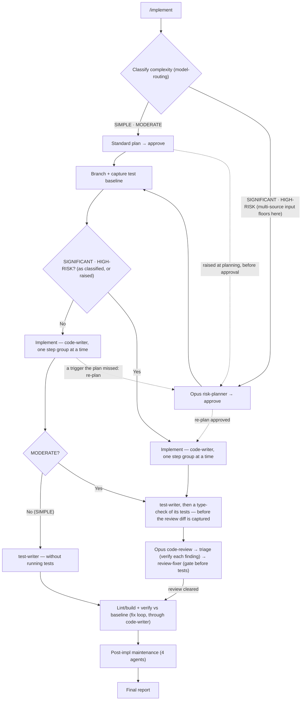

# /implement

Classifies a task's risk, creates a branch, plans the change and has a coding subagent implement it, writes tests, runs an Opus code review on all but `SIMPLE` work, and performs post-session maintenance.

## Who runs it

`/implement` runs in the [dev](../roles-and-phases.md#dev--build-verify-and-deliver) role, cost-attribution phase [implementation](../roles-and-phases.md#implementation) — being in this phase means code is actually being written, tested, and reviewed.

## Synopsis

```
/implement <ADDRESS> | <prompt> [@file…] [@spec-folder] [@repo…] [--no-commit] [--skip-costs] [--skip-feedback] [--enforce-model=<model>]
```

What you type after the command selects one of two modes: **keyed** when a positional address is present — a `<KEY>`, or an `@<path>` naming a folder in the specs tree — and **direct** otherwise (free-text or `@file`). A keyed run resolves its address the same way the companion plugin's `/docs-workflows:document` does.

`/implement` implements **one Epic per run**. When the resolved item already names a focus Epic (a bare Epic key — the folder's `EPIC-` prefix sets the altitude, never the kind it asserts, and a legacy folder with no prefix is placed by what it holds; no second positional is accepted), that Epic is the scope. A BRD container holds no Epic to implement and stops the run (`IMPLEMENT_BRD_NOT_SLICED`), naming each of its slices instead or, where it has none, `/product-workflows:brd-split` to carve one. That stop, and the folder read below, are taken only after the specs-repo preflight has settled the specs checkout's branch and the branch check (*What it needs*) has stopped a run on a plugin branch the default branch has moved past under the address's top-level folder, so a stale plugin branch cannot hide a slice, an Epic or its artifacts — save a newer block of `implementation.md`, a session file that check passes over, which a branch behind the default branch can still hide from the picker, showing an Epic as not started. On a run that found `$SPECS_PATH` misplaced, the preflight switches no branch and names a stale one it stays on, and the branch check stops on that one too. When the PRD is bare, a cheap folder read classifies it (on a multi-component PRD the flat-specification cases below never arise — see *Multi-component PRDs*): a PRD with exactly one Epic sets that Epic as the scope automatically, unless the PRD folder also holds a flat `specification.md` — a broad PRD-level slice, which `/design` designs as one unit — in which case it asks which of the two to implement, with no recommendation; a PRD with two or more Epics renders a **progress-aware picker** — each row showing the Epic's own artifacts (`specification.md` but no `design.md` → ○ not started; `design.md` present but no block in `implementation.md` → ◐ in progress, selectable and where the default cursor lands, since a merged design is exactly what this command wants; an `implementation.md` holding at least one block (a file holding only its heading records nothing) → ● done, greyed and not default-selectable, and selecting it offers to implement again), plus, **on the same condition as the one-Epic case above — only where the PRD folder also holds a flat `specification.md`** — the explicit choice to implement one broad PRD-level slice instead, since without that file the slice is a unit nothing specified: with it, that choice counts against the prompt's four options, so the array names every Epic where three or fewer stand, and otherwise at most two and lets you type the key of any other; without it, the array names every Epic where four or fewer stand, and otherwise at most three and lets you type any other — the *Another Epic* option that asks for the key names under it every Epic the array leaves out — and the first Epic not yet done, in progress before not started, is marked recommended where the broad-slice choice is not offered, while beside that choice nothing is, as in the one-Epic case; a PRD with no Epics offers to split with `/product-workflows:epics` first, or to implement a broad PRD-level slice. Selecting an Epic scopes that run only — there is no "next Epic" loop, because code-writing is heavy and branchy enough that each run targets one Epic.

All three run flags apply to this command. `--skip-costs` (or `WORKFLOWS_SKIP_COSTS`) skips Phase 7's session-cost entry, still advancing the checkpoint and dropping any deferred cost record a [ceded](../reference/session-cost.md#ceded-runs) `/prompt-brainstorm` or `/prompt-grill-me` run left pending in this session — see [Session cost](../reference/session-cost.md). `--skip-feedback` (or `WORKFLOWS_SKIP_FEEDBACK`) narrows Phase 4's maintenance step to bugs-only, dispatching `defect-reporter` in place of Agent 4 (`impl-maintenance`) — see [Session feedback](../reference/session-feedback.md). `--enforce-model=<model>` (or `WORKFLOWS_ENFORCE_MODEL`) pins every dispatched agent in this run — `risk-planner` and `code-review` included, overriding their frontmatter Opus pin — to one model, bypassing the Opus and Sonnet fallback chains that otherwise select it, and the coding model `code-writer` and `review-fixer` otherwise run on — see [Model routing](../reference/model-routing.md). In direct mode, the free-text `<prompt>` is protected the same way: a run flag forms a leading run — mixed, in any order, with this command's own `--no-commit`, an address/key and any `@path` token — before the prompt begins, or a trailing run at the very end, which may carry `--no-commit` and `@path` tokens too; a run flag in either position is stripped, one written inside the prompt itself is kept as prompt text.

## How it runs

`/implement` has 20 `## Phase` headings. Rather than walk every one, the diagram below deliberately names none of them: it compresses the whole run into its three real decision points — and the dotted edges a change of class takes — instead of naming each phase.



`IN` covers Phase 0 through Phase 1.8 — the session-model gate (*Gates*, below), the look for a run that stopped in this worktree (*Resuming a stopped run*, below), loading and classifying the input, the Phase 0.5 readiness pre-flight, clarification (which, on a keyed run, first resolves the applicable ARD; then, on every run, settles the working tree and the branch — Phase 1.4, below — before it looks in the inputs, the code, the repository's own docs, `git log` and the ARD's rules, and asks only what would change the result), and, only when the input is multi-source, the Phase 1.6 floor at SIGNIFICANT and the Phase 1.7 fan-out scan it triggers. `BR` covers Pre-Phase 3 (branch creation, from wherever Phase 1.4 left you, or none where the run continues on the unit's own branch) and Pre-Phase 3.5 (test-baseline capture) together — the baseline is always captured after the branch is settled — cut, or continued — and before any file is edited, on either path. **Phase 1.4 is why the plan reads the tree it will change**: the clean-tree check and the branch question come before the run's first read of the code, so a stash, a switch to the unit's own branch and a fresh start's move onto the default branch are all made before the look, the scan, the exploration and the planner read anything — and where any of those moves would change a spec file the run has read from inside the repository, the run stops instead, naming the file; where the move was the switch to the unit's own branch or its fast-forward, switching to that branch yourself and re-running continues on it with no move. Every stop from there until the code is committed names any stash it made and the branch you stand on. `G` is not a new decision: it is the class as it stands, drawn where the two paths part — Phase 1.5's, as the multi-source floor or a down-classification accepted at plan approval left it, or raised before any file is written when Phase 2A's plan shows a classification trigger (such as more than 3–5 non-test files, authentication, a schema or migration, or a public contract — the dotted `P1` → `P2` edge); after a down-classification you accepted at plan approval, only a trigger a later revision adds raises it. A run that meets such a trigger while implementing, one its approved plan did not state (one of the concrete triggers the [classification policy](../reference/model-routing.md) lists, not its catch-all of unclear requirements, large unknowns or otherwise high blast radius, whose unknowns are asked about instead), re-plans upward: `risk-planner` plans the rest with the diff so far, and once you approve, the run continues on the review path without re-branching or re-capturing the baseline (the dotted `IMA` → `P2` → `IMB` edges); cancelling that re-plan commits the work (unless `--no-commit`), and any pull request the run opens is a draft. That happens once per run: once the run's one re-plan is spent — at a down-classification you accept there, or by a Revise after a blocked step — a later trigger is put to you instead, to continue at the run's current class (without the review on a `SIMPLE` run; with it, but no re-plan, on a `MODERATE` one) or to stop, which commits the work as cancelling the re-plan does. `IMA` is Phase 3A and `IMB` Phase 3B, each coding the approved plan through `code-writer` (*Who writes the code*, below); `M` is Phase 3A's step 6, where a `MODERATE` run takes the review path too, with no `risk-planner` dispatched for it; `TWA` is Phase 3.5's `test-writer` dispatch on a `SIMPLE` run, which runs no tests; `TWB` is Phase 3B's steps 4a and 4b, on a `MODERATE` run too: step 4a dispatches `test-writer` before the review diff is captured, and step 4b type-checks the tests it wrote, as *Gates* says. `RV` is Phase 3B's review-triage-fixer sequence, which therefore sees code and tests together. `TS` runs lint/build, the `test-baseliner` verify against the captured baseline, and the fix loop, whose every fix is a `code-writer` dispatch — after `RV` clears on the reviewed path. A recorded test skip still runs lint/build and is reported, as described under Gates below. `MT` is Phase 4's four maintenance agents. `RP` is the Phase 5 Final Report — folded into it is Phase 4.5 (a silent no-op unless the review escalated spec/design conformance notes onto a spec/design in the specs repository, a note written into this repository's own spec riding on the code commit instead; otherwise its handoff outcome line appears in the report's own `### Spec/design conformance` section), which runs between Phase 4 and `RP` and is not separately pictured. Two more phases sit in the same gap and are likewise not pictured: Phase 4.6, the code-repo handoff that commits the work and — behind a consent choice — pushes it and opens a pull request, and Phase 4.7, which appends this run's refs to `implementation.md` on a keyed run — in the folder of the unit it implemented: the Epic's, whether you named the Epic or the picker chose it, or the PRD folder's for a broad PRD-level slice. Two further terminal phases run after `RP`: Phase 6 (follow-up tasks, written into the same unit's folder as Phase 4.7's record) and Phase 7 (session cost, plus the terminal artifact commit).

Nine named subagents can be dispatched, eight on any one run: `workflows-core:code-scanner` (Phase 1.7, only when the input is multi-source — one `code-scanner` per repo, capped at 4 concurrent, plus a seeded round 2 for any theme round 1 left inconclusive), `risk-planner` (Phase 2B, `SIGNIFICANT`/`HIGH-RISK` only), `test-baseliner` (captured in Pre-Phase 3.5, verified again in Phase 3.5), `code-writer` (step 1 of Phase 3A or 3B, once per step group of the approved plan, and Phase 3.5, once per fix attempt), `test-writer` (Phase 3.5 on a `SIMPLE` run, or step 4a of Phase 3B before the review diff is captured, and once more at step 4b where the type-check finds errors in the tests it wrote), `code-review` (Phase 3B's review gate, which a `MODERATE` run passes too — a split review dispatching it once per touched piece and once overall, as *Gates* says), `review-fixer` (Phase 3B, only on a `BLOCK` or `PASS WITH RECOMMENDATIONS` verdict), and `workflows-core:impl-maintenance` (Phase 4) — `workflows-core:defect-reporter` in its place under `--skip-feedback`. `code-writer` and `review-fixer` run on the run's coding model (*Who writes the code*, below); `risk-planner` and `code-review` keep their frontmatter Opus pin regardless of classification; the others run on the Sonnet fallback chain; `--enforce-model` overrides every one of them. Beyond those, general-purpose agents are dispatched too: a read-only codebase-exploration subagent at Phase 2A (none where a down-classification you accepted at Phase 2B sent the run there, its exploration being already written) and at Phase 2B only where no exploration this run made (Phase 1.7's, Phase 2A's or an earlier pass of Phase 2B's own) has written the codebase summary, on the same Sonnet chain; and Phase 4 dispatches three general-purpose agents (a documentation review, a knowledge-base review, and an instructions review) alongside `impl-maintenance` — all four in a single message, independent of each other.

### Who writes the code

The orchestrator — the session you run the command in — writes no source code in Phase 3A, 3B or 3.5: `code-writer` writes it. The approved plan is coded one step group at a time, in plan order — consecutive steps join one group until the next would take it past five files, each counted once, or past ten steps; a step that names no file joins the group of the next step that names one, or, where none follows, the group before it, and one that alone names more than five files is a group of its own; every plan's steps name the files they touch — the next group dispatched only once the one before it is done; every Phase 3.5 fix attempt is a `code-writer` dispatch too, and `review-fixer` applies the review's fixes. A helper two or more steps need is a step of its own in the plan, and each dispatch reuses a helper an earlier one wrote rather than copying it — where reuse needs a change outside its own steps' files, it writes its own and names the copy, which the review is told about. What the orchestrator still does there itself is mechanical: a plan's `git bisect` step, run first from the clean tree; a security scan's patch applied; a `[DEBUG-xxxx]` probe stripped before the review diff; the diffs captured; a conformance note written onto a spec; the type-check of the tests before the review; and Phase 3.5's lint, build and project install scripts, which it runs.

`code-writer` and `review-fixer` run on the run's coding model, which the class decides: `SIMPLE` work is coded on the session's own model; from `MODERATE` up, on the session's model where that is an Opus, Fable or Mythos model, and otherwise on the first available model of the Opus [fallback chain](../reference/model-routing.md#the-fallback-chain) — so a Sonnet session's `MODERATE` code is written on Opus wherever one is reachable. `--enforce-model` overrides both. A class change mid-run — a raise, or a down-classification you accept — moves every later dispatch to the new class's model; code already written stays as it is.

`code-writer` runs no lint, build, type-check or test in your working tree, at any class — every check but one runs in Phase 3.5, the lint and the build by the orchestrator itself and the tests through `test-baseliner`, and reviewed work reaches Phase 3.5 only after its review; the one is the type-check of the tests `test-writer` wrote, which the orchestrator runs before the review and which runs none of them (*Gates*). It does run the repository's own install, code-generation or formatting command where a plan step names one: an install with no dependency's install-time code, leaving to the orchestrator each of the project's own install scripts the plugin runs beside a build; a formatter only on the paths its step changed, where the command takes paths. One that cannot be limited so runs only where the tree held no uncommitted work of yours before the run began and no file a check changed was left out of the commit, every file it touches listed `formatter-only` where the step changed nothing else in it, so the review sees them; otherwise it is not run at all, the report naming it for you to run. On a bug fix it runs the repro, the build the repro needs and its probes only in a scratch checkout of the code as it was, never in your working tree — and it never runs a test the run itself wrote, in any tree, since that test is part of the unreviewed change: a step that runs one is left to the orchestrator, which runs it after the review, as described under *Gates*. It never asks you anything and writes no git state: it returns one of four statuses, which the orchestrator acts on.

- **`done`** — the group is coded, and the next is dispatched.
- **`needs_decision`** — a question nothing the run can read settles, whose answer you would notice in the result: the orchestrator asks it, with `code-writer`'s own options, and dispatches the rest of the group with your answer, which the Opus review of a reviewed run is then handed as your ruling, so the choice is not reported as a departure from the plan.
- **`trigger`** — on a `SIMPLE` or `MODERATE` run, a classification trigger the approved plan did not state: the run re-plans upward, once per run, as described above.
- **`blocked`** — a step cannot be coded as the plan writes it, because something the plan names is not so — a file, function, route, field or interface the tree does not hold, or holds otherwise — or an install it names fails, or, on a bug fix, the repro a step names does not go red on the code as it was (run up to ten times where the plan records a reproduction rate below 100%, and never a block where you chose to proceed without a repro). The run says what blocked and what is already coded, and asks whether to **Revise the plan** — you are then asked what to change — or to **Stop here**, the work so far committed through Phase 4.6 (left uncommitted under `--no-commit`, which the question says). Revising is the run's one re-plan: on `SIGNIFICANT` or `HIGH-RISK` work `risk-planner` re-plans with what blocked; on `SIMPLE` or `MODERATE` work the plan is revised and its class re-tested — a classification trigger the revised plan shows raises the class and hands the re-plan to `risk-planner` — and is put to you for approval again. Where the run's one re-plan is already spent, it stops without asking, the work committed as on **Stop here**; where `code-writer` could not read an input the run handed it, the run stops, since that is a defect of the command and not of the plan.

A return the run cannot read is retried once with the same request; a second is treated as `blocked`.

### The run-state file

`/implement` keeps every fact a later phase, a stop or the final report reads in one file, so that a compaction of the session loses none of it, the list of specs-repository files the run has read among them, which its specs-repository handoff takes. The file is `$(git rev-parse --git-path dev-workflows/implement-run.json)` in the code repository — inside its git directory, one per worktree and never staged, so no diff or commit carries it. Phase 1.4 opens by creating it from the facts the run holds by then, every other key taking the default `scripts/run-state.py` gives it — a slip in what the run hands the script is corrected and the call made once more. Where a file an earlier run left is there and this run did not resume it — you answered *Start fresh*, or an earlier release of `/implement` wrote it — the script first moves that file aside, as `implement-run.json.stale-<UTC stamp>`, carrying none of it into the new file, and deletes that run's durable copies (*Resuming a stopped run*, below); at most one such file is kept, nothing reads it, and the report's *Assumptions & limitations* names it. On a resume Phase 1.4 creates no file: the run has already taken the earlier run's file over. Every fact is written into it the moment the run learns it, through that script, which refuses a key the file does not hold, and a whole list handed to it as one entry to add to a list, and replaces the file whole on every write; every phase from Phase 1.5 to Phase 7 opens by reading it, and acts on what it holds rather than on what the session remembers — the plan you are asked to approve and each review's return are written to temp files it names before the question or the triage, so a compaction while either waits loses neither. The file, the temp files it names and their durable copies are removed once — as the run's last action before its terminal specs-repo commit, or by a stop once its message is out, which keeps a file it named as unreadable for you to look at. Where the run cannot reach the file at all, it stops, naming the error, and leaves the work uncommitted: the commit keeps your own uncommitted files out by what that file records, so the stop names every changed file, yours and the run's alike, for you to sort. Where another session has taken the file over — another `/implement` resumed the run, or this conversation's session id changed, as `/clear` changes it — the run stops at its next write to the file, committing and removing nothing, since that session now holds the file and the tree; `/implement` run again in this worktree offers to resume the run. Run one `/implement` at a time in a working tree: two runs there already collide on its files, and on this one.

### Resuming a stopped run

A run that dies part-way — its session crashed, killed or lost — leaves its run-state file behind. The next `/implement` in the same worktree looks for one straight after the session-model gate and the check that it runs inside a work tree, and before it resolves any address, so that a run it resumes takes its address from the file rather than from what you typed. Where there is none, it says nothing.

**What is proven first.** *Resume* is offered only where the code repository can be shown to hold that run's work as the run last recorded it. The run records the tree — each uncommitted path with a fingerprint of its content, and the commit HEAD stands on — before and after every action that can change it: each coding, test-writing, fixing or maintenance dispatch, each check, each patch applied, each probe stripped and conformance note written, each bisect and the commit among them. The resuming run tests the last of those records, by the first of these that applies:

- **A `git bisect` still running** — the run cannot be resumed until you end it with `git bisect reset`, which the question names.
- **HEAD** — it must stand on the run's branch, at the commit the run recorded, or one commit on where the run made its own commit and died before recording it. Otherwise the question names the branch and commit the run recorded and those HEAD stands on now, and the run cannot be resumed.
- **A record that proves nothing** — a snapshot whose copy has gone, or, once the run had edited the tree, no snapshot at all — means the run cannot be resumed either. Before its first edit, a run with no snapshot yet is resumable: what is dirty then is recorded as yours, as on any run.
- **The tree** — a snapshot taken now is compared with the last one recorded. Where no path differs, the run is resumable. Where the run had made no edit yet, what differs is yours, and the resumed run records it so. Where the run's own commit landed unrecorded, it is resumable only where that commit holds exactly the paths that differ, each as the record saw it. Where an agent, a patch, a probe strip or a note was under way, the paths that differ are listed — each that was dirty before the run marked as yours, since kept as the run's it is committed whole, your earlier changes in it included — and *Resume* is offered only as your saying they are that action's partial work. Where a check may have died part-way — a lint, build, type-check, verify or repro run after the first edit, or a bisect — they are listed the same way, and *Resume* is offered as your saying they are the check's output. Any other difference — the tree changed after the run's last record — means the run cannot be resumed.

Where the earlier run had lifted its session files in session-branch mode, the tree comparison waits until the resumed run has run the specs-repo preflight and lifted them again; paths it leaves to you to attribute are asked about then, and a tree it cannot prove stops the run, saying `/implement` run again offers *Start fresh*.

The question also names what you typed, where it differs from the earlier run — any prose or `@` token, a key that is not the run's, or a `--no-commit` the earlier run did not have — since a resume reads none of it, and recommends *Start fresh* there; a stash the run made that is no longer in the stash list, where *Resume* is then not recommended; and, where the file's session is not this session, or either cannot be named, that the earlier run may still be running in another terminal, and that resuming takes its state over, so that run stops at its next write, committing nothing. Where the run was stopping when it died, the question gives the reason, and says a resume ends the run as that stop.

**The answers.** The question names the phase and step the run stopped at, its session and last write, the unit, its class and branch, how many step groups were coded, and the last review's round and verdict, a commit, a push and a stash where there are any.

- ***Resume it at &lt;phase&gt; step &lt;step&gt;*** — recommended where the tree is proven, nothing you typed differs and the stash is still there.
- ***Start fresh — leave its work where it stands*** — nothing of the earlier run is resumed or undone. The run prints what that run left — its branch and the commits on it the remote's base branch lacks, the files it changed, its stash and whether the stash list still holds it, session files it had lifted, a bisect still running — and goes on with what you typed, as a run that found no file does; it prints the list again before the dirty-tree question, so you answer that question knowing whose edits are whose.
- ***Cancel*** — stops before the specs-repo preflight, leaving the earlier run's file, branch, stash and tree as they stand, so the next `/implement` offers the run again.

Where the tree is not proven, only *Start fresh* and *Cancel* are offered. Where the paths that differ are yours to attribute, *Resume* names whose they are and no answer is recommended, save *Start fresh* where what you typed differs. A run-state file that does not parse offers *Start fresh* and *Cancel*, naming the error.

**A run from an earlier release.** A run-state file written by a release of `/implement` before this one holds no tree record and no durable copy, so it cannot be resumed: the run says so and starts fresh, asking nothing, and moves that file aside when it creates its own.

**How a resume goes on.** The address, the unit and its folder, the specs in scope and `--no-commit` are the earlier run's; of what you type, only `--skip-costs`, `--skip-feedback` and `--enforce-model` are read, and they replace the earlier run's. On a keyed run it resolves the earlier run's address again, stopping where the unit's folder has been moved or renamed since; then it runs the specs-repo preflight. It then compares the environment the earlier run recorded — `$SPECS_PATH`'s real path, the specs repository's `origin` URL and the install the shared references load from — with the one it runs in now, and on a difference asks whether to go on in the current environment, recommended unless the `origin` differs, or to stop. The branch check, the in-scope specs gate and the lineage check run again, save that a spec the earlier run wrote a conformance note into passes the gate where its note stands exactly as written and the default branch's copy of that spec has not changed since, and stops, naming the spec, where either has; and the model routing is resolved again for this session's model. The run then takes the file over, reading it once more first to check that nothing changed it meanwhile. A check that may have died is settled next: each file it may have touched is put to you, the question saying that any of them may be your own edit made since, and none is kept in the commit unless you say so. Then the run enters the phase and step it stopped in:

- a question whose answer the file holds is not asked again, and every other question the step reaches is, since its earlier answer ended with the session that heard it;
- a step group whose report came back is not coded again, a review whose return landed is neither dispatched nor triaged again, and a commit the earlier run made is adopted as this run's rather than made twice, the push and pull-request question asked again, since no answer to it is kept;
- a coding, test-writing or fixing agent sent again, or one of Phase 4's documentation, knowledge-base and instructions reviews, is told that an earlier attempt may have partly done its work, so it reads each file as it stands and completes the work rather than writing it twice; `impl-maintenance`, or `defect-reporter` in its place, edits nothing and is told nothing;
- a run that died while stopping resumes as that stop.

The Final Report's *Assumptions & limitations* names each earlier session the run resumed, whose cost this run's cost entry does not include.

**Durable copies.** As the run records each temp file a resume needs — the task description, the plan, the codebase summary, the test baseline, each coding and test-writing report, each review's return and the tree snapshots among them — it has the script copy it into a directory beside the run-state file, `implement-run.d`. A resume that finds a temp file gone, as after a reboot clears the temp directory, reads its copy instead, and one with no copy is taken again where its step needs it. The end-of-run removal deletes the directory with the file.

**A stated limit.** A stop that runs no Phase 4.6 and dies before its end-of-run removal leaves the run-state file naming the phase the stop was made in, so the next `/implement` offers to resume the run there, even after a *Cancel*; answering *Start fresh* then has the stop's effect, nothing of that run resumed or committed.

### Multi-component PRDs

On a keyed run for an Epic carrying a `target:`, Phase 1 checks that the target is in this repository, on any PRD. Every keyed run first reads back the open follow-ups addressed to this repository and this unit — a change a run of the unit in another repository found this one needs — from the unit's `follow-ups.md` as checked out and as on the specs repo's default branch, prints them, and adds their changes to the description. A follow-up `/security-workflows:scan` wrote names its finding's patch by a path in the specs repository: the run reads the patch there — or its copy on the specs repo's default branch, where the checkout lacks it — and hands it to the planner as the fix's starting point — never the fix as given: the run reads each patch against the unit's specification, ARD and design before it plans, and a patch that falls short of one is a question it asks or settles there, as the plan then checks it like any other change. Before any other edit, on the branch it settled, it checks each task's patch with `git apply --check`, in task order, applying each that still applies before it checks the next: where one does, that fix starts by applying it and goes on through the run's own tests and review; where one does not — the code moved since the scan, or an earlier patch changed the lines it touches — or the patch could not be read, the run says so in its report's *Assumptions & limitations* and derives that fix afresh from the finding. A copy it read from the default branch into a temporary file is removed once its patch is applied or refused. Wherever the run names a security finding other than the one its own task carries — in the plan, the review, the report, the pull request or a follow-up — it names it with its status in the repository's findings register: a false positive with who decided it and the evidence, an accepted risk with its owner and review date, and one the register does not hold, or a register it cannot read, as such. It never writes a follow-up asking to fix a finding the register rules a false positive or an accepted risk; where its review disputes that ruling, the report says so, and who can decide it again, by what the register records. A decision still awaiting security review, or an accepted risk past its review date, is one `/security-workflows:scan`'s `--triage` lists, and the report names that run — given the unit's key only where the finding was raised for the unit, since a keyed `--triage` lists no other, and otherwise this repository's path. A confirmed accepted risk comes back to `--triage` only after its review date, which the report gives with its owner; and no mode lists a confirmed false positive again — only a later scan's possibly-same finding that a person matches to it reopens one — so the report names who decided it, to raise the dispute with. A keyed run whose only work is those follow-ups — it carries no prose or spec file of its own, and a run of the unit from this repository is already recorded — scans the code for the follow-ups' changes alone, still reading the unit's folder as their context. A task a PRD run of `/conformance` ruled out is not one of them: where the PRD's `_conformance.md`, as checked out or on the default branch, carries its exact line as `withdraws:`, the run prints it as overruled or withdrawn and builds none of it — the ruling may predate the line's arrival from a Dev's branch or a session branch. Run from a repository other than the Epic's target, a run that finds one recommends a **companion run**: it implements only those changes, since the Epic's own change is already in its target's repository, so it does not scan for, plan or review against the Epic's requirements, and its pull request names the change it completes; the next step tells you to tick each task a run answered — a companion run's, or any whose changes joined a run's description — once its change merges. A follow-up that names a repository its run was not given — save one named for the Epic's target — may name this one under another name, so the run prints those too and asks, recommending nothing where a printed name is a known repository's or this repository is itself one of the PRD's components. With no such follow-up it recommends stopping and running the Epic in its target's repository. Either question also offers to implement the whole Epic here anyway. On a PRD with two or more code components it also checks that the ARD's `## Contracts`, the PRD-level specification, and the Epic's own specification and design are on the specs repo's default branch; that the Epic carries a target from the PRD's set; and that its `## Contract` agrees with the ARD — every new or changed interface it consumes is produced by some Epic, every one it produces is its target's, every `[AD#N]` it cites is an interface, and it depends on each producer of what it consumes. A gap asks whether to stop and run the missing step first (recommended) or to continue, and continuing names the gap under the pull request's *Merge danger*. Addressed by its PRD, a multi-component PRD's flat specification is offered as a slice to implement only where the PRD has no Epic yet, and then not as the recommended choice.

## What it needs

- **The resolved input itself** — classified in Phase 0: free-text prose plus any `@path` tokens, each classified by inspection, with a key or specs folder resolved against `$SPECS_PATH` through `resolve-address`. A key that resolves to no folder stops the run, offering to re-enter it or cancel — it never falls through to a direct-prompt run. A key given while `$SPECS_PATH` is unset stops before it is resolved, naming the variable and offering to set it or cancel, since there is no tree to find it in; an `@<path>` address names its folder directly and runs without the variable. Run it from inside the repository it is to change: it changes the repository it is run from, and started outside every git work tree it stops straight after reading its run flags — before it resolves an address, touches the specs repository or asks which Epic — showing git's error where git gave one. Run from inside the specs repository itself — the repository whose top level `$SPECS_PATH` is — a run given a key or a specs folder stops once the address resolves, before it touches the specs repository, telling you to run it from the code repository; a direct run there goes on, with one line saying it branches and changes the specs repository, its session files included, which are committed on that branch and go out only when it is pushed: with the code at the push choice for those its commit takes, and when you push the branch for the rest; a run that stops before it cuts its branch commits them on the branch it then stands on, the default branch after a fresh start, which the run's closing commit pushes — or, where the preflight had to stay on a plugin branch it would have left, on the default branch, landed without moving your checkout; typed while another command's run in this session is open on the branch your checkout stands on, it otherwise commits them there and does not push them while that run stays open. Where the specs repository's default branch takes no push, they go to your session branch instead, never onto the run's branch. The directory you run it from lies in that code repository and is never read as a spec folder itself, so a `prompt.md` or `*-design.md` file in it is read only when you name it: by file, or, below the repository's top level, by naming the directory (`@.`), which is then classified like any other `@path` — a folder holding those files is read as a spec folder. An `@path` at a repository's top level is read as a code repository, with a notice where it also holds `prompt.md` or `*-design.md` files (name those by file to read them). A path that does not exist, or a directory or file of no recognized kind, is named as each input is classified, and an unreadable file stops the run, both before the specs-repo preflight. A direct run with no description — no prose, and no spec file or spec folder named — stops there too, listing the forms a description takes (a key among them) and any `prompt.md` or `*-design.md` file in the directory you ran it from. If the primary description is a design doc (`/design`'s output) carrying unresolved open questions, `/implement` refuses to proceed by default — a design must be decision-complete before implementation; overriding is logged in the Final Report. A `specification.md`-level open question is exempt: it is the spec's own — one the design phase answers, or one it leaves open for the specification's owner with its proposal written under it — and a design may legitimately carry a spec that still has some.
- **Specs, for keyed runs.** When Phase 0's address resolution finds no `specs` at all, `/implement` prompts for one rather than planning blind. Direct-mode runs are exempt — the prompt or spec file supplied is the instruction.
- **A specs checkout not behind for the unit, on keyed runs.** Once the address resolves and the specs-repo preflight has run, a keyed run checks the branch your specs checkout stands on, once the folder is placed — so a BRD container or a folder nothing places is refused first — and before it is read. Where it is a plugin branch the default branch has moved past under the address's top-level folder in `specifications/` — the PRD folder, or the `BRD-` folder above a slice — a document there added, changed or removed since that branch was cut, session files such as `implementation.md` aside, the run stops, naming the paths and what to do — switch the specs checkout to its default branch and re-run. A direct run resolves no folder and skips this.
- **Any in-scope `specification.md`/`design.md`, gated on `$SPECS_PATH`'s main** (Phase 0). An *unmerged* one (an open pull request, not yet on main) is a hard stop, naming `$SPECS_PATH` explicitly since `/implement` stands in a code repo, not the specs repo. An **absent** one is not a stop at all — the run behaves exactly as it would with no such gate (on a multi-component PRD, Phase 1 asks about a missing Epic specification or design, offering to continue — see *Multi-component PRDs*), and a direct-prompt run, which resolves no in-scope spec, is unaffected either way. This is the reverse of `/design`'s `specification.md`, which stops on absence (see the [`/design`](design.md) page).
- **A current chain under them, or your say-so** (Phase 0, keyed runs). Once the in-scope `specification.md` and `design.md` pass the gate, the run checks their lineage up the chain — the PRD, ARDs and Epic they were built from and, above the PRD, its idea or, on the BRD route, the decision register, the grounding and the slice inventory. Where one moved since, or carries no lineage record yet, it shows what moved and asks whether to revise the highest stale document first or proceed; *proceed* is recorded in the block this run writes to the unit's `implementation.md`, so a later run does not ask again about the same version.
- **The multi-source rule** (Phase 1.6): more than one distinct code repo (counted by top level, so an `@path` whose top level is already counted adds none), or any folder input (a specs folder or a spec/design folder), floors classification at `SIGNIFICANT` — overridable at plan approval — and triggers the Phase 1.7 fan-out scan in place of the single Explore subagent. The run changes code only in the repository you run it from: every other code repository it is given is read-only context, and the changes one of them needs become one follow-up for that repository — shared with any other whose `origin` URL ends in the same name: a task Phase 6 files on a keyed run that finishes (a direct run lists it in its report), named in the stop message on one that stops after plan approval. Where the plan changes no file in this repository at all, the run asks, in place of plan approval, whether to revise the plan or stop with nothing written, naming the run each other repository needs. **A referenced directory that is missing, or that is neither a recognized folder type nor a git repo, is always surfaced to the user immediately and never silently skipped** — the run asks whether to continue without it or stop.
- **An optional ARD** (resolved at the start of Phase 1's clarification, which reads its rules; Phase 1.8, keyed runs only) — where none applies — or one exists only in your working tree or on a branch of your own, never handed off — the run skips it; where one sits on an unmerged branch the commands cut, or your checkout's copy of a merged one differs from the default branch's, it stops, naming `$SPECS_PATH` explicitly; where a merged one applies, it carries its invariants as implementation guardrails, passed to `code-review` as the applicable ARD on every reviewed run — `MODERATE` and up (guidance only on `SIMPLE`, which has no review gate) — with every `ARD deviation:` line the run has recorded, so the review reads a recorded departure from a Rule as recorded rather than blocking on it.
- **A clean working tree**, or explicit consent to stash or proceed dirty, before the run first reads the code (Phase 1.4), ahead of the feature branch Pre-Phase 3 creates or the unit's own it continues on (on a dirty tree, a file of yours the run then changes is committed whole, your earlier changes with it; a stash sets aside your tracked changes except in the specs the run reads — its spec files, and any specs folder inside the repository — which it names, and leaves your untracked files where they are) — never implemented directly on the default branch. A run that stashed names the stash wherever it ends: in the stop's own message, or in the `Code repo:` line, under `--no-commit` too; a stop also names the branch you stand on, since the run may have switched it before planning. Just before the baseline the run reads the tree again, and a file that turned dirty while the plan was reviewed — one you edited — is treated as yours (a file the planner's repro wrote was put to you when the repro ran, below), kept out of the run's commit unless the run then changes it, and named in the report; a file of yours that was dirty already is taken as it stands then, so an edit you made to it while the plan was reviewed stays out of the commit too.

## What it produces

Code changes on a feature branch — a fresh one, named per the target repo's own documented convention, or `<prefix>/<key>-<slug>` as the fallback, or the unit's own, where the run continues on it (below) — **committed** in Phase 4.6 without asking, then pushed and opened as a pull request behind a three-option consent choice (push + PR recommended, push only, or neither). The one question before the commit is a possible secret: the lines it adds are scanned first, and where the scan finds a token, key or password it cannot dismiss as a placeholder, it shows you where — never the value — and asks whether to stop and leave the work uncommitted so you can remove it, or commit it as not secret. The commit subject ends with `[<key>]` — the key of the unit the run implemented, which the branch name carries too: the Epic's wherever it implements an Epic, even one the picker or the one-Epic path chose under a PRD address, and the PRD's for a broad PRD-level slice — and carries a `Work-Item:` trailer where that unit's folder has one, which is what lets `/document` and `/release-notes` find the work later. A run whose review or tests did not clear is committed like any other, and still *offered* for push and pull request under the same consent choice — a failed gate never downgrades what you are offered. What changes is the pull request itself: where one is opened it is a draft whose body leads with a DO-NOT-MERGE line naming the blocking fact, and where the push updates one already open — after either push answer, wherever `gh` can find it — the run turns that one back into a draft and posts that line on it as a comment. `--no-commit` skips the phase entirely and leaves everything in the working tree.

**Continuing on the unit's own branch.** Before it first reads the code, a keyed run in a repository whose default branch it can resolve fetches the remote's refs, and the branch the latest block of the unit's `implementation.md` records for this repository by name, so a single-branch clone sees it too — where a fetch fails or times out, it says so and reads them as last fetched — and looks that branch up. Where the remote no longer has the branch, the run removes a tracking ref still standing for it, as a pruning fetch would, and says so. In a shallow clone it warns that a merged branch may read as open, and it never deepens the clone; where it could not compare the branch's tip with the default branch, it says the merge state rests on ancestry and the commit subject alone, and where a conflict was all a pushed local branch whose remote copy is gone could show, it says that, the merge state resting on the commit subject alone. Where that branch's pull request has not merged and you stand on it, carrying commits the default branch lacks, the run asks whether to **Continue on this branch** (recommended), to branch from where you stand, to branch from the default branch, or to cancel, the question naming the branch and saying the work joins its open pull request. Where you stand anywhere else — the branch being a local one, or only the remote's — and you have no uncommitted changes to tracked files (untracked files do not count), it asks the same with **Switch and continue** first — on the default branch without the option to branch from where you stand, which would be the same fresh start. With uncommitted changes to tracked files it does not offer the switch: it says why, and asks whether to stop so you can commit or stash first (recommended) or to cut a fresh branch here — one without the unit's commits, whose pull request would be a second one. Before either question it asks the host, where `gh` can, whether the branch has an open pull request, and where it has none the question says so instead: continuing commits on the branch, and the run then offers to open one. A local copy behind the remote's is fast-forwarded first, and the run says so. Continuing cuts no branch: a push updates the branch's pull request where one is open, and the run's record names the same branch. A follow-up for an Epic whose pull request is open (a security fix from `/security-workflows:scan`, or any other) joins that pull request instead of opening a second one. Where that pull request has already merged and you still stand on its branch, the run recommends a fresh start from the default branch instead, since a branch cut from where you stand would carry the merged commits into a second pull request. Where the branch has gone on since the merge, the usual question stays (below), recommending to branch from where you stand — which keeps the work added since — where every commit you stand on carries the unit's key; the run says first that such a branch also carries the merged commits.

**Where you stand, and a fresh start.** Where you stand anywhere but the default branch, carrying commits it lacks, and no question about the unit's own branch takes its place, the run lists those commits and asks whether to branch from where you stand, to branch from the default branch — a fresh start — or to cancel. A direct run recommends branching from where you stand. A keyed run recommends it only where every listed commit's subject ends with the unit's own `[<key>]`, the commit convention the run itself writes; where any does not — another unit's work, say, or a commit made by hand — or the commits could not be read, it recommends the fresh start, naming the commits that lack the key, since a branch cut from them would carry that work into this unit's pull request. A fresh start fetches nothing and never moves your local default branch. Where your local copy is strictly behind the remote's, holding nothing the remote's lacks — as the clone last fetched it, which a keyed run has just refreshed — the run puts HEAD on the remote's commit, detached, and cuts its branch from there, so the code is written against the current base; it does the same, without asking, where you already stand on that local copy, or on a branch or commit that holds nothing of its own and is behind the remote's default, such as an old merged branch; and a stop before the branch is cut names that detached commit. Where your local copy holds commits the remote's lacks, the run starts from your local copy, and the report's *Branch* section says how many commits it is ahead of the remote's and behind it — as it does in the specs repository itself where your local copy is only behind, since a detached HEAD there could leave the run's session-file commit on no branch.

Four Phase 4 maintenance outputs, always collected together: a documentation update (or an explicit "no update required"), knowledge-base entries (one per lesson, each titled by its own lesson), an instructions (`CLAUDE.md`) update, and an `impl-maintenance` Lessons Learned report. On a reviewed run — `MODERATE` and up — with a spec/design in scope, save a companion run (*Multi-component PRDs*, above), unresolved `missing`/`contradicts` findings from `code-review`'s conformance dimension are escalated as open-question notes written back onto the source `specification.md`/`design.md` where it lies in the specs repository or this one, a spec anywhere else having its gap reported instead (Phase 3B step 7.5), committed with the code where it lies in this repository (Phase 4.6), and, where it lies in the specs repository, handed off behind a consent choice onto its main branch (Phase 4.5), save on a direct run from inside the specs repository, where that repository is this one and the note is committed with the code — on a run that finishes; one that stops after the review names any such note in its stop message, uncommitted in the specs repository unless that repository is the one the run changes, where the stop commits it with the code — Phase 4.5 being a silent no-op when nothing was escalated into the specs repository, which covers every `SIMPLE` run and every run with no spec/design in scope.

A structured Phase 5 Final Report (classification, branch, files changed, review verdict and triage, spec/design conformance, deferred items, next step); Phase 6 follow-up tasks for any qualifying manual or out-of-scope items; and Phase 7's session-cost entry plus the terminal commit of `$SPECS_PATH`'s bounded session-artifact paths — never the code repo this run just changed. A run that stops, a *Cancel* or a *Stop* answer included, produces no report, no follow-ups and no resume pointer, and runs no session maintenance; one that stops after editing on its branch first runs Phase 4.6, committing the work, save under `--no-commit`, where the run-state file cannot be reached, or where another session has taken it over; and every such stop still writes the session-cost entry and ends with the terminal commit of the specs repository and its `Specs repo:` line. Where `SPECS_PATH` is unset or misplaced, the cost entry stays in the run's printed output and nothing is committed.

## Gates

**The session-model gate comes first.** Straight after the run flags are stripped and the rules its question follows are loaded — before the run reads an address, the specs repository or any code, and on every run whatever its class — `/implement` checks the model the session runs on. Its orchestration — the classification, the routing of every dispatch, the review gate and the phase order — runs on that model, which nothing inside a running command can change, and a session below Opus has been seen to classify its way past the review gate. On an Opus, Fable or Mythos session it says nothing. On any other it asks whether to stop and relaunch on Opus with `claude --model opus` (recommended) — which stops with nothing written and nothing switched — or to go on anyway on the session's model, recorded in the final report's `### Assumptions & limitations` and under the pull request's *Merge danger*. Where no Opus model is reachable there is nothing to relaunch onto: the choice is to proceed on the Sonnet floor, recorded the same way, or cancel. Under `--enforce-model` nothing is asked, as no Opus-session gate in the family fires under it ([Model routing](../reference/model-routing.md#enforcing-one-model)).

Pre-Phase 3.5 captures a test baseline **before any source file is edited**, on both the `SIMPLE`/`MODERATE` and `SIGNIFICANT`/`HIGH-RISK` paths. On `MODERATE`, `SIGNIFICANT` and `HIGH-RISK` work, the Opus `code-review` runs **before** tests, never after — Phase 3B's, which Phase 3A's review gate runs on `MODERATE` work, dispatching no `risk-planner` for it; `SIMPLE` work is not reviewed — and the plugin's invariant is that tests never run on reviewed work until the review returns a non-`BLOCK` verdict, or you settle a `BLOCK` that no surviving `BLOCKER` supports. On `SIGNIFICANT` or `HIGH-RISK` bug work that holds for the diagnosis too: the planner's repro for the run's first plan, before the run starts editing, runs on your working tree — where a lockfile git tracks (npm's, pnpm's or yarn's) has no dependencies installed beside it, the run first asks whether to install them — those missing, and no others, exactly as the lockfile pins them, running no dependency's install-time code, and stopping before it plans where the install changed a tracked file — or to plan without them, the planner then told a repro that needs them cannot run; from the first edit until the review nothing runs against the working tree — no check (a lint, a build, a type-check or a test), save the type-check of the tests described below, and no repro or probe; a command that writes the change rather than checks it, as an install, a code generation or a formatting does, is none of these, and the review sees what it wrote — and a probe or the repro runs only in a scratch checkout of the code as it was, outside the repository and removed whatever it exits with — the coding subagent runs every probe and every repro a plan step calls for there, from its first dispatch on, save a repro that runs a test the run itself wrote, which waits for the review, and the planner runs a re-plan's repro there, whether or not the run has edited yet — and a bisect, which moves `HEAD`, runs first, before any edit; and the repro's re-run and the new regression test's check that it fails on the code before the fix both wait for the review, a check that fails on anything but the bug's assertion being reported as inconclusive, the run's verify being the check that it passes. On `SIMPLE` and `MODERATE` bug work no planner runs, so there is no planner's repro: the coding subagent runs the plan's repro steps, and every probe a plan step places, in the scratch checkout of `HEAD`, and a repro step that does not go red there is `blocked`, as *Who writes the code* says. A step that runs a test the run itself wrote, or re-runs the repro against the change, it leaves to the orchestrator, which runs it in Phase 3.5, after the review on `MODERATE` work: one that expects a test the run wrote to fail as the red-capability check, the test copied into a scratch checkout of the code as it was, where it must fail as the step expects — at every class of bug work — and any other with the verify, where it is a test of a suite the baseline holds, and beside the lint and the build otherwise. On work that is not a bug fix, such a step's test is run as any other is, expected to pass, and the report says once that its failure before the change was not confirmed. Before the review, on a reviewed run where `test-writer` wrote tests, the orchestrator type-checks them, so the review does not spend its findings on tests that do not compile: it runs the type-checker your repository configures for them, directly — `tsc --noEmit` on your spec configuration where you have one, `vue-tsc`, `pyright`, `mypy` or `go vet` — and never a build tool, a project script or a checker set to load a plugin, so it runs none of the tests and none of your repository's own code, and Java, Kotlin, C# or Rust tests get no such check; where the tool allows, it writes nothing into your tree. An error in a file `test-writer` wrote sends those tests back to `test-writer` once, to fix; any other error, and any that round leaves, is reviewed as the code stands, and the type-check runs again with the lint and the build after the review, where a failure the code before the change reports too, at the same file with the same message, is named and not fixed, as a lint failure is. Between the review and `review-fixer`, the orchestrator runs its own finding triage — each finding verified at the location it names and kept, marked unverified (recorded with what would settle it) or dismissed (with a reason that disposes of that finding's own claim); `review-fixer` is handed **survivors only**, and unverified and dismissed findings never reach it. `review-fixer` fixes `BLOCKER`, `MAJOR` and `MINOR` findings whose fix lies in this repository, on a `BLOCK` and a `PASS WITH RECOMMENDATIONS` alike (one whose fix lies in another code repository is recorded as a follow-up instead, and a `BLOCKER` among them stops the run as a review that stayed blocked); a `NIT` you do not apply (below), a note asking an architect or a PM for a decision rather than a code change, and a finding `review-fixer` itself defers are listed in the report's *Deferred items* and the pull request; a `BLOCK` verdict gets one re-review after the fix cycle, and a `PASS WITH RECOMMENDATIONS` whose findings `review-fixer` fixed offers you that same one re-review before tests run; the re-review is triaged too, carrying forward what triage already ruled, and a review that stayed blocked — a `BLOCKER` surviving that triage, or a verdict you chose to keep — stops the run rather than looping; a second `BLOCK` that no surviving `BLOCKER` supports is yours to settle, and so is a first `BLOCK` that leaves `review-fixer` nothing to take — only `NIT`s, notes for an architect or a PM, or another repository's findings — which dispatches no fixer and runs no re-review on that account: settled as not a `BLOCK`, it goes on as any review that is not one does, so the offer below follows, and where you apply its `NIT`s, the one re-review is offered after that pass. A first `PASS WITH RECOMMENDATIONS` that triage leaves with no survivor at all — every finding dismissed or marked unverified, or none returned — is yours to settle too, at the same prompt, rather than taken as a `PASS`. After the first review and after that one re-review, wherever the verdict is not `BLOCK` or you settled it as not one, the run offers once to apply what the review left open whose fix is only an edit — after the first review its `NIT`s, which then join `review-fixer`'s one pass, or make that pass where there would be none; after the re-review every such finding still open, which one more `review-fixer` pass applies, with no review after it and the tests running after it as always, the report and the pull request saying the verdict predates those edits. Where `review-fixer` defers a finding because the approved plan mandates what it objects to, the run asks at once whether the finding governs — the plan revised to it — or the fix is applied with the plan text kept, the departure logged in the report. It recommends revising the plan where every such finding contradicts only the plan's own text, and none of `design.md`, the specification and the applicable ARD; where one also contradicts any of them, it recommends nothing and the question names the passage and says why: either answer applies the fix, so the code departs from that document, which the run does not amend, and the answers differ only in whether the plan is revised to carry the departure. Where a fix breaks an ARD Rule, the question also says that the re-review, where it runs, will block on it unless the departure is recorded: *Apply the fix, keep the plan text* records it as an `ARD deviation:` line, which the re-review is handed, and *Revise the plan* records none. Either way `review-fixer` applies that fix, before the one re-review, which reads your ruling. A review of `SIGNIFICANT` or `HIGH-RISK` work that finds the change `SIMPLE` asks you to accept that instead; accepted, it counts as a pass and no later fix is reviewed again. A re-classification that names `MODERATE`, or that comes back from a `MODERATE` review, has nothing to accept, since `MODERATE` work is reviewed in full: the run asks for the full review once more without asking you, a second such return asks you only to re-run the full review or cancel, and a third stops the run.

**A review split by the design's pieces.** Where the in-scope `design.md` draws review pieces — its `## Pieces` section, which [`/design`](design.md) draws only where one reviewer could not review the whole change in depth and the change lies in one repository — and the change the first review sees touches the files of two or more of them, the review is split, on any run but a companion run. The run matches the change's paths against each piece's `Files:` with `scripts/pieces.py`, then dispatches one `code-review` per touched piece, in parallel, each reviewing that piece's files and tests in depth and checking its side of the contract the design fixes between the pieces, and, once they return, one overall review that reads them and reviews the whole change for what none of them can see: where the pieces meet, helpers duplicated across them, behaviour that spans them, and every file no piece names. The overall review alone traces the specification's requirements, so a requirement one piece implements never reads as missing from another's review. Triage runs once over all of their findings, verifying each on its own before any two are matched; the same finding made by two of them — one place, one claim — counts once where triage gave both the same disposition, and where it did not, each keeps its own; the verdict is the worst of theirs, the settle prompts and the offer to apply what they left open are asked once for the split review, and one `review-fixer` pass takes every survivor. The re-review re-runs the review of each piece whose diff the fix changed, a piece it first touched included, and of each piece whose review handed the fixer a finding, changed or not, then the overall review — or, chosen at the settle prompt where no fixer ran, every review of the first round. The review of the Phase 3.5 fixes is one review of the whole change, as on any run, and so is every review of a change that touches one piece's files or none. A `## Pieces` section the run cannot use — malformed, or unreadable — is reviewed as one piece: the run prints `design.md's ## Pieces unusable — <the defect, or the exit and its message> — reviewed as one piece`, records it under *Assumptions & limitations*, and asks nothing. The report's *Opus review* section lists each review of a split run with its round, scope and verdict, the overall review's scope with the number of files only it reviews in full.

On every reviewed run with a specification in scope, save a companion run, the review — each review within its own files where it is split — also asks, of each test the change adds or changes that is named after one of the specification's test cases or acceptance criteria, whether it would fail if the behaviour it names broke: a test whose assertions hold whatever the code does is a finding.

`test-writer` is **mandatory** for any code change; when no test framework is detected at all (no marker in `test-baseliner`'s [detection table](../reference/test-suite-detection.md) qualified and the repository declares no test command of its own in its CI configuration, contributing guide or README) — and equally when every suite the capture actually *ran* aborted with no counts it could parse, which is not the same as the detected set and not the same as failing to start — the run asks the user to specify a command or explicitly skip (logged in the Final Report) rather than silently proceeding without tests. A skip is scoped to what was asked: the lint, the build and the type-check of the tests still run, only the test verification and its fix loop are dropped. That question is asked at Pre-Phase 3.5, where a supplied command is re-run as a capture and still becomes a real baseline — after the edits there is nothing left to baseline, so the answer the run already has is applied rather than asked for again. A repository with several test suites is not that case — `test-baseliner` baselines every one of them that table covers and `test-writer` writes against each stack the diff touches, and a repository where one of those suites could not be run is baselined `PARTIAL`: the suites that ran are still verified, and the Final Report names the ones that were not. Every fix Phase 3.5 makes is a `code-writer` attempt on the coding model, never an edit of the orchestrator's own: an attempt is handed either every check that failed — the lint, the build and the rest together — or the verify's report, and the orchestrator runs the checks again after it, since `code-writer` runs none. A lint failure, or a failure of the type-check of the tests, is this run's unless the same command, run on a scratch checkout of the code as it was before the change, reports it at the same file with the same message: such a failure is named under *Assumptions & limitations* and goes to no attempt, nothing is asked about it, and it never makes the run's pull request a draft; a failing build is always this run's. The loop caps at two attempts in all, the lint and build attempts counted with the test ones, and a fix you direct after choosing to investigate further counts for nothing; failures still present after that are surfaced to you rather than looped on — investigate further, accept them with a reason, which the report records and which makes any pull request the run opens a draft, or cancel — and so is a test this run itself wrote that fails, which is a *new* failure rather than a regression, and so moves no status of its own. A verify that compared nothing is surfaced too, rather than read as a pass.

**Files a check writes are put to you before the run's commit can carry them.** A command run against your working tree writes into it as well as reading it — a crashed browser's core dump, a snapshot a test run refreshes, a build's output — so the run reads the tree with the plugin's own `tree-snapshot.py` script, fingerprinting each uncommitted file and naming each path exactly as git holds it just before and just after each such command — each check: on a bug, the planner's repro for the run's first plan, before the run starts editing (a re-plan's runs in a scratch checkout, outside your tree); each `test-baseliner` run (the baseline capture and every verify); the type-check of the tests before the review, and its second run after `test-writer`'s fix; each round of Phase 3.5's lint and build checks; a bug plan's bisect; and the repro's re-run after the review. `code-writer`'s own installs, code generation and formatting are no checks: what they write is part of the change. Files a check created or changed, tracked or not, are put to you before the run acts on its result, in at most two questions per check, each naming every file with what it was before: absent; clean in the last commit; set aside earlier — dirty before the run's first edit, or left out of the commit at an earlier check — and unchanged since; set aside earlier and changed since, which counts as the run's edit; or edited by the run. The files it created come in one question — leave them out of the commit (recommended), delete them, or commit them with the change. The files that existed before come in another — keep the run's changes in the commit, or leave them out — with no answer recommended and deleting never offered, and its text says what each answer does to each file: a file set aside earlier, changed since or not, is committed whole if kept, its earlier changes included — yours, or an earlier check's — and leaving out a file the run had edited leaves the run's own edits to it out too. A free-text answer can settle the files one by one; one that settles nothing is asked once more, then taken as the recommended answer, or, where none is recommended, as keeping the changes, and *Assumptions & limitations* names the default and the files it settled — kept that way, a file set aside earlier is committed whole, its earlier changes included. The planner's repro for the run's first plan runs before the run's last look at your tree before its first edit, and that look keeps everything dirty then out of the commit, so at that check the files it created can only be left out or deleted, and a file that existed before is left out unasked and named. A file left out stays in your working tree, uncommitted, and the report's *Assumptions & limitations* and the `Code repo:` line name it. A file a check put back as the last commit has it, or removed, is named — in the question where one is asked, otherwise on a line of its own — and in *Assumptions & limitations*, with no question about it. A read that fails twice stops the run, naming the error, rather than taking a tree it could not read for an unchanged one; before the run's first edit that stop commits nothing, and names each file an earlier check touched with your answer to it, a file you chose to commit with the change included — the run keeps every such answer in its run-state file, so a compaction loses none — and, where the read that failed was the one taken after a check, says that check may have left output the run could not read.

## Example

Implement one Epic from a multi-Epic PRD whose specification and design are already merged:

```
/dev-workflows:implement ACME-77-01
```

The run resolves `ACME-77-01` as the focus Epic, gates its in-scope `specification.md`/`design.md` on the specs repo's main branch, classifies the task (`SIGNIFICANT` by the multi-source floor, its resolved specs folder being a folder input), delegates planning to `risk-planner`, creates a feature branch, captures the test baseline, has `code-writer` code the plan one step group at a time — on the session's model where that is Opus, Fable or Mythos, else on the first available model of the Opus fallback chain — writes tests, runs the Opus code review and triage, verifies against the baseline, and closes with the four Phase 4 maintenance agents and the Final Report, whose next step comes before the Epic's pull request merges: `/dev-workflows:conformance ACME-77-01`, then `/security-workflows:scan ACME-77-01`, from the repository it branched, the PRD's remaining Epics after them. Once every Epic has merged, the PE's `/dev-workflows:conformance` on the PRD comes next, and `/docs-workflows:document` after it.

## See also

- [Workflow overview](../workflow.md) — where this command sits among the plugin's others.
- [`/conformance`](conformance.md) — the next step after an Epic: it checks the Epic against what its documents require, before its pull request merges, on its branch; once every Epic has merged, the PE runs it on the PRD.
- [Roles and phases](../roles-and-phases.md) — what the `dev` role owns, including how an unmerged in-scope spec/design stops the run while an absent one does not.
- [`/design`](design.md) — the upstream command whose merged `design.md` `/implement` gates on when it's in scope (a resolved `specification.md` with no `design.md` yet is gated the same way, independently).
- `/docs-workflows:document` — the downstream command, run once every Epic under the PRD has merged and the PE's `/dev-workflows:conformance` on the PRD has run; it ships in the companion `docs-workflows` plugin and is documented there.
- [Model routing](../reference/model-routing.md) — the classification rules, the multi-source floor, and the Opus fallback chain `risk-planner` and `code-review` resolve against, as `code-writer` and `review-fixer` do from `MODERATE` up on a session not already on Opus, Fable or Mythos.
- [Session cost](../reference/session-cost.md), [Session feedback](../reference/session-feedback.md), and [Follow-ups](../reference/follow-ups.md) — the terminal Phase 5–7 bookkeeping a finished run emits, of which a stopped one writes the cost entry alone.
- The `finding-triage` reference (shipped in `workflows-core`, listed on its References page) — the triage step run between `code-review` and `review-fixer`.
- The `ard-resolution` reference (shipped in `workflows-core`, listed on its References page) — how the optional ARD is resolved and inherited as implementation guardrails.
- The `document-lineage` reference (shipped in `workflows-core`, listed on its References page) — the upstream check run on the in-scope specification and design, and where a *proceed* is recorded.
