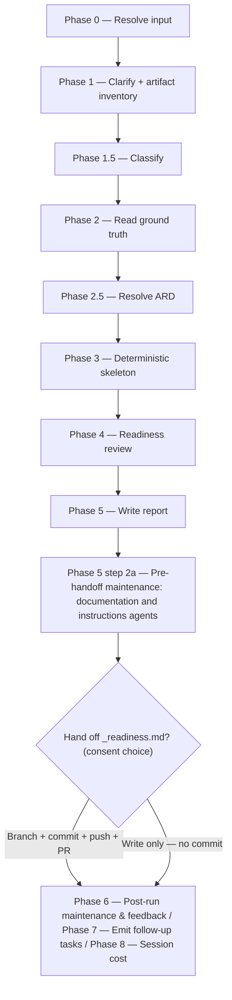

# /ready

Verifies whether the ARD, specification, and design artifacts on record actually justify a PRD or Epic's derived phase — read-only, and it never stops on an artifact it can't confirm. It also reads the record the PE's conformance check of the PRD leaves on the specs repo's default branch: once that record is settled, and no work implemented on the PRD is later than it, a PRD at *Implementation* reaches the optional *Delivery verified* stage. And it reads two drafts there, `/docs-workflows:document`'s pull-request draft and a release note `/docs-workflows:release-notes` drafted at the dev stage: once both are on the default branch, and no work implemented on the PRD is later than either, a PRD at *Implementation*, or at *Delivery verified*, reaches *Release Preparation*. "Later" is decided by the moment each record carries where both carry one, and by date otherwise (below).

## Who runs it

`/ready` runs in the [dev](../roles-and-phases.md#dev--build-verify-and-deliver) role, cost-attribution phase [readiness](../roles-and-phases.md#readiness) — being in this phase means the workflow phase is being derived from the ARD / spec / design record — the optional *Delivery verified* stage from the PRD's conformance record, and *Release Preparation* from the documentation and release-note drafts — never changed.

## Synopsis

```
/ready <ADDRESS> [--claimed "<status>"] [--skip-costs] [--skip-feedback] [--enforce-model=<model>]
```

**`--claimed "<status>"`** (optional) — a workflow phase you declare, typically pasted from whatever tracker you keep. The run compares it against the phase it derives from the artifacts and reports any divergence; a claim **above** the derived phase caps the verdict, a claim below is reported and does not. The value must name a stage of the ladder your address is judged on — the PRD's or the Epic's — and one that does not is asked for again with that ladder shown, never matched to the nearest stage. The PRD ladder's optional stage is accepted by either name, `Delivery verified` or `Delivery verified (optional)`, on a PRD address only; the Epic ladder has no such stage, so on an Epic address either name is asked for again. Every other stage is matched as the ladder writes it. The flag may come before or after the address: it is set aside with the status after it before the address is read.

**Without it, the run cannot catch a wrong claim** — a derived phase cannot contradict itself, so `/ready` reports what the artifacts show and nothing more. That is the cost of having no mirror to check against, and the flag is how anyone who does keep a tracker gets the check back, whichever tracker it is.

All three run flags apply to this command. `--skip-costs` (or `WORKFLOWS_SKIP_COSTS`) skips Phase 8's session-cost entry, still advancing the checkpoint and dropping any deferred cost record a [ceded](../reference/session-cost.md#ceded-runs) `/prompt-brainstorm` or `/prompt-grill-me` run left pending in this session — see [Session cost](../reference/session-cost.md). `--skip-feedback` (or `WORKFLOWS_SKIP_FEEDBACK`) narrows Phase 6's maintenance step to bugs-only, dispatching `defect-reporter` in place of Agent 4 (`impl-maintenance`) — see [Session feedback](../reference/session-feedback.md). `--enforce-model=<model>` (or `WORKFLOWS_ENFORCE_MODEL`) pins every dispatched agent in this run — `readiness-reviewer` included, overriding its frontmatter Opus pin — to one model, bypassing the Sonnet-floor fallback described below — see [Model routing](../reference/model-routing.md).

The command takes a **single positional address** — a `<KEY>`, or an `@<path>` naming a folder in the specs tree. The resolved folder decides the altitude and the ladder it is judged on — by its prefix, never by the kind it asserts, since a BRD-route slice is a `PRD-` folder asserting `kind: brd`. A BRD container is tested first: a `BRD-` folder, or a legacy unprefixed one holding `coverage-ledger.md` or `brd/brd-inventory.md` and no `brd-link.md` naming a `parent:`, is on neither ladder and stops the run (`READY_BRD_NOT_SLICED`), naming each of its slices to check instead or, where it has none, `/product-workflows:brd-split` to carve one. Otherwise an `EPIC-` folder is an Epic-level run on the Epic ladder and a `PRD-` folder a PRD-level one on the PRD ladder; a legacy unprefixed folder — including one whose key happens to begin with a kind token, which is not a prefix — is placed by what it holds: a resolved `kind: epic` on the Epic ladder, a resolved `kind: prd` or a `brd-link.md` naming a `parent:` on the PRD ladder. A second key is not accepted: it would always be derivable from the first. The container stop and the placement are taken only after the specs-repo preflight has settled the specs checkout's branch, so a stale plugin branch cannot hide a slice from the listing or the file that places the folder. On a run that found `$SPECS_PATH` misplaced, the preflight switches no branch; it names a stale one it stays on, and that branch can still hide either.

**A PRD folder holding a flat `specification.md` is a broad PRD-level slice beside its Epics** — the unit `/design` designs and [`/implement`](implement.md) implements as one, save on a multi-component PRD not built whole by the override (see *Multi-component PRDs*) — and a PRD-level run judges it as one more row of its per-Epic inventory rather than by a check of its own: its phase is derived on the Epic ladder from the PRD folder's own `specification.md`, `design.md` and `implementation.md`, the PRD's readiness needs it at `Refined` or past it as it needs every in-scope Epic, and the report names it `broad slice`. A block an earlier `/implement` run left in the PRD folder's `implementation.md` for an Epic it chose there counts toward the slice until you move it into that Epic's own `implementation.md` — only once `git show <commit>` in the repository the block names, read against the Epic's own `specification.md`, shows the work was that Epic's; a block you cannot attribute that way stays in the PRD folder. To move it, cut it from the PRD folder's file and append it to the Epic folder's, creating that file where the folder has none, under the heading `# Implementation — <key> <slug>` with the Epic folder's key and slug — a move, not a copy.

## How it runs

`/ready` has 11 `## Phase` headings. The diagram below collapses the deterministic, orchestrator-inline phases and shows the one real decision the run makes after it already has a verdict in hand: whether to commit and hand off the readiness snapshot.



Two named subagents are dispatched: `readiness-reviewer` (Phase 4, the sole judgment-heavy delegate — Opus, frontmatter-pinned, dispatched regardless of classification (unless `--enforce-model` overrides it)), and `workflows-core:impl-maintenance` (Phase 6, session lessons-learned). Three general-purpose agents run beside them on the same Sonnet chain: a documentation review and an instructions review in Phase 5 step 2a, before the handoff, and a knowledge-base review in Phase 6, beside `impl-maintenance`. `/ready` has **no delegated writer or implementation subagent** — Phase 3's coverage map, status-expectation checklist, and repo-availability check are built mechanically, orchestrator-inline, from Phase 2's folder read and Phase 1's artifact inventory. `impl-maintenance` and the three general-purpose agents run on the Sonnet fallback chain; `readiness-reviewer` keeps its frontmatter Opus pin regardless of classification (unless `--enforce-model` overrides it), falling to the Sonnet floor (recorded as a degradation) only when no Opus is available at all. Classification is typically `MODERATE` — bounded scope, a single PRD or Epic, read-only, no code changes — escalating to `SIGNIFICANT` only for an unusually large multi-Epic PRD whose coverage chain spans many Epics and repos.

### Multi-component PRDs

On a PRD with two or more code components, *Ready for Implementation* expects the ARD with `## Contracts`, the PRD-level specification, and a specification and design for every in-scope Epic — and no PRD-level design, because there the PRD-level specification is designed and implemented through its Epics; a PRD built whole by the 0-Epic override of `/design` or `/implement` is read as a single-component slice instead. The report adds a `Contract coverage` section: each Epic's target, and every new or changed interface a consumer uses that no Epic produces, a new or changed interface no Epic produces at all, one produced by an Epic that does not target its producer, an Epic citing an `[AD#N]` that is no interface, and a consumer that does not depend on its producer.

## What it needs

- **A PRD or Epic address** — with none, or with a token that is not a key — bare, behind its folder's kind prefix (`EPIC-<KEY>`), or as its folder's whole name — the run stops (`READY_NEEDS_KEY`); `/ready` has no direct-prompt behaviour. An address resolving to a `BRD-` container stops too (`READY_BRD_NOT_SLICED`). An Epic address whose folder is not one of its PRD folder's Epics is put to you (`READY_FOCUS_NOT_FOUND`): check the whole PRD instead, re-enter the Epic key, or cancel.
- **`$SPECS_PATH`** — must resolve; `/ready` reads the ARD/spec/design artifacts from there and writes `_readiness.md` back into the same feature folder. If unset, the run stops and asks for a path.
- **A clean specs-repo checkout on `main`/`master`** — `/ready` reads artifacts from a clean default branch, never a branch of its own; a dirty or non-main checkout triggers a warn-and-ask, naming each path that made it dirty, rather than a silent read, because it may show unmerged, in-flight artifacts as if they were the handed-off truth. Two kinds of change do not count as dirt: in session-branch mode — whether or not a session identity resolved — the session files, such as cost, feedback, `resume.md` and `implementation.md`, that the specs-repo preflight puts back over the checkout from your session branch on every run, or that stay in the checkout where no identity names a session branch; and `/ready`'s own `_readiness.md` in the folder it checks, which a declined handoff leaves uncommitted. `/ready` reads a session-branch `implementation.md` as the record, as every command in the mode does; neither kind is a document whose handoff the check guards, so the re-check passes on a checkout whose only changes are those. Once that is settled, the run checks the branch the checkout stands on. Where it is a plugin branch the default branch has moved past under the address's top-level folder in `specifications/` — the PRD folder, or the `BRD-` folder above a slice — a document there added, changed or removed since that branch was cut, session files aside, the run does not stop: it records that as a readiness finding naming the paths and what to run, capping the verdict at `PARTIAL`, and goes on reading the checkout — save after it has switched to its open `ready/` branch on your answer below, where a branch behind the default branch ends the run instead, since the switch took it off the clean checkout it settled. Where the `ready/` branch this run's handoff would reuse is open and has changed something under that folder, it asks first whether to switch to that branch and continue there, or stop until its pull request is merged, or closed and the branch deleted — and a stop there, or a switch git refuses, ends the run.
- **The gated ARD/spec/design themselves — `/ready` is the one command here whose gated inputs never stop it.** Every other command of this plugin that gates an artifact on the specs repo's default branch stops when that artifact resolves off it — save [`/design`](design.md) on a threat model beside the ARD, an optional input: it reads no model that is not merged, offers no threat review of it and says so in one line; and [`/conformance`](conformance.md) on the PRD's own ARD where it looks that ARD up only for the PRD folder's threat model, on a PRD with no Epic folder: it leaves the model unused, says so in one line and goes on. `/design`'s `specification.md`, and the `specification.md` and `design.md` of the unit a keyed [`/implement`](implement.md) builds, are the extreme case of that rule — this plugin's gated inputs whose absence stops a run rather than falling back, where the others stop only on being unmerged; the companion `product-workflows` commands whose gated input was never optional stop on absence too — `/epics` among them, on a PRD never written and, since 2026-11-15, on a `prd.md` in the folder that was never handed off — and so do its `/create-ard` and `/specify` on an idea-route PRD that was never written and, on either route, on a `prd.md` in the folder that was never handed off. `/ready` is the mirror opposite for every artifact it checks: an artifact authored only on a branch, or on `main` but unconfirmed, or unverifiable against any ref, becomes a readiness finding that caps the verdict at `PARTIAL`; an artifact that is absent outright is recorded as a coverage gap. A specification, a design or a whole Epic folder that reached `main` after the branch your checkout stands on was cut counts as present-but-unconfirmed rather than absent: the run looks for each on `main` as well as in your checkout, so a later merge is reported as the stale checkout it is, never as a gap. Reporting readiness is `/ready`'s whole function, so a run that stops instead of reporting has failed at the one thing it exists to do.
- **A current lineage, reported rather than asked about** (Phase 1). For each Epic, and for the PRD-level specification, the run checks the lineage of its specification and design up the chain — the Epic, ARDs and PRD they were built from, each threat model a design that holds a threat review was built from, and, above the PRD, its idea or, on the BRD route, the decision register, the grounding and the slice inventory. A link whose upstream has moved since is a ⚠ finding naming the document to revise and the command that revises it, and caps the verdict at `PARTIAL`; a link a document of the same Epic recorded accepting is shown as accepted and caps nothing; a document with no lineage record yet is a note. `/ready` never asks about any of it and writes nothing into those documents.
- **An optional ARD** (Phase 2.5) — where none applies, the ARD-conformance dimension is skipped entirely; where a merged one applies, its `[AD#N]` invariants go into the review; where one sits on an unmerged branch the commands cut, the same invariants are carried forward **and the run never stops**, adding an "ARD authored, not handed off" finding instead, while one only in your working tree or on a branch of your own counts as none; and a working copy that differs from the merged ARD — a declined refinement, or a hand edit — **never stops** either: it becomes an "ARD edited, not landed" finding capping the verdict at `PARTIAL`, and the ARD-conformance dimension is skipped until the edit lands. So does a branch of this run's own that still holds the ARD it was cut with, or none, after `main` changed or added it: an "ARD changed on `main`, not in this checkout" finding, the dimension skipped until you merge `main` into that branch.
- **The PRD's conformance record — optional, and read from the default branch alone** (Phase 1). On a PRD and an Epic address alike, the run reads the PRD folder's `_conformance.md` — the record the PE's [`/dev-workflows:conformance`](conformance.md) of the PRD writes, never an Epic's — from the specs repo's default branch, never from your checkout: a record only in your working copy, or only on an unmerged `conformance/` branch, has not landed and counts as none. It decides one thing, the PRD ladder's optional stage, *Delivery verified (optional)*, which follows *Implementation*. The record settles it only where all seven of these hold: it is a PRD run's record; its `Not traced:` and `Not shown merged:` lines are both there and both read `none`; nothing stands under its `## Unverified`; every entry is final or resolved, save an entry that only lists a Dev's entry from an Epic's record, without ruling on it, whose requirement was withdrawn or is gone from its document, since it then keeps the Dev's proposal for good; no *fix the code* entry is unresolved, save one whose requirement was withdrawn or is gone from its document; no work was implemented after it — no `/implement` block in the `implementation.md` of the PRD folder or of any of its Epics, in your checkout or on the default branch, is later than the record; and the record shows no open threat and no threats not traced on its `Threats:` line (the threat test, below). Current versions record a moment on a block and on the record, to the second in UTC: on a block, the moment `/implement` wrote it, and on the record, the moment its conformance run started. Where a block and the record both carry that moment, the moments decide, and an equal one is not later. Where either lacks a usable moment — one written by an older version, or by a run that had lost track of the moment it started; one whose moment is malformed or names an impossible time; a record whose moment is later than the moment this run started, or sits more than a day from its date, as on a conformance run that ran across days, or that carries more than one moment line; or an older block whose entries do not all carry the same one — the two are compared by their dates instead: then a block dated the record's own day does not count, since a date records no time of day, and writers in different time zones can put the two dates a day apart either way. A block's moment later than the moment this run started is still used: it can only make that block later, which asks for a new conformance run, where falling back to dates could miss work done later the same day. A `/ready` run that has lost track of the moment it started never reads the clock again in its place: it then uses neither the record's moment nor any draft's, and treats each as one with no moment — compared by date, or, for a `pr-draft.md` in a shallow clone, not dated at all — while blocks keep theirs. Each moment comes from its writer's own clock, so a clock running minutes off can misorder work done minutes apart. A conformance run writes the `Threats:` line only where it had a threat model or a design's threat review to trace, so a record with neither the line nor a `## Threats` section — the usual case, and every record written before threats were traced — passes the threat test, unlike the coverage lines, whose absence fails theirs. That test fails on a line that reads `not traced — update workflows-core` or counts any threat `open`, on a line the run cannot read, on a header carrying more than one such line, and on a `## Threats` section with no `Threats:` line, since a conformance run writes that section only beside the line, so the section alone means the line was lost: the run never guesses at the line. No other state of a threat holds the stage — unanswered, due for review or stale among them: only an open threat, code that does not carry its mitigation, is a fact about the delivery. A record written before those two coverage lines existed settles nothing until `/dev-workflows:conformance <PRD>` runs again, and neither does one older than work implemented since. Where the record settles it, a PRD the other stages place at *Implementation* is placed at *Delivery verified (optional)* instead. Every other PRD passes the stage over — never a straddle, never a finding, never a cap on the verdict — and keeps the phase the other stages give it. Where the record does not settle the stage, the run's `Delivery:` note says `not verified` and why, which is one of these: no default branch to read the record from — the specs folder is no git repository, or has none; no record on the default branch; a record whose text it could not read; or the first test above that failed (for work implemented since, naming the Epic or PRD and the date of the first later block it found, with that block's moment where it carries one; for the threat test, how many threats are open, or that they were not traced — update `workflows-core`, then run `/dev-workflows:conformance <PRD>` again — or that their line could not be read), followed, where entries are still open, by each of them as `<PRD>/[DD#n]`. Nothing here asks or stops.
- **The PRD's documentation and release-note drafts — optional, and read from the default branch alone** (Phase 1). On a PRD and an Epic address alike, the run looks in the PRD folder on the specs repo's default branch, never your checkout, for two drafts, both written by commands of the companion `docs-workflows` plugin: `pr-draft.md`, the pull-request draft a keyed `/docs-workflows:document` run for the PRD or one of its Epics writes once it commits its pages on a documentation-repository branch and does not cancel at its push prompt; and, in `release-notes.md`, a draft whose hidden scope comment carries the line `stage: dev`, which `/docs-workflows:release-notes` writes on a run once a specification or design exists for the PRD. A draft with no stage line, as older drafts have, counts for neither stage; a `/docs-workflows:release-notes <PRD>` run once a specification or design exists drafts one that does. Both on the default branch are what *Release Preparation* expects — documentation and a release note drafted, not published: the run reads no documentation repository, so it cannot tell whether either went out. Each draft is compared with every `/implement` block of the PRD and of its Epics — the blocks the conformance test's sixth condition reads, compared the same way: by the moment each carries where both carry one, and by date otherwise, a block dated the draft's own day then not counting against it. `pr-draft.md` ends with a hidden line giving the moment its `/document` run started; one without a usable line — written by an older version; with the line removed or not in its exact form; or with a moment that names an impossible time or is later than the moment this run started — is dated by the last commit that changed it on the default branch, and in a shallow clone of the specs repository it cannot be dated and does not count. A dev-stage draft is dated by the day it was appended, and its hidden scope comment also gives the moment its `/release-notes` run started, where a current version wrote it; a moment there that is malformed, names an impossible time, is later than the moment this run started, or stands on more than one line is not used, and that draft is compared by its day. The documentation counts only where no block is later than `pr-draft.md`, and the release note only where at least one dev-stage draft has no block later than it. So drafts that landed for one delivery stop counting once more work is implemented, until the two commands run again after it. A PRD the stages below place at *Implementation*, or at *Delivery verified (optional)*, is placed at *Release Preparation* once both are there and current, whether or not its conformance record settles the optional stage; one that falls short of an earlier stage stays at the lower stage, as with any stage. Where either draft is missing or has work implemented after it, the run's `Release preparation:` note says `not shown` and which — naming, for each that falls short, the draft (for the release note, its newest-dated dev-stage draft), the first block later than that draft in the order the run reads them, and the command to run again — or that there is no default branch to read them from. Nothing here asks or stops, and a missing draft is never a finding.
- **Mounted repos under `$REPOS_PATH`, best-effort presence only.** Phase 3(c) derives candidate repo names from each in-scope Epic's `target:` repository, the `repo:` entries of each in-scope Epic's `implementation.md`, and of the broad slice's, any `design.md`'s confirmed-repos header, and any ARD's `grounded_repos:` frontmatter, then checks which are mounted. This is informative context for the reviewer, never a hard gate — unlike `/design`'s Phase 3, `/ready` never dispatches `workflows-core:code-scanner` and never scans code.

## What it produces

A `SUPPORTED` / `PARTIAL` / `NOT-SUPPORTED` verdict with a requirement coverage roll-up (N/M requirements covered, each `❌` gap named — or `not assessed — PRD states no live requirements`, where the verdict is `NOT-SUPPORTED` because nothing was verified rather than because something failed) and the full `readiness-reviewer` Findings section, by dimension. `/ready` **authors nothing** in the PRD/Epic/ARD/spec/design sense — its only authored write is `_readiness.md`, overwritten on every run at the PRD dir (PRD-level check) or the Epic subdir (Epic-level check). Beside it, the Phase 5 step 2a maintenance agents may edit an existing documentation page or `CLAUDE.md` in the same folder, and an edit to a file that stood committed and clean before them rides `_readiness.md`'s handoff (below).

On a `SUPPORTED` verdict the report's next step names [`/implement`](implement.md) for the same address only where the unit it would build has its specification and design on the specs repo's default branch, as Phase 1 found them — on a PRD with Epic folders, only where a unit that run would offer holds both and no implementation record: `SUPPORTED` says the artifacts justify the stage they reach, not that both are there, and a keyed `/implement` stops without them. Otherwise it names what the first missing document needs — its landing where it is written and not merged; where it is written nowhere, the command that writes it, or, where the PRD is not on the default branch either, what the PRD needs first (a BRD-route slice needs none where it passes the slice's ledger tests, which `/product-workflows:specify` applies first): its landing, or `/product-workflows:create-prd`; on a BRD-route slice whose `brd-link.md` names no `parent:`, whatever its PRD's state, no command, saying that line is missing and to restore it or report it; on any other BRD-route slice that fails those tests, whatever its PRD's state, what the slice needs first instead (`/product-workflows:brd-split` in the form that applies, the slice's `coverage-ledger.md` reported by path with `/product-workflows:prd-ground`, which stops there by design, or no command, with the reason); on a multi-component PRD with no Epic folder, for a missing design, `/product-workflows:epics` first, with `/dev-workflows:design` answered *Design across components anyway* as the alternative, or that `/design` alone where `/epics` would stop on the PRD folder — and a ⚠ finding is named with its own remedy. `/ready` itself still stops on nothing.

Every run, at either altitude, also reports a `Delivery:` line beside the derived phase, in its report and in `_readiness.md`: `verified — <PRD>/_conformance.md (checked <the record's date>) on <default branch>`, or `not verified — <reason>`. It is a note `readiness-reviewer` is handed and never judges. Where the PRD is at *Implementation* or a later stage and its delivery is not verified, the report's next step adds the PE's `/dev-workflows:conformance <PRD>`, whatever the verdict: the run, once every Epic has merged, whose settled record verifies the delivery — a PRD at *Implementation* then reaches the optional stage, and one at *Release Preparation* stays there.

Beside the `Delivery:` line, every run reports a `Release preparation:` line, in its report and in `_readiness.md`: `shown — <PRD>/pr-draft.md and a dev-stage draft in <PRD>/release-notes.md, on <default branch>`, or `not shown — <reason>`, naming each draft missing from the default branch, or with work implemented after it, or that there is no default branch to read them from; where the release note is the one missing and `release-notes.md` there holds drafts with no stage line, it counts them and says that a run at the dev stage writes one that has it, which counts once its handoff merges. It is a note too, never a finding, and never lowers the verdict: documentation and release notes come after the readiness this command checks. Where the PRD is at *Implementation* or *Delivery verified*, the status-expectation checklist the reviewer is handed carries the line beneath that stage.

`_readiness.md` is committed and handed off only behind a consent choice — the **advisory** variant, whose second option says no command stops on this rather than promising a downstream stop, because nothing gates `_readiness.md` and `/implement` only reads it for a one-line advisory — creating `ready/<KEY>-<slug>`, never automatically. Declining leaves it uncommitted, and the step 2a agents' edits with it; the terminal `commit-artifacts` step stages only `$SPECS_PATH`'s bounded session-artifact paths and never `_readiness.md` or those edits. Phase 7 additionally emits one follow-up per named readiness gap on a `PARTIAL`/`NOT-SUPPORTED` verdict, plus a standing reminder to reconcile any status you keep elsewhere with the artifacts; a clean `SUPPORTED` run qualifies no follow-ups at all.

**Maintenance runs on both sides of the handoff**, as on `/product-workflows:epics`. Just before it, in Phase 5 step 2a, a documentation agent may update an existing page directly inside the checked folder — never `_readiness.md`, an Epic or any other artifact a command of the family writes — and an instructions agent that folder's existing `CLAUDE.md`. The run checks each path either returns against what that agent may edit, prints the edits it hands off above the consent choice, and hands them off with `_readiness.md`, in the same commit — or, where you decline, leaves them uncommitted with it; a path outside that set is named in the report as left uncommitted, and an edit the specs repository's top-level `CLAUDE.md` or your global `~/.claude/CLAUDE.md` needs is proposed in the report, never written. Both agents are told the checked folder by name, and that the session's working directory may be a code repository they never edit. An agent's own account of its edits is not taken on trust: the run reads the checked folder's uncommitted state, and that of the repository the session runs in where that is not the specs repository, before the agents run and again after, each read taken by the plugin's own `tree-snapshot.py` script, which names every path exactly as git holds it — one with a space or a non-ASCII character in its name included — and tells a file an agent created apart from one that stood committed and clean; where that script cannot read a tree, none of the agents' edits there is handed off, and the report says so. An edit to a file that already held uncommitted changes — yours, say — and a file an agent created are reported rather than handed off as the agent's; any change in the session's repository, and any in the checked folder that no agent reported, is reported too; nothing is reverted. After the handoff, in Phase 6, a knowledge-base agent writes only under `~/.claude/memory/`, proposing a project-specific entry rather than writing it, and `impl-maintenance` writes nothing.

## Gates

Phase 4 dispatches `readiness-reviewer` — Opus (unless `--enforce-model` overrides it), frontmatter-pinned, mandatory on every run regardless of classification — with the Phase 3 mechanical skeleton (coverage map, status-expectation checklist, repo availability, and on a multi-component PRD the targets and contract-coverage tables), the Phase 3(0) derived phase with the artifacts that placed it there, the `Delivery:` note, any `--claimed` value, and the Phase 2.5 applicable ARD when one resolved. No verdict is written or reported without it. The brief also states what the reviewer may read, never the PRD's conformance record, since the `Delivery:` note stands for it, nor its documentation and release-note drafts, since the status-expectation checklist stands for them, both having been read from the default branch: every artifact path it names and the rubric, every artifact the derived phase names, each in-scope `implementation.md` among them, and the `dev-workflows/` bookkeeping of the checked folder and of its PRD folder. It reads no file of a code repository outside the specs repository, and a fact only a code repository would show, or only a specs file outside its scope — a sibling Epic's specification, say — it reports as unverified, never as present or absent. `readiness-reviewer` is the plugin's **only reviewer that does joint cross-artifact analysis** — the reviewers that gate the artifacts it reads (`prd-reviewer`, `ard-reviewer`, `epic-reviewer`, `spec-reviewer`, `design-reviewer`), and this plugin's `code-review`, are each scoped to judging one artifact's own quality; several also read a companion artifact for traceability or non-contradiction (`design-reviewer` reads the source `specification.md`, `ard-reviewer` reads an inherited PRD-level ARD, `spec-reviewer` reads the applicable ARD, `epic-reviewer` reads sibling Epics), but none of them synthesizes a verdict across artifacts the way `readiness-reviewer` does.

Because `/ready` authors nothing, there is no fixer to dispatch and no `BLOCK`/re-review cycle — the gate's outcome *is* the verdict and its Findings section, not a pass/fail loop feeding a fix. A `⚠` artifact state (authored on a branch, unconfirmed on main, or unverifiable against any ref) is recorded as a `MAJOR`-or-worse finding for the reviewer's "Status consistency" dimension, but it never stops the run — it only caps how high the verdict can land. A stop the run does take — an address it cannot resolve, a `BRD-` container, a folder it cannot place or a PRD folder that resolves to several, a *Cancel* at the checkout warning or at `READY_FOCUS_NOT_FOUND`, a branch check that ends the run as described above, a reviewer run that returns no verdict — still writes the session-cost entry and ends with the terminal commit of the specs repository and its `Specs repo:` line, with no report, session maintenance, follow-ups or resume pointer; once the run has opened its run folder, its own message is followed by a `Run folder kept:` line (see [Stopping and resuming](#stopping-and-resuming)). Where `SPECS_PATH` is unset or misplaced, the cost entry stays in the run's printed output and nothing is committed.

## Example

Check whether an Epic is really ready to move into `Refined`:

```
/dev-workflows:ready ACME-77-01
```

The run resolves `ACME-77-01` with `resolve-address`; its folder's `EPIC-` prefix is what sets the altitude and the Epic ladder, so no second key is passed and none is accepted. It reads that Epic and the parent PRD's artifacts from the resolved tree, resolves any applicable ARD, locates the Epic's `specification.md`/`design.md` and checks each against the specs repo's default branch (never stopping on what it finds), builds the coverage map and status-expectation checklist, and dispatches `readiness-reviewer`. It prints the verdict with its coverage roll-up and Findings, writes `_readiness.md` into the Epic subdir, and offers to commit and hand it off — declining leaves the snapshot written but uncommitted.

## Stopping and resuming

A session can end in the middle of a run — a crash, a container restart, usage limits that stop you for hours. So the run keeps its working state in a **run folder**, which it opens in Phase 0 once the address is placed and `--claimed` is settled — after every refusal that does not depend on what the run itself writes, and before it checks your checkout — and running `/dev-workflows:ready <ADDRESS>` again on the same machine offers to continue it. The folder lies outside every repository and is readable by you alone, so nothing in it is ever committed; where it lives, and how to keep it across a container restart, is on `workflows-core`'s own environment page. It is named after this command, the key the address resolves to and the specs repository — by its `origin` — and not after the directory you start in, so a run started from another directory finds it. Where no folder can be made or written — a full disk, a directory you cannot write — the run prints one `NOTE:` line and goes on exactly as it would without one, and cannot then be resumed; a folder that stops being usable mid-run is met the same way.

**What a resume reuses.**

- **The reading.** At the end of Phase 3 the run writes down what it read and settled: the brief it hands `readiness-reviewer`, the git blob id of every file under the PRD folder and of the `workflow-states.md` rubric, and the report sections those phases decide. A resumed run that finds it reads the specs repository again for none of Phases 1 to 3, and skips Phase 0's checkout and branch checks with them. A reading is made for one `--claimed` value: resumed with another, the run reads afresh.
- **The review.** `readiness-reviewer`'s result is saved once the run has gone on with it, and reused while the brief it was given, the agent's instructions and its model are unchanged. A review that returned no verdict is never saved, so the run that resumes after that stop dispatches it again. The brief is the one an earlier session built, so a document edited since does not redo the review: the question below names each such file, and *Start over* reads them again.
- **The snapshot.** Once the review is in, the run composes `_readiness.md` and its report once and keeps them. A resumed run that finds them goes on from there — writing `_readiness.md`, the pre-handoff maintenance, the handoff and the end of the run — and reads and reviews nothing again, whatever `--claimed` you type then.
- **Side effects, each made once.** Writing `_readiness.md`, Phase 5 step 2a's maintenance, the handoff and the steps that end a finished run — maintenance and feedback, follow-ups, the cost entry and the resume pointer — are each recorded as made, and a resumed run skips those an earlier session finished. A handoff an earlier session began and never recorded as finished is made again on the branch that session made or found, so nothing is committed or opened twice. A step 2a cut off after its agents were dispatched is run again from the dispatch: its edits are checked against the checked folder as it stood before the first agents ran, so one an earlier dispatch made and no agent reports now is reported as such, and the agents are told an earlier session may already have made their edit. Phase 6's knowledge-base agent, run again after being cut off, may append an entry a second time, which its report line says. A cost entry an earlier session began and never recorded is not measured again, since that could count the same spend twice; a `NOTE:` says so.
- **Your handoff choice.** The consent choice of Phase 5 step 3 is recorded with what you were shown — the choice and the maintenance edits printed above it — and reused while it is shown the same, printing `Answer reused from earlier in this run — …`. Every other question is asked again by a session that reaches it. To answer the handoff choice again, start over.
- **What the run read once.** The moment the run started, the `Delivery:` and `Release preparation:` lines it read from the default branch, and the timestamp `_readiness.md` carries are taken by the first session that reads each and kept by every later one, so they do not move with the clock or the default branch.

**The question it asks.** On a start that finds this run unfinished, the run asks whether to resume it — recommended — or start over, showing when it started, when it was last written, the last phase it logged and how many agent results it holds, and also:

- where another session owns the run, that the session may still be running in another terminal or container, and that resuming takes it over;
- where the arguments you typed differ from those it ran with, both;
- where the snapshot stands, that resuming goes on from it, reuses the handoff choice it recorded and reads and reviews nothing again, so a `--claimed` given now changes nothing;
- otherwise, where the reading stands, that resuming goes on from it, naming each file under the PRD folder, and the rubric, that has changed since: the saved review stands as it was, and a review not saved yet reads those files as they now stand.

*Start over* deletes the folder, its saved result and recorded answer with it, and the run goes on as a new one.

**Changed instructions or models.** The saved review is also tied to `readiness-reviewer`'s own instructions and to the model it ran on, so a plugin update that changes that agent, or a session that resolves another model for it — `--enforce-model` among the ways — redoes it, with one line saying so; the run holds one saved result, so it never asks. A shared reference the reviewer reads while it works does not count.

**One session per run.** Resuming takes the run over, and so does *Start over*, whose new run stands at the same place: where Claude Code names each session, a session still running the run, in another terminal or container, stops with `READY_RUN_TAKEN_OVER` the next time it writes to the folder, writing nothing more. Where a session has no name from Claude Code, nothing tells the two apart, and neither stops.

**When it stops, and when it finishes.** A stop the run takes once its folder is open keeps the folder and prints, after its own message, `Run folder kept: <folder> — run /dev-workflows:ready <ADDRESS> again to resume.` — save `READY_RUN_TAKEN_OVER`, which writes nothing more. A stop before the folder opens — on the address, `$SPECS_PATH`, a run flag, a `BRD-` container or a folder the run cannot place — prints no such line. A stop's own cost entry and terminal commit are not recorded as made, so the session that resumes and finishes the run measures its own spend. A run that finishes removes its folder just before its terminal commit, or says in a `NOTE:` why it could not, in which case a later run removes it with the other old folders below; where another session took the run over at that point, it prints a `NOTE:` and ends there, with no terminal commit. A folder no session has written for 30 days is removed by the next run of any command that keeps one.

**Known limits.** On a resumed run the specs-repo preflight, which runs before the folder opens, may name this run's own uncommitted `_readiness.md` and maintenance edits in its dirty-tree notice — an advisory, which leaves them as they are. A change outside the PRD folder since the reading — a repository mounted or removed, an upstream document of the lineage check that lies outside it — is neither named nor read again; *Start over* reads it.

## See also

- [Workflow overview](../workflow.md) — where this command sits among the plugin's others.
- [Roles and phases](../roles-and-phases.md) — what the `dev` role owns, including the handover-model exception `/ready` gets: the one command here none of whose gates stops it, where every other command's own gate is fatal — `/design`'s on a threat model, and `/conformance`'s on the PRD's own ARD where it looks that ARD up only for a threat model, aside — and why verification is not a lane of its own.
- [`/design`](design.md) — the opposite extreme on the same gate: `/design` stops outright when its `specification.md` is absent — one of this plugin's gated inputs whose absence stops a run rather than falling back, beside the `specification.md` and `design.md` of the unit a keyed [`/implement`](implement.md) builds (the companion `product-workflows` commands whose gated input was never optional stop too — `/epics` among them, on a PRD never written and, since 2026-11-15, on a `prd.md` in the folder that was never handed off — and so do its `/create-ard` and `/specify` on an idea-route PRD that was never written and, on either route, on a `prd.md` in the folder that was never handed off), while `/ready` reads that same class of artifacts and never stops on any of them.
- `/product-workflows:create-ard` and `/product-workflows:specify` — the upstream commands, shipped in the companion `product-workflows` plugin, whose ARD and `specification.md` `/ready` verifies (via `design.md`, whose upstream is `/design`, in the same chain).
- [Model routing](../reference/model-routing.md) — the classification rules and the `readiness-reviewer` Opus pin, including its Sonnet-floor fallback.
- [Session cost](../reference/session-cost.md), [Session feedback](../reference/session-feedback.md), and [Follow-ups](../reference/follow-ups.md) — the terminal Phase 6–8 bookkeeping a finished run emits, of which a stopped one writes the cost entry alone.
- The `phase-handoff` and `ard-resolution` references (shipped in `workflows-core`, listed on its References page) — the gates `/ready` reads and records as findings rather than stopping on, `phase-handoff`'s branch check included — save that check's question about an open `ready/` branch, whose *Stop*, or a switch git refuses, ends the run as it ends any producer's.
- The `document-lineage` reference (shipped in `workflows-core`, listed on its References page) — the lineage check `/ready` reports on, by its never-ask form.
- The `run-folder` reference (shipped in `workflows-core`, listed on its References page) — the run folder this command keeps, which [Stopping and resuming](#stopping-and-resuming) describes; `workflows-core`'s own environment page says where it lives.
- [`workflow-states.md`](../../references/workflow-states.md) — the PRD and Epic status ladders, the PRD ladder's optional *Delivery verified* stage among them, expected-artifacts columns, and readiness targets `readiness-reviewer` applies.
- [`/conformance`](conformance.md) — the check whose PRD record, once settled, on the default branch, with no work implemented after it and no threat open or not traced, places a PRD at the optional *Delivery verified* stage.
