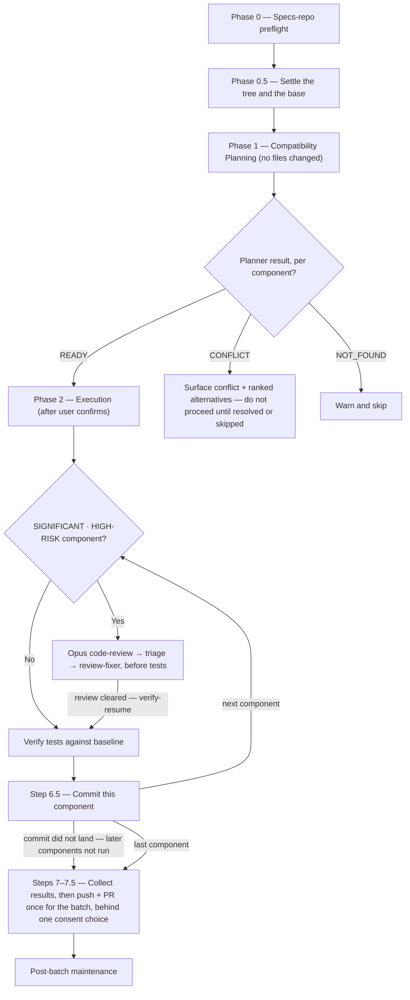

# /upgrade

Upgrades libraries, frameworks, runtimes, or build tools to specified or latest versions — planning compatibility for every requested component before touching a single file, then executing each one in turn.

## Who runs it

`/upgrade` runs **outside the PRD pipeline** — it has no cost-attribution phase and no role. It emits **no cost attribution at all**: it has no Product Requirements Document to attribute spend to, and the family's shared cost rules record that exemption by name rather than passing over it in silence. The `phase:` values it does pass to `upgrade-planner` and `upgrade-executor` — `full`, `verify-resume`, `regression-resume` — belong to a completely different vocabulary: the model-routing **resume protocol**, saying how much of a single component's own re-entered work must be redone after a review or a failed test, not where a run sits in the product lifecycle. The two vocabularies share the field name `phase` and nothing else — see [Roles and phases](../roles-and-phases.md#cost-attribution-phases) for the fuller distinction.

## Synopsis

```
/upgrade <component[:exact|:minor|:latest|:lts]> [<component…>] [--no-commit] [--skip-feedback] [--enforce-model=<model>] [--allow-install-scripts <name>[,<name>…]]
```

Each token is a bare `component` (highest version compatible with everything else already in the repo) or `component:1.2.3` (exact), `component:minor` (latest patch on the current minor), `component:latest` (latest stable), or `component:lts` (latest LTS, resolved from the technology's official release feed where it has one, otherwise from endoflife.date; asked of the user on lookup failure). A component can be a library, a framework, a language runtime, a build tool, or a path like `.github/workflows`. Multiple components upgrade in one run, planned together so cross-component conflicts surface before anything is written.

Two of the three run flags apply to this command — `--skip-costs` does not, since `/upgrade` emits no cost attribution at all (see [Who runs it](#who-runs-it) above). `--skip-feedback` (or `WORKFLOWS_SKIP_FEEDBACK`) narrows step 8's post-batch maintenance to bugs-only, dispatching `defect-reporter` in place of `impl-maintenance` — see [Session feedback](../reference/session-feedback.md). `--enforce-model=<model>` (or `WORKFLOWS_ENFORCE_MODEL`) pins every dispatched agent in this run — `risk-planner` and `code-review` included, overriding their frontmatter Opus pin, and reaching `upgrade-executor`'s own nested `test-baseliner` dispatch too — see [Model routing](../reference/model-routing.md).

## How it runs

`/upgrade` has 4 `## Phase` headings. The diagram below shows both real decisions the run makes — what a component's compatibility plan resolved to, and whether that component's classification gates tests behind an Opus review — and the loop that commits each component as its gates settle and pushes the batch once at the end.



**The run is safe to execute because planning and execution are two separate agents with a user confirmation gate between them.** Phase 1 dispatches `upgrade-planner` once per requested component, in parallel — it detects the component in the repo, resolves the requested target version, and verifies compatibility with every *other* component in the repo, **before anything is written to disk**. Only once every `READY` plan is confirmed by the user does Phase 2 begin: `upgrade-executor` then applies the approved plan for one component at a time, sequentially, to avoid conflicting edits to shared dependency files. For every component classified `SIGNIFICANT`/`HIGH-RISK`, Phase 1 additionally dispatches `risk-planner` (Opus, frontmatter-pinned) before execution to plan around blast radius, migration order, and rollback. `upgrade-planner`, `upgrade-executor` (on `SIMPLE`/`MODERATE`), and `test-baseliner` run on the Sonnet fallback chain; `risk-planner` and `code-review` keep their frontmatter Opus pins.

## What it needs

- **One or more component tokens**, each with an optional version-resolution suffix — see the Synopsis grammar above.
- **The target repo** — its build files, runtime version files, and CI YAML are inventoried against the plugin's bundled ecosystem table ([References](../reference/references.md)) to detect current versions.
- **`$SPECS_PATH`** — for the Phase 0 specs-repo preflight and the terminal artifact commit; this repo is never the one being upgraded, and the code repo is untouched by any specs-repo step.
- **A settled tree before anything is planned.** Phase 0.5 settles the tree and the base before Phase 1 reads a version: a dirty working tree is surfaced (stash, proceed, or cancel), and the run then moves onto the default branch where you are on it or hold no work of your own there, or asks where to branch from where you do — so every plan is made against the tree the upgrade is applied to. An executor that finds a file no longer pinning the version its plan names stops that component rather than editing it.
- **A confirmed plan before any file changes**, save the stash you chose at Phase 0.5. Phase 1 never modifies files, and Phase 2 never touches a file before the upgrade branch exists — a dirty tree is never upgraded over silently, and a file of yours the upgrade then changes is committed whole, your earlier changes with it. A run that stashed names the stash wherever it ends: in the stop's own message, or in the `Code repo:` line, under `--no-commit` too.

## What it produces

Upgraded component version(s) applied on a freshly created feature branch, **each component committed on its own** as soon as its gates settle (step 6.5; each commit's added lines are first scanned for secrets, and a hit is put to you; a commit that does not land, because a hook rejects it, git fails to stage or write it, or you stop it at the secret scan, ends the batch there, leaving that component's changes uncommitted, later components unrun and any pull request a draft) — so a batch that dies part-way still has the finished components committed on a branch that bisects — and the branch pushed once for the batch behind a three-option consent choice (push + PR recommended, push only, or neither) in step 7.5. `--no-commit` skips both steps and leaves everything in the working tree. Unless you branch from where you stand, or the run cannot resolve a default branch at all, the branch starts from the default branch as the remote has it: the run fetches the remote's refs once, and never moves your local default branch — where that is strictly behind the remote's, holding nothing the remote's lacks, outside the specs repository, the branch is cut from the remote's commit, HEAD detached there first, whether you chose to branch from the default branch or already stood on it — as it is, without asking, where you stand on a branch or commit holding nothing of its own that is behind the remote's default, such as an old merged branch; where it holds commits the remote's lacks, the branch is cut from your local copy and the Upgrade Summary says how far the two differ. A fetch that fails, or a read-only mount, is reported and does not stop the run.

No cost entry is ever written (see [Who runs it](#who-runs-it) above), and no `resume.md` is written for `/upgrade` — its durable state is already the branch on disk, not a PRD-scoped artifact, and a run cut short is continued from its run folder ([Stopping and resuming](#stopping-and-resuming)). The terminal `commit-artifacts` step still runs, committing only `$SPECS_PATH`'s bounded session-artifact paths — never the code repo `/upgrade` just changed. A run that stops, a *Cancel* or a declined plan included, ends with that terminal commit of the specs repository and its `Specs repo:` line too, with no session maintenance or feedback; once the run has opened its run folder, its own message is followed by a `Run folder kept:` line.

## Gates

Phase 2 prep captures **one** test baseline before any component executes, reused for the whole batch rather than re-captured per component. Where that capture cannot run at all, the run asks you once — supply a test command, upgrade unverified, or cancel — before the first component executes and while a baseline can still be taken; upgrading unverified finishes every component `TESTS_NOT_RUN`, so the batch's pull request is a draft carrying the DO-NOT-MERGE line. A repository that simply has no tests is not that case: the capture returns cleanly, nothing is asked, and no component is marked down. For each `SIGNIFICANT`/`HIGH-RISK` component, once `upgrade-executor` returns `AWAITING_REVIEW`, the Opus `code-review` gate runs **before any test verification** — the plugin's invariant that tests never run on risky work until review returns a non-`BLOCK` verdict, or you settle a `BLOCK` that no surviving `BLOCKER` supports. Between the review and any fixer dispatch, the orchestrator runs its own finding triage — each finding verified at the location it names and kept, marked unverified or dismissed, every unverified finding and every dismissal recorded with a reason; `review-fixer` is handed **survivors only**. A `BLOCK` or `PASS WITH RECOMMENDATIONS` verdict invokes `review-fixer` for the surviving `BLOCKER`/`MAJOR` findings, then one re-review against the refreshed diff; the re-review is triaged too, carrying forward what triage already ruled on that component, and a review that stayed blocked — a `BLOCKER` surviving that triage, or a verdict you chose to keep — stops work on that component rather than looping; a second `BLOCK` that no surviving `BLOCKER` supports is yours to settle, and a Cancel at that prompt also stops only that component while the run goes on. `SIMPLE`/`MODERATE` components skip this gate entirely and verify tests directly.

A regression the executor can fix itself — an import rename, an assertion's syntax — is fixed and verified again before the component is reported green; one that remains, or one it cannot fix, is a `TEST_REGRESSION`. A `TEST_REGRESSION` result on either path hands the decision to the orchestrator (never the executor, which cannot prompt): keep the upgrade and leave the failures for later, revert and skip the component, or investigate further — looping at the orchestrator until a decision is made. A revert — that choice, or a build the executor could not repair — puts your tracked and untracked files back as they stood just before that component, from a snapshot taken then, so your own uncommitted changes in a file the upgrade touched survive it, as does an earlier component's work under `--no-commit`. It also undoes an edit anybody else made to the repository while that component ran, and lists every path it put back below the results table, with the snapshot that brings any of them back. In a Node project it then puts `node_modules` back to the lockfile's versions too, installing them without their install scripts, and the summary names each package it put back unbuilt, with the command that builds it. A revert that could not put everything back says so, and any pull request it reaches is a draft. A `TESTS_NOT_RUN` result is the different case where the verify call compared nothing at all — a runner that could not start, not a test that failed — and nothing is reverted on it: the component is carried into the Upgrade Summary as unverified, and where the batch opens a pull request at all it is a draft carrying a DO-NOT-MERGE line. Whether one is opened is the consent choice's answer, and then whether `gh` can open one at all — a remote `gh` cannot target, a `gh` that is absent or not authenticated, or a pull request already open on the branch each end the run with none opened by it. A repository whose base branch cannot be resolved gets no pull request either way: one with an `origin` whose branch ladder is exhausted still reaches the push, subject to the same consent choice, while one with no `origin` at all has nothing to push and keeps the commits locally.

## Install scripts

`/upgrade` installs the new version of a dependency without the code that version ships to run at install time — an npm, yarn or pnpm package's install scripts, the build of a Python source distribution, or a Composer project's scripts and plugins — in a container and on a host alike. The run names each package it skipped, with the command that would run, in the summary, whatever the outcome; it never runs that code itself and never asks about it mid-run. When a component the run did not keep failed because one of those scripts was needed, rerun with `--allow-install-scripts <name>[,<name>…]` (`project:<hook>` for one of the project's own scripts): the run then installs as before and runs exactly the named packages' install code — except in a yarn berry project whose linker is not `node-modules` (Plug'n'Play is berry's default), where no command builds one package alone, so the run names `yarn rebuild` and everything it would build instead — and in a uv project, or for a Composer plugin, where it names the command that would run them for you to run by hand, since neither can be allowed for one package alone. Where the run kept an upgrade, the summary gives each entry's own command to run on its branch instead, since a rerun would upgrade it again. A package a revert, or a later install in the same run, put back without its build comes with the command that builds it — in such a yarn berry project, `yarn rebuild` and everything it would build — and the run names each one at its test-failure question too, since a later test may fail on it. A uv project installs with `--no-build`, and a Composer one with `--no-scripts --no-plugins`, its own `composer.json` scripts then run as the project's commands; each skipped package is named the same way. Bundler, Poetry, PDM and Hatch install as before, their install-time code included, and NuGet, Go, Cargo, Maven and Gradle run none. The rules are in [the references](../reference/references.md).

## Example

Upgrade a framework to its latest stable release and a runtime to its latest LTS in one run:

```
/dev-workflows:upgrade springboot:latest java:lts
```

`upgrade-planner` runs both components in parallel, resolving `springboot`'s highest stable release and `java`'s current LTS, and checking each against the other's plan for conflicts. Once both plans are confirmed, a feature branch is created, a single test baseline is captured, and Phase 2 executes `springboot` then `java` in sequence — `springboot`'s major bump typically routes through `risk-planner` and the Opus review gate before tests, `java`'s LTS bump may or may not, depending on the API-surface change `upgrade-planner` found. Each component is committed as its own gates settle — and the branch pushed once for the batch where you said so, the repository has an `origin`, and the push itself succeeded — and the run closes with the Upgrade Summary table, the `Code repo:` outcome line for the code repository, which is what says which of the three happened, the `workflows-core:impl-maintenance` report, and the `Specs repo:` outcome line for the bounded session-artifact commit.

## Stopping and resuming

A session can end in the middle of a run — a crash, a container restart, usage limits that stop you for hours — and a batch of upgrades, each planned, executed, reviewed and tested in turn, has a lot to lose. So the run keeps its working state in a **run folder**, which it opens right after the specs-repo preflight, before it settles your tree, and running the same `/dev-workflows:upgrade` command again in the same repository on the same machine offers to continue it. The folder lies outside every repository and is readable by you alone, so nothing in it is ever committed; where it lives, and how to keep it across a container restart, is on `workflows-core`'s own environment page. It is named after this command, the specs repository — by its `origin` — the root of the repository you upgrade, and the arguments you typed, so the same components in another order, or with other flags, are another run: where other unfinished runs of this command stand on the same repository with other arguments, the run lists them and offers to resume one — in the question below where this run is unfinished too, and otherwise in a question of its own, which recommends starting the new run. Where no folder can be made or written — a full disk, a directory you cannot write — the run prints one `NOTE:` line and goes on exactly as it would without one, and cannot then be resumed; a folder that stops being usable mid-run is met the same way.

**What a resume reuses.**

- **Your tree and the run's branch, as the run left them.** Settling the tree — the dirty-tree question and its stash — moving onto the base, and cutting the run's branch are each recorded as made, with what they left: the stash, the paths that were dirty before the run with their fingerprints, the base, the branch. A resumed run makes none of them again: it never stashes or asks about its own work as a dirty tree, and never cuts a second branch, however far it had gone — `--no-commit` work left between two components included.
- **The plan.** Once you approve the plan, a resumed run plans nothing again: it reads each component's plan, class and risk plan from the folder. The version a `latest` or `lts` component resolves to is read once, so a release published between two sessions does not change what the run upgrades to. Before you approve, a resumed run plans again, reusing each planner's and risk planner's saved result while the dispatch it would make is the same, and asks the planning questions again, save for an `lts` version you gave, which it keeps. A change you make to the code between two sessions before approving is planned for afresh, since each dispatch names the tree it reads.
- **The baseline.** The test baseline is saved with the tree it was captured on, and once a component has begun, a resumed run never captures it again: a capture then would measure the run's own edits. Your answer to a capture that could not run, and the test command you gave, are recorded.
- **Each component.** A component the run finished is skipped, its row read from the folder. One it was working on goes on from where it stopped: each finished executor or fixer pass is reused while the files it wrote still hold what the run left there, each saved review and its triage are reused, and your settle-prompt and regression answers are recorded with what you were shown and reused while it is shown the same, printing `Answer reused from earlier in this run — …`. An executor or fixer cut off mid-edit is never dispatched again over what it left: the run first puts the tree back as it stood before that component began — from the same snapshot a revert uses, so your own uncommitted changes from before then survive, while any edit made since the component began, between the sessions included, is reverted with its work — and does the component again from its start, listing the paths it put back below the results table with the snapshot that brings any of them back. Where the component cannot be put back — a commit made on the branch since, or a revert that could not finish — it asks whether to stop or to redo the component from the tree as it stands; redone that way, the component finishes unclean, and any pull request is a draft. Where a finished pass's files have changed since, not by the run, it asks whether to keep them, redo the component from its start, or stop.
- **Side effects, each made once.** Each component's commit, the push and pull request, and the maintenance and feedback that end a finished run are recorded as made, and a resumed run skips those an earlier session finished. One begun and never recorded as finished is made again without doing it twice: a commit that landed is found and not made again, a push of a branch already pushed moves nothing, and a pull request already open is found. Your push choice is recorded too, and asked again only on its own triggers.

**Your branch, and edits made between sessions.** Before a resumed run reads your tree again for its baseline or a component, it checks that you are still on its branch, and where you are not, it stops and tells you to switch back. Unless you passed `--no-commit`, once a session, before the first component it starts — or, where it starts none, before the push — it also checks that nothing uncommitted has appeared that its own commits did not leave: an edit you made between the two sessions, or output a test run left. It asks whether to leave those paths out of the run's commits (recommended), commit them with the run's work, or stop. Under `--no-commit` the earlier components' work is uncommitted by design, and the run commits nothing, so nothing is checked.

**The question it asks.** On a start that finds this run unfinished, the run asks whether to resume it — recommended — or start over, showing when it started, when it was last written, the last phase it logged and how many agent results it holds, and, where another session owns the run, that the session may still be running in another terminal or container and that resuming takes it over. *Start over* deletes the folder, its saved results and recorded answers with it, and the run goes on as a new one from your tree as it stands: a branch, commit or stash an earlier session made stays as it is.

**Changed instructions or models.** A saved result is also tied to its agent's own instructions and to the model it ran on. A resumed run counts the stale ones once it knows its models: ten or fewer are redone without asking, one line saying how many and why; more than ten, and it asks *Resume and redo them*, *Resume and keep them* or *Start over*, recommending none. It counts no result it will not use again — the plan's once you approved it, the baseline's once a component has begun, a review's once it was triaged, and every result of a finished component — and an executor or fixer pass is never redone because its instructions or model changed. Where the baseline it keeps so was captured under `test-baseliner` instructions or a model that have changed since, the summary says so on a `Baseline: kept …` line. The summary's `Resumed:` line says how many saved results were reused and how many dispatched, and a `Kept from earlier agent instructions or models:` line names each one kept.

**One session per run.** Resuming takes the run over, and so does *Start over*, whose new run stands at the same place: where Claude Code names each session, a session still running the run, in another terminal or container, stops with `UPGRADE_RUN_TAKEN_OVER` the next time it writes to the folder, writing nothing more. An agent that session had already dispatched may keep working until then. Where a session has no name from Claude Code, nothing tells the two apart, and neither stops.

**When it stops, and when it finishes.** A stop the run takes once its folder is open keeps the folder and prints, after its own message, `Run folder kept: <folder> — run /dev-workflows:upgrade <the arguments> again to resume.` — save `UPGRADE_RUN_TAKEN_OVER`, which writes nothing more. Where every component was not found, which resuming would only meet again, the line says so and names *Start over* instead. A run that finishes removes its folder just before its terminal commit, or says in a `NOTE:` why it could not, in which case a later run removes it with the other old folders below; where another session took the run over at that point, it prints a `NOTE:` and ends there, with no terminal commit. A folder no session has written for 30 days is removed by the next run of any command that keeps one.

**Known limits.** The check for edits made between sessions runs before a component starts, so a component the run was already working on when the session ended is not checked. An edit made between the sessions to a file none of its finished passes wrote — whether passes were still to be made, or none had been — is committed with that component as its own, as one made while the run was going would be; and where that component's commit had landed but was not yet recorded, the edit lands as a second commit under the component's subject. The planners' reads of the web, other than a `latest` or `lts` version, are not recorded: a saved plan stands though a registry has moved since. A run resumed long after it began — two weeks, by git's default — may find the snapshot of the component it was working on pruned, and then cannot put that component back, and asks.

## See also

- [Workflow overview](../workflow.md) — where this command sits among the plugin's others.
- [`/vuln`](vuln.md) — the plugin's other maintenance command outside the PRD pipeline, sharing the same no-cost-attribution fact, the same resume-phase vocabulary, and the same review/triage/fixer/test gate shape for CVEs instead of version bumps.
- [`/implement`](implement.md) — the pipeline command `/upgrade` borrows its review machinery from: `risk-planner`, `code-review`, `review-fixer`, and the shared finding-triage step between them.
- [Roles and phases](../roles-and-phases.md#cost-attribution-phases) — the closing note distinguishing the cost-attribution `phase:` vocabulary from the resume-protocol `phase:` vocabulary `/upgrade` passes.
- [Session cost](../reference/session-cost.md) — states plainly that `/vuln` and `/upgrade` emit no cost attribution at all.
- [Session feedback](../reference/session-feedback.md) — how the terminal feedback step persists plugin-facing lessons from this run.
- [Resume and checkpoints](../reference/resume-and-checkpoints.md) — why `/upgrade` writes no `resume.md` and gets a plain end-of-run `/compact` suggestion instead.
- [Model routing](../reference/model-routing.md) — the per-component classification rules and the Opus fallback chain `risk-planner`/`code-review` resolve against.
- The `finding-triage` reference (shipped in `workflows-core`, listed on its References page) — the triage step run between `code-review` and `review-fixer`.
- The `run-folder` reference (shipped in `workflows-core`, listed on its References page) — the run folder this command keeps, which [Stopping and resuming](#stopping-and-resuming) describes; `workflows-core`'s own environment page says where it lives.
