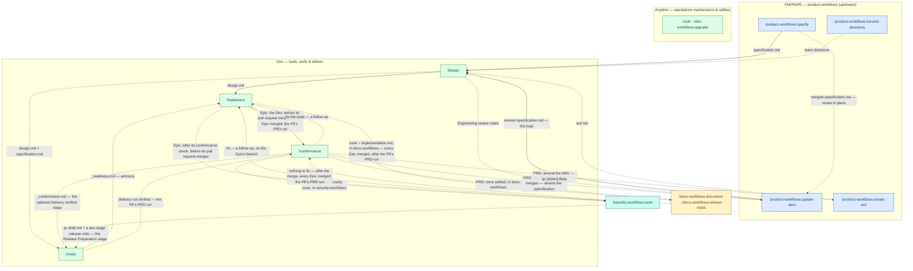

# Workflow overview

This is the `dev-workflows` pipeline top to bottom — every command shown here, in the order the roles typically hand work to each other. This plugin's spine picks up from `specification.md`, which the companion `product-workflows` plugin's PRD → architecture → Epic breakdown → specification ladder (and its six-command BRD-to-PRD route) lands on the specs repo's default branch: `/design → /implement` carries it the rest of the way to shipped code, [`/ready`](commands/ready.md) verifies the artifacts alongside that spine, and the companion `docs-workflows` plugin closes the PRD out with `/docs-workflows:document` and `/docs-workflows:release-notes`.

The diagram draws `specification.md` and the ARD reaching [`/design`](commands/design.md), and `/ready` reading what `/design` leaves, but [`/implement`](commands/implement.md) and `/ready` also resolve the applicable ARD and the in-scope `specification.md`/`design.md` once they exist — each edge is drawn once to keep the diagram readable, not because the others do not consult those artifacts. `/ready`'s verdict, `_readiness.md`, is advice `/implement` reads; it blocks nothing. The dashed `_conformance.md` edge into `/ready` is the PE's record of the PRD: `/ready` reads it from the specs repo's default branch, and where it is settled — a PRD run's, with nothing left untraced, not shown merged or unverified, every entry final or resolved, no *fix the code* still open and no work implemented after it, as the `/ready` page details — a PRD at *Implementation* reaches the optional *Delivery verified* stage. Short of that, `/ready` passes the stage over and says why in a note, which lowers no verdict. Where a PRD is at *Implementation* or a later stage and delivery is not verified, `/ready` then offers the PE's PRD run of `/conformance`, whatever its verdict — the dashed edge from `/ready` back to `/conformance`. The dashed edge from the documentation commands into `/ready` is the two drafts they leave in the PRD folder: `/docs-workflows:document`'s pull-request draft, `pr-draft.md`, and a release note `/docs-workflows:release-notes` drafted at the dev stage, its hidden scope comment saying `stage: dev`. Once both are on the specs repo's default branch, and neither is dated before the latest work implemented on the PRD, a PRD at *Implementation* or *Delivery verified* reaches *Release Preparation* — documentation and a release note drafted, not published; until then a note says which is missing, and lowers no verdict.

Six nodes in this diagram are not this plugin's commands and are drawn for continuity only. Four ship in the companion `product-workflows` plugin: `/product-workflows:specify`, where this plugin's spine picks up, `/product-workflows:update-spec`, which revises a merged specification in place, `/product-workflows:create-ard`, whose ARD `/design` respects, and `/product-workflows:harvest-decisions`, whose team decision records `/design` grounds on — alongside `/idea`, `/create-prd`, `/update-prd`, `/epics`, and the six-command BRD-to-PRD route that feeds it; that plugin's own Workflow overview page carries the full upstream diagram. On a decision to amend a document, the PE's PRD-level [`/conformance`](commands/conformance.md) puts a note on the document holding the requirement and recommends the command that revises it: `/product-workflows:update-spec` for the specification and `/product-workflows:create-ard` for an `[AD#n]` Rule, both drawn here, or `/product-workflows:update-prd` for the PRD and `/product-workflows:epics` for an `epic.md`, which are not. The combined `/docs-workflows:document · /docs-workflows:release-notes` node ships in the companion `docs-workflows` plugin and is documented there: it reads what `/implement` recorded, and it is offered by the PE's PRD-level `/conformance`, once every Epic has merged and that run's decisions are settled — `/implement` offers it only after that run. `/security-workflows:scan`, the security scan an Epic's [`/conformance`](commands/conformance.md) hands on to before the merge, ships in the companion `security-workflows` plugin, which this one does not depend on: a finding it marks fix comes back to `/implement` as a follow-up, which continues on the Epic's branch, so the fix joins the Epic's open pull request. Where no finding went to fix, the scan hands on to the PE's PRD-level `/conformance` once that pull request and the remaining Epics have merged.

The diagram above shows where each command sits in the pipeline; [Roles and phases](roles-and-phases.md) says what each role is accountable for and what it hands over at each seam.

**One command name in this plugin collides with a Claude Code built-in of the same name: [`/upgrade`](commands/upgrade.md).** Typing the bare form reaches Claude Code's own command instead of the plugin's, so use the qualified `/dev-workflows:upgrade`. **`/design` collides on some accounts:** Claude Code's own `/design`, which makes a Design artifact, is switched on for some accounts only, and where it is on the bare form can reach it, so type `/dev-workflows:design` there. `/release-notes`, drawn here for context, collides the same way as `/upgrade` and is qualified `/docs-workflows:release-notes`; `/statusline` and `/feedback` collide too and are qualified `/workflows-core:statusline` and `/workflows-core:feedback`. Each ships in a companion plugin. No other command in this plugin is known to collide today, so the rest work either way, and among this plugin's own commands the diagram above spells out the qualified form only where a collision is certain.

## Roles

| Role | Runs | Produces → lands at |
|---|---|---|
| **Dev** | `/design`, `/implement`, `/ready`, `/conformance` (then `docs-workflows`' `/document` and a final `/release-notes`); off the spine, `docs-workflows`' `/docs-init`, `/docs-brand` and `/docs-audit` | `design.md` on the specs repo's default branch; code committed on a branch in `$REPOS_PATH`, the push and the pull request behind a consent choice; a read-only readiness verdict that sets no status |
| **Anytime** | [`/vuln`](commands/vuln.md), `/upgrade` | a fixed CVE or a completed upgrade, committed on a feature branch in `$REPOS_PATH` |

The Dev also runs the companion `security-workflows` plugin's `/security-workflows:scan` on each Epic, after `/conformance` and before its pull request merges; that plugin's own Security Engineer role audits whole repositories with it. The PM, PA, and PE roles that produce this plugin's own input — `specification.md` — ship in the companion `product-workflows` plugin; see [Roles and phases](roles-and-phases.md) for where this plugin's spine picks up and that plugin's own Roles and phases page for what each of those three roles owns.

## Artifact homes

- **`$SPECS_PATH/specifications/PRD-<KEY>-<slug>/`** — the shared, team-visible home for `specification.md` and `design.md`, in the `EPIC-` folders below the PRD folder (a BRD route puts the same PRD folder one level down, inside `BRD-<KEY>-<slug>/`, per the companion `product-workflows` plugin's own conventions). `/design` lands its file here, then hands it onto the specs repo's default branch for `/implement` to find.
- **`$REPOS_PATH`** — the mounted code clones. `/implement`, `/upgrade`, and `/vuln` each work here on a feature branch and each finish it the same way ([`code-handoff.md`](reference/references.md)): the work is committed without asking — unless its secret scan finds a possible secret, which is put to you first — and pushing it and opening a pull request sit behind a consent choice asked once and then reused — put again only where a later unit's outcome differs from the one you answered under, in either direction. `/vuln` does that once per fixed CVE, `/upgrade` commits once per component and pushes once for the batch.
- **Plugin bookkeeping** — feedback and session-cost files — lives under `<PRD-dir>/dev-workflows/` inside `$SPECS_PATH` on a run that resolved a PRD folder (a keyless run writes them at the specs root instead, under `dev-workflows-feedback/` and `dev-workflows-cost/`), committed and pushed alongside the specs artifacts it describes. Two records land outside that subfolder, beside the artifacts they are about: follow-up tasks, in the folder the run resolved (`/implement`'s in the folder of the unit it implemented) — see [Follow-ups](reference/follow-ups.md) for the full ladder — and `/implement`'s `implementation.md`, in the folder of the unit implemented.

## Sources of truth

- **The artifacts** are the source of truth for workflow *status* — [`workflow-states.md`](../references/workflow-states.md) is read in the direction its *expected artifacts* column supports, and `/ready` derives the phase from what is on disk — save two stages: the optional *Delivery verified* stage, which it reads from the PE's conformance record, taken from the specs repo's default branch and never your checkout, and from when the implementation records were written — by the moment each carries where both sides carry one, and by date otherwise — since work implemented after the record leaves the stage unreached; and *Release Preparation*, which it reads from the documentation run's pull-request draft and a release note drafted at the dev stage, both taken from the default branch too, and from the implementation records again, compared the same way, since work implemented after the drafts leaves the stage unreached. An operator who keeps a tracker can still check a declared status against it with `/ready --claimed "<status>"`.
- **The specs repo's default branch** is the source of truth for whether a phase's deliverable is actually *done*. A producing command lands its artifact there; the next command in the chain stops while the artifact sits on an unmerged branch the commands cut, and treats one no such branch carries — written only to disk, or committed only to a branch of your own — as absent, falling back from it or, for a few, stopping. See [Roles and phases](roles-and-phases.md) for what happens when the artifact is on an unmerged branch instead, or missing entirely.

## Cross-cutting commands

These ship in companion plugins and run against the same specs tree, outside this plugin's own role pipeline:

- **In `workflows-core`.** The specs-tree frame-set indexer, the plugin-feedback commands and the session diagnosis: `/workflows-core:frames`, `/workflows-core:feedback`, `/workflows-core:prompt`, `/workflows-core:prompt-brainstorm`, `/workflows-core:prompt-grill-me` and `/workflows-core:diagnose-session`, whose only write there is its cost entry. `/workflows-core:statusline` ships there too and is the one that does not meet the criterion above — it configures your terminal status line and touches the specs tree not at all.
- **In `docs-workflows`.** The documentation half this plugin's Dev role hands off to, plus the cold-start scaffold that creates the repository it writes into and the audit that finds what that repository is missing: `/docs-workflows:document`, `/docs-workflows:release-notes`, `/docs-workflows:docs-init`, a standalone `/docs-workflows:docs-brand`, and `/docs-workflows:docs-audit` — the five that emit their own session bookkeeping here. The plugin's other two, `/docs-workflows:docs-profile` and `/docs-workflows:docs-serve`, work only inside a documentation repository: neither runs a specs preflight or a terminal commit, so neither writes anything into the specs tree.
- **In `product-workflows`.** The PRD → architecture → Epic breakdown → specification ladder this plugin's spine picks up from, and the six-command BRD-to-PRD route that feeds it — `/product-workflows:idea`, `/product-workflows:create-prd`, `/product-workflows:update-prd`, `/product-workflows:create-ard`, `/product-workflows:epics`, `/product-workflows:specify`, the route's own `/product-workflows:brd-intake`, `/product-workflows:brd-split`, `/product-workflows:prd-ground`, `/product-workflows:brd-interview`, `/product-workflows:brd-package` and `/product-workflows:brd-reconcile`, and its two effort-proposal commands `/product-workflows:prd-proposal` and `/product-workflows:brd-proposal`, which price a requirement set in hours and gate nothing on this ladder.
