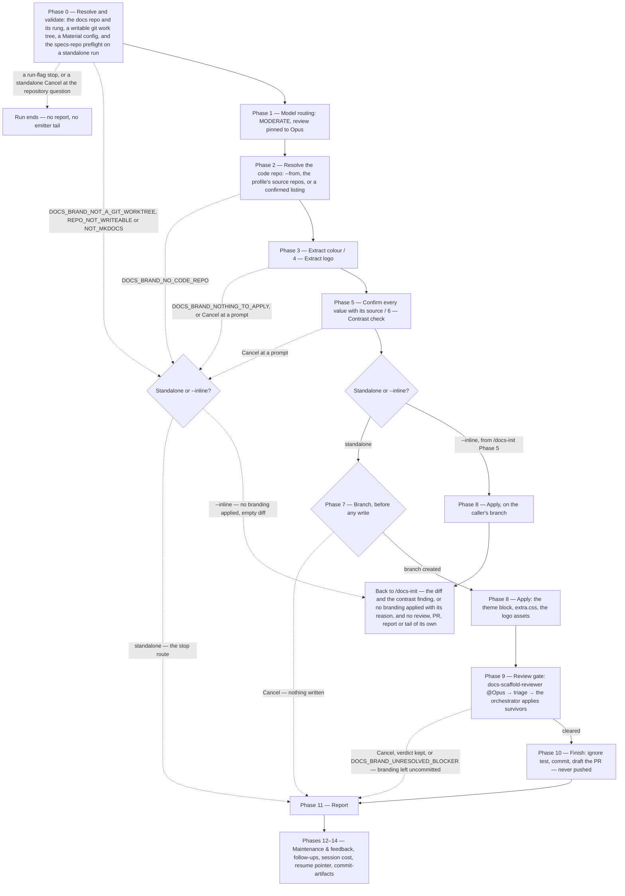

# /docs-brand

Extracts a logo and a rough primary/accent colour pair from a product's own code and applies them to a documentation site's Material for MkDocs theme.

## Who runs it

`/docs-brand` runs two ways. **Standalone** it is a setup utility reached at any point, as `/docs-workflows:docs-profile` is, but gated by its own Opus review, and it finishes on a branch with a drafted pull request. **`--inline`** it is a phase `/docs-workflows:docs-init` Phase 5 dispatches during a fresh scaffold: its diff and its contrast finding join that command's own single review and single PR rather than opening a second one. And where it cannot brand — any stop below that an `--inline` run can reach, or a Cancel at one of its prompts — it never ends the scaffold: it hands back `no branding applied: <reason>` with an empty diff, and `/docs-init` carries on as if `--no-brand` had been passed. Expectations are deliberately modest — a mark and a colour pair, not a design system — because rebrands happen and re-scaffolding a whole docs site to pick up a new logo would be absurd.

## Synopsis

```
/docs-brand [<docs-repo-path>] [--from <code-repo-path>] [--inline] [--skip-costs] [--skip-feedback] [--enforce-model=<model>]
```

`--from` and `--inline` are stripped from the arguments before the remaining token is read as the optional docs-repo path (Phase 0). `--from <code-repo-path>` names the product's code repository to extract from; without it, the run falls through the resolved docs profile's own `source_repos[]` — written by `/docs-init` and by [`/docs-audit`](docs-audit.md), so a portal either has touched usually answers here — and then a confirmed listing under `$REPOS_PATH` (Phase 2). `--inline` switches the run to the caller-embedded mode described above, skipping this command's own preflight, review gate, pull request, and emitter tail.

All three run flags apply to a **standalone** run the same way they apply elsewhere in the family: `--skip-costs` (or `WORKFLOWS_SKIP_COSTS`) skips Phase 14's session-cost entry, still advancing the checkpoint and dropping any deferred cost record a [ceded](../reference/session-cost.md#ceded-runs) `/prompt-brainstorm` or `/prompt-grill-me` run left pending in this session — see [Session cost](../reference/session-cost.md). `--skip-feedback` (or `WORKFLOWS_SKIP_FEEDBACK`) narrows Phase 12's maintenance step to bugs-only, dispatching `defect-reporter` in place of `impl-maintenance` — under the flag only real defects are persisted, never the in-session Lessons Learned report. [Session feedback](../reference/session-feedback.md#bugs-only---skip-feedback) has the rest. `--enforce-model=<model>` (or `WORKFLOWS_ENFORCE_MODEL`) pins every agent a standalone run dispatches — `docs-scaffold-reviewer` (overriding its frontmatter Opus pin), `workflows-core:impl-maintenance`, and, under `--skip-feedback`, `defect-reporter` — to one model. **`--inline` never re-strips these from its own arguments**: `/docs-init` Phase 5 constructs that run's whole argument list itself (the resolved docs-repo root, `--from`, `--inline`), which never carries a run-flag token, so this run instead inherits the flag settings `/docs-init` already resolved — its enforced model, where set, is recorded in this run's own Phase 1 routing record the same way, though it changes nothing under `--inline`: that path dispatches no reviewer and no maintenance agent of its own to carry it, and enforcement never changes what Phase 1 classifies, only which model a dispatched step would run on.

## How it runs

A dotted edge is a stop or a Cancel. On a standalone run each one that reaches the Phase 11 report still runs the emitter tail after it; under `--inline` it hands [`/docs-init`](docs-init.md) `no branding applied` instead.



## What it needs

- **A docs repository that already exists** — resolved by the same signal-positive ladder `/docs-workflows:docs-serve` uses: the given path, else the working directory when it carries a docs signal, else `$DOCS_PATH` when it carries one, else a search under `$REPOS_PATH`, else a question. Its MkDocs configs are found through the profile's `builds[]`, where the profile records one, and otherwise as `mkdocs.yml` and `mkdocs.internal.yml` in the resolved directory, so a site below its repository's top level, such as a monorepo's `site/`, is branded where it sits: the stylesheet and the assets go under each config's own docs directory, while git runs at the top level. Every config found must additionally resolve to `theme: name: material` — the **effective** value, with `INHERIT` followed, so the `mkdocs.internal.yml` `/docs-init` scaffolds, which inherits its theme from `mkdocs.yml` and carries no `theme:` block of its own, passes rather than being refused. This command writes Material-native configuration, the family's one deliberate exception to never branching on a repo's generator.
- **A code repository to read from** — named by `--from`, or resolved from `$REPOS_PATH` with a confirmation (Phase 2). It is read-only: nothing here writes into it, and the applied theme never references it at build time.
- **Nothing pre-existing in the docs repo beyond a Material MkDocs config** — a `stylesheets/extra.css` file is created if absent and the `theme:` block is edited into place rather than replaced, so a hand-built Material for MkDocs site is branded the same way as one this family scaffolded; a site running a different theme or a different generator entirely is outside what this command supports (`DOCS_BRAND_NOT_MKDOCS`, below).

## What it produces

Phase 3 walks a fixed colour precedence — a Tailwind config's `theme.extend.colors`, CSS custom properties matching `--(color-)?(primary|brand|accent)`, a MUI `createTheme` call, a web-app manifest's `theme_color`, and SCSS/LESS `$primary` / `$brand` / `$accent` variables — taking the first rule that matches anything and recording its file and line. Accent is looked for independently among the three rules that name it explicitly, defaulting to the primary value when none of them match. Phase 4 searches `public/`, `src/assets/`, `static/`, `logo*` / `brand*` / `icon*` filenames, `favicon.*`, and a manifest's `icons[]`, ranking SVG over PNG and larger over smaller, and is the one place a logo is picked from among candidates — presented as a literal, capped choice list when more than one candidate is found; a path the operator types, where nothing was found or at the confirmation's edit, is taken as given.

Every extracted value is printed with its source before Phase 8 applies anything, and the operator confirms or edits it — nothing here is ever applied silently. Phase 6 checks the confirmed primary, its derived light and dark variants, and the confirmed accent against the WCAG 2.2 contrast threshold for body text (4.5:1) and reports each ratio to two decimals; a failing colour is still applied if the operator confirms it — it is their brand — and the finding is carried into the drafted PR message regardless of outcome. On a standalone run, Phase 7 creates the branch **before** anything is written — matching the family invariant and `/docs-profile`'s own order. Phase 8 then writes the `theme:` / `extra_css:` additions **only into a config that inherits nothing** — on a scaffolded repository that is `mkdocs.yml` alone, since `mkdocs.internal.yml` already inherits both, and a theme block of its own there is the divergent-configuration defect the scaffold's own rules name. It edits into the existing block rather than replacing it (a literal replacement would drop `name: material` itself), and writes only what it is applying: the palette and the CSS variables for a confirmed colour, the `logo` and `favicon` keys — together with copying the files into `assets/` under the site's docs directory, `docs/assets/` on the default layout — for a confirmed logo. A scaffold writes neither key until this command applies a logo, so no config ever names an image nothing wrote. And the commit never names one it leaves out: just before a standalone run commits, every file it wrote is tested against the docs repository's own `.gitignore`, and a logo, favicon or stylesheet that repository ignores is left uncommitted rather than forced in, with the config key naming it removed and both named in the pull-request draft and the report. (An `--inline` run commits nothing; `/docs-init` runs the same test over its diff.)

## Gates

**Opus review regardless of class**, unless `--enforce-model` pins the reviewer to another model. `/docs-brand` classifies as MODERATE, but the rule for the portal-building set — every command of it that writes an artefact, `/docs-init`, this one and `/docs-audit` — is that each passes a high-tier review with no tiering by unit (not every command in the plugin: [`/document`](document.md) in direct mode takes a style check and no review gate, [`/release-notes`](release-notes.md) a light gate, `/docs-profile` no review gate at all, and `/docs-serve` writes no artefact and runs none) — a MODERATE classification only lowers which model plans, never which model reviews. `docs-workflows:docs-scaffold-reviewer` reviews the config and CSS diff at Opus (standalone only; an `--inline` run's diff joins the caller's own review instead). Its findings are triaged by the orchestrator before anything is applied — each verified at the location it names, every dismissal and every unverified finding recorded with a reason, and only survivors acted on. **There is no dedicated fixer for this diff** — the orchestrator applies surviving findings itself, bound by the patch gate, and surfaces a finding it cannot safely patch for a human decision rather than guessing at it.

## Failure modes

On a standalone run every stop below, and a Cancel at one of the extraction, confirmation or contrast prompts, still ends with the report — naming the stop — and the session bookkeeping: the cost entry is recorded and the terminal bookkeeping commit runs. Only an `--enforce-model` value that names no model, or one this session cannot use, ends the run before that.

- `DOCS_BRAND_NOT_A_GIT_WORKTREE` — the resolved docs repo is not inside a git work tree.
- `DOCS_BRAND_REPO_NOT_WRITEABLE` — the resolved docs repo is not writeable.
- `DOCS_BRAND_NOT_MKDOCS` — no MkDocs config was found (none of the configs the profile's `builds[]` records or, where it records none, neither `mkdocs.yml` nor `mkdocs.internal.yml` in the resolved directory), or a config found resolves to a theme other than Material (the effective `theme.name`, `INHERIT` followed, must be `material` in every config found). Scaffold one with `/docs-workflows:docs-init` first, or point this run at a repo that already runs Material.
- `DOCS_BRAND_NO_CODE_REPO` — no code repository resolved to extract from, after checking `--from`, the docs profile's source-repo set, and `$REPOS_PATH`.
- `DOCS_BRAND_NOTHING_TO_APPLY` — neither a colour nor a logo was found or supplied; there is nothing for the run to brand.
- `DOCS_BRAND_UNRESOLVED_BLOCKER` — a BLOCKER finding from `docs-scaffold-reviewer` was neither fixed nor overridden.
- A Cancel at the review gate, or keeping the review's verdict after triage left no finding behind it standing (every one dismissed or unverified), stops a standalone run there: the branding stays uncommitted on its branch, no pull request is drafted, and the cost entry is still recorded. Settle the findings, check each written path with `git check-ignore <path>` and leave any it prints unstaged, after removing every config reference to it, then commit by hand.
- A failing contrast check is never a stop — it is a confirmation prompt (Phase 6): the operator may apply the colour anyway, choose a different value, or cancel.
- **Under `--inline`, no stop ends the caller's run.** Every stop above that an `--inline` run can reach — all but `DOCS_BRAND_UNRESOLVED_BLOCKER` and a stop at the review gate, both of which belong to the standalone review gate an `--inline` run skips — and a Cancel at any of its prompts returns `no branding applied: <reason>` with an empty diff and no contrast finding. Every one of those happens before anything is written, and `/docs-init` continues its scaffold as if `--no-brand` had been passed, recording the reason.

## Example

```
/docs-workflows:docs-brand ~/repos/example-docs --from ~/repos/example-webapp
```

Resolves the docs repo and the named code repo, walks the colour and logo precedence, confirms what it found, checks contrast, creates a branch, applies the theme to the MkDocs config the other one inherits from, dispatches the scaffold review, and finishes with a drafted pull request — never pushed, never merged.

```
/docs-workflows:docs-init
```

`/docs-init` Phase 5 runs `/docs-brand --inline` on the repo it just scaffolded, folding the branding diff and its contrast finding into the scaffold's own single review and single pull request.

## See also

- [Workflow overview](../workflow.md) — where this command sits among the plugin's others.
- [The documentation route](../docs-workflow.md) — the whole procedure from an empty repository to a populated portal; its first step, `/docs-init`, runs this command as one of its phases.
- [`/docs-init`](docs-init.md) — the command `--inline` mode serves; scaffolds the docs repository this command later rebrands, and runs this one as its own Phase 5.
- [`/docs-profile`](docs-profile.md) — the sibling standalone-plus-`--inline` setup command this one follows the same finishing discipline as (branch, commit, drafted PR, never pushed).
- [`/docs-serve`](docs-serve.md) — preview the branded site once the pull request above is merged.
- [Session cost](../reference/session-cost.md) — the standalone path's fixed `docs-scaffold` / `dev` attribution, and why `--inline` never emits its own entry.
