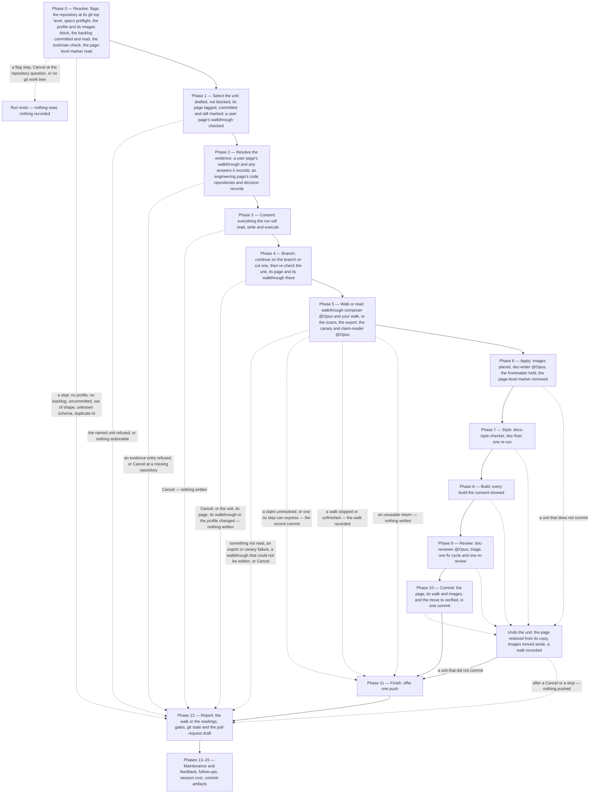

# /docs-verify

Verifies one drafted page of the documentation backlog — a unit you name, or the next actionable one — by its audience's method, and commits the verified page and the unit's move to `verified` together, in one commit on a branch. A user page is walked: you take each step of its walkthrough in this session and say what you saw. An engineering page is read: its claims are read in the code and in its architecture decision record.

## Who runs it

`/docs-verify` is the command after [`/docs-write`](docs-write.md): that command drafts a unit's page and moves the unit to `drafted`, and this one checks what the page says and moves it on. [Workflow overview](../workflow.md) draws the backlog commands together, and [The documentation route](../docs-workflow.md) is the written procedure around them — what comes before, and what still comes after.

It classifies each unit as **MODERATE** — one drafted page, its claims walked by you or read in the code, and applied as you answered or took them, on a branch nothing merges without you. The walkthrough's composition or the reading, the writing and the review each run on the Opus chain (unless `--enforce-model` pins another model); the scans, the style check and the fixes run on the Sonnet chain.

**Two ways to verify, by the unit's audience.**

- **A user page is walked.** An agent, `walkthrough-composer`, reads the page — never the code — and composes a walkthrough whose steps observe every claim on it, or, where the unit already has one, appends the steps it misses, never rewriting a step. You see every step it proposes before anything is written. Then the run asks you about each step in turn, and writes each answer into the walkthrough the moment you give it.
- **An engineering page is read.** An agent reads each claim in the code the page's evidence names, at today's commit of its repository, and in the page's architecture decision record at the specs repository's default branch.

**What `verified` means here.** Every claim on the page was observed in a step of its walkthrough — or read at today's commit — and either confirmed or rewritten to what you saw, or to what the code or its decision record says; every marker is gone; and the page's evidence records the walkthrough, or the commits that were read. A page that cannot reach that stays `drafted`.

## Synopsis

```
/docs-verify <unit-id>|--next [--docs-repo <path>] [--skip-costs] [--skip-feedback] [--enforce-model=<model>]
```

Name exactly one unit, once:

- **`<unit-id>`** — that unit, matched against the backlog's unit ids as written. A unit it cannot verify stops the run, with a line naming the one thing to change.
- **`--next`** — the first actionable unit, lowest priority number first, then file order. A unit an unmerged branch has itself moved, or the default branch — `origin`'s, or your local one where it holds commits `origin`'s lacks — has moved since the branch or commit you stand on left it, is passed over, and so is a unit whose repository you skip.

`--docs-repo <path>` names the documentation repository. Without it the run looks in the working directory, then `$DOCS_PATH`, then one level under `$REPOS_PATH`, where only a directory holding a `.git` of its own counts, and asks where none of them is one; the unit selector is never read as a path. Every recognised flag is stripped, `--docs-repo` with the value after it, before the unit id is read, and any other token beginning `--` stops the run.

All three run flags apply. `--skip-costs` (or `WORKFLOWS_SKIP_COSTS`) skips the session-cost entry while still advancing the checkpoint — see [Session cost](../reference/session-cost.md). `--skip-feedback` (or `WORKFLOWS_SKIP_FEEDBACK`) narrows the maintenance step to bugs-only — see [Session feedback](../reference/session-feedback.md#bugs-only---skip-feedback). `--enforce-model=<model>` (or `WORKFLOWS_ENFORCE_MODEL`) pins every agent the run dispatches to one model, the Opus composer, reader, writer and reviewer included.

## What it needs

- **A documentation repository that is a git work tree**, with a profile and a backlog, both committed as they stand, and the backlog in the shape the backlog runs read — as for [`/docs-write`](docs-write.md), whose page says what each of these means.
- **A drafted unit and its page, committed.** The unit's status is `drafted`, nothing blocks it, and its page is the one page carrying the unit's id, tracked, with no change you have not committed, and still opening with the not-yet-verified marker. A page that no longer opens with that marker — one a person already verified by hand, or one edited since its drafting — is refused, and the line says which to do: only where a person did verify every claim, move the unit to `verified` by hand; otherwise put the marker back as the first line of its body, after the internal marker on an internal page, commit it and run again.
- **For a user page, its walkthrough.** The unit's entry carries a `walkthrough:` line. Where it names a walkthrough, that file under `.dev-workflows/walkthroughs/` is the one walked: it must belong to this unit, be in the shape the run reads — the one [Evidence and walkthroughs](../reference/docs-evidence.md) shows — and hold at least one step. Where it is `null`, the run walks the file at `.dev-workflows/walkthroughs/<unit-id>.yml` where one belonging to the unit stands there, and otherwise composes one at that path; composing one needs the unit's `roles` to name the role the page addresses, a unit id that reads as text — not a number, a date or a word like `true` — and a file system that takes hard links, since the new file is linked into place so that it can never overwrite one already there.
- **For a user page with screenshot slots, the profile's `images` block** — its policy, and the folder, size limit or URL prefix that policy uses. Without the block, no slot is asked about and each is left as it is. An image placed in the repository where none stood is linked into place the same way.
- **For an engineering page, the page's evidence.** The page's own `evidence:` frontmatter names what it rests on: code in a repository the backlog's sources record, an architecture decision record under the specifications tree, or both. Each entry is held to a plain form before anything reads it, and one that is not refuses the unit by its position.
- **For an engineering page, the code repositories that evidence names.** Each is found as `/docs-write` finds one — its recorded path, else its origin under `$REPOS_PATH`, else by asking you — and counts as a repository only where it holds its own `.git`. One outside `$REPOS_PATH` is read only once you have agreed to its path. Each is scanned at its default branch, and that commit is the one the page is verified against.
- **`$SPECS_PATH`**, for a page whose evidence is an architecture decision record, and for the run's own bookkeeping. The record is read at the specs repository's default branch, never at the commit the page recorded and never from the working tree. With the variable unset, the run reads a repository only where one of the backlog's surfaces found in code — a role, task, concept, reference or service — names it, and refuses the unit otherwise: without the variable it cannot tell another repository from the specs repository, which it never scans.
- **Room in the session's temporary directory** — for an export of each repository's commit, or a walk's files. **A limit:** a file above 1 MiB is left out of the export, and a repository above 50,000 files or 512 MiB of files to export is not read at all — the unit then stays `drafted` this run. The page's evidence may record at most twenty commits for one repository, and the exports at those older commits are held to the same limits together, past which their comparison is left out of the report.
- **The tools the profile's build and lint commands run**, as for `/docs-write`.

## Phases

The diagram shows the run's flow. A dotted edge is a stop, a Cancel, a unit that cannot move, or a unit that does not commit.



| Phase | What happens |
|---|---|
| 0 — Resolve | Strip the flags; resolve the git top level; run the specs-repo preflight; read the profile and its `images` block; check the backlog and profile are committed; read the backlog's shape. |
| 0 — continued | Name any directory an earlier run left under `.dev-workflows/unfinished/`; run the toolchain check; read the not-yet-verified marker the page must open with; classify the run. |
| 1 — Select | Take the named unit, or the next actionable one; check its page, and a user page's walkthrough; pass over a unit an unmerged branch, or the default branch since yours left it, moved. |
| 2 — Evidence | A user page: its walkthrough, and whether the answers it records count. An engineering page: each entry of its `evidence:`, resolved to a code repository or a decision record. |
| 3 — Consent | Ask once, showing what the run will read, write and execute, and the branch. |
| 4 — Branch | Continue on your branch or cut a new one, told how far it is behind, and where the run could not tell whether the default branch moved the unit; re-read the unit, page, walkthrough and profile. |
| 5 — Walk or read | A user page: the walkthrough composed or extended, then walked with you, step by step, its slots filled. An engineering page: each repository read at today's commit, then the readings question. |
| 6 — Apply | Place the images; `doc-writer` applies the answers; the frontmatter is held; the not-yet-verified marker is removed. |
| 7 — Style | Run the style check over the page, fix its violations once, and re-run it. |
| 8 — Build | Run every build the consent showed. |
| 9 — Review | An Opus review, triaged; one fix cycle and one re-review; a finding still standing asked about one at a time. |
| 10 — Commit | Test the page again, then commit the page — with its walkthrough and images — and the unit's move to `verified` together. |
| 11 — Finish | Offer one push. |
| 12–15 | The report with its pull-request draft, then maintenance and feedback, follow-ups, session cost and the specs-repo commit. |

## Gates

**The consent.** Nothing is scanned, exported or written until you have seen, in one question: the unit and its page; for a user page, its walkthrough — named by the unit, found at the unit's own path, or to be composed there — its steps and its slots, the one Opus agent that composes or extends it, any answers it records and whether they count, and the profile's image settings; for an engineering page, each code repository the run will read, one outside `$REPOS_PATH` marked as admitted only by this answer, each decision record, read at the specs default branch, and that each repository's commit is exported into a scratch directory and read there by an agent that holds no shell, with the export's limits; the branch, and when cutting a new one fails; each build config; every build and lint command the run will execute, verbatim; and that the unit takes three Opus dispatches.

**The branch question.** Where you stand on a branch other than the default, the run asks whether to continue on it or cut a new one. Where your branch lacks commits of the default branch — `origin`'s, as last fetched, for the run fetches nothing first, or the local one where `origin` has none — it says how many; where it lacks none, it says nothing of it. A unit the default branch moved after the branch or commit you stand on left it — `origin`'s, as last fetched, or your local one where it holds commits `origin`'s lacks — is never verified from there, where the backlog holds it at its older status: `--next` passes it over, and a unit you name stops the run before the consent (`DOCS_VERIFY_BASE_MOVED`). Where the run could not tell — in a shallow clone, on an orphan branch, or where a backlog could not be read — the question says continuing may verify one a second time, and recommends neither answer: cutting a new branch, or merging the default branch into yours first, reads any move. It also says where cutting a new branch fails: wherever the default branch differs from yours in anything the run re-checks — the backlog, the unit's entry in it, its surface, a source its evidence names, its page, its walkthrough, another page carrying its id, or the profile — as when the unit is not merged there yet, or the default branch moved it on — and where the switch would overwrite a change you have not committed. **A walkthrough holding answers you have not committed** is such a change: choose to go on with it, or commit it first — stashing it hides the answers, and the run then stops, since the walkthrough is no longer the one you agreed to.

**The walk.** For a user page, `walkthrough-composer` reads the page and proposes the steps that observe each claim — a whole walkthrough, or the steps an existing one misses — and the run shows you how many claims are covered, every step it will add — and, for a new walkthrough, the role it is walked as and what must hold before it starts — and any claim no step can observe. **A claim no step can observe** — why the product is as it is, what happens away from its screens, how fast it is or how it behaves under load, what only another role sees — ends the run's work on the unit before anything is written to the walkthrough: the unit stays `drafted`, blocked by `claims-unresolved`, and the run commits only that record. An *explanation* page states the product's rationale, so this is where it usually ends: verify such a page by hand, as [The documentation route](../docs-workflow.md) says. For a new walkthrough you name, once, the environment you walk it in. Before the first step, the run tells you the role, the environment and the preconditions the walkthrough records, so you sign in and set up as it says: every answer is that role's, in that environment. Then:

- **Answers already recorded** in the walkthrough count only where it carries a stamp naming this page exactly as it stands now — the same path, and the same content as git computes it, line-ending and filter settings included. Where they count, the run asks whether to take them, showing the role, environment and preconditions they were recorded under, every `differs` and `blocked` answer's text, every step the composer adds, the counts, and their source: the last commit that touched the file, or *uncommitted in your working tree*. *Take these answers* walks only the steps they leave open — each unanswered, each `blocked`, and each `differs` with no text; *Walk it again here* clears them and walks every step. Where they do not count, the walk clears them, and the consent said so.
- **One question per step**, giving its number, action, target and what you should see. Answer `confirmed`, `differs` — you are asked for what you saw, on one line, and the page's claim is rewritten to it — or `blocked`, where you could not establish what the step did — you are asked why, on one line. **A button, a menu item or a route you cannot find where the step names it is `blocked`, not `differs`**: nothing was taken that could show something else. *Stop — keep these answers for a later run* ends the walk there.
- **Each answer is written into the walkthrough as you give it**, so nothing is lost if the session ends; the next run takes the answers and walks the rest.
- **Screenshots.** A slot is the image-slot comment on a line of the page — indented, inside a list item, or not — once: a slot whose comment appears more than once is not asked about, and the report says so. After the step a slot follows, the run asks for its image: a file you have — copied when you name it, at most the profile's size limit, `png`, `jpg`, `jpeg`, `gif`, `webp` or `svg` — or, where the profile's images live in object storage or a CDN, the URL you uploaded it to, under the profile's prefix: the prefix followed by `/`, with no segment in its path that, percent-decoded, is `.` or `..` or holds `/`, `\`, `%` or `;`, so neither a lookalike host nor a path climbing out of the prefix is taken. Where you give a value the run cannot take, it says why and asks again. *Skip* leaves the slot as it is, and so does the run where the image's place in the repository is one git ignores, or already holds an image of another kind for that slot, which the report names. Then, once, before anything is applied, you are asked whether every image shows nothing that must not be published: the run does not look at them, and *Cancel* publishes nothing and records the walk.
- **The walk passes** only where every step is answered, none is `blocked`, and every `differs` has its text. Otherwise the run commits the walk as it stands — no token — and the next run takes it.

**The reading.** For an engineering page, each repository is scanned at its default branch, and that commit — today's — is exported, with the commits the page's evidence recorded, into a scratch directory as plain files. `claim-reader` reads the page's claims there with searches and reads alone: it can run nothing and write nothing. Before it grades anything it, and the run where the session has the same search tools, look for two canary files the run planted in the export, under names the reader is not told — one in a hidden directory, one where ordinary ignore rules point — so that the reader's report of them is what its searches found. A search that cannot see both would miss a file a claim rests on, so the run stops rather than grade on a partial view. Each reading's line, quote and source file is then checked against the page and the export's own file list before you see it.

**Your two questions, on an engineering page.** Where a decision record and the code say a claim differently, you decide, one claim at a time: document it as the code reads, or leave it undecided, which keeps the unit `drafted`. Then one question shows every claim the code or the decision record states otherwise, with its words and where they were read, before anything on the page changes.

**The style check, the build and the review**, as for [`/docs-write`](docs-write.md): the build decides whether the unit can move; the review is Opus, its findings triaged before any fix, with one fix cycle and one re-review. A finding on how an answer was applied goes back to `doc-writer`; a fix that would add or remove a claim, a sentence or a section — a missing section the repository's guidance requires, for one — goes to no agent, since a verified page must say only what was answered: you are asked about it, to defer it or to accept it with a rationale. So too, on a user page, a claim the walk did not test — none of its steps states it — and a claim a `differs` step contradicts where what you saw names nothing in its place: no agent can settle what nobody observed, so you are asked, and deferring keeps the walk for a later run.

**What the run checks that no agent can.** Before and after every writing agent, it reads the working tree and ends the unit on any file changed other than the page, on any change to the page's frontmatter other than its evidence and review-by date, or on its internal marker moved. Between its own steps it holds the page to what its last step left there — from the page you consented to, through the reader's or the walk's copy, to the commit — and ends the unit where something else changed it; it holds a walkthrough the same way, from the consent to each answer and the commit. The composer's steps, and every answer you give, reach the walkthrough only through the backlog's line reader, which writes them in its one shape. The not-yet-verified marker is removed by the run itself, only after the answers are applied, and only where no other marker is left on the page. A style violation you fix by hand, when the run offers it, is shown to the reviewer as your fix, and must stay within the wording of the sentence the violation names.

## Outputs

- **One commit** on the run's branch holding the verified page — each claim confirmed or rewritten to what you saw or what the code or its decision record says, its evidence advanced, its review-by date moved on, the not-yet-verified marker gone — and the backlog's move of the unit to `verified`; for a user page, also the walkthrough with its answers and each image placed in the repository. The message is `docs: verify <unit-id> (<type>, <audience>)`, or your profile's commit convention where it takes only a summary and holds no apostrophe, line break, control character or bidirectional control — a convention that does not keeps the `docs:` form, and the report says so. A user page's commit body names its walkthrough.
- **Or a record commit** where the unit cannot move: `docs: record <unit-id> (<type>, <audience>)`, or the convention as above. On an engineering page, where a claim could not be resolved — a claim no reading settles, a file the evidence names gone from today's commit, or a disagreement you left undecided — the page is untouched, the unit stays `drafted`, and its `blocked_by` takes `claims-unresolved`, so `--next` passes it over until you clear it; the report lists each claim and why, and each evidence entry whose file is gone from today's commit, by its place in the page's `evidence:` — correct or remove that entry, commit the page, clear the token and run again. On a user page, a claim no step can observe takes the same token, with the backlog alone committed; and a walk that ends without the move — you stopped, a step stayed `blocked` or unanswered, the build or the review did not pass, or you cancelled after the walk began — commits the walkthrough with every answer given, and no token, so `/docs-verify <unit-id>` takes those answers and walks the rest.
- **One push offer** where the run committed, never forced. No pull request is opened.
- **A pull-request draft, printed in the report** and written to no file: the unit, its walk or its readings, each disagreement you decided, the review verdict and its triage, the build results, and the deferred items — filled into the documentation repository's own pull-request template where it has one, read as data.
- **A session cost entry and any feedback**, filed under `$SPECS_PATH/documentation/<docs-repo-slug>/`, as for `/docs-write`. See [Session cost](../reference/session-cost.md).

## Failure modes

- `DOCS_VERIFY_UNKNOWN_FLAG`, `DOCS_VERIFY_SELECTOR` — the arguments name an unknown flag, or not exactly one unit.
- `DOCS_VERIFY_NOT_A_REPOSITORY` — the resolved directory lies in no git work tree.
- `DOCS_VERIFY_NOT_WRITEABLE` — the repository's top level cannot be written.
- `DOCS_VERIFY_NO_PROFILE` / `DOCS_VERIFY_PROFILE_COMMAND` — no readable profile, or a build or lint command holding a line break, or a build config outside the repository.
- `DOCS_VERIFY_PROFILE_IMAGES` — the profile's `images` block holds a value the run cannot use: a policy other than `in-repo`, `object-store` and `cdn`, a folder outside the repository, a size that is not a whole number from 1, a URL prefix that is not an `https` address of at most 2,048 characters a page can link to, with no segment in its path that, percent-decoded, is `.` or `..` or holds `/`, `\`, `%` or `;`, or no prefix where object storage or a CDN needs one. Correct it in the profile.
- `DOCS_VERIFY_NO_BACKLOG` / `DOCS_VERIFY_UNCOMMITTED` — no backlog, or the backlog or the profile not committed as it stands.
- `DOCS_VERIFY_BACKLOG_UNREADABLE` / `DOCS_VERIFY_BACKLOG_SHAPE` / `DOCS_VERIFY_UNKNOWN_SCHEMA` / `DOCS_VERIFY_DUPLICATE_ID` — the backlog's reader could not run, a line is outside the shape it reads, its schema version is not one this release reads, or two units share an id.
- `DOCS_VERIFY_NO_MARKER` — the plugin's own files are out of step: the not-yet-verified marker could not be read from them. Update the plugin.
- `DOCS_VERIFY_NO_UNIT`, `DOCS_VERIFY_STATUS`, `DOCS_VERIFY_BLOCKED`, `DOCS_VERIFY_SURFACE`, `DOCS_VERIFY_RELEASE_UNIT`, `DOCS_VERIFY_TYPE` — the named unit cannot be verified, and the line says what to change. A `missing` unit's line names any unmerged branch that drafted it, and the default branch where it moved the unit after your branch left it.
- `DOCS_VERIFY_PAGE`, `DOCS_VERIFY_PAGE_TAGGED`, `DOCS_VERIFY_NO_PAGE_MARKER` — the unit's page is not set, not a plain file, not tagged with the unit's id, not committed as it stands, or carried by a second page too — or git could not read a file or directory under the content root, which the line names, to tell; or it no longer opens with the not-yet-verified marker, because a person may already have verified it or it was edited since its drafting — only where a person did verify every claim, move that unit to `verified` by hand; otherwise put the marker back as the first line of its body, commit it and run again, as step 8 of [The documentation route](../docs-workflow.md) says for a page you rewrote.
- `DOCS_VERIFY_WALKTHROUGH` — a user page's walkthrough cannot be walked: the entry has no `walkthrough:` line (add `walkthrough: null`), the walkthrough it names is not a file under `.dev-workflows/walkthroughs/`, it belongs to another unit, it holds no step, git ignores its path, so no commit could hold your answers, or the run would compose one and cannot — the unit records no role, or its id does not read as text. The line says which, and what to change.
- `DOCS_VERIFY_WALKTHROUGH_SHAPE` — a line of the walkthrough is outside the shape the run reads, a block of text spread over lines among them. The line names the line and why; reformat it as [Evidence and walkthroughs](../reference/docs-evidence.md) shows.
- `DOCS_VERIFY_EVIDENCE` / `DOCS_VERIFY_ARTIFACT` — an entry of the page's `evidence:` is outside its form, names a repository the backlog does not record, one that is not a clone, the specs repository, or — with `$SPECS_PATH` unset — one no surface of the backlog found in code names, or rests on a decision record the run cannot read at the specs default branch.
- `DOCS_VERIFY_NO_BASE` / `DOCS_VERIFY_NO_CANDIDATE` — `--next` found no default branch to compare other branches' backlogs against (name the unit instead), or no actionable unit.
- `DOCS_VERIFY_BASE_MOVED` — the unit you named was moved on the default branch — `origin`'s, or your local one where it holds commits `origin`'s lacks — after the branch or commit you stand on left it. On a branch of your own, verifying it there would verify it a second time: merge the default branch into yours and run again, which then reads the unit at the status the default branch gave it. On the default branch itself, or a detached HEAD, the run would cut its branch from the default branch and find the unit no longer drafted there: pull the default branch and run again from it to see that status.
- `DOCS_VERIFY_UNIT_CHANGED` / `DOCS_VERIFY_PROFILE_CHANGED` — on the run's branch the unit, its page, its walkthrough or the profile is not what the consent showed. Cutting a new branch from the default branch while the branch that drafted the unit is unmerged gives the first: the unit is still `missing` there. Continue on the drafting branch instead. Cutting one after the default branch moved the unit on, where the run could not tell it had, gives it too: the unit is no longer `drafted` there. So does stashing a walkthrough's answers you had not committed.
- `DOCS_VERIFY_EXPORT` — an export of a repository's commit could not run, or a search for the canary files the run planted came back without one of them. A missing canary file means the search tools cannot see some of the exported files — a hidden directory, or an ignore file somewhere above the session's temporary directory — or that the reader could not make its searches, a permission prompt you refused for one; either way the run stops before any claim is graded, and nothing is written.
- `DOCS_VERIFY_WALK_WRITE` — the walkthrough could not be written or read, git could not compute what it holds, or it changed under the run, by your hand or another session; the line says which. Its state is not one the run made, so it commits no record of the walk: whatever stands in the file — a step, a stamp, an answer — stays there, uncommitted. Look at it, then commit it or restore it. Under `--next`, a unit whose walkthrough git could not compute, or that changed while the run read it, before the run chooses the unit, is passed over instead, with that line as its reason.
- `DOCS_VERIFY_PAGE_CHANGED` — the page changed under the run, after you consented: by your hand, another session or a build. Nothing the run read or wrote for it is applied, and the page as it stood is kept, as below.
- `DOCS_VERIFY_SCRATCH` — the run could not make a file or directory in the session's temporary directory, or that directory was cleared during the session. Nothing more is written; the line says how to make it again, or start a new session.
- `DOCS_VERIFY_BACKLOG_EDIT` — the backlog's move or record could not be finished. The page is restored as below, and the backlog is restored from the copy taken before the edit only where the reader says its own undo failed; otherwise it is left as it is, and the report names the copy for you to compare.

**A unit that ends after the run changed its page keeps the page.** Before the page is restored to what it was when you consented, the page as it stood — the answers applied, a fix you made by hand, anything else written there — is moved under `.dev-workflows/unfinished/<unit-id>/`, or the next free `-2`, `-3` directory, at its own path; nothing is overwritten, and the report names where it went. Images the run placed are moved there too, and an image it replaced is put back — unless something on the image's path changed under the run, when the image is left where it is and the report names it, for you to look at. Compare it, take what you want from it, then remove it: where your content root is the repository itself, `/docs-audit --refresh` meets it as a second page carrying the unit's id until you do. Where it cannot be moved there, it is copied into the run's scratch directory instead, and the report names that copy. Where neither works, the page is left as it stands — and it is **not verified**, though the marker may already be gone from it: do not commit it as it is. The report gives the one command that puts back the page you consented to.

**A walk is never lost to a later failure.** Once the walk has begun — the composer's steps written, the stamp placed, or the recorded answers taken — any end but the verify commit commits the walkthrough as the walk left it, with the backlog naming it, before the run moves on — unless the walkthrough could not be written or read, git could not compute what it holds, or it changed under the run, by your hand or another session's, which is `DOCS_VERIFY_WALK_WRITE`; or the record itself cannot be made, the backlog's entry for the unit having changed under the run among the reasons: then the walkthrough is left in your working tree, uncommitted, and the report names it. Where nothing changed since the last commit — answers taken from it, then a failing build — no commit is needed, and the report names the commit that already holds them. Where a hook refuses the record, the walkthrough stays in your working tree, uncommitted, and the next run's branch question names it: choose to go on with it, and that run takes its answers.

**Something not read leaves no trace.** A repository you skip, one over the export's limits, an evidence file the export left out, or a claim not found in a repository whose export left files out: the unit stays `drafted`, no token is written and nothing is committed, and the report says what was not read and why. A later run that can read it may resolve what this one could not.

**Every stop once the run holds its repository's git top level still finishes the run's bookkeeping**: the report, the cost entry and any feedback, and the terminal specs-repo commit. The flag stops, a Cancel at the repository question and `DOCS_VERIFY_NOT_A_REPOSITORY` record nothing, having read and written nothing.

**Limits.**

- **A user page holding any claim no step can observe** — a sentence of rationale is one — cannot be verified by this command: the walk never starts, and the unit is blocked until the page no longer holds such a claim, or you verify it by hand.
- **Recorded answers bind to the page as git computes it.** Answers recorded on another machine whose line-ending or filter settings differ from yours — `core.autocrlf` among them — do not count here, though the page's text is the same: the run asks for the walk again rather than take them.
- **A stamp proves no walk.** Anyone who can commit can write answers and a matching stamp: the run shows you every answer that is not a plain `confirmed`, and names who last committed the file, before you take them. That question is the check.
- **A slot keeps one image file.** Where one of another kind already stands at the slot's place — a `.png` where you give a `.jpg` — the run leaves the slot unfilled and names that file: replace or remove it by hand, and run again.
- **A session that dies before its report leaves the export behind** — the source of each repository the run read, under the session's temporary directory, in a directory named `dv-docs-verify-export-` and six characters. The run removes it at its report; remove it yourself where a run never got there.
- **Where the session names no scratchpad directory**, the export, or a walk's files, lie in the system's temporary directory, outside the project, and the agents' reads there may each ask for your permission. Refusing one of the reader's or the composer's ends its work unfinished, and the unit ends with nothing written rather than graded on what the agent could see.
- **`--next` and an unpushed default branch.** Where your local default branch holds commits its remote does not, a draft branch cut from those commits still counts as having moved its unit, so `--next` passes that unit over. Push the default branch, or name the unit.
- **A page that quotes the not-yet-verified marker in inline code** cannot be verified by this command: the run cannot tell a quotation there from a marker left on a claim, so it ends the unit rather than remove one — and it finds this only when it comes to remove the marker, after the walk or the reading and the writing: two Opus dispatches, on an engineering page with your answer to the readings question between them. Verify such a page by hand.

## Example

```
/docs-workflows:docs-verify --next
```

Resolves the documentation repository, takes the highest-priority drafted unit that no unmerged branch has itself moved, nor the default branch since yours left it, resolves its evidence, and asks once. Then it continues on the drafting branch or cuts a new one. For a user page, it has the walkthrough composed or extended, shows you every step, and walks it with you, a question per step; for an engineering page, it scans and exports each repository, has `claim-reader` read every claim, and shows you the claims the code or the decision record states otherwise. Then it applies what you answered, removes the marker, style-checks, builds and reviews the page, and commits the page and the unit's move to `verified` in one commit — and offers to push.

```
/docs-workflows:docs-verify ORDERS-HOWTO-2 --docs-repo /workspace/docs
```

That one user unit. Where you stop half way, the run commits the walkthrough with your answers; run the same command again, take those answers, and walk the steps left.

```
/docs-workflows:docs-verify AUTH-REF-3 --docs-repo /workspace/docs
```

An engineering unit. Where a claim cannot be resolved, the page is left as it is and the run commits only the backlog's record of why, `claims-unresolved` in the unit's `blocked_by`.

## See also

- [The documentation route](../docs-workflow.md) — the whole procedure from an empty repository to a published portal, and how a page is verified by hand.
- [`/docs-write`](docs-write.md) — drafts the page this command verifies.
- [`/docs-audit`](docs-audit.md) — writes the backlog, and its `--refresh` reconciles a page whose unit's move was lost in a merge.
- [Documentation backlog](../reference/docs-backlog.md) — the file this command moves units in.
- [Evidence and walkthroughs](../reference/docs-evidence.md) — what a page's claims may rest on, what a walkthrough holds, and what a marked claim looks like.
- [Session cost](../reference/session-cost.md) — what this run charges to, and where the file lands.
