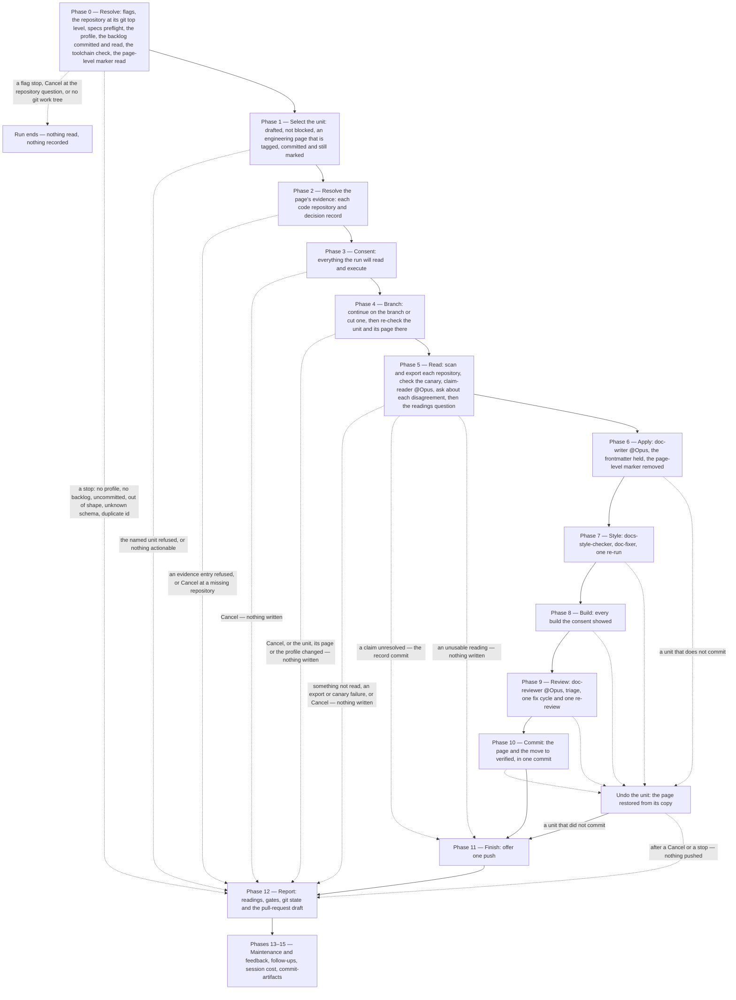

# /docs-verify

Verifies one drafted page of the documentation backlog — a unit you name, or the next actionable one — by its audience's method, and commits the verified page and the unit's move to `verified` together, in one commit on a branch. In this release it verifies an engineering page: its claims are read in the code and in its architecture decision record.

## Who runs it

`/docs-verify` is the command after [`/docs-write`](docs-write.md): that command drafts a unit's page and moves the unit to `drafted`, and this one checks what the page says and moves it on. [Workflow overview](../workflow.md) draws the backlog commands together, and [The documentation route](../docs-workflow.md) is the written procedure around them — what comes before, and what still comes after.

It classifies each unit as **MODERATE** — one drafted page, its claims read in the code and applied as you take them, on a branch nothing merges without you. The reading, the writing and the review each run on the Opus chain (unless `--enforce-model` pins another model); the scans, the style check and the fixes run on the Sonnet chain.

**An engineering page only, in this release.** A user page — one a person verifies by walking it — is refused, with a line naming the by-hand route; the next release walks it here. An engineering page is read, not walked: an agent reads each claim in the code the page's evidence names, at today's commit of its repository, and in the page's architecture decision record at the specs repository's default branch.

**What `verified` means here.** Every claim on the page was read at today's commit and either confirmed or rewritten to what the code or its decision record says, every marker is gone, and the page's evidence records the commits that were read. A page that cannot reach that stays `drafted`.

## Synopsis

```
/docs-verify <unit-id>|--next [--docs-repo <path>] [--skip-costs] [--skip-feedback] [--enforce-model=<model>]
```

Name exactly one unit, once:

- **`<unit-id>`** — that unit, matched against the backlog's unit ids as written. A unit it cannot verify stops the run, with a line naming the one thing to change.
- **`--next`** — the first actionable unit, lowest priority number first, then file order. A unit an unmerged branch has itself moved, or the default branch has moved since your branch left it, is passed over, and so is a unit whose repository you skip.

`--docs-repo <path>` names the documentation repository. Without it the run looks in the working directory, then `$DOCS_PATH`, then one level under `$REPOS_PATH`, where only a directory holding a `.git` of its own counts, and asks where none of them is one; the unit selector is never read as a path. Every recognised flag is stripped, `--docs-repo` with the value after it, before the unit id is read, and any other token beginning `--` stops the run.

All three run flags apply. `--skip-costs` (or `WORKFLOWS_SKIP_COSTS`) skips the session-cost entry while still advancing the checkpoint — see [Session cost](../reference/session-cost.md). `--skip-feedback` (or `WORKFLOWS_SKIP_FEEDBACK`) narrows the maintenance step to bugs-only — see [Session feedback](../reference/session-feedback.md#bugs-only---skip-feedback). `--enforce-model=<model>` (or `WORKFLOWS_ENFORCE_MODEL`) pins every agent the run dispatches to one model, the Opus reader, writer and reviewer included.

## What it needs

- **A documentation repository that is a git work tree**, with a profile and a backlog, both committed as they stand, and the backlog in the shape the backlog runs read — as for [`/docs-write`](docs-write.md), whose page says what each of these means.
- **A drafted unit and its page, committed.** The unit's status is `drafted`, nothing blocks it, and its page is the one page carrying the unit's id, tracked, with no change you have not committed, and still opening with the not-yet-verified marker. A page that no longer opens with that marker — one a person already verified by hand, or one edited since its drafting — is refused, and the line says which to do: only where a person did verify every claim, move the unit to `verified` by hand; otherwise put the marker back as the first line of its body, after the internal marker on an internal page, commit it and run again.
- **The page's evidence.** The page's own `evidence:` frontmatter names what it rests on: code in a repository the backlog's sources record, an architecture decision record under the specifications tree, or both. Each entry is held to a plain form before anything reads it, and one that is not refuses the unit by its position.
- **The code repositories that evidence names.** Each is found as `/docs-write` finds one — its recorded path, else its origin under `$REPOS_PATH`, else by asking you — and counts as a repository only where it holds its own `.git`. One outside `$REPOS_PATH` is read only once you have agreed to its path. Each is scanned at its default branch, and that commit is the one the page is verified against.
- **`$SPECS_PATH`**, for a page whose evidence is an architecture decision record, and for the run's own bookkeeping. The record is read at the specs repository's default branch, never at the commit the page recorded and never from the working tree.
- **Room in the session's temporary directory** for an export of each repository's commit. **A limit:** a file above 1 MiB is left out of the export, and a repository above 50,000 files or 512 MiB of files to export is not read at all — the unit then stays `drafted` this run. The page's evidence may record at most twenty commits for one repository, and the exports at those older commits are held to the same limits together, past which their comparison is left out of the report.
- **The tools the profile's build and lint commands run**, as for `/docs-write`.

## Phases

The diagram shows the run's flow. A dotted edge is a stop, a Cancel, a unit that cannot move, or a unit that does not commit.



| Phase | What happens |
|---|---|
| 0 — Resolve | Strip the flags; resolve the repository's git top level; run the specs-repo preflight; read the profile; check the backlog and the profile are committed; read the backlog's shape. |
| 0 — continued | Name any directory an earlier run left under `.dev-workflows/unfinished/`; run the toolchain check; read the not-yet-verified marker the page must open with; classify the run. |
| 1 — Select | Take the named unit, or the next actionable one; check its page; pass over a unit an unmerged branch has itself moved, or the default branch since yours left it. |
| 2 — Evidence | Resolve each entry of the page's `evidence:` to a code repository or a decision record. |
| 3 — Consent | Ask once, showing what the run will read, export and execute, and the branch. |
| 4 — Branch | Continue on your branch or cut a new one, told how far it is behind and of a unit the default branch moved; re-read the unit, its page and the profile there. |
| 5 — Read | Scan and export each repository at today's commit; `claim-reader` grades every claim; you settle each disagreement and take the readings. |
| 6 — Apply | `doc-writer` applies the readings; the frontmatter is held; the not-yet-verified marker is removed. |
| 7 — Style | Run the style check over the page, fix its violations once, and re-run it. |
| 8 — Build | Run every build the consent showed. |
| 9 — Review | An Opus review, triaged; one fix cycle and one re-review; a finding still standing asked about one at a time. |
| 10 — Commit | Test the page again, then commit the page and the unit's move to `verified` together. |
| 11 — Finish | Offer one push. |
| 12–15 | The report with its pull-request draft, then maintenance and feedback, follow-ups, session cost and the specs-repo commit. |

## Gates

**The consent.** Nothing is scanned, exported or written until you have seen, in one question: the unit and its page; each code repository the run will read, one outside `$REPOS_PATH` marked as admitted only by this answer; each decision record, read at the specs default branch; that each repository's commit is exported into a scratch directory and read there by an agent that holds no shell, and the export's limits; the branch, and when cutting a new one fails; each build config; every build and lint command the run will execute, verbatim; and that the unit takes three Opus dispatches.

**The branch question.** Where you stand on a branch other than the default, the run asks whether to continue on it or cut a new one. Where your branch lacks commits of the default branch — `origin`'s, as last fetched, for the run fetches nothing first, or the local one where `origin` has none — it says how many; where it lacks none, it says nothing of it. Where the default branch moved the unit after your branch left it — only a unit you named can be one, since `--next` passes such a unit over — it names the unit and says continuing verifies it a second time; where the run could not tell — in a shallow clone, on an orphan branch, or where a backlog could not be read — it says continuing may. Either way it recommends neither answer: cutting a new branch, or merging the default branch into yours first, reads the move. It also names the two cases in which cutting a new branch fails.

**The reading.** Each repository is scanned at its default branch, and that commit — today's — is exported, with the commits the page's evidence recorded, into a scratch directory as plain files. `claim-reader` reads the page's claims there with searches and reads alone: it can run nothing and write nothing. Before it grades anything it, and the run where the session has the same search tools, look for two canary files the run planted in the export — one in a hidden directory, one where ordinary ignore rules point. A search that cannot see both would miss a file a claim rests on, so the run stops rather than grade on a partial view. Each reading's line, quote and source file is then checked against the page and the export's own file list before you see it.

**Your two questions.** Where a decision record and the code say a claim differently, you decide, one claim at a time: document it as the code reads, or leave it undecided, which keeps the unit `drafted`. Then one question shows every claim the code or the decision record states otherwise, with its words and where they were read, before anything on the page changes.

**The style check, the build and the review**, as for [`/docs-write`](docs-write.md): the build decides whether the unit can move; the review is Opus, its findings triaged before any fix, with one fix cycle and one re-review. A finding on how a reading was applied goes back to `doc-writer`; a fix that would add or remove a claim, a sentence or a section — a missing section the repository's guidance requires, for one — goes to no agent, since a verified page must say only what was read: you are asked about it, to defer it or to accept it with a rationale.

**What the run checks that no agent can.** Before and after every writing agent, it reads the working tree and ends the unit on any file changed other than the page, on any change to the page's frontmatter other than its evidence and review-by date, or on its internal marker moved. Between its own steps it holds the page to what its last step left there — from the page you consented to, through the reader's copy, to the commit — and ends the unit where something else changed it. The not-yet-verified marker is removed by the run itself, only after the readings are applied, and only where no other marker is left on the page. A style violation you fix by hand, when the run offers it, is shown to the reviewer as your fix, and must stay within the wording of the sentence the violation names.

## Outputs

- **One commit** on the run's branch holding the verified page — each claim confirmed or rewritten to what the code or its decision record says, its evidence advanced to the commits read, its review-by date moved on, the not-yet-verified marker gone — and the backlog's move of the unit to `verified`. The message is `docs: verify <unit-id> (<type>, <audience>)`, or your profile's commit convention where it takes only a summary and holds no apostrophe, line break, control character or bidirectional control — a convention that does not keeps the `docs:` form, and the report says so.
- **Or a record commit** where a claim could not be resolved — a claim no reading settles, a file the evidence names gone from today's commit, or a disagreement you left undecided: the page is untouched, the unit stays `drafted`, and its `blocked_by` takes `claims-unresolved`, so `--next` passes it over until you clear it. The message is `docs: record <unit-id> (<type>, <audience>)`, or the convention as above. The report lists each claim and why, and each evidence entry whose file is gone from today's commit, by its place in the page's `evidence:` — correct or remove that entry, commit the page, clear the token and run again.
- **One push offer** where the run committed, never forced. No pull request is opened.
- **A pull-request draft, printed in the report** and written to no file: the unit, its readings, each disagreement you decided, the review verdict and its triage, the build results, and the deferred items — filled into the documentation repository's own pull-request template where it has one, read as data.
- **A session cost entry and any feedback**, filed under `$SPECS_PATH/documentation/<docs-repo-slug>/`, as for `/docs-write`. See [Session cost](../reference/session-cost.md).

## Failure modes

- `DOCS_VERIFY_UNKNOWN_FLAG`, `DOCS_VERIFY_SELECTOR` — the arguments name an unknown flag, or not exactly one unit.
- `DOCS_VERIFY_NOT_A_REPOSITORY` — the resolved directory lies in no git work tree.
- `DOCS_VERIFY_NOT_WRITEABLE` — the repository's top level cannot be written.
- `DOCS_VERIFY_NO_PROFILE` / `DOCS_VERIFY_PROFILE_COMMAND` — no readable profile, or a build or lint command holding a line break, or a build config outside the repository.
- `DOCS_VERIFY_NO_BACKLOG` / `DOCS_VERIFY_UNCOMMITTED` — no backlog, or the backlog or the profile not committed as it stands.
- `DOCS_VERIFY_BACKLOG_UNREADABLE` / `DOCS_VERIFY_BACKLOG_SHAPE` / `DOCS_VERIFY_UNKNOWN_SCHEMA` / `DOCS_VERIFY_DUPLICATE_ID` — the backlog's reader could not run, a line is outside the shape it reads, its schema version is not one this release reads, or two units share an id.
- `DOCS_VERIFY_NO_MARKER` — the plugin's own files are out of step: the not-yet-verified marker could not be read from them. Update the plugin.
- `DOCS_VERIFY_NO_UNIT`, `DOCS_VERIFY_STATUS`, `DOCS_VERIFY_BLOCKED`, `DOCS_VERIFY_SURFACE`, `DOCS_VERIFY_RELEASE_UNIT`, `DOCS_VERIFY_TYPE` — the named unit cannot be verified, and the line says what to change. A `missing` unit's line names any unmerged branch that drafted it, and the default branch where it moved the unit after your branch left it.
- `DOCS_VERIFY_PAGE`, `DOCS_VERIFY_PAGE_TAGGED`, `DOCS_VERIFY_NO_PAGE_MARKER` — the unit's page is not set, not a plain file, not tagged with the unit's id, not committed as it stands, or carried by a second page too — or git could not read a file or directory under the content root, which the line names, to tell; or it no longer opens with the not-yet-verified marker, because a person may already have verified it or it was edited since its drafting — only where a person did verify every claim, move that unit to `verified` by hand; otherwise put the marker back as the first line of its body, commit it and run again, as step 8 of [The documentation route](../docs-workflow.md) says for a page you rewrote.
- `DOCS_VERIFY_USER_UNIT` — a user page, which this release does not walk: verify it by hand as [The documentation route](../docs-workflow.md) says, or wait for the next release.
- `DOCS_VERIFY_EVIDENCE` / `DOCS_VERIFY_ARTIFACT` — an entry of the page's `evidence:` is outside its form, names a repository the backlog does not record or one that is not a clone, or rests on a decision record the run cannot read at the specs default branch.
- `DOCS_VERIFY_NO_BASE` / `DOCS_VERIFY_NO_CANDIDATE` — `--next` found no default branch to compare other branches' backlogs against (name the unit instead), or no actionable unit.
- `DOCS_VERIFY_UNIT_CHANGED` / `DOCS_VERIFY_PROFILE_CHANGED` — on the run's branch the unit, its page or the profile is not what the consent showed. Cutting a new branch from the default branch while the branch that drafted the unit is unmerged gives the first: the unit is still `missing` there. Continue on the drafting branch instead.
- `DOCS_VERIFY_EXPORT` — an export of a repository's commit could not run, or a search for the canary files the run planted came back without one of them. The canary means the search tools cannot see some of the exported files — a hidden directory, or an ignore file somewhere above the session's temporary directory — so the run stops before any claim is graded, and nothing is written.
- `DOCS_VERIFY_PAGE_CHANGED` — the page changed under the run, after you consented: by your hand, another session or a build. Nothing the run read or wrote for it is applied, and the page as it stood is kept, as below.
- `DOCS_VERIFY_SCRATCH` — the run could not make a file or directory in the session's temporary directory, or that directory was cleared during the session. Nothing more is written; the line says how to make it again, or start a new session.
- `DOCS_VERIFY_BACKLOG_EDIT` — the backlog's move or record could not be finished. The page is restored as below, and the backlog is restored from the copy taken before the edit only where the reader says its own undo failed; otherwise it is left as it is, and the report names the copy for you to compare.

**A unit that ends after the run changed its page keeps the page.** Before the page is restored to what it was when you consented, the page as it stood — the readings applied, a fix you made by hand, anything else written there — is moved under `.dev-workflows/unfinished/<unit-id>/`, or the next free `-2`, `-3` directory, at its own path; nothing is overwritten, and the report names where it went. Compare it, take what you want from it, then remove it: where your content root is the repository itself, `/docs-audit --refresh` meets it as a second page carrying the unit's id until you do. Where it cannot be moved there, it is copied into the run's scratch directory instead, and the report names that copy. Where neither works, the page is left as it stands — and it is **not verified**, though the marker may already be gone from it: do not commit it as it is. The report gives the one command that puts back the page you consented to.

**Something not read leaves no trace.** A repository you skip, one over the export's limits, an evidence file the export left out, or a claim not found in a repository whose export left files out: the unit stays `drafted`, no token is written and nothing is committed, and the report says what was not read and why. A later run that can read it may resolve what this one could not.

**Every stop once the run holds its repository's git top level still finishes the run's bookkeeping**: the report, the cost entry and any feedback, and the terminal specs-repo commit. The flag stops, a Cancel at the repository question and `DOCS_VERIFY_NOT_A_REPOSITORY` record nothing, having read and written nothing.

**Limits.**

- **A session that dies before its report leaves the export behind** — the source of each repository the run read, under the session's temporary directory, in a directory named `dv-docs-verify-export-` and six characters. The run removes it at its report; remove it yourself where a run never got there.
- **Where the session names no scratchpad directory**, the export lies in the system's temporary directory, outside the project, and the agents' reads there may each ask for your permission. Refusing one of the reader's — at its first search or any later one — ends its reading unfinished, and the unit ends with nothing written rather than graded on what the reader could see.
- **`--next` and an unpushed default branch.** Where your local default branch holds commits its remote does not, a draft branch cut from those commits still counts as having moved its unit, so `--next` passes that unit over. Push the default branch, or name the unit.
- **A page that quotes the not-yet-verified marker in inline code** cannot be verified by this command: the run cannot tell a quotation there from a marker left on a claim, so it stops rather than remove one. Verify such a page by hand.

## Example

```
/docs-workflows:docs-verify --next
```

Resolves the documentation repository, takes the highest-priority drafted engineering unit that no unmerged branch has itself moved, nor the default branch since yours left it, resolves its page's evidence, and asks once. Then it continues on the drafting branch or cuts a new one, scans and exports each repository, has `claim-reader` read every claim, and shows you the claims the code or the decision record states otherwise. Once you take the readings, it applies them, removes the marker, style-checks, builds and reviews the page, and commits the page and the unit's move to `verified` in one commit — and offers to push.

```
/docs-workflows:docs-verify AUTH-REF-3 --docs-repo /workspace/docs
```

That one unit. Where a claim cannot be resolved, the page is left as it is and the run commits only the backlog's record of why, `claims-unresolved` in the unit's `blocked_by`.

## See also

- [The documentation route](../docs-workflow.md) — the whole procedure from an empty repository to a published portal, and how a page is verified by hand.
- [`/docs-write`](docs-write.md) — drafts the page this command verifies.
- [`/docs-audit`](docs-audit.md) — writes the backlog, and its `--refresh` reconciles a page whose unit's move was lost in a merge.
- [Documentation backlog](../reference/docs-backlog.md) — the file this command moves units in.
- [Evidence and walkthroughs](../reference/docs-evidence.md) — what a page's claims may rest on, and what a marked claim looks like.
- [Session cost](../reference/session-cost.md) — what this run charges to, and where the file lands.
