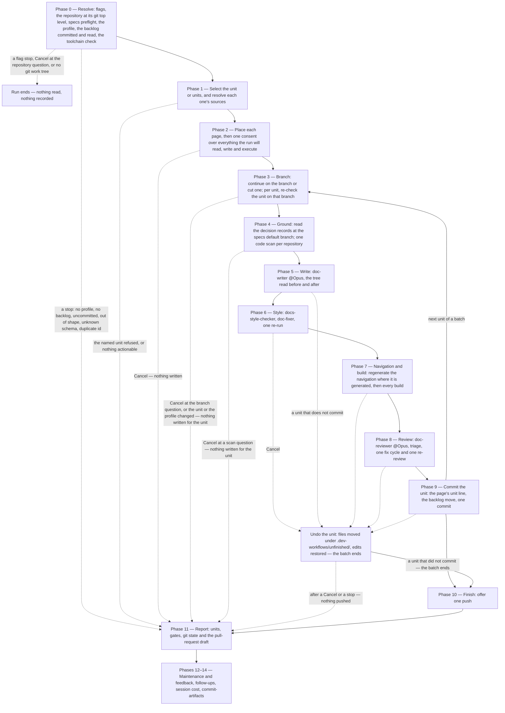

# /docs-write

Drafts one page per unit of the documentation backlog — a unit you name, the next actionable one, or up to ten — from that unit's own evidence, and commits the page, its navigation and the unit's move to `drafted` together, in one commit on a branch.

## Who runs it

`/docs-write` is the command after [`/docs-audit`](docs-audit.md): the audit writes the backlog, and this command takes its units one at a time and writes each one's page. [Workflow overview](../workflow.md) draws it beside the backlog, and [The documentation route](../docs-workflow.md) is the written procedure around it — what comes before, and the walking and publishing of a page that still come after it.

It classifies each unit as **MODERATE** — one page of one type, written from evidence the run reads, on a branch nothing merges without you. The page is written on the Opus chain and reviewed by an Opus reviewer (unless `--enforce-model` pins another model); the scans, the placement, the style check and the fixes run on the Sonnet chain.

**A drafted page is not a verified one.** Every claim the evidence does not ground is marked inline, and every page this command writes opens with one more marker saying it was drafted from the product's code and specifications and has not been checked against the product itself. The unit moves to `drafted`, never further: walking the page and removing the markers is still yours, as [The documentation route](../docs-workflow.md) says.

## Synopsis

```
/docs-write <unit-id>|--next|--batch <n> [--docs-repo <path>] [--skip-costs] [--skip-feedback] [--enforce-model=<model>]
```

Name exactly one unit, once:

- **`<unit-id>`** — that unit, matched against the backlog's unit ids as written. A unit it cannot draft stops the run, with a line naming the one thing to change.
- **`--next`** — the first actionable unit, lowest priority number first, then file order.
- **`--batch <n>`** — the first `n` actionable units, `n` from 1 to 10. A batch leaves out tutorials and how-tos, and asks once for all of its units. A batch that finds fewer than `n` takes what it found and says so.

`--docs-repo <path>` names the documentation repository. Without it the run looks in the working directory, then `$DOCS_PATH`, then one level under `$REPOS_PATH`, and asks where none of them is one; the unit selector is never read as a path. Every recognised flag is stripped, `--docs-repo` and `--batch` each with the value after it, before the unit id is read, and any other token beginning `--` stops the run.

All three run flags apply. `--skip-costs` (or `WORKFLOWS_SKIP_COSTS`) skips the session-cost entry while still advancing the checkpoint — see [Session cost](../reference/session-cost.md). `--skip-feedback` (or `WORKFLOWS_SKIP_FEEDBACK`) narrows the maintenance step to bugs-only — see [Session feedback](../reference/session-feedback.md#bugs-only---skip-feedback). `--enforce-model=<model>` (or `WORKFLOWS_ENFORCE_MODEL`) pins every agent the run dispatches to one model, the Opus reviewer included.

## What it needs

- **A documentation repository that is a git work tree**, with a profile and a backlog. The run resolves the repository, reports which rung of the ladder answered, and works at its git top level. A directory in no git work tree is refused before anything is read, since a run that commits needs one.
- **The backlog and the profile committed.** Both must be tracked, with nothing uncommitted in either, before the run writes anything; otherwise it stops and names the file to commit. A change folded in from an uncommitted backlog or profile would otherwise ride into a page's pull request.
- **A backlog in the shape the run reads.** No YAML parser ships with this plugin, so the backlog is read line by line, and every line must be a whole item: no value continues past the line it opens on. **A limit:** a backlog formatted by hand that a YAML reader accepts can still be refused — by its indentation or by a key form above all. The stop names the line and the reason; reformat that line, or re-run `/docs-audit --refresh`, whose write is always in shape.
- **Page paths of a plain form.** A page path is written into the backlog, into git and into a command, so it is held to letters, digits, `.`, `_`, `-` and `/`, ending `.md`. **A limit:** a content root or a page name holding a space or a non-ASCII character is refused — a proposed path is passed over, and a path you type is refused and asked for again.
- **The code repositories a unit's evidence names**, as the backlog's sources record them. Each is found by its recorded path, else by its origin under `$REPOS_PATH`, else by asking you. One outside `$REPOS_PATH` is read only once you have agreed to its path: in the consent, or — a path you give when a scan finds a repository missing — in that answer, which the question presents as an admission. Each is scanned at its default branch: a clone is switched to that branch and pulled, save the repository your session runs in where it stands on another branch, and the documentation repository itself where it is also a source, each read at its default branch by ref, its checkout left where it is.
- **`$SPECS_PATH`**, for a unit whose evidence is an architecture decision record, and for the run's own bookkeeping. The only specs document the run reads is an `ard.md` under the specifications tree, at the specs repository's default branch — never a working-tree copy, and never a scan of that repository.
- **The tools the profile's build and lint commands run.** A missing build tool is reported before anything is written, since no unit whose page that build compiles can be committed without a passing build.

## Phases

The diagram shows the run's flow. A dotted edge is a stop, a Cancel, or a unit that does not commit.



| Phase | What happens |
|---|---|
| 0 — Resolve | Strip the flags; resolve the repository's git top level; run the specs-repo preflight; read the profile; check the backlog and the profile are committed; read the backlog's shape. |
| 0 — continued | Name any directory an earlier run left under `.dev-workflows/unfinished/`; run the toolchain check; classify the run and record its model routing. |
| 1 — Select | Take the named unit, or the actionable ones; pass over any a branch not yet merged has already moved; resolve each unit's code repositories and decision records. |
| 2 — Place | Take the unit's recorded page path, or find a place for the page; list each file that gains a link or a navigation entry; ask once, showing what the run will read, write and execute. |
| 3 — Branch | Continue on your branch or cut a new one, checking the working tree first; then, per unit, re-read the unit and the profile on that branch. |
| 4 — Ground | Read each decision record at the specs default branch; scan each code repository at its default branch, at most four at a time. |
| 5 — Write | Write the brief and have `doc-writer` draft the page and its entries; refuse any edit outside them. |
| 6 — Style | Run the style check over the page, fix its violations once, and re-run it. |
| 7 — Build | Regenerate the navigation where the configs say it is generated, then run every build the consent showed. |
| 8 — Review | An Opus review, triaged; one fix cycle and one re-review; an unresolved BLOCKER asked about one at a time. |
| 9 — Commit | Write the page's `unit:` line and the unit's move in the backlog, then commit page, navigation and backlog together. |
| 10 — Finish | Offer one push, once, after the last unit. |
| 11–14 | The report with its pull-request draft, then maintenance and feedback, follow-ups, session cost and the specs-repo commit. |

## Gates

**The consent.** Nothing is written, and no repository is scanned, until you have seen, in one question: each unit and its page path; each file that gains the page's entry; each code repository and decision record the run will read, a repository outside `$REPOS_PATH` marked as admitted only by this answer (a repository you name later, when a scan finds one missing, is admitted by that answer instead, and its question says so); the branch; each branch whose backlog could not be read; each build config; every build and lint command the run will execute, verbatim; and that the style check also runs the repository's own linter, such as Vale or markdownlint, on the repository's configuration. A batch asks once for all of its units.

**The style check, the build and the review**, per unit. The style check runs the repository's own linter and the semantic prose pass over the page, and one fixer pass is made over its violations. The build runs every build the consent showed, and it decides whether the unit can move: only a passing build — or a profile that records no build command for the page's space — lets the unit commit. A build that fails on its content gets one fixer pass and one re-run; a build that fails because its tool will not run asks you, and proceeding without it ends the unit uncommitted. The review is Opus, and its findings are triaged before any fix: each is verified where it points, kept, marked unverified or dismissed with a reason, and only survivors are fixed. One fix cycle and one re-review at most; a BLOCKER still standing is asked about one at a time — fix notes, defer, override with a rationale, or cancel.

**What the run checks that no agent can.** Before and after every writing agent, it reads the repository's working tree — and the one your session runs in, where that is another — and ends the unit on any file the agent changed or created other than the page and the files that gain its entry, or on a change to such a file's frontmatter. The markers are kept out of the style pass: neither the style check nor its fixer reports, rewords or removes one.

**A unit moves only in the commit that finishes it.** The page's `unit:` line, the unit's status and its page path are written at the commit step and nowhere earlier, and committed with the page and its navigation in one commit. A unit that does not commit — a build still failing, a deferred finding, a refused commit, a cancel — loses its `unit:` line, has the files the run created for it moved under `.dev-workflows/unfinished/<unit-id>/` (or the next free `-2`, `-3` directory), and has every file the run edited for it restored; nothing is deleted, and the batch ends there. So a page that never committed carries no unit id, and `/docs-audit --refresh` never matches it to its unit.

## Outputs

- **One commit per unit** on the run's branch: the page, each file that gained its entry or each regenerated navigation config, and the backlog's move of that unit to `drafted`. The message is `docs: draft <unit-id> (<type>, <audience>)`, or your profile's commit convention where it takes only a summary, with the unit id and the page path in its body.
- **The page** — under its content root, under `internal/` for an internal unit — carrying its type, audience, visibility, evidence and review-by date in its frontmatter, every claim its evidence does not ground marked, and the page-level marker first in its body — after the internal marker, on an internal page.
- **One push offer**, after the last unit, never forced. No pull request is opened.
- **A pull-request draft, printed in the report** and written to no file: the units moved, their pages, the files edited, the review verdicts and their triage, the build results, the markers left, the deferred items, and any unit left under `.dev-workflows/unfinished/`.
- **A session cost entry and any feedback**, filed under `$SPECS_PATH/documentation/<docs-repo-slug>/`, as for an audit — unless the run found `$SPECS_PATH` misplaced or its environment changed, when they stay in the run's output. See [Session cost](../reference/session-cost.md).

## Failure modes

- `DOCS_WRITE_UNKNOWN_FLAG`, `DOCS_WRITE_SELECTOR`, `DOCS_WRITE_BAD_BATCH` — the arguments name an unknown flag, not exactly one unit, or a batch size outside 1 to 10.
- `DOCS_WRITE_NOT_A_REPOSITORY` — the resolved directory lies in no git work tree.
- `DOCS_WRITE_NOT_WRITEABLE` — the repository's top level cannot be written.
- `DOCS_WRITE_NO_PROFILE` / `DOCS_WRITE_PROFILE_COMMAND` — no readable profile, or a build or lint command holding a line break, or a build config outside the repository.
- `DOCS_WRITE_NO_BACKLOG` / `DOCS_WRITE_UNCOMMITTED` — no backlog, or the backlog or the profile not committed as it stands.
- `DOCS_WRITE_BACKLOG_UNREADABLE` / `DOCS_WRITE_BACKLOG_SHAPE` / `DOCS_WRITE_UNKNOWN_SCHEMA` / `DOCS_WRITE_DUPLICATE_ID` — the backlog's reader could not run, a line is outside the shape it reads (named, with its reason), its schema version is not one this release reads, or two units share an id.
- `DOCS_WRITE_NO_UNIT`, `DOCS_WRITE_STATUS`, `DOCS_WRITE_BLOCKED`, `DOCS_WRITE_PAGE_TAGGED`, `DOCS_WRITE_SURFACE`, `DOCS_WRITE_RELEASE_UNIT`, `DOCS_WRITE_TYPE`, `DOCS_WRITE_INTERNAL_UNIT`, `DOCS_WRITE_WALKTHROUGH`, `DOCS_WRITE_EVIDENCE`, `DOCS_WRITE_ARTIFACT` — the named unit cannot be drafted, and the line says what to change. `--next` and `--batch` pass such a unit over instead, and the report says why.
- `DOCS_WRITE_NO_MARKER` — the plugin's own files are out of step: the page-level marker every drafted page must open with could not be read from them. Update the plugin.
- `DOCS_WRITE_NO_BASE` / `DOCS_WRITE_NO_CANDIDATE` — `--next` or `--batch` found no default branch to compare other branches' backlogs against (name the unit instead), or no actionable unit.
- `DOCS_WRITE_PAGE_PATH` — the unit's recorded page path is outside the form above (edit it), or names a file that exists (tag that page with the unit's id and re-run `/docs-audit --refresh`, or set the path to null).
- `DOCS_WRITE_UNIT_CHANGED` / `DOCS_WRITE_PROFILE_CHANGED` — on the run's branch the unit or the profile is not what the consent showed.
- `DOCS_WRITE_BACKLOG_EDIT` — the backlog's move could not be finished. The unit is undone, and the backlog is restored from the copy taken before the edit only where the reader says its own undo failed; otherwise it is left as it is, and the report names the copy for you to compare, since another writer may have changed the file.

**Every stop once the run holds its repository's git top level still finishes the run's bookkeeping**: the report, the cost entry and any feedback, and the terminal specs-repo commit. The flag stops, a Cancel at the repository question and `DOCS_WRITE_NOT_A_REPOSITORY` record nothing, having read and written nothing.

**Cancelling after the branch step** undoes the unit in hand, pushes nothing, and names the branch and each unit already committed on it.

## Example

```
/docs-workflows:docs-write --next
```

Resolves the documentation repository, checks that its backlog and profile are committed, takes the highest-priority unit no other branch has already moved, places its page, and asks once. Then it cuts a branch, scans the unit's code repositories at their default branch, drafts the page, style-checks, builds and reviews it, and commits the page, its navigation and the unit's move to `drafted` in one commit — and offers to push.

```
/docs-workflows:docs-write --batch 3 --docs-repo /workspace/docs
```

Up to three actionable units, tutorials and how-tos left out, each placed and listed in one consent, then written, built and reviewed in turn on one branch. A unit that does not commit ends the batch, its files moved under `.dev-workflows/unfinished/`; the units before it stay committed.

## See also

- [The documentation route](../docs-workflow.md) — the whole procedure from an empty repository to a published portal, and what to do with a drafted page.
- [`/docs-audit`](docs-audit.md) — writes the backlog this command reads, and its `--refresh` reconciles a page whose unit's move was lost in a merge.
- [`/docs-init`](docs-init.md) — scaffolds a repository whose navigation this command regenerates.
- [`/docs-profile`](docs-profile.md) — writes the profile this command reads.
- [`/document`](document.md) — documents a feature from its PRD; it reads no backlog.
- [Documentation backlog](../reference/docs-backlog.md) — the file this command moves units in.
- [Evidence and walkthroughs](../reference/docs-evidence.md) — what a page's claims may rest on, and what a marked claim looks like.
- [Session cost](../reference/session-cost.md) — what this run charges to, and where the file lands.
