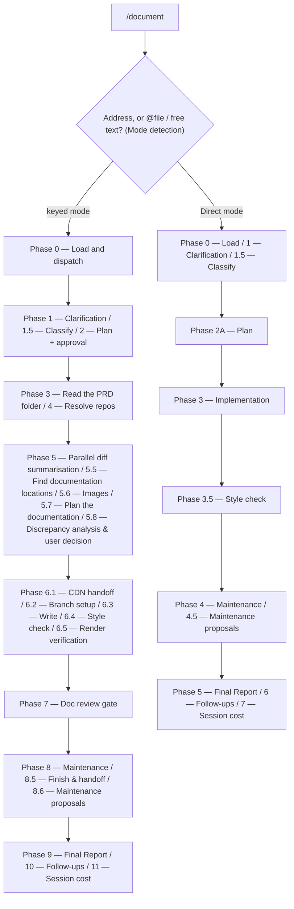

# /document

Writes or updates product documentation — either a full keyed feature-documentation run, or a small one-shot doc edit.

## Who runs it

`/document` runs in the [dev](../roles-and-phases.md#dev--document-what-shipped-and-keep-the-portal) role, cost-attribution phase [documenting](../roles-and-phases.md#documenting) — being in this phase means product documentation is being written or updated for a shipped feature. Both of its modes emit the same fixed `phase: documenting, role: dev` pair to the cost report; unlike [`/release-notes`](release-notes.md), which infers its phase from whether engineering artifacts exist yet, `/document` never has to infer anything — a documentation run is dev-phase work regardless of which mode wrote it.

## Synopsis

```
/document <PRODUCT-NNNN> [--skip-costs] [--skip-feedback] [--enforce-model=<model>]
/document <@file | free-text doc-edit description> [--skip-costs] [--skip-feedback] [--enforce-model=<model>]
```

**A reader needs to know which mode a run is in before anything else on this page applies.** `/document` selects between two structurally different pipelines from the first argument token, and everything below — inputs, outputs, and gates — differs by mode:

- **Keyed mode (Mode A)** — the first token is a single positional address: a `<KEY>` — bare, behind its folder's kind prefix (`EPIC-<KEY>` reads as `<KEY>`), or as its folder's whole name — or an `@<path>` naming a folder in the specs tree. The resolved folder supplies the specs this run documents from, and the PRD comes from the PRD folder — the resolved folder itself, or, where the address names an Epic folder, the folder above it, the Epic then scoping the repositories resolved, the diff summaries and the documentation plan to itself. An address that resolves but leads to no `prd.md` the run can read takes a named stop in Phase 0 step 1, before the run asks anything or touches the docs repository, never the re-enter/cancel escalation an unresolved key gets, since re-entering a key that resolved cannot help. `DOCUMENT_BRD_NOT_SLICED` stops on a BRD container, whose PRDs sit in its slices: it lists each slice, and offers `Enter a slice key (you'll be prompted)` or `Cancel`, taking a typed key only where it is one of the keyed slices listed and re-asking otherwise, and running the specs-repo preflight again for the slice entered, so the slice is read on the branch a direct run on it would read, save where that preflight leaves a switch undone and the run goes on from the branch it stands on; a container with no slice yet is a plain stop naming `/product-workflows:brd-split`. `DOCUMENT_FOLDER_NOT_PLACED` stops on a folder the run cannot place at any level, naming what the folder carries and the remedy: give it a carrier, or, where it holds an `idea.md` and no `prd.md`, run `/product-workflows:create-prd`. `DOCUMENT_NO_PRD` stops on a PRD folder with no `prd.md`, or with one the run cannot read, which it reports with the read error and names no command for. Its remedy is `/product-workflows:create-prd` on the idea route; on a BRD-route slice it follows the slice's ledger — `/product-workflows:brd-split` while a claimed row is still unallocated, a missing or unreadable `coverage-ledger.md` reported by path, the parent's keep-or-remove `/brd-split` for a slice claiming nothing, and no command for a slice that claims rows but covers none of them here, which holds no PRD of its own and so nothing to document; for an Epic with no PRD folder above it, it names moving the Epic folder into one. A PRD folder that carries no key stops too (`DOCUMENT_PRD_NO_KEY`), naming the two ways to give it one. Each of these stops is a user halt, so none is recorded as a plugin gap. A `prd.md` whose frontmatter asserts no `kind: prd` is still read as the PRD.
- **Direct mode (Mode B)** — everything else: a leading `@file` token, free-text prose, or a directory outside the specs tree. This is the **one-shot doc-edit** pipeline: apply a described change to existing pages with no address, and with no repo or ref resolution at all.

All three run flags apply to both modes. `--skip-costs` (or `WORKFLOWS_SKIP_COSTS`) skips the terminal session-cost phase — Phase 11 in keyed mode, Phase 7 in direct mode — still advancing the checkpoint and dropping any deferred cost record a [ceded](../reference/session-cost.md#ceded-runs) `/prompt-brainstorm` or `/prompt-grill-me` run left pending in this session; see [Session cost](../reference/session-cost.md). `--skip-feedback` (or `WORKFLOWS_SKIP_FEEDBACK`) narrows the maintenance phase's Agent 4 — Phase 8 in keyed mode, Phase 4 in direct mode — to bugs-only, dispatching `defect-reporter` in place of `impl-maintenance`: under the flag only real defects are persisted, never the in-session Lessons Learned report ([Session feedback](../reference/session-feedback.md#bugs-only---skip-feedback)). `--enforce-model=<model>` (or `WORKFLOWS_ENFORCE_MODEL`) pins every dispatched agent in this run — `doc-reviewer` included, overriding its frontmatter Opus pin, and reaching `docs-style-checker`'s own nested `prose-style-checker` dispatch too — to one model, bypassing the model fallback chains the run would otherwise select from, and suppressing Phase 1.5's window-relaunch advisory ([Model routing](../reference/model-routing.md#enforcing-one-model---enforce-model)). In direct mode, the free-text argument is protected the same way: a run flag forms a leading run — together with a leading `@<path>` token where the argument opens with one — or a trailing run at the very end; a run flag in either position is stripped, one written inside the text itself is kept as text, never read as a flag.

Keyed mode takes the address and nothing else. Where each page is written follows from the page itself: Phase 5.5 resolves every write target against the content roots the resolved profile declares, and Phase 6.3 writes each page into the root that owns it. A repo whose profile declares several content roots is handled the same way — a page is edited where it lives, and the per-root lint, build, and dev-server commands are selected from the root that owns it.

For writing child Epic drafts from a PRD, use the pipeline plugin's `/product-workflows:epics`. For release notes, use [`/release-notes`](release-notes.md) — `/document` never writes release-notes or what's-new pages: `/release-notes` drafts the note into the PRD folder, and whoever publishes your release notes takes it from there. For a change that touches both code and docs, use `/dev-workflows:implement` instead of either mode of this command.

## How it runs

`/document` has **34 `## Phase` headings — more than any other command in the family** (the pipeline plugin's `/product-workflows:epics`, the next-largest, has 23). Almost all of that comes from running two pipelines under one name: 23 phases belong to keyed mode, 11 to direct mode, each numbered from its own Phase 0. A 34-node diagram would not be a diagram, it would be the file, so the graph below shows the shape a reader actually navigates — the mode split, then each mode's own phases collapsed into the steps a reader experiences as one decision or one unit of work.



The `MD` fork is the command's own `## Mode detection` section, run once before either pipeline starts. Both branches share one thing ahead of the split: a `specs-preflight` pass against `$SPECS_PATH`, run before dispatch so it covers Mode B as well as Mode A.

Eight subagents are dispatched, none shared by both modes except `docs-style-checker`, `workflows-core:doc-fixer`, and `workflows-core:impl-maintenance`. Keyed-mode-only: `diff-summarizer` (Phase 5, up to 4 concurrent per batch), `doc-location-finder` (Phase 5.5), `doc-planner` (Phase 5.7, pinned to the Opus chain), `doc-writer` (Phase 6.3, also Opus-pinned — the sole author of the written pages; the orchestrator prepares its handoff and commits its output, but never writes pages itself), and `doc-reviewer` (Phase 7, Opus-pinned by its own frontmatter). Shared by both modes: `docs-style-checker` (Phase 6.4 in keyed mode, Phase 3.5 in direct mode), `doc-fixer` (invoked from the style-check phase in either mode, plus Phase 7 in keyed mode), and `impl-maintenance` (Phase 8 in keyed mode, Phase 4 in direct mode, alongside three general-purpose maintenance agents in a single dispatch). Direct mode additionally dispatches a read-only general-purpose exploration agent at Phase 2A before drafting its plan — so even the lighter pipeline dispatches well over the two-subagent floor.

## What it needs

**Direct mode** needs the doc-edit description itself — an `@file` or free text — and expects the content to already be in the user's head or the file, not scattered across PRD sections and the diffs behind them; that's the boundary with keyed mode. It works on the repository it edits — the one holding the directory or `@file` it is given, or `cwd`'s where the description names no path — and its toolchain preflight, its checklist and its style check all read that repository, whichever one `cwd` sits in. Where the target sits in a site below that repository's top level — a monorepo's `website/` — the preflight and the style check look for the site's own `.vale.ini`, lockfile and lint configuration there first and then in each directory above it up to the top level, as keyed mode does. When the target is not a git repository, Phase 0 records all three of direct mode's gates and skips the checklist extraction, rather than stopping the run. Its toolchain preflight is sourced only from the repo's own config signals and documented `Prerequisites` — there is no profile in direct mode, since a profile is a keyed-mode/docs-repo concept.

**keyed mode** needs:
- **A resolved address** — a key or an `@<path>` naming a folder in the specs tree. A key needs `$SPECS_PATH` set, since the key is found by searching that tree: with the variable unset the run stops in Mode detection, naming it and offering to set it or cancel, before it resolves anything; an `@<path>` address names its folder directly and runs without the variable. Keyed mode never gates this PRD on being merged anywhere: nothing in the command calls `require-on-main`, so it reads the PRD folder directly regardless of what specs artifacts exist or where they live, once the branch check below has passed.
- **A specs checkout not behind for the PRD** — once the address resolves, the specs-repo preflight has run and the folder is placed, a keyed run checks the branch the specs checkout stands on, before it reads the folder's documents. An address that leads to no PRD the run can read, or to a PRD folder with no key, stops on that first, before this check. Where it is a plugin branch the default branch has moved past under the address's top-level folder in `specifications/` — the PRD folder, or the `BRD-` folder above a slice — a document there added, changed or removed since that branch was cut, session files aside, the run stops, naming the paths and what to do — switch the specs checkout to its default branch and re-run.
- **A writable docs repository**, resolved cwd-preferred: the git root of `cwd` when it carries a docs signal (a `package.json` script matching `*:start`, `*:build`, `*:lint` or `docs:*`; a `.docstack/` directory, `mkdocs.yml`, `docusaurus.config.js`, `antora.yml`, a Vale configuration file under any of the five names Vale reads (`.vale`, `_vale`, `vale.ini`, `.vale.ini`, `_vale.ini`) or `DOCUMENTATION-GUIDELINES.md`; or a `_snippets/` directory at any level), else the `$DOCS_PATH` hint (default `/workspace/docs`) when it carries a docs signal or an in-repo profile, else a docs repo discovered under `$REPOS_PATH` by signal (an in-repo profile, or a docs signal — never by repository name), else an explicit ask. Whichever answers, the run then works at that directory's git top level — a `$DOCS_PATH` or a typed path naming a site below it, such as a monorepo's `website/`, is taken up to it — because that is where the profile lives and where its paths and commands are rooted. A resolved path that fails `test -w` stops the run with `REPO_NOT_WRITEABLE`.
- **A docs-profile** — loaded in-repo from that top level, from the built-in default (which applies only to a repo shaped like the bundled worked example), or generated on demand by an inline [`/docs-profile`](docs-profile.md) run for any other repo that has none; a custom repo whose profiling run is cancelled stops with `PROFILE_REQUIRED`, naming any stash profiling made and, where the Cancel came after profiling switched the repository to its default branch, the branch to switch back to; one whose profiling stops on its own error — a bootstrap branch an earlier run left behind — stops with that error. The inline run hands back the branch it cut and the commit it made, and the finish renames that branch and squashes onto that commit — it never looks either up. **A run that stops after that commit and before Phase 6.2 renames the branch** — a missing tool you cancelled on, a Cancel at a clarification, classification or plan prompt, or any later stop or Cancel before Phase 6.2 renames the branch — leaves the docs repository on that branch with the profile commit on it and nowhere else, so it ends by naming the branch, the commit and the base branch to switch back to, with the commands to keep or drop the profile: a leftover branch of that name stops the next run that profiles the repository inline.
- **Additive `specs`** (optional, from `$SPECS_PATH` or a passed directory) — never gated; an empty list proceeds without prompting. When present, it feeds Phase 5.8's three-way PRD/spec/code discrepancy check instead of the plain PRD/code two-way one.
- **Mounted repos under `$REPOS_PATH`**, matched by their `git remote get-url origin` slug to each in-scope `repo` slug the implementation record and the commit scan named. Nothing requires `gh`: where it is installed and logged in and a scanned clone is on GitHub, a merged pull request naming a key adds the commits it landed, and every other one found is listed, never read ([key discovery](../reference/references.md)). A slug with zero matches is never silently dropped — it is escalated once, in a single consolidated gate covering every missing repo in the run, not one prompt per slug — save where no entry of `${REPOS_PATH:-/workspace}` exists and Phase 1's question took *Proceed without the repos*, which already chose PRD-only content for every repo, and no base named at the plan's *Revise plan* undid that answer: there no gate is put, and each repo's refs are recorded as unresolved. A slug with several clones uses the preferred one (a basename ending `-repo`, then `_repo` or `_fast`, then the alphabetically last) — the one key discovery scanned — and, before that gate, the run lists the others and asks once whether to use another.

## What it produces

**Direct mode** produces edits to the target file(s) — in the repository the argument resolves to, which is not necessarily `cwd` — left **uncommitted** — the user manages git manually for a doc edit, and this mode creates no branch and no commit, ever. It always runs its four Phase 4 maintenance agents (documentation, knowledge base, instructions, `impl-maintenance` — `defect-reporter` in its place under `--skip-feedback`) and, on any accepted proposal, applies it uncommitted alongside the doc edit. Each of those agents is told the folder it works in by its absolute path — the edited repository's top level, or the target itself where that is in no repository — and that it edits nothing outside that folder, the session's working directory possibly being a code repository. Where the working directory is in a git repository outside that folder, the run reads that repository's status before and after the agents, with the plugin's own `tree-snapshot.py` script, which names every path exactly as git holds it, and reports every path that changed there while they ran, leaving each as it stands, or, where that script cannot read the repository, says it went unread; a path the documentation agent returns outside the folder is reported as an out-of-scope write. It ends with a Phase 5 report; there is no next-step recommendation printed, since a one-shot edit has no PRD to hand off.

**keyed mode** produces one or more product-doc pages, written by `doc-writer` into the resolved docs repo at the confirmed write targets. When the write context is `docs_repo` (or a `non_docs_repo` the user confirmed), Phase 6.2 creates a feature branch before writing, the orchestrator commits what `doc-writer` wrote into the docs repo, and Phase 8.5 squashes the run into clean history and, where git accepts the squash commit, offers a push plus pull request — unless you answer the plan's *Revise plan* with "no branch", which leaves the pages uncommitted on the branch the docs repo is on and skips Phase 8.5 (not offered where the run profiled the repository inline, whose profiling already cut the branch); for `obsidian` or `plain_dir` contexts nothing is ever branched or committed there. Phase 8.5 also writes the pull request's title and body, ready to paste, to `pr-draft.md` in the resolved PRD folder, which the run's terminal commit of the specs repository takes wherever it commits at all; once it is on the specs repo's default branch, `/dev-workflows:ready` reads it as the PRD's documentation drafted — one of the two drafts its *Release Preparation* stage expects, counted only while no work implemented on the PRD is dated after its last commit there; a run that skips Phase 8.5, or cancels at its push prompt, writes none. When Phase 5.8 records a `document-as-spec`, `skip-and-report`, or qualifying `document-as-code` decision, a `<KEY>-implementation-gaps.md` bug-report draft is also written to the resolved PRD folder — save for a decision taken from a conformance record, which drafts no gap and holds no release (below). A new screenshot the pages need goes into the PRD folder's `Doc screenshots/` subfolder — the default staging directory for an image uploaded by hand, too — and never into its `attachments/`, which holds only the sources a run vendored; an image already under `attachments/` is still offered as a Phase 5.6 candidate. Its maintenance agents are told the docs repository by its absolute path, and that they edit nothing outside it, the session's working directory possibly being a code repository; the run reads the docs repository's status, and the session's repository's where that lies outside it, before and after them, with the plugin's own `tree-snapshot.py` script, which names every path exactly as git holds it, and reports every path that changed while they ran; where that script cannot read the docs repository, the documentation agent's edits there stay out of Phase 8.5's squash, save to a page the run wrote, and the report says so. A page the documentation agent edited that already held somebody else's uncommitted changes, or one outside the docs repository, is reported and kept out of Phase 8.5's squash; a page `doc-writer` wrote or `doc-fixer` edited goes into that squash as it then reads, a change made while the agents ran included. Under Phase 6.2's *Proceed anyway*, somebody else's changes stay out of the squash, save in a page `doc-writer` wrote or `doc-fixer` edited, which carries them whole. The run ends with a Phase 9 Final Report (PRD folder summary, repos analysed, refs in scope, output files, branch, the verification-gates table, render verification, review verdict and triage, the four maintenance summaries, screenshots staged for manual upload, the conformance decisions taken, implementation gaps, deferred items) followed by Phase 10 follow-ups and Phase 11 session cost.

**Keyed mode also reports the lineage above what it documents** (Phase 0, once the folder is placed and before anything is dispatched). It checks each unit's specification and design up the chain — the Epic, ARDs and PRD they were built from and, above the PRD, its idea or, on the BRD route, its decision register and grounding — for the focus Epic alone on an Epic address, for the PRD folder and each Epic under it otherwise, and for `prd.md` alone where nothing under the PRD is specified yet. A link whose upstream has moved since its document was built — a PRD revised after its specification or design was written — is a ⚠ line in the readiness table and the final report's `### Lineage`, naming the document to revise and the command that revises it. It is one more cause of a requirement the code may not have, reported beside Phase 5.8's discrepancies and never a reason to stop. A link a document of the same unit accepted is shown as accepted; a document with no lineage record yet, not on the specs repository's default branch, or changed on the specs checkout from the default branch's copy — a PRD revised on an open branch — is a note, and the report never calls the lineage current while one of those is listed. Nothing is asked and nothing is written: the pages carry no lineage, and neither does any file in the specs tree. An `@<path>` run with `$SPECS_PATH` unset has no specs repository to check, and says so.

Independent of either mode's own writes, the terminal `commit-artifacts` step commits only `$SPECS_PATH`'s bounded session-artifact paths — never the docs write target, which is always a separate repository. A run that ends early in either mode — at a named stop, a *Cancel* that ends the run, a relaunch or a redirect to another command — still writes its session-cost entry and ends with that terminal commit of the specs repository and its `Specs repo:` line, with no follow-ups, no resume pointer and no maintenance phase it had not already reached; where it names a docs-repository branch left behind by inline profiling, that notice comes after the `Specs repo:` line. Where `SPECS_PATH` is unset or misplaced, the cost entry stays in the run's printed output and nothing is committed. A direct-mode run that stops before it has a documentation repository to write into — an unreadable `@file`, or a malformed run flag with no address given — writes no cost entry at all, since there is nowhere to file one.

## Gates

**`docs-style-checker` is mandatory in both modes** and dispatched unconditionally — the orchestrator never skips it on its own judgement of which linters are installed. It runs the repo's primary linter (Vale or equivalent) and `prose-style-checker` as a complementary semantic pass, merging both finding sets; violations go to `doc-fixer`. `prose-style` is a declared dependency, so the complementary pass has no absent case — it is also what carries the check on a repository that configures no linter of its own.

Every gate's outcome is recorded in a run-scoped gate ledger with six possible outcomes — `RAN`, `DEGRADED`, `FAILED`, `UNAVAILABLE`, `SKIPPED_BY_USER`, `NOT_APPLICABLE` — and no outcome is orchestrator-assignable to mean "I decided this wasn't necessary": `UNAVAILABLE` must be converted to one of the other five before the run proceeds, `SKIPPED_BY_USER` must carry the user's decision verbatim, and `NOT_APPLICABLE` must name the unmet precondition. **Every gate in the registry appends its row when that gate completes; a missing row, an unconverted `UNAVAILABLE`, or an unattributed skip is a `doc-reviewer` BLOCKER.** keyed mode's registry has seven gate ids:

| Gate | Precondition |
|---|---|
| `toolchain_preflight` | always (after profile resolution) |
| `source_truth_verification` | ≥1 code repository resolved in Phase 4 |
| `style_check` | ≥1 file written |
| `repo_checklist` | the repo publishes authoring/verification guidance |
| `build_check` | write context is a buildable repo, whether or not the profile records a build command |
| `render_smoke_check` | buildable repo with ≥1 affected page |
| `image_review` | ≥1 candidate image, to add or possibly stale |

`build_check` runs every build the profile records in `builds[]` — the profile [`/docs-init`](docs-init.md) writes records each of its builds there — and otherwise the build command of each space the run wrote into. Each build is reported on its own, so a failure names the build that failed, and `doc-fixer` is handed that build's output. Where a build will not run for an environmental reason — its tool missing, say, or a missing `.docstack` shim — the gate's registered fallback still runs when its own tools are present: the smoke check's boot of that build's own servers, the ones that publish what it compiles (for a `builds[]` entry the server of the same `visibility`, for a space's build that space's servers, for the flat build every server the check boots). `build_check` is recorded `DEGRADED` once one of those servers comes up; another build's server is no proof for it. You are asked whether to install the tool, proceed without the check, or cancel only where that fallback cannot run or brings none of those servers up, and declining the smoke check then declines the build check with it. `render_smoke_check` reports a 404 on an affected page with its URL and leaves the page for you to check by hand, never sending it to `doc-fixer`: the page's URL is derived, so a 404 cannot tell a wrong URL from a missing page. A server error (5xx) is a render defect, handled like a build's content failure. The smoke check starts and stops its servers under `bash`, probes ports with `curl` and reads process groups — from `/proc` on Linux, which needs nothing installed, and with `ps` elsewhere — so the toolchain preflight requires `bash` and `curl`, and off Linux `ps`, wherever the profile records a dev server; where one cannot run, the check does not start rather than reading a missing tool as a port that answers: every affected page goes to the manual pages-to-visit table, the gate's fallback, and `render_smoke_check` is recorded `DEGRADED` with the tool named. A server whose own command's tool is missing — a `pnpm`, `npm` or `yarn` whose dependencies are not installed counting as missing — is never booted either: its pages go to the same table and the gate is recorded `DEGRADED`, rather than the check waiting out a readiness timeout for a server that could never start.

**Direct mode registers exactly three of those seven** — `toolchain_preflight`, `repo_checklist`, and `style_check` — and the other four never appear at all, not even as `NOT_APPLICABLE`: direct mode has no Phase 5.8, no Phase 5.6, and no Phase 6.5 to produce them.

**Keyed mode alone gates on `doc-reviewer`** (Phase 7, Opus-pinned by its own frontmatter). Its findings are triaged by the orchestrator — each verified at the location it names, dismissals and unverified findings recorded with a reason — before `doc-fixer` ever sees them; `BLOCK` invokes `doc-fixer` for BLOCKER/MAJOR findings and one re-review, capped at one fix cycle plus one re-review. `doc-fixer` is told to defer, never to choose, a finding whose suggested fix offers alternatives that differ in what the text means or requires (readings of a requirement, a scope line or a term), or whose fix takes a product or scope decision, naming the alternatives: a `BLOCKER` of that kind reaches you at the escalation, and a MAJOR goes to the final report's deferred items. Alternatives that mean the same, such as two ways to mend one link, stay an edit it applies. `PASS WITH RECOMMENDATIONS` with no MAJOR survivor dispatches nothing, offers no re-review and goes straight on — where triage dismissed every finding, after a prompt at which you settle the verdict; with one, it invokes `doc-fixer` for the MAJOR survivors only and then offers the re-review the cap still holds once — taken, it is dispatched and triaged like the `BLOCK` re-review; declined, the final report says the verdict predates the fixes. **Direct mode has no `doc-reviewer` gate at all, and therefore no BLOCKER fix cycle, no re-review, and no finding triage in this mode** — a style-linter violation is a deterministic match with nothing to trace, so there is nothing for a triage step to adjudicate. Because nothing downstream would catch a coverage gap, an `UNAVAILABLE` `style_check` row in direct mode is surfaced directly to the user as the gate ledger's `UNAVAILABLE` conversion prompt — the only place the gap appears, since there is no reviewer to raise it as a BLOCKER instead. Direct mode also runs none of `/dev-workflows:implement`'s code-oriented verification machinery: no `test-baseliner` captures a test baseline, no `test-writer` writes tests, and no `code-review` gate runs at all — direct mode edits prose, not code, so there is nothing for any of the three to do.

Keyed mode also runs a Phase 5.8 **discrepancy analysis** whenever the PRD narrative, the (optional) spec, and the code disagree — an analysis table is presented and you decide per claim or in one batch which phrasing to document, the batch question naming every discrepancy itself — save a discrepancy a conformance record already decides, which is never put to you (below). Documenting what shipped is the recommended choice. Documenting what was intended while the code lags drafts a bug report and holds the release: the run warns at once, and its report and pull-request draft say the release and the pages wait until the bug is fixed. It makes zero direct API calls: a keyed run's `refs[]` are resolved by pure local `git` against clones under `$REPOS_PATH`, matched by `git remote get-url origin` slug, and nothing here calls a REST API over HTTPS — the forge commands in the run are key discovery's optional, read-only `gh search prs` and `gh pr view` and the `gh pr create` Phase 8.5 offers for the run's **own** pull request, and `gh` wraps the API rather than calling it directly. And its branch policy classifies the **resolved `docs_repo_path`**, not `cwd` — Phase 6.2 branches only when that classification lands on `docs_repo` or a user-confirmed `non_docs_repo`, and the plan you approved says it will.

**A decision already made in `/dev-workflows:conformance` is taken, not asked again.** In Phase 3 the run reads the conformance records in scope — the PRD folder's `_conformance.md` and each Epic's, or, on an Epic address, that Epic's and the PRD record's entries about it — from the specs checkout's working tree, so a record whose pull request has not merged yet is read wherever your checkout holds it, and the report says each was read from the working tree. A missing record is simply absent. One that cannot be read, or is malformed — no `key:` in its frontmatter, a merge-conflict marker, or no `Run:` line naming an Epic or PRD run and its date — gets a ⚠ line and is treated as absent. A PE's ruling on a Dev's entry takes that entry's place, unless a later Epic run has since closed it, and an entry no longer counts once it is resolved, fixed, withdrawn or gone from its document, overruled, or satisfied again by later code. In Phase 5.8, before the analysis table, each discrepancy the code still shows is matched by its exact requirement against the entries that still count: the same document in the same folder, and the same requirement id, or the same quoted text where it has none — an id alone never matches. A matching entry decides it without asking: *fix the code* leaves the claim out, its fix pending, and *amend the document* or *accept* documents what the code does, read from the source today rather than from the record. Where two entries match, the PE's final decision beats a Dev's proposal, and between equals *fix the code* wins; a Dev's proposal that nothing outranks is taken and marked as a proposal. A discrepancy the run could not check against any code, or one where the code offers several candidate wordings, has no single wording to document from *amend the document* or *accept*, so it is asked as usual, though *fix the code* still leaves it out. A decision taken from a record drafts no bug report, holds no release and puts no banner on the pull-request draft: the record already carries it. The run prints one line for each before the table, and asks nothing where the records decided every discrepancy. The final report's `### Conformance` section names each entry taken and what its claim became, each one outranked, each whose discrepancy was asked anyway, each whose requirement the code now matches and each that matched no discrepancy, and, for each record, how many commits each repository's default branch has gained since the commit it checked — `may have moved` where it checked an Epic's branch before the merge, `not measured` where no clone was resolved. Nothing there changes a decision or asks anything.

## Example

Document a shipped PRD once every Epic under it is implemented (keyed mode):

```
/docs-workflows:document ACME-77
```

The run resolves the docs repo and profile, asks for output path / refresh policy / screenshot intent, classifies (typically `SIGNIFICANT`), reads the PRD folder, resolves the repos the implementation record names, determines the applicable space(s), summarises the diffs in parallel, locates write targets, reviews images, plans the documentation, resolves any PRD/spec/code discrepancy, writes the pages via `doc-writer`, runs the style check and render verification, gates on `doc-reviewer`, and closes with the four maintenance agents plus the Final Report — recommending `/docs-workflows:release-notes <PRD>` next, once every Epic is documented.

A same-session typo fix on an unrelated page runs direct mode instead — `/docs-workflows:document @note.md` or a free-text description — which skips address and repo resolution entirely, explores the target file and its neighbours, plans, edits, runs the mandatory style check, and ends with a report; no branch, no commit, and no reviewer gate.

## See also

- [Workflow overview](../workflow.md) — where this command sits among the plugin's others.
- [Roles and phases](../roles-and-phases.md) — what the `dev` role owns here, and why both of this command's modes emit the same fixed `documenting`/`dev` cost attribution. The companion `dev-workflows` plugin's page of the same name describes the rest of the `dev` role, and the companion `workflows-core` plugin's lists every lifecycle phase with the role it is charged to. [Session cost](../reference/session-cost.md) says which commands emit `documenting`.
- `/dev-workflows:implement` — the command to use instead for a change that touches both code and docs; it ships in the companion pipeline plugin.
- `/product-workflows:epics` — writes child Epic drafts from a PRD; a different output from either mode of this command.
- [`/release-notes`](release-notes.md) — the recommended next step once a PRD is fully documented, and the sibling command whose own phase/role IS inferred rather than fixed.
- [Model routing](../reference/model-routing.md) — how each mode classifies, which steps run on Opus, and `--enforce-model`; the model-routing `classification` reference (shipped in `workflows-core`, listed on its References page) holds the rules, and the `doc-planner` / `doc-writer` / `doc-reviewer` Opus pins used in keyed runs only.
- [Session cost](../reference/session-cost.md) — the cost entry both modes emit, in Phase 11 in keyed mode and Phase 7 in direct mode. [Session feedback](../reference/session-feedback.md) covers the feedback step of the maintenance phase, Phase 8 in keyed mode and Phase 4 in direct mode, and [Resume and checkpoints](../reference/resume-and-checkpoints.md) the resume pointer keyed mode writes after its cost entry; follow-ups have their page in `dev-workflows`.
- The `finding-triage` reference (shipped in `workflows-core`, listed on its References page) — the triage step run between `doc-reviewer` and `doc-fixer` in keyed runs only.
- [References](../reference/references.md) — the plugin's gate ledger (the six verification-gate outcomes, the full per-mode gate registry, and the reviewer-BLOCKER rule for a missing or unconverted row) and its repo-verification-gates file (how a docs repo's own pre-PR checklist is extracted into the `repo_checklist` gate).
- The `source-truth` reference (shipped in `workflows-core`, listed on its References page) — the PRD-vs-spec-vs-code discrepancy-escalation protocol Phase 5.8 runs, and the rules by which it takes a decision a conformance record already holds.
- The `document-lineage` reference (shipped in `workflows-core`, listed on its References page) — the lineage check keyed mode reports on in Phase 0, in the form that never asks anything.
