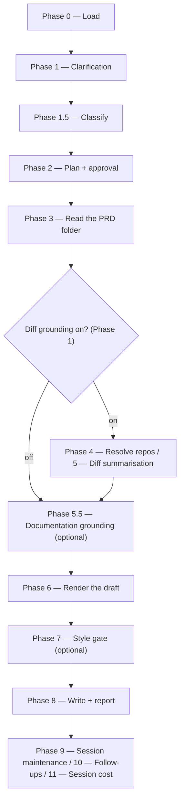

# /release-notes

Drafts a customer-facing release-notes summary for a resolved Product Requirements Document or ticket, for the PM to publish wherever their release notes are published.

## Who runs it

`/release-notes` is the plugin's one **dual-role** command — the same command runs at two different points in a PRD's life, and the cost phase tells them apart by inference rather than by a fixed label. The discriminator is deliberately narrow: **the presence of downstream engineering artifacts** — any `specification.md` or `design.md` under the PRD's specs dir. **None present** → phase [`prd-creation`](../roles-and-phases.md#prd-creation), role [`pm`](../roles-and-phases.md#pm--the-early-release-note) — the PRD exists but no engineering work has started, and Epics may or may not exist yet. **Either present** → phase [`documenting`](../roles-and-phases.md#documenting), role [`dev`](../roles-and-phases.md#dev--document-what-shipped-and-keep-the-portal) — the dev re-run, once a specification or design is in scope.

**Epic presence is deliberately not part of the signal.** A PRD can have drafted Epics — via `/product-workflows:epics` — while still entirely in PM/PE hands: nothing about an Epic draft implies engineering has started on it. Keying the discriminator on Epics would misattribute that ordinary PM-phase PRD as a dev run. Specs and designs are the right signal because they can only exist once `/product-workflows:specify` or `/dev-workflows:design` has actually run against the PRD — an Epic drafted by `/product-workflows:epics` never gets close to producing either.

**What differs between the two runs is narrower than the phase label suggests.** The command reads the same PRD hierarchy, offers the same optional diff grounding, and runs the same style gate regardless of which phase it infers, which it does in Phase 0, before it asks anything. It matters in two places. The first is the diff-grounding question: on the PM run nothing is built yet, so it recommends the PRD alone; on the dev run code may have shipped that differs from the PRD — a requirement left unbuilt, or added after the work was planned — and only the diffs check a claim against the commits the note covers, so it recommends grounding in them. Without them a requirement that was never built goes into the note as shipped. The second is the **Feature update** documentation link: on the PM run the feature isn't built yet, so no link is offered or asked for at all; on the dev run, the author may supply a redirect short link that will later point at the page `/document` publishes. Everything else — the draft's shape, its destination, its style check — is identical either way.

## Synopsis

```
/release-notes <ADDRESS> [--version <v>] [--no-docs] [--docs <path>] [--skip-costs] [--skip-feedback] [--enforce-model=<model>]
```

All three run flags apply to this command. `--skip-costs` (or `WORKFLOWS_SKIP_COSTS`) skips Phase 11's session-cost entry, still advancing the checkpoint and dropping any deferred cost record a [ceded](../reference/session-cost.md#ceded-runs) `/prompt-brainstorm` or `/prompt-grill-me` run left pending in this session — see [Session cost](../reference/session-cost.md). `--skip-feedback` (or `WORKFLOWS_SKIP_FEEDBACK`) narrows Phase 9's maintenance step to bugs-only, dispatching `defect-reporter` in place of `impl-maintenance`: under the flag only real defects are persisted, never the in-session Lessons Learned report ([Session feedback](../reference/session-feedback.md#bugs-only---skip-feedback)). `--enforce-model=<model>` (or `WORKFLOWS_ENFORCE_MODEL`) pins every dispatched agent in this run — `release-notes-writer`, `diff-summarizer`, `prose-style-checker` and `prose-fixer` included — to one model, bypassing the detection-chain routing described below; `/release-notes` has no Opus reviewer and no model-gated advisory, so enforcement changes no gate here, only which model each dispatch runs on ([Model routing](../reference/model-routing.md)).

`/release-notes` is **address-required** — there is no free-text input, and an `@<path>` naming a file is an address (the folder that holds it), never an input to draft from; a prompt with no positional address, or (with `$SPECS_PATH` set) with a token that is not a key (bare, behind its folder's kind prefix, or as its folder's whole name), stops with `RELEASE_NOTES_NEEDS_KEY`. The address is a `<KEY>`, or an `@<path>` naming a folder in the specs tree or a file inside one. A `<KEY>` is found only by searching `$SPECS_PATH`, so with that variable unset Phase 0 stops before resolving it, naming the variable and offering *Set SPECS_PATH* — which then asks you for the path — or *Cancel*; an `@<path>` needs no specs tree to resolve and runs on.

## How it runs

`/release-notes` has 14 `## Phase` headings.



The `d1` fork is the Phase 1 diff-grounding choice — the PRD alone recommended on the PM run, the diffs on the dev run (see *Who runs it*). It decides whether Phase 3's diff-source step runs at all — the `implementation.md` read and the `git log --grep` commit scan that build the refs — and Phase 4's repo resolution and Phase 5's `diff-summarizer` batches go with it; Phase 3's read of the PRD itself runs either way. No phase collects a PR link: a ref carries no URL and no host classification, and nothing requires `gh` — where it is installed and logged in and a scanned clone is on GitHub, a merged pull request naming a key adds the commits it landed, and every other one found is listed, never read ([key discovery](../reference/references.md)).

**Before Phase 1 asks anything, the run reports the lineage above the note** (Phase 0). It checks each unit's specification and design up the chain — the Epic, ARDs and PRD they were built from and, above the PRD, its idea or, on the BRD route, its decision register and grounding — for the focus Epic alone on an Epic address, for the PRD folder and each Epic under it otherwise, and for `prd.md` alone on a note drafted before anything is specified. A link whose upstream has moved since its document was built — a PRD revised after its specification or design was written — is a ⚠ line naming the document to revise and the command that revises it, shown before the diff-grounding question so you answer it knowing the PRD may carry a requirement the code does not have. With diff grounding on, such a claim meets the code in the per-claim discrepancy table like any other; with it off, the only check against the code is a conformance record from a PRD run written after the requirement was added (below), and the plan says how the claims are checked. A link a document of the same unit accepted is shown as accepted; a document with no lineage record yet, not on the specs repository's default branch, or changed on the specs checkout from the default branch's copy — a PRD revised on an open branch — is a note, and the final report's `Lineage:` line never calls the lineage current while one of those is listed. Nothing is asked and nothing is written: no lineage goes into `release-notes.md` or a note. An `@<path>` run with `$SPECS_PATH` unset has no specs repository to check, and says so.

**It also reads `/dev-workflows:conformance`'s records, with diff grounding on or off.** Phase 0 lists every `_conformance.md` in scope — the focus Epic's and the PRD folder's on an Epic address, otherwise the PRD folder's and each Epic's — with the date each was written and the commits it checked, before Phase 1 asks anything; a folder without one is simply not listed, and no record is ever needed. A record that cannot be read, or is malformed — no `key:` in its frontmatter, a merge-conflict marker, or no `Run:` line naming an Epic or PRD run and its date — is named in a ⚠ line instead, and the run goes on as if it were absent. Phase 3 reads the open entries of the rest: a requirement the code does not satisfy as written, with the decision someone recorded on it, a PE's ruling on a PRD run taking the place of a Dev's proposal unless a later Epic run has closed the entry, and an entry left out once it is resolved, fixed, withdrawn, overruled, or satisfied again by later code. On an Epic address the PRD's record counts only for that Epic's requirements. The draft follows each decision and asks nothing about one: a claim whose entry says *fix the code* is left out, since the fix has not landed, and one whose entry says *amend the document* or *accept* says what the code does instead of what the requirement says. Neither is put to you again as a discrepancy. Where two entries bear on one claim, a PE's decision beats a Dev's proposal, and between equals *fix the code* wins; two accounts of what shipped that disagree leave the claim out. The one question the records can lead to comes where leaving claims out leaves the note nothing it ships to describe: you are asked for the wording, or to leave a TODO marker, and wording that restates a claim left out is asked for again. With diff grounding on, a record that checked a repository before commits this note read there gets a ⚠ line in the report: what it settled may have changed since, and running `/dev-workflows:conformance` again brings it up to date. The report names every entry and what the draft did with it, marks a Dev's decision no PE has ruled on yet as a proposal, counts the requirements the record left unverified or not checkable, and for a claim left out says to run `/dev-workflows:conformance` again once the fix lands, on the folder whose record holds the entry, then this command. Where diff grounding is off and the run is a dev run or a lineage link is stale, the plan's `Code check:` line says whether claims were checked against the code only through these records — as of their dates, and only where a record traced the requirement a claim comes from — or not at all.

Three subagents are dispatched: `workflows-core:docs-grounder` (Phase 5.5, read-only grounding on the shipped product docs — default ON when `$DOCS_PATH` resolves, advisory, never a gate), `release-notes-writer` (Phase 6, the sole author of the rendered draft), and `workflows-core:impl-maintenance` (Phase 9, alongside no other maintenance agents — `/release-notes` has none of `/document`'s or `/dev-workflows:implement`'s three general-purpose maintenance dispatches). `diff-summarizer` (Phase 5) is a fourth agent, dispatched only when diff grounding is on. `prose-style-checker` and `prose-fixer` (Phase 7) belong to the separate `prose-style` plugin, a declared dependency of this one, so neither is ever skipped for want of a plugin — but they are not gated alike: `prose-style-checker` runs whenever the user keeps the style gate, while `prose-fixer` runs only when that pass returns violations *and* the user chose auto-fix, so "report only" keeps the gate and never reaches the fixer.

## What it needs

- **A resolved address** — a key or an `@<path>` naming a PRD or Epic folder in the specs tree, or a file inside one. An address that is not an `@<path>` needs `$SPECS_PATH` set, since it is found by searching that tree: with the variable unset the run stops in Phase 0, naming it and offering to set it or cancel, before resolving anything. An Epic folder's PRD is read from the PRD folder above it, and the draft then covers that Epic's changes; `release-notes.md` is the PRD folder's either way.
- **A specs checkout not behind for the PRD** — once the address resolves and the specs-repo preflight has run, the run checks the branch the specs checkout stands on, before Phase 1 asks anything. Where it is a plugin branch the default branch has moved past under the address's top-level folder in `specifications/` — the PRD folder, or the `BRD-` folder above a slice — a document there added, changed or removed since that branch was cut, session files aside, the run stops, naming the paths and what to run: merge the default branch in, where this run builds on that branch — its own `prd/` branch, or an earlier phase's open branch it stacks on — or switch to the default branch, where it does not. Where the `prd/` branch the draft's handoff would reuse is open and has changed something under that folder, it asks first whether to switch to that branch and continue there, or stop until its pull request is merged, or closed and the branch deleted.
- **Optional diff grounding** (recommended on a dev run, not on a PM run) — when turned on, `$REPOS_PATH` is resolved the same way `/document` resolves it, and clones are matched by `git remote` against the repo slugs the implementation record and the commit scan named; a repo that resolves to zero matches is put to you as a choice rather than resolved silently, and a repo you then skip degrades the grounding for that repo and never the run.
- **Optional `$DOCS_PATH` grounding** (Phase 5.5), resolved once in Phase 2 alongside plan approval — read-only, never a gate.
- **For a breaking change that takes effect in a later release, that release.** The PRD names it, or the run asks, with a `<!-- TODO: effective version -->` placeholder in the draft until it's answered — never the version the draft is filed under, which is the release that announces the change.
- **For a deprecating change, an end-of-life date.** A deprecation note is required whenever the PRD deprecates a capability or is itself a deprecation (a deprecation the PRD puts out of scope, leaves to later work, or mentions only as background needs none), and it always needs an end-of-life date — the end-of-support date is optional. A missing end-of-life date is never invented: it becomes a gap the command asks the user about, with a `<!-- TODO: end-of-life date -->` placeholder in the draft until it's answered.

## What it produces

**Where it lands.** `release-notes.md` in the resolved PRD folder, appended as a section: the Change Type selects `## Breaking changes`, `## Feature updates` or `## Fixes`, and those sit under a heading for the release version one level above them (`--version <v>`, else asked once in Phase 1 and shown in Phase 2's plan; `# Unreleased` when declined), each titled draft's `### title` sitting below its section. Each draft sits under an HTML comment naming the PRD's key, or the Epic's on an Epic address, the date, the stage the run drafted at — `stage: pm` or `stage: dev`, as the run inferred it (*Who runs it*, above) — and every commit that run read, by repository; it renders as nothing and is not part of what you paste. The stage line is what `/dev-workflows:ready` reads: a `stage: dev` draft on the specs repo's default branch is one of the two drafts its *Release Preparation* stage expects, beside `/document`'s pull-request draft — counted only while no work implemented on the PRD is dated after the newest such draft's date. A draft whose comment has no stage line, as older drafts have, counts for neither stage; a run at the dev stage writes one that does. The comment is how a later run with diff grounding on takes its boundary per scope, **by what an earlier note read rather than by any date**: from each implementation record it reads every block recording a commit no earlier note covering that record read — a note for the PRD covers every Epic's, a note for an Epic that Epic's alone — so a note drafted for one Epic does not hide another Epic's earlier work, and a branch committed before a note but merged after it is read rather than silently skipped, wherever that note records what it read. A note marked superseded bounds nothing, and nor does a `# Unreleased` note for the same key that a run filing under `# Unreleased` is about to supersede — whatever its section — so a re-drafted note reads again everything the one it replaces read, and the replaced note is marked rather than deleted. The commit scan beside the record keeps to the same boundary: it drops every commit a block names and every commit an earlier covering note read, and nothing else, save what the date fallback below drops. A note that records no read set falls back, for its record, to its date, and the run then lists what that fallback dropped beside the ones it used: every block, and every commit it dropped by the commit's own date. A commit dropped *with* a block recording it gets no line of its own — that block's listing accounts for it, naming the record and the heading date, the block itself naming its commits — so a commit you cannot find a line for is one of those rather than one the run lost.

**The comment records what the run read, never what it merely found.** Phase 3 finds the commits — off the record, and off commit *messages* in the scan — and opens no diff; the diffs are read in Phase 5, and the read set is settled there. So a repository you answer *Skip and continue without its refs* for, one no clone under `$REPOS_PATH` matched, and a ref `diff-summarizer` could not open all contribute nothing to the comment — including a squash-merged branch deleted along with its commits, since this command gives `diff-summarizer` no keys to search the history by in the ref's place. The run reports every one under **Not read**, and the next grounded run reads them again rather than skipping them forever on the strength of a note that never opened them; for a ref whose commits have left the clone, that means the same block comes back next release and is reported again, which is work re-reported rather than work lost.

**The authored body only** — never an identifier, a PR link, a `Change type:` line, or a metadata wrapper around the note, such as an `{{#internal-note}}` block: whoever publishes the draft adds any identifiers or wrapper their publishing process needs. For a titled destination (`## Feature updates` / `## Breaking changes`) that's the category label (the PRD's own `release_notes_category`, used verbatim, or omitted entirely when the PRD carries none), an `### title`, and customer-facing prose; under `## Fixes` it's **one bare past-tense sentence, or two** where the conditions or the resolution need a second, opening with a past-tense verb, with no label and no title. Where the PRD says that something already done outside the release sets what a reader sees on the day it ships — every earlier rating removed before go-live, say, so every book starts at **Not yet rated** — the note says so in one plain sentence: in a titled note's first paragraph, or in a paragraph of its own straight after a list, and worked into a fix's resolution within its two sentences. The PRD can say it anywhere in its live text — its Goal, its scope, an assumption marked settled — but a starting state it gives only as an assumption, a plan or a step still to be done stays out of the note, and so does one no reader sees; one a conformance decision covers follows that decision. Exactly **one** Summary is ever produced per run — never one block per declared release version — and no title in it names the release version; the version is the `#` heading the draft is filed under. A breaking note says when it takes effect only where that heading cannot: one taking effect in a later release than it is filed under opens `Starting with <release>, …`, the release taken from the PRD or from you and never invented or copied from the heading, and a deprecation far enough out that only its date is known gives its end-of-life date instead. Every breaking note carries its remediation in a paragraph opening with **Action plan:**; where the PRD states none, the draft carries a TODO marker there and the run asks. Titles aim for 80 characters or fewer, a titled note's first paragraph for about two sentences, with a breaking note's `Starting with …` clause and the starting-state sentence on top, and link text names its target; no note carries a codename, a feature-flag name, an internal team or component name, a person's name, or a marketing superlative.

The **section** is resolved from the PRD's `change_type` when it carries one that routes — `not applicable` does not, nor does `Bug fix` on a deprecating change, and neither stops the run — else inferred from the change's nature, with a low-confidence inference confirmed by its consequence (the shape and the section it lands under) rather than by presenting the bare enum label. A deprecating change carries its required end-of-life date (and optional end-of-support date) as a trailing note in the Summary. Choosing another route at the confirmation prompt re-drafts the note in that shape rather than relabelling it — a deprecating change is never offered the Fix route. The Phase 8 report states where it landed, what the draft did with each open conformance entry, the title's length, the first paragraph's sentence count, when a breaking note takes effect and where its Action plan came from, and reminds the user to publish it wherever their release notes are published. `/release-notes` also drafts an implementation-gaps bug report when `release-notes-writer` returns a PRD-vs-source discrepancy, resolved through the same per-claim decision table `/document` (keyed mode) Phase 5.8 uses.

## Gates

**Acceptance-criteria checks run with or without diff grounding**, on every claim but one a conformance entry settled, whose wording is the decision on file. A draft claim that contradicts the PRD is shown beside the cited criterion, with choices to use the criterion, enter corrected wording, or omit the claim. This authoring discrepancy does not create an implementation-gap report. Code-versus-PRD discrepancies use the separate intended-versus-actual decision flow only when verified code evidence is available; its intended side comes from the PRD, not from a mistaken draft. Documenting what shipped is the recommended choice there; documenting what was intended drafts a bug report and holds the release, and the run warns at once and repeats the hold in its report, its pull-request body and the paste reminder.

**The draft reaches the default branch by pull request.** Once the draft is appended — where `$SPECS_PATH` is set and the PRD folder lies inside its work tree; an `@<path>` run without it, or one whose folder is in another tree such as a second clone, is offered nothing, says so in its report, and leaves the draft written — the run asks whether to branch, commit, push and open a pull request for it — recommended — or leave the file written for you to handle; it is a release note a team reviews before it is published, so it is handed off like every other phase's output, on a `prd/` branch, and never pushed straight to the default branch with the session's bookkeeping. Declining leaves `release-notes.md` written and uncommitted: no command stops on it, but a later `/release-notes` run reads it only while the checkout stays where it was written, [`/docs-audit`](docs-audit.md) reads the committed drafts and misses it, and every later run of any command reports the uncommitted file — its preflight skipping the leftover flush, catch-up and branch settling — until you commit or remove it. `/dev-workflows:ready` misses a declined dev-stage draft too: it counts a dev-stage draft toward the PRD's *Release Preparation* stage only once the draft is on the default branch, and a pm-stage draft never. The run prints that cost, `/docs-audit` and `/ready` included, on one line above the choice, so you read it before you pick.

**Light gate only.** There is no Opus review and no tests, and no deliverable branch is created but the handoff's — `specs-preflight` — its re-run when you enter a slice key at the BRD-container stop included — may switch `$SPECS_PATH` between branches that already exist and were created by the plugin, but it creates no deliverable branch, and the branch check after it switches only onto the open `prd/` branch the handoff would reuse, and only on your answer. Where your specs repository's default branch takes no push, the run's own session files go to a `session/<identity>` branch, which holds no deliverable and which your checkout never stands on. The one optional gate is a **style check** (Phase 7): when the user chose it, `prose-style-checker` runs against the rendered draft and, on the auto-fix choice, `prose-fixer` applies safe fixes. Both work on a scratch copy of the draft, so neither touches a section an earlier run appended, and the command names the specs repository to the checker as the repository whose rules apply: the draft is checked under the house-style overlay the specs repository keeps in `.prose-style/rules/`, as `release-notes.md` itself would be, rather than under the rules of the repository the session happens to stand in. The report's style line names the rule set applied. `prose-style` 0.4.0 and later echo back the repository they were given; this plugin declares `prose-style` with no version range, and where an older checker runs its output carries no echo, and the report records the style check `DEGRADED`, saying the specs repository's rules may not have applied and that `prose-style` needs updating. Optional here means the user's own answer in Phase 1 — `prose-style` is a declared dependency, so the phase never skips itself for want of a plugin.

**The run has no worthiness gate, and there is no content state in which it refuses to draft.** Every PRD is relevant for release notes, so the PRD format carries no field asking whether it is, and a `relevant_for_release_notes` field left in an existing PRD is read by nothing — an explicit `false` or `no` included. The run refuses only on its address and on what resolving it needs: Phase 0 stops naming `$SPECS_PATH` where a `<KEY>` arrives with that variable unset, stops with `RELEASE_NOTES_NEEDS_KEY` where the prompt carries no positional address at all or one that fails the key grammar, stops naming every match where one resolves ambiguously, stops with `SPECS_PATH_INSIDE_TREE` on either address form where `$SPECS_PATH` is set inside the specs tree rather than at its root, and raises the shared re-enter/cancel escalation where one resolves to nothing. An address that resolves but leads to no `prd.md` the run can read takes a named stop in Phase 0 step 1, after the specs-repo preflight — run once the address resolves, before the folder is placed — has settled the specs checkout's branch and before the run asks anything or resolves documentation grounding, never the re-enter/cancel escalation an unresolved key gets, since re-entering a key that resolved cannot help. `RELEASE_NOTES_BRD_NOT_SLICED` stops on a BRD container, whose PRDs sit in its slices: it lists each slice, and offers `Enter a slice key (you'll be prompted)` or `Cancel`, taking a typed key only where it is one of the keyed slices listed and re-asking otherwise, and running the specs-repo preflight again for the slice entered, so the slice is read on the branch a direct run on it would read, save where that preflight leaves a switch undone and the run goes on from the branch it stands on; a container with no slice yet is a plain stop naming `/product-workflows:brd-split`. `RELEASE_NOTES_FOLDER_NOT_PLACED` stops on a folder the run cannot place at any level, naming what the folder carries and the remedy: give it a carrier, or, where it holds an `idea.md` and no `prd.md`, run `/product-workflows:create-prd`. `RELEASE_NOTES_NO_PRD` stops on a PRD folder with no `prd.md`, or with one the run cannot read, which it reports with the read error and names no command for. Its remedy is `/product-workflows:create-prd` on the idea route; on a BRD-route slice it follows the slice's ledger — `/product-workflows:brd-split` while a claimed row is still unallocated, a missing or unreadable `coverage-ledger.md` reported by path, the parent's keep-or-remove `/brd-split` for a slice claiming nothing, and no command for a slice that claims rows but covers none of them here, which holds no PRD of its own and so nothing to draft a release note from; for an Epic with no PRD folder above it, it names moving the Epic folder into one. A PRD folder that carries no key stops too (`RELEASE_NOTES_PRD_NO_KEY`), naming the two ways to give it one. Each of these stops is a user halt, so none is recorded as a plugin gap. Each of them, and a *Cancel* that ends the run at a later question before the draft is written, still writes the session-cost entry and ends with the terminal commit of the specs repository and its `Specs repo:` line, with no session maintenance, follow-ups or resume pointer. Where `SPECS_PATH` is unset or misplaced, the cost entry stays in the run's printed output and nothing is committed. A `prd.md` whose frontmatter asserts no `kind: prd` is still read as the PRD. Whether a note is worth drafting is the decision of whoever runs the command.

The run makes **no external API calls but two** — key discovery's optional, read-only `gh` search and view, and, when you accept the draft's handoff, the calls it makes through `gh` to check your login and open the pull request: Phase 3 builds its refs with no URL and no host classification, every diff is taken by local `git` against a clone under `$REPOS_PATH`, and the folder read is strictly read-only.

## Example

One invocation, two runs — the command is the same either time, and only the inferred phase differs.

**The PM's early run**, with the PRD opened and nothing specified or designed yet:

```
/docs-workflows:release-notes ACME-77
```

The run finds neither `specification.md` nor `design.md` under the PRD's specs dir, so it takes this as the PM's early run. It asks about diff grounding (PRD content only recommended) and the release version, classifies as `MODERATE`, reads the PRD, resolves `$DOCS_PATH` grounding if configured, and renders the draft via `release-notes-writer` with no documentation redirect link, because the feature isn't built and there is no page to point at yet. It then runs the optional style gate and writes the persistent draft with a reminder to publish it.

**The dev's later re-run**, once a specification or design is on record:

```
/docs-workflows:release-notes ACME-77
```

Byte for byte the same command. What differs follows from what the specs dir now contains: the run is taken as the dev's later one, so the diff-grounding question recommends grounding in the diffs, and the draft may carry a documentation redirect short link. Where `/dev-workflows:conformance` has recorded a check of the PRD or an Epic, its open entries shape the draft on either answer. Same destination, same classification, same style gate, same publish reminder.

## See also

- [Workflow overview](../workflow.md) — where this command sits among the plugin's others.
- [Roles and phases](../roles-and-phases.md) — the `pm` and `dev` roles this command straddles, and what distinguishes the `prd-creation` and `documenting` cost phases. The companion `workflows-core` plugin's page of the same name lists every lifecycle phase with the role it is charged to; the companion `product-workflows` plugin's describes the `pm` role in full, and `dev-workflows`' the rest of the `dev` role. [Session cost](../reference/session-cost.md) says which of this plugin's commands emit each phase.
- `/product-workflows:create-prd` — the upstream command that produces the PRD a PM-phase run of `/release-notes` typically drafts from; it ships in the companion pipeline plugin.
- [`/document`](document.md) — the command whose eventual published page a dev-phase run's documentation link points at; the sibling command whose own phase/role is fixed rather than inferred.
- `/product-workflows:epics` — Epic drafting; deliberately excluded from the `/release-notes` phase/role discriminator even though it can run before or after this command.
- [Model routing](../reference/model-routing.md) — how this plugin's commands classify and route; `/release-notes` is always `MODERATE`. The model-routing `classification` reference (shipped in `workflows-core`, listed on its References page) holds the rules.
- [Session cost](../reference/session-cost.md), [Session feedback](../reference/session-feedback.md) and [Resume and checkpoints](../reference/resume-and-checkpoints.md) — the terminal Phase 9–11 bookkeeping every run emits: feedback in Phase 9, the cost entry and the resume pointer in Phase 11. Follow-ups, Phase 10, have their page in `dev-workflows`.
- [References](../reference/references.md) — the plugin's release-note types file: the section map, the per-section draft shape and prose rules, the deprecation-note rule, the effective-version rule, the rule for a state the release starts from, Change Type sourcing, and how a claim a `/dev-workflows:conformance` entry settled is worded in the draft, all of which `release-notes-writer` applies. Which entries count, which of two entries on one claim wins and what each decision maps to are the `source-truth` reference's (shipped in `workflows-core`, listed on its References page), which the release-note types file cites rather than copies.
- The `cost-emission` reference (shipped in `workflows-core`, listed on its References page) — the full phase/role inference this page's *Who runs it* section is derived from.
- The `document-lineage` reference (shipped in `workflows-core`, listed on its References page) — the lineage check Phase 0 reports on, in the form that never asks anything.
