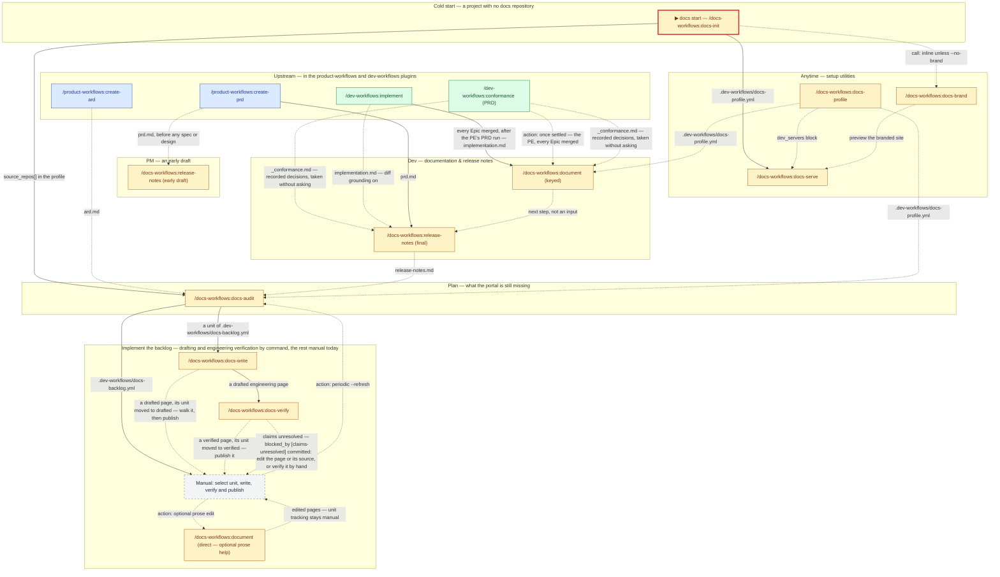

# Workflow overview

`docs-workflows` carries the documentation tail of the pipeline the companion `product-workflows` and `dev-workflows` plugins drive. Every command it ships is shown below. The spine is short: once a Product Requirements Document's Epics are implemented and merged and the Product Engineer's conformance check of the PRD is settled, [`/docs-workflows:document`](commands/document.md) writes the product documentation and [`/docs-workflows:release-notes`](commands/release-notes.md) drafts the note that announces it. Before that spine can run at all there has to be a documentation repository, and [`/docs-workflows:docs-init`](commands/docs-init.md) is the cold-start command that creates one — a portal skeleton that builds, serves, lints and carries a profile — running [`/docs-workflows:docs-brand`](commands/docs-brand.md) inline as one of its own phases. [`/docs-workflows:docs-profile`](commands/docs-profile.md), `/docs-workflows:docs-brand`, and [`/docs-workflows:docs-serve`](commands/docs-serve.md) also stand alone outside the spine — setup utilities reached at any point: the first teaches `/document` what an existing documentation repository looks like, the second extracts a logo and a rough colour pair from the product's own code and applies them to the docs site, and the third runs that repository's own dev server so you can look at it. Between the cold start and the spine sits [`/docs-workflows:docs-audit`](commands/docs-audit.md), which answers what the portal is still missing: against a documentation repository that already exists, it reads the code repositories the profile records and the specs tree, and writes a coverage grid and a prioritised backlog into that repository to be worked through — so it runs after `/docs-init` on a fresh portal, and at any later point on one that has been filling up. [`/docs-workflows:docs-write`](commands/docs-write.md) works through it a unit at a time: it drafts a unit's page from that unit's evidence and commits the page with the unit's move to `drafted`, leaving the page's verification to [`/docs-workflows:docs-verify`](commands/docs-verify.md), which reads an engineering page's claims in the code and commits the page with the unit's move to `verified`, or to a person, who walks a user page. The ▶ node, outlined in red, is where the documentation flow starts: `/docs-workflows:docs-init`, for a project with no documentation repository yet.

Four nodes are drawn for continuity and are not this plugin's commands: `/dev-workflows:implement` and `/dev-workflows:conformance` ship in the companion `dev-workflows` plugin, and `/product-workflows:create-prd` and `/product-workflows:create-ard` in the companion `product-workflows` plugin, and each is documented there. `/document` reads what `/implement` recorded, and it is the Product Engineer's `/dev-workflows:conformance` of the PRD that offers it, once every Epic has merged and that run's decisions are settled; `/implement` offers it only after that run. The two dashed `_conformance.md` edges are the records `/dev-workflows:conformance` writes, which both documentation commands read: each record in scope — the PRD's, and each Epic's, whose decisions stay a Dev's proposals until the PE rules on them — read from your specs checkout. A decision recorded there on a requirement — save one on a Rule of a design's threat review, a threat mitigation the design settles, which neither command takes — is taken without asking you again: a claim whose entry says *fix the code* is left out, since the fix has not landed, and one whose entry says *amend the document* or *accept* describes what the code does. `/document` takes one only for a discrepancy it still finds in the code; `/release-notes` follows each open entry without re-checking the code. Neither drafts a bug report or holds the release for a decision so taken, and each report names every entry it took.

**`/release-notes` is drawn twice** because it runs at two moments: an early draft from `prd.md`, before any specification or design, and a final note once the Epics are implemented. It reads nothing `/document` writes — its inputs are `prd.md`, the Epic folder an Epic address names, its own earlier notes, `/dev-workflows:conformance`'s `_conformance.md` records where there are any, and `implementation.md` where diff grounding is on — so the edge between the two documentation commands is the order `/document` suggests, not a handover.

**The gray backlog step is manual, not an installed command.** [`/docs-write`](commands/docs-write.md), drawn beside it, selects an actionable unit, drafts its page, writes the page's `unit:` and the backlog's `page_path` and `status`, and commits them together. `/docs-verify`, drawn beside it too, takes a drafted engineering unit, reads its page's claims in the code and its decision record, applies the readings you take and commits the page with the unit's move to `verified` — or, where a claim does not resolve, commits the record of why, `blocked_by: [claims-unresolved]`, and leaves the unit `drafted`; verifying a user page and publishing any page stay manual. So does every step for a page written any other way: [The documentation route](docs-workflow.md) says how to select the unit, write its page, maintain those fields, verify its claims and publish it. `/document` direct mode can help with a described edit, but neither mode reads the backlog or manages those fields. The return edge to `/docs-audit --refresh` is a periodic coverage check, not a substitute for verifying the page.

**One command name here collides with a Claude Code built-in of the same name: `/release-notes`.** Typing the bare form reaches Claude Code's own command instead of this one, so use the qualified `/docs-workflows:release-notes`. `/document`, `/docs-init`, `/docs-audit`, `/docs-write`, `/docs-verify`, `/docs-profile`, `/docs-brand`, and `/docs-serve` are not known to collide today, so the rest work either way, and the diagram above spells out the qualified form throughout because that form always works.

## The two modes of `/document`

`/document` is one command with two modes, selected by its first argument token, and the difference between them is the whole shape of the run.

| Mode | Selected by | What it does | Gates |
|---|---|---|---|
| Keyed | a positional address — a key, or `@<path>` naming a folder in the specs tree | Reads the resolved PRD folder, resolves the repos its implementation record and commit scan name, summarises the refs they record in parallel, locates write targets, plans, writes | Style check, then an Opus `doc-reviewer` review |
| Direct | no positional address — an `@file`, free text, or a plain directory | A one-shot prose edit on whatever the argument names | Style check only — no reviewer, and Phase 3 creates no branch and no commit of the edit |

A change that touches both code and docs is `/dev-workflows:implement`'s, not either mode of this command.

## Where each command writes

- **A documentation repository** — `/docs-init` creates one: the page skeleton, both build configs, `.vale.ini` and its vocabulary, the CI workflow, and `.dev-workflows/docs-profile.yml`, all on a branch it commits and drafts a pull request for and never pushes. `/document` writes pages there and, in keyed mode on a repository `/docs-init` scaffolded, regenerates the generated `nav:` blocks of `mkdocs.yml` and `mkdocs.internal.yml` to place them, and in keyed mode finishes on a branch with an opt-in push and a copy-paste pull-request draft — unless you answer the plan's *Revise plan* with "no branch", which leaves the pages uncommitted. `/docs-profile` writes `.dev-workflows/docs-profile.yml` and complementary `CLAUDE.md` guidance there, as a reviewable pull request; it never pushes or auto-merges. `/docs-brand` writes theme colours, CSS variables, and copied logo/favicon assets there — the same branch-commit-drafted-PR discipline as `/docs-profile`, standalone; folded into `/docs-init`'s own single PR when run `--inline`. `/docs-serve` writes a pid/port record under that same `.dev-workflows/`, so `--stop` and `--status` work in a later session, a log for each server it starts, under the system's temporary directory, and, where nothing already ignores that record, one line in the repository's local `.git/info/exclude` — never a page, never a branch, never a commit. `/docs-audit` writes `.dev-workflows/docs-backlog.yml` there, and the profile's `source_repos[]` key where that key was absent, and nothing else — no page, and no branch and no commit either: the backlog is left in the working tree for you to review and commit with the rest of your work — and the profile with it, where the run recorded `source_repos[]` in it, since `/docs-write` and `/docs-verify` start only once both files are committed. `/docs-write` writes a page per unit there, with its navigation entries or regenerated `nav:` blocks and the unit's move in the backlog, all in one commit per unit on a branch it cuts or continues, offers one push and prints a pull-request draft without writing it anywhere; the files of a unit that does not commit go under `.dev-workflows/unfinished/`. `/docs-verify` writes the verified page there and the unit's move to `verified`, in one commit on a branch it cuts or continues — or, where a claim does not resolve, only the backlog's record of why, in a commit of its own — offers one push and prints a pull-request draft without writing it anywhere; where its unit does not commit after the run changed the page, the page as the run left it is kept — under `.dev-workflows/unfinished/` where it can be moved there, else as a copy the report names — before the page you consented to is restored; where neither works, the page is left in place, not verified, and the report says so.
- **`$SPECS_PATH`** — session bookkeeping, and the drafts a run leaves beside a PRD: the cost, feedback and follow-up entries `/document`, `/release-notes`, `/docs-init`, `/docs-audit`, `/docs-write`, `/docs-verify`, and a standalone `/docs-brand` run emit ([Session cost](reference/session-cost.md), [Session feedback](reference/session-feedback.md)), the resume pointer keyed `/document` and `/release-notes` write ([Resume and checkpoints](reference/resume-and-checkpoints.md)), and drafts such as `/document`'s `pr-draft.md` and `<KEY>-implementation-gaps.md`, each committed by the terminal step bounded to those paths — and `/release-notes`' `release-notes.md`, which is not one of them but a deliverable that run hands off by pull request, on a `prd/` branch, behind your consent — except on a run that found the specs checkout on a detached HEAD, or found `$SPECS_PATH` misplaced or its environment changed, which writes them and commits none. A screenshot `/document` stages there for manual upload is kept out of `git status` instead, being a copy kept only until you upload it. `/release-notes` derives where its draft goes rather than asking — its Phase 1 sets it to `release-notes.md` in the resolved PRD folder, where the draft is appended under the release version's heading and the section its change type selects — and it writes nothing in a docs or code repository or in the current working directory, where it is not the specs repository; the draft is the authored body only, and whoever publishes it adds any identifiers or wrapper their publishing process needs. A run with no PRD to attribute to — `/docs-init`, `/docs-audit`, `/docs-write`, `/docs-verify`, a standalone `/docs-brand`, and `/document` in direct mode — files its cost and feedback per docs repository under `documentation/<docs-repo-slug>/` rather than in the pending queue — unless the run found `$SPECS_PATH` misplaced or its environment changed, when both stay in the run's output — and keeps its follow-ups in its own report. `/docs-profile` and `/docs-serve` run no specs-preflight and no terminal commit, so neither writes anything here at all; an `--inline` `/docs-brand` run emits nothing of its own either, since its cost belongs to the caller's entry. None of the nine writes a pipeline artifact there but `/release-notes`' draft, the one it hands off by pull request.

## Sources of truth

- **The PRD folder** is what a keyed run reads: the Product Requirements Document itself, plus the implementation record and commit scan that name the diffs to summarise. See [Getting started](getting-started.md) for what has to be in place before a keyed run works at all.
- **The resolved docs profile** is what tells `/document` where a page belongs, what frontmatter it carries, and how to verify the render. In-repo first, then the bundled default, then on-demand profiling.

See the [documentation index](README.md) for the per-command pages and the agent, reference and environment inventories.
