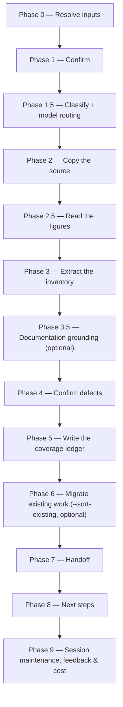

# /brd-intake

Copies a customer-supplied business requirements document into the specs repo verbatim — and with it
every file that document links, wikilinks included, after showing you the list — transcribes every
linked image it takes, extracts a `[BR#n]` requirement inventory from the document, its linked
markdown and those transcriptions, settles with you which possible defects in the document's
wording become questions for the customer — at most a budget of plain-language questions a
sitting — and writes a coverage ledger where every requirement starts `unallocated`.

## Who runs it

`/brd-intake` runs in the [pm](../roles-and-phases.md#pm--product-management) role, cost-attribution
phase `brd-to-prd` — the phase shared by every command of the BRD-to-PRD route, the way [`/idea`](idea.md) and
[`/create-prd`](create-prd.md) share `prd-creation`. It is the route's entry point, and the only command in it that
is handed a customer-supplied source document: later commands read the copies and the inventory this
run made, and none extracts requirements from the customer's files again. Downstream, each command
of the route gates on what an earlier command in the chain produced, and on anything this command
wrote only where it writes into it. Nothing gates on this command's own inventory and ledger at
all: `/brd-split`, run on the root, reads both from the working tree and stops on what they contain
rather than on where they have been merged. Every command after that gates on a later hop
(`/prd-ground` on the slice's own ledger `/brd-split` copied, `/brd-split` again on `/prd-ground`'s
findings, `/brd-interview` on those findings — it reads the ledger from the working tree for its
allocation gate — `/brd-package` on `/brd-interview`'s register, and `/brd-reconcile` on
`/brd-package`'s sent prompt). The exception is this command's defect log, which two commands write
into. Each slice's [`/brd-reconcile`](brd-reconcile.md) writes its defect resolutions into
`brd/brd-defect-log.md`, so it gates on that log too, before it confirms any answer from the
customer's review, and waits while the log is anywhere but the specs repo's default branch, or
edited in the checkout and not handed off. Each slice's [`/brd-interview`](brd-interview.md) gates
on it before the one resolution it may write, `resolved-by` for an `unsourced` defect a verified
finding settles, on the operator's confirmation — and where the log is unsettled it writes nothing
there and prints the value to write by hand. Every command of the route runs as pm,
[`/prd-ground`](prd-ground.md) included.

## Synopsis

```
/brd-intake <BRD-KEY> @<brd-file> [--budget <N>] [--sort-existing <dir>] [--no-docs] [--docs <path>] [--skip-costs] [--skip-feedback] [--enforce-model=<model>]
```

- **`<BRD-KEY>`** (mandatory) — a short stable identifier for the BRD. Format-validated only
  (`^[A-Z][A-Z0-9_]*(-\d+)+$`); a BRD is a markdown file in `$SPECS_PATH`, never checked against a
  tracker.
- **`@<path>` in place of the key** — an `@` token naming an existing directory under `$SPECS_PATH/specifications/` is the address: it resolves that folder and nothing else, the run taking the key the folder asserts, and it is how you get past an `ambiguous` stop naming two folders that assert one key. A bare key beside it — never a flag or a flag's value — naming the same folder is dropped as the same address typed twice; any other such bare token stops with `BRD_INTAKE_TWO_ADDRESSES`. Any other `@` token is the source file, which is always a markdown file and never a directory.
- **`@<brd-file>`** (mandatory) — the customer's source document. Must already be markdown — a PDF,
  a Word document, or a slide deck is rejected rather than converted.
- **`[--budget <N>]`** (optional) — the most questions one sitting of the defect walk asks, a whole number from 5 to 50; 25 without it. Anything else stops the run with `BRD_INTAKE_BAD_BUDGET` before anything is written. On a run that resumes, the value given now applies, and without one the value the run started with.
- **`[--sort-existing <dir>]`** (optional) — additionally migrate an already-hand-written package
  at `<dir>` into seed files. The source is still required and still gated (Phase 0) — this never
  replaces the extraction, it only adds Phase 6 on top of it.
- **`[--no-docs]`** (optional) — turn documentation grounding off for this run.
- **`[--docs <path>]`** — points documentation grounding at that root for this run instead of `${DOCS_PATH:-/workspace/docs}`. The flag and its value are stripped together before the address is parsed.

All three run flags apply to this command. `--skip-costs` (or `WORKFLOWS_SKIP_COSTS`) skips Phase 9's session-cost entry, still advancing the checkpoint and dropping any deferred cost record a [ceded](../reference/session-cost.md#ceded-runs) `/prompt-brainstorm` or `/prompt-grill-me` run left pending in this session — see [Session cost](../reference/session-cost.md). `--skip-feedback` (or `WORKFLOWS_SKIP_FEEDBACK`) narrows Phase 9's maintenance step to bugs-only, dispatching `defect-reporter` in place of `impl-maintenance` — see [Session feedback](../reference/session-feedback.md). `--enforce-model=<model>` (or `WORKFLOWS_ENFORCE_MODEL`) pins every dispatched agent in this run — `figure-reader` and `brd-reader` (overriding their frontmatter Opus pin), `workflows-core:docs-grounder`, `workflows-core:question-planner`, `workflows-core:impl-maintenance`, and, under `--skip-feedback`, `defect-reporter` — to one model; the interactive Phase 1 confirmation and the Phase 4 defect walk still run on the session's own model, since enforcement pins subagent dispatches and never the orchestrator's own inline work — see [Model routing](../reference/model-routing.md).

## How it runs



Five subagents are dispatched: `figure-reader` (Phase 2.5, frontmatter-pinned to Opus except under `--enforce-model`/`WORKFLOWS_ENFORCE_MODEL` — it
transcribes every linked image the run takes, in parallel batches, without reading the document that
links it), `brd-reader` (Phase 3, frontmatter-pinned to Opus except under `--enforce-model`/`WORKFLOWS_ENFORCE_MODEL` — its defect candidates are judgement
over a long, contradictory document, and a conflict it never proposes reaches no one), `workflows-core:docs-grounder` (Phase 3.5, read-only grounding on the shipped product docs — default
ON when `$DOCS_PATH` resolves, advisory, never a gate), `workflows-core:question-planner` (Phase 4, on Opus, passed by the run — it groups the defect candidates that share a cause into one question and ranks the rest, and asks nobody anything) and `workflows-core:impl-maintenance` (Phase 9, session lessons-learned — replaced by `defect-reporter` under `--skip-feedback`/`WORKFLOWS_SKIP_FEEDBACK`).

## What it needs

- **`<BRD-KEY>`** — mandatory, unless an `@<path>` address names the folder; absent with no such address, or malformed, stops the run with `BRD_INTAKE_NEEDS_KEY`, which
  lists beneath it the keys the specs tree already holds — one line per prefix, its highest top-level
  key and how many top-level and nested keys use it, ten prefixes at most — so the next one is easy to pick; it proposes
  none. A key
  that resolves to a **slice** stops the run with `BRD_INTAKE_SLICE`, naming the parent to re-intake
  instead: a slice has no source document of its own — the source and the records beside it under
  `brd/` are the parent's, one hop up, while the slice's own `brd/brd-inventory.md` and
  `coverage-ledger.md` are created by `/brd-split` on the parent — and re-running here would overwrite the allocations `/brd-split` recorded in its ledger. A key
  that resolves to any other folder that is not a BRD stops too, before anything is copied: an
  **Epic** folder with `BRD_INTAKE_EPIC_LEVEL`, and an **idea-route PRD folder** — a `PRD-` folder no
  BRD carved — a slice whose `brd-link.md` names no `parent:`, or a folder placed at no level with
  `BRD_INTAKE_NOT_A_BRD`, which for that slice says the `parent:` line is missing and to restore it or
  report it. Both leave the folder as it
  stands and ask for a key no folder asserts, since the run creates a BRD folder only where the key
  resolves to nothing; an existing root BRD is the one folder a key may name, and that is a re-run.
- **`@<brd-file>`** — mandatory; absent stops the run with `BRD_INTAKE_NEEDS_SOURCE`.
- **Your answer about what the document links.** Phase 1 walks every link first, read-only, and shows
  you what it found. Where anything lies outside the document's own folder it asks whether to capture
  it; where anything is neither markdown nor an image it asks you to convert it first
  (`BRD_INTAKE_UNREAD_ATTACHMENTS` on *Stop*), because nothing reads such a file.
- **A markdown source.** A non-markdown source (a PDF chief among them) stops the run with
  `BRD_INTAKE_NEEDS_MARKDOWN` rather than being converted automatically — the source becomes
  immutable the moment it is intaken, and every `[BR#n]` this run writes anchors into it, so an
  unchecked machine conversion must never silently become the record of what the customer asked
  for. Converting is the operator's own step, done where the result can be checked against the
  original. A source that is a symbolic link, or no regular file, stops the run with
  `BRD_INTAKE_SOURCE_NOT_A_FILE`: the document is captured only as the file it is, never through a
  link.
- **`$SPECS_PATH`** (required) — if unset, the run stops naming `SPECS_PATH`.
- **On a re-run, a specs checkout not behind for the BRD.** Where the key names a BRD folder that
  already exists, the run checks the branch the specs checkout stands on once the specs-repo
  preflight has run, before anything is copied. Where it is a plugin branch the default branch has
  moved past under that folder — a document there, a slice's included, added, changed or removed
  since that branch was cut, session files aside — the run stops, naming the paths and what to run:
  merge the default branch in, where this run builds on that branch — its own `brd/` branch, or an
  earlier phase's open branch it stacks on — or switch to the default branch, where it does not.
  Where the `brd/` branch this run's handoff would reuse is open and has changed something under
  that folder, it asks first whether to switch to that branch and continue there, or stop until its
  pull request is merged, or closed and the branch deleted. A folder this run creates has nothing
  to compare.
- **`$DOCS_PATH`** (optional, default `/workspace/docs`) — documentation grounding, resolved once
  in Phase 1 and consumed with grill-rank ranking over Phase 4's defect walk. Missing, unreadable,
  or carrying no markdown file is a silent, non-blocking skip. Turned off explicitly with
  `--no-docs`. The [`/epics`](epics.md) consent-ordering exception does not apply here: `/brd-intake` runs no
  `require-on-main` gate, so resolving in the ordinary confirmation step already puts the one
  consent-bearing step ahead of every write.
- **No repos.** `/brd-intake` is cwd-agnostic and needs no `$REPOS_PATH` — grounding against code
  and design is `/prd-ground`'s job, run later.
- **No prior `/brd-*` deliverable.** `/brd-intake` is the entry point of the route: it consumes no
  earlier phase's artifact, so it runs no `require-on-main` gate in Phase 0, unlike every
  downstream command on this route, including `/prd-ground`.

## What it produces

Under `$SPECS_PATH/specifications/BRD-<BRD-KEY>-<slug>/` — the `BRD-` kind prefix is part of the
name the run creates:

- `brd/source/<basename>` — the customer's source, copied byte-for-byte and never edited. Byte-for-byte
  is its content, not its file mode: every copy under `brd/source/` and `brd/source-external/` is
  written at mode `0644`, so a source on a mount that marks its files executable is not committed
  executable, and a re-run resets to `0644` any file already there at another mode — taken this run
  or not — and hands the mode change off with the rest, beside any file an earlier run reset and
  never handed off. Every copy, every reset and every hash is made by a small program that reads
  the names itself, so a customer's file name holding a space, `$(`, a backtick, a quote or a
  leading `-` is copied and committed as it stands and runs nothing; and it follows no symbolic
  link, so a linked file that is one — pointing at a key file outside the folder, say — or that the
  link reaches through a folder that is one, is captured nowhere, and the link log names it
  unreadable. A re-run
  over a revised source replaces the copy of each file whose bytes changed, git keeping the earlier
  one, and leaves an unchanged file untouched; a document revised under a new filename is copied at
  that name beside the earlier copy, which stays, and is read as a revision of it rather than as a
  new document. The run names each file it records replaced, and each slice whose inventory still
  names an earlier document.
- `brd/source/<the paths it links>` — every file the run takes from the document's own directory,
  copied byte-for-byte to the same relative path, so the copied text's links resolve exactly as the
  customer's did. Screenshots are the usual case, and this run is where they are captured: no later
  command of the route writes under `brd/source/`, so a file left behind here stays out of the record
  until the document is intaken again.
- `brd/source-external/<basename>` — every file the document links from outside its own folder, where
  you chose to capture it, by basename (a different file under a name already taken there gets a
  numbered suffix; an identical one is re-used); immutable as `brd/source/` is, and never replaced
  by a re-run either, since a changed file lands under a new name.
- `brd/brd-link-log.md` — every link in a captured file whose target the copy did **not**
  capture, each with its reason (a URL, an unreadable target, a wikilink matching several files,
  or — where you chose the document's own folder only — a link to a file outside it), the run's
  counts, and a table mapping every captured link that does not resolve as written (a wikilink, an
  external file) to its copy. Written on every run.
- `brd/brd-figures.md` — what the plugin read in each linked image the run takes: a verbatim
  transcription, the customer's annotations and what they point at, and the rows each image yields
  or illustrates.
- `brd/brd-inventory.md` — one row per `[BR#n]`, each with its `source_anchor` and any confirmed
  `[DEF#n]` defects — a `conflict` or `duplicate` on the row it was raised on only — and, in its
  frontmatter, which file the rows were last reconciled against as the document, the hash of
  every file they were reconciled against, your account of each top-level section and each image
  that holds or illustrates no row, and which rows came from a sentence you quoted rather than from
  the reader — so a re-run reports one of those in its own words instead of listing it, every time,
  beside the rows the reader really did stop finding. A re-run keeps every id, and keeps a row's wording
  wherever the file its anchor points into is unchanged since then — judged against that record,
  never against the copy on disk or the link log, so a revised document is recognised as one
  whatever it is called, even after a run that copied it stopped before reconciling; where the new
  read returns a row over an unchanged file that could be a kept row reworded, it asks you whether it
  is the same requirement; a row the new read does not find again is kept, never renumbered away;
  and every id it mints is reported by id. On an inventory with no such record, the first re-run rewords
  every row it matches to the new read's wording, once, reporting each change, and keeps the record from then
  on. Before it copies anything, that re-run
  records which document the rows were last read from — out of the link log it is about to rewrite,
  where there is one — so a run that stops before reconciling still leaves the document on record
  for [`/brd-split`](brd-split.md) and [`/brd-package`](brd-package.md) to name. After its table, an
  *Inventory notes* list says which rows came from one customer item that the reader split into
  several — a split is recorded there and never becomes a defect or a question — and which rows
  you recorded in the defect walk as restating another rather than as a defect. The split notes are
  written afresh from each run's read; a restatement note stays while a re-run's read still finds
  the two rows repeating each other, and is dropped, and named in the final report, where it no
  longer does. The notes are written once the defect walk has settled, so a run that ends before
  then leaves them as they stood.
- `brd/brd-defect-log.md` — one entry per `[DEF#n]` the walk logs, resolution `open`: each you
  chose to ask the customer about, each possible gap in what the current system does that grounding
  settles later, and each you chose to send on unreviewed, its reason marked *not reviewed at
  intake*. A re-run keeps every entry already there, id and resolution unchanged, and adds only the
  defects it newly logs.
- `coverage-ledger.md` — one row per `[BR#n]`, disposition `unallocated` on every row.
- With `--sort-existing <dir>`: `prd-seed.md`, `ard-seed.md`, `spec-seed.md`, sorted by altitude
  from the hand-written package — seeds only, never findings.

The link log, the inventory, the defect log and the ledger each have one fixed layout — frontmatter,
an opening line where a reader needs one, and a markdown table — and share one cell encoding: a
literal `|` is written `\|` and a line break `<br>`, and the requirement text is verbatim once those
two are decoded, which every reader does before it shows, hands over or compares a cell.

Behind Phase 7's consent choice, these are committed, pushed, and a pull request opened against the
specs repo's default branch under a new `brd/<BRD-KEY>-<slug>` branch prefix. Declining leaves them
for you to land, and that option says the next phase will stop until they are on main: it is each
slice's `/brd-reconcile`, which waits at its gate on the defect log.

## Gates

- **Phase 3 — `brd-reader`** (Opus, frontmatter-pinned; no override unless `--enforce-model`/`WORKFLOWS_ENFORCE_MODEL` enforces one). Extraction from the document, its
  linked markdown and the image transcriptions, which it reads and never changes, writing only its
  own result file: it proposes a `[BR#n]` row per requirement plus
  unconfirmed candidate defects — each saying what it saw (the two readings of an ambiguous row,
  what two rows clash over, the measure an untestable row lacks) and how sure it is, an `ambiguity`
  on any obligation only an image states — lists the rows it split out of one customer item rather
  than proposing a defect for the split, and never decides a defect itself. `EMPTY` (no identifiable requirement) short-circuits Phase 4. On a
  first intake it writes the inventory and the ledger with no row — and the run says so plainly,
  because the route stops on a claimless BRD: Phase 8 then offers a re-run of this command with a
  corrected source instead of offering `/brd-split`, which would refuse the BRD. Over an inventory
  an earlier intake filled it changes nothing — the inventory, the defect log and the ledger stand
  as they were, since an empty read has not shown any requirement gone — and Phase 8 offers
  `/brd-split` only where a ledger row is still `unallocated`. `NOT_FOUND` stops the run and surfaces
  the agent's exact message.

  **The inventory's coverage of its own source is then checked, both directions, from what the run
  already holds** — the anchors the read returned, the image transcriptions, and the rows
  `brd-reader` said each image illustrates; nothing is written to the inventory until this check has
  settled, save where a dangling anchor stops the run — every row the run holds is written first
  then, so the anchor can be corrected by hand. Every `source_anchor` must resolve, in whichever of
  its three forms it takes — pointing into the document, a linked markdown file, or an image. One that resolves to nothing is a
  row nobody can trace back and the run stops, **except a row a re-run kept because its anchor no
  longer resolves — the revised source dropped what it named**: that is a recorded state, and
  stopping on it would refuse a customer's revised BRD with a remedy nobody could perform. And every **top-level section** — of
  the document and of each linked markdown file, the sections at the shallowest level beneath its
  title where one heading titles it — and every **image** must either hold or illustrate a row or be
  accounted for, a section holding one where it links an image or an appendix that yields a row: one
  that does neither is a question rather than a stop, since only a person can say whether it binds
  the delivery team to anything, so the run names each — a section with what the source has under
  it, an image with what the plugin read in it, or its reason where it could not be read. **Re-reading
  is asked once, for the whole set; accounting is asked per item.** The set question offers a re-read
  — `brd-reader` dispatched again over everything, its result replacing the first read's rows,
  candidates and notes wholesale unless it finds no requirement at all, and allowed once per run — or
  accounting for each item, or cancelling. Beside each item it shows the reason `brd-reader` gave for
  it — why a section it took no row from binds nothing, or why an image bears on no obligation — and
  it recommends accounting where a re-read could change none of the items, or where the reader gave
  a reason for every item a re-read could change; otherwise it recommends the re-read, since a
  section the reader gave no reason for is one it may have missed. Where a section's own text
  carries a binding word such as *must* or *shall*, the reason still counts, but the sentence is
  quoted beside it and that section's own question leaves *They hold no obligation* unmarked, so you
  decide against the sentence itself rather than accept a default — and where it does bind, quoting
  it adds that row without discarding the rest of the read. An item the reader gave no reason for is
  left unmarked the same way, once you have declined the re-read or the re-read still gave none, since
  that is the item it may have missed. Then each section or image still unaccounted for gets its
  own question: it holds no obligation, which is recorded, or you quote a sentence in it that binds,
  shown the text it is checked against, one obligation to a quote and as many quotes as the item
  binds; each is checked against the source word for word and becomes a row of its own. A quote the
  source does not hold is never written through: the item's question comes back with it, so you can
  quote again, record that it holds nothing, or stop. Every account is kept in the inventory — an
  image's also shown on its line in the figures file — so a re-run over an unchanged file does not
  ask about the same section or image again, while a changed file's accounts are asked afresh. On a
  first intake the rows are numbered once, after the last read and any row a quote added, in reading
  order. **Section granularity is
  the point and was measured**: real BRDs carry fifty or sixty headings under about fifteen
  top-level sections, of which nine or so legitimately hold nothing, so the operator answers nine
  questions rather than fifty — and on a real package the
  sections carrying no row included the user stories and the acceptance tests, which is exactly the
  pair worth putting to a human.
- **Phase 3.5 — `docs-grounder`** (optional). Read-only, advisory, never a gate. Its digest is
  consumed grill-rank: `docs_challenges` are ranked into the order Phase 4 walks its candidates,
  and one may be *raised* as an additional defect candidate — but only as `unsourced` (the
  requirement asserts current behaviour a shipped page corroborates or contradicts) or `ambiguity`
  (the BRD uses a term the docs use for something else). **A `[DEF#n]` is the only thing
  documentation can put on a `[BR#n]` row, and only Phase 4's human confirmation puts it there.**
  `docs_references` — what the product already ships and documents — is reported for `/prd-ground`
  to check against code, and written nowhere; the ledger's `evidence` column stays empty until
  grounding runs, and [`/prd-ground`](prd-ground.md) fills it when it does.
- **Phase 4 — the defect walk**, not an agent gate: a walk through what the reader proposed, at most
  a budget of questions a sitting — 25 unless `--budget` says otherwise — each about the
  **wording** of the customer's document, never about code. It opens by saying so: *These questions
  check the wording of the BRD. A problem you confirm becomes a question to the customer later;
  one you mark clear is dropped. Each question shows what I saw and the answer I recommend.*
  - **What needs no human gets no question of its own.** A row split out of one customer item is
    recorded in the inventory's notes and is no defect. A possible gap in what the current system
    does (`unsourced`) is logged without a question, since grounding settles it and the customer is
    never asked about it; a row that only restates another (`duplicate`) is noted in the inventory
    as a restatement and not logged, so the pair stays visible and no customer question follows.
    Both are shown once, as one list, with one question: all fine as listed, or name the ones to
    look at, which are then asked about singly.
  - **The rest is grouped and ranked.** `question-planner` puts candidates with a common cause —
    one term used in two senses across a dozen rows — as one question, and ranks the queue so the
    least certain, and those touching the most rows, come first. Where more remain than the budget
    allows, those the reader was most sure of, and whose recommendation the planner puts forward
    too, may be put as one table to accept, or to name the exceptions in, which are then asked
    singly; nothing raised from documentation, or that the reader was less sure of, goes in it.
  - **Each question stands on its own.** It opens *This is about the wording of requirement
    [BR#n] in the BRD.*, quotes the row, says what the reader saw — the two readings side by side,
    what two rows clash over, what cannot be measured, the implementation detail a row prescribes —
    and offers *Ask the customer about this*, *Ask the customer, about a narrower point*, *The
    wording is clear — nothing to ask* and *Cancel*, each saying what it does, one marked
    recommended with its reason, from how sure the reader was. A narrower point asks you for the
    narrowed reason, which the customer's question is later built from. An answer you type is read
    as the option it expresses, and the same question is never put to you twice; you are asked why
    only where you chose against the recommendation without saying.
  - **At the budget** the sitting ends: what it closed without asking you singly — the groups, the
    list and the table — is shown once for you to accept or reopen, and you choose to go on with the
    next sitting now (recommended), stop and continue later, or send the rest on as open defects,
    unreviewed, each marked so in the defect log. Sending the rest on is never the default, since
    an open defect becomes a question to the customer.
  - **Only what the walk logs becomes a `[DEF#n]`**, numbered once the walk ends, in the order of
    the row it was raised on — never in the order the questions were asked. The customer's document
    is never edited: the customer's answer settles a defect later — asked by
    [`/brd-interview`](brd-interview.md), recorded by [`/brd-reconcile`](brd-reconcile.md) — or a
    person records a [`/prd-ground`](prd-ground.md) finding that does. The final report gives the
    walk's account: every candidate the reader proposed, and what became of it.
  - **A re-run does not ask again about a defect already logged, or a restatement already
    noted**: a candidate with the same class and row as an entry on file is that entry — a
    `conflict` or `duplicate` matching where the entries on file already join the same rows, raised
    from either end, and a `duplicate` where a restatement note already joins them — keeping its id,
    reason and resolution; where several share one class and row they pair in order, and a
    candidate left over is asked with those entries shown beside it, so a restatement is not logged
    twice, and a `conflict` or `duplicate` some but not all of whose pairs the log already joins is
    asked with each entry joining one of them and, logged, records only the pairs none of them
    joins, which its question says, so a pair on file is not logged twice and one nothing joins is
    not dropped; only the rest are walked, taking ids after the highest in use; and an entry this
    read did not propose again — for a `conflict` or `duplicate`, one no pair of whose rows a
    candidate joins — is kept, and reported as not re-raised, while one only some of whose pairs a
    candidate joins counts as re-raised and is reported with the pairs no candidate joined; a
    defect an earlier release logged for a split is kept and reported as recorded as a split. A
    `[DEF#n]` id is never reused, renumbered or deleted, so an inventory or ledger row, or a held
    customer question, naming it still names the same defect.
- **Phase 5 — the allocation gate downstream.** `/brd-intake` itself never blocks on the ledger — it
  only ever writes `unallocated` rows. The gate that gates on them is the **allocation** gate (no
  `unallocated` row may survive), not a merge-state one, and it belongs to
  [`/brd-split`](brd-split.md), which walks it on both the root and each slice.

A run that stops — on a refusal under *What it needs*, a stop above, *Stop* or *Stop and convert* at the confirmation, a *Cancel* that ends the run, or *Stop here and continue later* between two sittings of the defect walk — still writes the session-cost entry and ends with the terminal commit of the specs repository and its `Specs repo:` line, with no session maintenance, feedback or resume pointer; what it copied or wrote before the stop stays in the folder, uncommitted. A stop taken once the run's folder is open also prints, after its own message, a `Run folder kept:` line ([Stopping and resuming](#stopping-and-resuming)). Cancelling the handoff is not a stop: the files stay written and the run goes on to its next-step offer. Where `SPECS_PATH` is unset or misplaced, the cost entry stays in the run's printed output and nothing is committed.

## Stopping and resuming

A session can end in the middle of the defect walk — you stop between two sittings, the conversation is compacted, a container restarts. So the run keeps its working state in a **run folder**, which it opens in Phase 0 once every refusal there has had its chance, and running `/product-workflows:brd-intake <BRD-KEY> @<brd-file>` again on the same machine offers to continue it. The folder lies outside every repository, so nothing in it is ever committed; where it lives, and how to keep it across a container restart, is on `workflows-core`'s own environment page. Where no folder can be made or written, the run prints one `NOTE:` line, goes on exactly as it would without one, and cannot then be resumed.

- **Your answers.** Every answer in the defect walk is recorded as you give it, before the next question is shown, so a resumed run goes on at the next question you have not answered, in the sitting you were in — or, after *Stop here and continue later*, the next one. A *Cancel* is never recorded, so a resume asks that question again.
- **Agent results.** `brd-reader`'s and `question-planner`'s results are saved once the run has gone on with them, and reused while the dispatch it would make now is the same — the same files, byte for byte, and the same agent instructions and model. The final report of a resumed run says what it reused, on one `Resumed:` line.
- **What the run already wrote.** Once Phase 3 has written the inventory, a resumed run does not read the source again — it would take its own inventory for an earlier intake's — and goes on from what it recorded then; where the earlier session stopped before that write, the run goes through Phases 1 to 3 again, re-using every copy and transcription already there. Once the walk has written the defect log, a resumed run does not walk again. Your handoff choice is recorded too, and the handoff, the session maintenance, the feedback, the cost entry and the resume pointer are each recorded once made, so a resumed run never branches, pushes, opens a pull request or writes a cost entry twice.

Another session that resumes the run, or starts it over, takes it over: the first one stops at its next step with `BRD_INTAKE_RUN_TAKEN_OVER` and writes nothing more — no cost entry, no terminal commit and no final report. A run that finishes removes its folder; one that stops keeps it.

## Example

Intake a synthetic customer BRD for a new BRD key:

```
/product-workflows:brd-intake ACME-001 @customer-brd.md
```

The run resolves or creates the BRD folder, walks every link `customer-brd.md` makes and shows you
what it found — how many linked files of each kind (markdown, image, and files that are neither) lie
inside the document's own folder and how many outside it, every target it could not resolve with its
reason, and **by path** every file outside the folder and every file that is neither markdown nor an
image — copies it verbatim into `brd/source/` together with the files you took, records in
`brd/brd-link-log.md` each link in a copied file whose target it did not copy, and why,
transcribes the linked images,
dispatches `brd-reader` to extract the `[BR#n]` inventory from all of it, asks you at most 25
plain-language questions a sitting about the wording of the rows its defect candidates sit on —
after one list of what needs no question of its own — writes the defect log and the coverage ledger
with every row `unallocated`, and offers to branch, commit, push, and open a pull request.

## What it offers next

Phase 8 offers the next step from the inventory and ledger this run leaves, and runs nothing itself:

- **At least one `[BR#n]` row still `unallocated`** (the ordinary case) → [`/brd-split <BRD-KEY> "<how to cut it>"`](brd-split.md) (recommended), to carve slices. `<how to cut it>` is left for you to fill with your own slicing instruction: a root with rows to place refuses to run without one. It waits for nothing, since `/brd-split` on a root reads this run's files without gating them.
- **Rows on file, none `unallocated`** (an empty read over an earlier intake that `/brd-split` already walked) → re-run `/brd-intake <BRD-KEY> @<brd-file>` with a corrected source, or stop; neither is recommended. A re-run whose read finds a requirement resets every row to `unallocated`.
- **No `[BR#n]` row at all** → the same two choices, neither recommended; `/brd-split` is left out because it would refuse the BRD. The run says which file or conversion it read, so you can judge the source.

[`/prd-ground`](prd-ground.md) is never offered here: it refuses a root BRD, and grounding happens on the slices `/brd-split` carves.

## See also

- [The BRD-to-PRD route](../brd-workflow.md) — the route's own diagram and parameter table, and where this command sits on it.
- [Workflow overview](../workflow.md) — the whole plugin on one diagram, the BRD route beside the idea route.
- [Roles and phases](../roles-and-phases.md) — what the `pm` role owns and hands off.
- [Model routing](../reference/model-routing.md) — the classification rules this command applies.
- The `addressing` reference (shipped in `workflows-core`, listed on its References page) — the `<BRD-KEY>` grammar and folder
  resolution this command uses.
- [References](../reference/references.md) — the plugin's own formats this command applies: the BRD format (the `[BR#n]` row shape, the immutability rule, what `brd/source/` and `brd/source-external/` hold and the link log beside them, the figures file, and the six defect classes this command confirms against), linked sources (how Phase 1 finds, resolves and walks the document's links) and the coverage ledger format (the ledger row shape, the six dispositions, and the ledger line every command of the BRD-to-PRD route ends its final report with).
- The `question-budget` reference (shipped in `workflows-core`, listed on its References page) — the budget, the shape of every question, the table, the end-of-sitting list and the account the defect walk follows; `question-planner`'s contract is on `workflows-core`'s Agents page.
- The `docs-grounding` reference (shipped in `workflows-core`, listed on its References page) — the `$DOCS_PATH` resolution gate,
  the `docs grounding:` line this command shows verbatim, and the grill-rank consumption mode.
- [Agents](../reference/agents.md) — `figure-reader`'s, `brd-reader`'s and `docs-grounder`'s full
  contracts.
- [Session cost](../reference/session-cost.md), [Session feedback](../reference/session-feedback.md),
  and [Resume and checkpoints](../reference/resume-and-checkpoints.md) — the terminal Phase 9
  bookkeeping every run emits.
