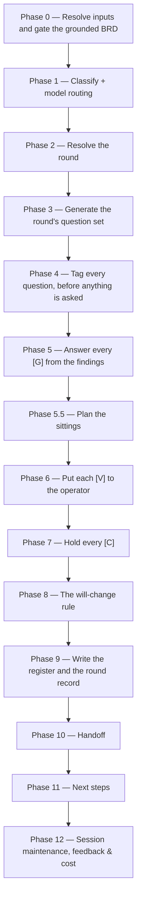

# /brd-interview

Turns a grounded, fully-allocated BRD into a **decided** one. It generates a round of open questions,
tags every one of them `[G]`, `[V]` or `[C]` **before a single one is asked**, answers every `[G]`
from the grounding findings without asking anybody, merges questions that ask the same thing, puts
each `[V]` nothing has settled to the operator one at a time with mandatory argumentation — where
more are open than one sitting holds, a few strategic questions first, each answer closing every
question it covers; then at most a budget of questions a sitting, the ones beyond it whose answer it is confident of put
together as one table to accept or name exceptions in, and every answer applied to the questions
still open, so that one an answer settles is recorded without being asked — and holds every `[C]`
for the customer, with the answer your team would propose beside it where one of your answers
settles that, or re-tags it `[V]` where one shows it was yours to decide all along. It writes `decisions.md`, the
round's own record, the `[C]` question set, and — where a decision raises a defect in the code or
re-dispositions one already on file — the code-defect log; and, on the operator's confirmation, it
writes a resolution into the parent BRD's requirement-defect log for an `unsourced` defect a
verified finding of the slice settles.

## Who runs it

`/brd-interview` runs in the [pm](../roles-and-phases.md#pm--product-management) role,
cost-attribution phase `brd-to-prd` — the phase shared by every command of the BRD-to-PRD route. It
takes over once `/prd-ground` and `/brd-split` have both run on the same slice: a verified finding
set and a fully-allocated ledger are what its Phase 0 gates on.

## Synopsis

```
/brd-interview <BRD-KEY> [--round N] [--budget <N>] [--skip-costs] [--skip-feedback] [--enforce-model=<model>]
```

- **`<BRD-KEY>`** (mandatory) — the slice whose questions this run decides. `resolve-address` searches every
  level it bounds (three) — a root, a slice, an idea-route PRD folder or an Epic folder alike — because a root has to resolve before it can be
  refused by name; format-validated only, never checked against a tracker. **Only a slice is
  interviewed**: a resolved root stops with `BRD_INTERVIEW_ROOT_LEVEL`, naming
  [`/brd-split`](brd-split.md) as the way to carve one, and an idea-route PRD folder — a `PRD-`
  folder no BRD carved, carrying no `brd-link.md` — stops with `BRD_INTERVIEW_NOT_A_SLICE`, naming
  [`/create-ard`](create-ard.md) and [`/specify`](specify.md) as the way that route goes on, once its PRD is on the default branch wherever the specs tree is a git repository — after [`/create-prd`](create-prd.md), its handoff merged, where the folder holds none yet. An `EPIC-` folder stops with `BRD_INTERVIEW_EPIC_LEVEL`, naming the slice the Epic sits in where it sits in one — or, where that slice's `brd-link.md` names no `parent:`, the run stops with `BRD_INTERVIEW_BRD_LINK_NO_PARENT` on that slice instead.
- **A slice whose `brd-link.md` names its `parent:`.** [`/brd-split`](brd-split.md) writes a `parent:` into every slice's `brd-link.md`; one a hand edit left with none stops the run with `BRD_INTERVIEW_BRD_LINK_NO_PARENT` in Phase 0, before anything is read through it. The stop names the file, prints `git log -p` on it to find the commit that carried the line, and says to restore the line and land it — or, where no commit carried it, to write it by hand as the key of the BRD folder the slice sits in, or to report it. A legacy folder with no kind prefix whose `brd-link.md` names no `parent:` beside its ledger or inventory is read as a BRD container instead, as before (the [`coverage-ledger-format`](../reference/references.md) reference states the stop once).
- **`@<path>` in place of the key** — an `@` token naming an existing directory under `$SPECS_PATH/specifications/` is the address: it resolves that folder and nothing else, the run taking the key the folder asserts, and it is how you get past an `ambiguous` stop naming two folders that assert one key. A bare key beside it — never a flag or a flag's value — naming the same folder is dropped as the same address typed twice; any other such bare token stops with `BRD_INTERVIEW_TWO_ADDRESSES`.
- **`--round N`** (optional) — target one round: resume it if it is open, or re-open it if it is
  closed, recorded as a re-open with its cause. Naming the next round opens it only where every
  round is closed: beside an open round it stops with `BRD_INTERVIEW_ROUND_STILL_OPEN`, naming the
  open round, since the bare command would resume that one, and the step each of its holding states
  needs, in the order they must run — a grounding pass for a question that needs grounding, then the
  bare resume for a deferred, untagged or newly grounded one, then the package and the
  reconciliation for a question held for the customer, since the packaging step refuses a round
  still holding any of the others — save a question deferred only on questions held for the
  customer, which the packaging step admits, and which is resumed once their answers are recorded. With no flag the run continues at the first round
  still holding a question without a terminal disposition; with every round closed it generates the
  next round's questions from what changed after the last one was generated — a finding added or
  superseded, or its verdict or verifier outcome changed, whenever that happened, read against the
  `generated against:` line the last round's record carries (a record without that line
  is compared at the earliest commit on any ref, any branch included, that holds it exactly
  as it stands on disk, which misses a grounding change committed before that commit or in it — one
  made while that round was still open, or one a squash commit or a late commit of the record
  carries, which the report flags where that commit itself changed a grounding file — and, where no
  commit on any ref holds the record as it stands, detects no finding change at all), a requirement defect that became this BRD's to ask, or a re-grounding that moved a decision's
  evidence — for a decision the will-change rule held, every finding it rests on superseded and the
  successors no longer `will-change`; for any other, any finding it rests on superseded and that
  finding's successors not confirming it (Phase 3 and Phase 8,
  below), a decision reopened elsewhere — by [`/brd-reconcile`](brd-reconcile.md), on a customer
  answer that constrains it or by its propagation sweep from a BRD it depends on, or by an
  interrupted run of this command — whose question no round still holds unanswered, which the round
  puts again under the decision's own tag (Phase 3, below), or a re-decision an interrupted run left standing at that round, which the round records
  as a `[V]` already disposed *decided* and puts to nobody (*What it produces*, below) — and opens that round only where some question source puts a question, so a
  `--rebaseline` pass that confirms every decision it bears on, or leaves it waiting on its
  prerequisite, is reported as re-grounded with nothing moved and opens nothing — **or, on a BRD with no round record at all, generates round 1's questions and branches on
  what it finds.** At least one question opens the round; none at all writes
  `interview/round-1.md` recording the walk and what it found nothing of, and the run completes
  there. That record is not an empty round: it names each question source and what this BRD held
  under it, so a reader meets an account of a completed walk rather than a silence. **It is also why
  this command is required before packaging even on a slice with nothing to ask** — you cannot know
  there is nothing to ask until it has run, and [`/brd-package`](brd-package.md) refuses a BRD with
  no round record rather than re-deriving that judgement for itself.

  **Every open requirement defect this BRD owns becomes a question for the customer** — an
  ambiguity, a conflict, a duplicate, or an untestable or scope-leaking requirement confirmed at
  intake, including an obligation only an image states — and always a `[C]`: the defect is in the
  customer's own words. At most one slice owns a defect — the one holding the lowest-numbered of the
  rows the defect joins (the row it was raised on and every row it names) that is still built or
  deferred there; where none is, the one holding the lowest-numbered of those rows it rejected citing
  that defect, which asks it on that row's question; where there is neither, no slice owns it and
  this route never puts it to the customer — a slice whose round covers one of its rows says so in
  its round record, naming the rows and their fates, and a defect whose every row the root itself
  settled is named by no slice at all: a slice that once claimed such a row holds it only as an
  orphan row, which is out of its round's scope, and the root is never interviewed. An orphan row
  carrying the parent's own rejection never makes its slice the defect's carrier either. A defect is
  raised once across all the slices: where any slice's `[C]` question set already carries it, none
  raises it again. The one later question that carries it is the re-put of a customer answer the
  will-change rule held `open` (Phase 8, below), which carries the defect that answer could not settle. A row the question names that the asking slice does not claim — another slice's, or
  one the root settled — is written with the parent's key in front, `<PARENT-KEY> [BR#n]`, because
  the package carries only the slice's own inventory and [`/brd-package`](brd-package.md) would
  otherwise stop on the bare id as a citation that resolves to nothing. Everything written from the
  question keeps that form — the held entry, the decision it becomes, and the `[CD#n]`
  [`/brd-reconcile`](brd-reconcile.md) freezes from the customer's answer, save the customer's own
  quoted words. Where a defect's owner cannot be told yet — a row it joins still unallocated, or a
  sibling's ledger or question set unreadable — the run withholds the defect and says why. **Round
  1's record decides which round a defect goes into.** Where round 1's record has no requirement-defect
  line, its defects belong in round 1: an
  open round 1 takes them at once, and a closed one is re-opened with `--round 1` and the cause
  *requirement defects became a question source* — a bare run names those defects and offers that
  re-open rather than asking them itself, and a new round it opens for a changed finding or decision
  proceeds without them. Where round 1's record carries that line, a defect that becomes its to ask later goes
  into a new round — the one this run opens on the defect's own account, where every round was
  already closed, so it is asked in the round it made askable. Where this run instead resumed a
  round already open, it waits for the next one, and the run names it as waiting rather than letting
  a package go out silent about it.

  **Every row this BRD rejected becomes a question for the customer too**, always a `[C]`: nothing
  on the route records why a requirement was rejected, so whether the customer accepts not getting
  it is theirs to say. It carries the defect the rejection cites wherever this slice is that
  defect's carrier — no row the defect joins is live anywhere, and this slice holds the
  lowest-numbered one rejected citing it — so the customer's answer settles it; where that row's
  question was already put and is still held for the customer, the defect is added to that question
  as one more line rather than asked beside it. Where no held question can be told to be the row's —
  none names it, more than one could be it, or it was already answered — the defect is asked as a
  question of its own, which names any answer already given as context; the held questions it could
  not choose between are named in the run's final report, not to the customer. A rejected row raises
  nothing where the customer withdrew it themselves, where the defect it cites is already answered or
  already asked, where any slice — this one included — owns that defect through a live row, whose
  question names this row as context, or where another slice carries it. A deferred row raises a
  question only where no rationale for the deferral was ever recorded.
- **`--budget <N>`** (optional) — the run's question budget, the most questions one sitting puts
  to you (a table counts as one), a whole number from 5 to 50; anything
  else stops the run with `BRD_INTERVIEW_BAD_BUDGET` before anything is written. Without it, a run
  that resumes takes the budget its question registry recorded, and any other run takes 25. The
  run's question registry records the budget when it is made.

There is **no `--no-docs` flag**, because this command does no documentation grounding at all — see
[What it does not do](#what-it-does-not-do).

## The tag decides who may answer

| Tag | Meaning | Who may answer |
|---|---|---|
| `[G]` | Answerable from code or design grounding | **Nobody.** The command answers it from the findings |
| `[V]` | A delivery-side design decision | The **operator**, with recorded argumentation. Never the customer |
| `[C]` | A genuine business decision | The **customer**, and only via a review package |

The two "never"s are rules, not tendencies, and the reasons are these. A `[G]` put to a person
returns their belief about the system rather than the system, and that belief then becomes a
requirement nobody re-checks; a `[V]` dressed as a `[C]` extracts authority the customer never meant
to give and cannot defend later.

**How the command guarantees the first of those** is a property of its phase order, not of its
prose. Tagging runs over the whole round before any asking phase opens; the phase that answers `[G]`
questions raises no prompt of any kind; the operator queue holds exactly what the tagging phase has
fixed — including a `[G]` re-tagged to `[V]`, which is re-tested there before it joins — and nothing
reaches it that has not been through that phase, nor anything at all once the queue opens save a
question it reopens, a held `[C]` of the round one of your answers shows was yours to decide,
re-tagged `[V]` with its cause recorded — a question the tagging phase tagged — and a strategic
question planned over `[V]`s the tagging phase tagged, which takes their tag; and a
`[G]` can leave the `[G]` set only by re-tagging, which re-enters at the tagging phase and is
admissible only against a named finding nobody could settle — one reading `NOT-PROVABLE`, or one
whose verifier outcome is `unprovable`, whatever verdict it keeps.

**The round is scoped to the rows this BRD is answerable for.** Questions are generated over the
ledger rows reading `covered-here`, `deferred-to`, `rejected` or `superseded-by` — never over a row
reading `covered-by: <OTHER-KEY>`, whose requirement that BRD owns and whose questions belong to its
own round, and never
over an **orphan row**: a row for a requirement the slice's `claims:` no longer names, which its
parent's walk withdrew and settled elsewhere, and which carries the parent's `rejected` or
`superseded-by` across unchanged where the parent settled it that way — so it reads like a row the
slice rejected itself, and only `claims:` tells the two apart. That is the one test that reads
`claims:`; a row's fate is otherwise read off the `disposition` column rather than the inventory,
because a stale inventory would put a withdrawn row back in scope, and the cost is the same
requirement reaching the customer in two packages. A delegated row stays readable as context; what
it may not be is the thing asked about.

**A question carrying two tags is a defect in the question**, not a gap in the taxonomy: it is split
until each part carries exactly one, and the `[G]` part is answered first, because its answer
routinely changes what the business question should ask. A question nobody can tag is
under-specified and is rewritten — never filed with a guessed tag.

**A requirement whose grounding settled nothing raises a question for a person — one, however many
repositories it was grounded against.** A row raises a question for an unsettled claim only where no repository in the run settles it; a repository settles it where its verified finding carries a verdict other than `NOT-PROVABLE` and a verifier outcome other than `unprovable`.
A finding reading `SUPERSEDED` takes no part, raising and settling nothing: the finding that
replaced it is read instead. A finding reading `NOT-PROVABLE` — that repository could not settle
it — settles nothing, and neither does a finding whose verifier outcome is `unprovable`, whatever
verdict it keeps other than `SUPERSEDED`: where `/prd-ground`'s verifier re-derived the finding
twice, blind, and the two disagreed, the finding keeps its verdict beside that outcome, and the run
reads the outcome as well as the verdict, so a requirement nobody could settle is never treated as
grounded. A repository that lacks a feature its sibling has therefore raises no such question of
its own where the sibling settles the row, and a row no repository settles raises one question,
not one per repository. The question arrives at tagging carrying every finding on the row that
could not settle it, and is tagged `[V]` or `[C]`, never `[G]`.

**A repository that lacks a surface its sibling has raises no premise-moved question either.**
Grounding can record that absence as `AMENDED` — a rule about a surface the commit lacks, corrected
to *the surface does not exist at this commit; the rule is a requirement on new work* — or as
`REWRITTEN`, where the requirement asserted the surface exists; either settles the row, and either
would otherwise read as a premise that moved. The command reads such a finding as an **absence
finding**, by what its own correction or evidence records and never by inference, and an absence
finding raises nothing while another repository's finding on the row is neither an absence finding
nor one that settles nothing — that sibling has the surface. So whichever verdict grounding gives
the absence — `NOT-PROVABLE`, or an absence finding's `AMENDED` or `REWRITTEN` — the lacking
repository raises no question of either kind for a row a sibling with the surface settles. Where every finding
that settles the row is an absence finding, the row raises one premise-moved question carrying them
all, never one per repository. A finding showing the surface present and behaving otherwise than the requirement
says is a genuine amendment and is asked as before.

All three run flags apply to this command. `--skip-costs` (or `WORKFLOWS_SKIP_COSTS`) skips Phase 12's session-cost entry, still advancing the checkpoint and dropping any deferred cost record a [ceded](../reference/session-cost.md#ceded-runs) `/prompt-brainstorm` or `/prompt-grill-me` run left pending in this session — see [Session cost](../reference/session-cost.md). `--skip-feedback` (or `WORKFLOWS_SKIP_FEEDBACK`) narrows Phase 12's maintenance step to bugs-only, dispatching `defect-reporter` in place of `impl-maintenance` — see [Session feedback](../reference/session-feedback.md). `--enforce-model=<model>` (or `WORKFLOWS_ENFORCE_MODEL`) pins every agent this run dispatches — `workflows-core:question-planner` and `workflows-core:answer-applier`, and `workflows-core:impl-maintenance` or, under `--skip-feedback`, `defect-reporter` — to one model; the round's reading, tagging and interactive walk still run on the session's own model, since enforcement pins subagent dispatches and never the orchestrator's own inline work — see [Model routing](../reference/model-routing.md).

## How it runs



A run that finds every round closed and nothing a question source would ask since the last one —
an unanswered code-defect flag counts as something to ask, below — opens no new round: it reports that plainly — nothing changed, or each change and why it raised
nothing — with any requirement defect that belongs to a closed round 1, and the re-open
that asks it — removes any torn write an interrupted run left and reports each one, and reaches the handoff with nothing
to commit where the register is already on file, nothing was torn, no interrupted
re-disposition of a code defect was completed, none was left uncommitted and no `unsourced` defect
was closed; otherwise it hands off what it wrote — `decisions.md`
as its header line alone where none was on file, any file a torn-write removal or a completed
re-disposition changed, a code-defect log an earlier run left changed and uncommitted, and the
parent's defect log where Phase 10 wrote a resolution into it.
`workflows-core:impl-maintenance` runs in the terminal phase for session lessons-learned — replaced by `defect-reporter` under `--skip-feedback`/`WORKFLOWS_SKIP_FEEDBACK`. Beside it the run dispatches two agents that read no code, each on the Opus tier: `workflows-core:question-planner` once tagging is done, to find the questions that ask the same thing, those no answer would change and those a decision on file already settles; where more questions are open than one sitting holds, before each strategic sitting, to group them under strategic questions, each closing the questions it covers; and again at the opening of each sitting of the detailed walk, to rank the questions left, pick those whose answer it is confident of for the sitting's table, and name any question whose findings cite something other than the BRD showing the code fails what it was itself meant to do; and `workflows-core:answer-applier` after each answer, to find the open questions that answer settles or narrows, and the questions held for the customer it gives a proposed answer or shows were yours to decide. No grounding or review agent is dispatched — every finding this command reads was already independently re-derived by
`/prd-ground`'s own verifier pass.

**Questions are kept in a registry, and every answer is applied to it.** Once every question of the round is tagged, the run builds one registry of every `[V]` and `[C]` question on file in the slice — every round's, rounds written before this release included, with the state each record last gives it. A held `[C]` that a review package has already carried to the customer — its round and position found in one of the slice's `bundle-*/` directories, or any such directory unreadable — is marked carried and left exactly as the customer holds it. A resumed run checks the bundles again before it goes on, since a package may have been built between its sessions: a question carried since is marked carried too, and anything the run had done to it that a carried question may not take — a re-tag, the decision it led to, any answer applied from that decision — is undone and reported. Before the first question, `question-planner` proposes merges of questions asking the same substance (never across tags, never a carried question), drops of questions whose answer would change nothing, and answers a decision on file already determines — a decision of this slice's register, of a sibling slice's under the same parent, or of a BRD this slice's `depends-on:` names, the last two cited with their BRD's key — and the run records them, with the answer a decision on file lets your team propose for a question held for the customer. A question that puts a decision on file again is never merged, dropped, applied, given a proposed answer, re-tagged or put in a table: it is always asked on its own.

**The `[V]`s are put in sittings, at most a budget of questions each** — 25 unless `--budget` says otherwise, numbered `Q1/25`, `Q2/25` and on. Each sitting opens with `question-planner`'s plan: it records any question a decision on file now settles, ranks the rest, and, where more of the round's `[V]`s are open than the budget, picks those whose answer it is confident of. Those are put first, as one table — each row the question, the answer it recommends and why — which counts as one question: accept them all, or name the exceptions, each then asked on its own; each row accepted is recorded as a decision confirmed in a table. A question that puts a decision on file again, or a deferred one the customer's answers have now unblocked, is never a row. Then each `[V]` of the round is put on its own, in the plan's order, never one already closed, in plain words: what is being decided; what the run saw — the rows, each finding with its verdict and outcome and the repository or frame set it came from; the options, each with what it does; and the option it recommends, with why. Choosing the recommended option records that reason as the decision's argumentation; any other option asks why, unless your answer already says. A typed answer is read as the option it expresses, and nothing is asked twice. Deferring a question asks why it cannot be answered yet and, where it waits on questions held for the customer, which — offering those that share one of its rows — and deferring it again keeps what it waited on unless you name others; once the customer's answers to all of those are recorded, the next run says so and puts the question again with that answer as its recommendation, unless a decision on file — that answer among them — now settles it, when it is recorded as applied and shown in the end-of-sitting list. A question deferred only on questions held for the customer does not keep the package from being built, since what it waits on is what the package carries; it never goes to the customer itself. Any other deferred question keeps the package from being built until it is answered. After each answer `answer-applier` reads the other open `[V]` questions, and every question held for the customer, against it — every one save a question that puts a decision on file again, one an earlier release's record leaves untied to any decision it may put again, and one the run set aside after the registry refused it twice: a question the answer settles in one line is recorded as an applied `[VD#n]` naming the decision it follows, and one it settles in part is narrowed to what is still open. A question held for the customer is never answered by you. Where your answer settles what your team would propose, that proposal is recorded beside it, `- **Proposed answer:** <text> — follows [VD#n]`, for the customer to confirm or correct, and the question stays held. Where your answer shows the question was yours to decide all along, it is re-tagged `[V]` with the cause on a `- **Re-tagged:**` line: recorded at once as applied from your answer where that alone decides it, and otherwise re-tagged only where it is a question of the round being worked, which is then put to you in its turn. A question a package has already carried takes a proposal only, written into its round's record and never over the question the customer holds; and a question a requirement defect raised, a rejected row's, one a deferred question of another round waits on, and one of another round your answer does not decide on its own is never re-tagged — where such a verdict carries the answer it would have applied, that answer is recorded as a proposal instead. A deferral the run writes names no question since re-tagged among those it waits on, and one left naming none keeps the package from being built until it is answered. An answer whose position may yet be held — resting only on findings about to change, or written conditional on a prerequisite's decision — is applied to nothing, and the questions it might have closed are asked. At the end of each sitting the run lists everything it closed without asking singly — each applied answer grouped by the decision it follows, each merge and each drop with its reason, each row confirmed in a table — and asks once whether all of it stands, or which to reopen; a reopened question returns to the queue, with every answer applied from it. The table and this list are the only prompts that carry more than one question. Where a sitting reaches its budget with questions left, the run then asks whether to continue with the next sitting now (recommended), stop here and continue later — the run stops with every answer kept, `BRD_INTERVIEW_SITTING_STOPPED`, and running it again resumes at the next question — or defer every question left with one reason you give, which leaves the round open. Nothing is deferred unless you choose it.

**Strategic sittings come first where one sitting cannot hold the questions.** Once the registry has merged what it can, the run counts the round's open `[V]`s and the open questions held for the customer. Where the `[V]`s are more than one budget, it says so before the first question — `Questions for a person after merging: <N> ([V] <n>, [C] <n>). Plan: strategic sittings first, then the detailed walk. Expected agent dispatches: question-planner 1 per sitting + answer-applier 1 per answer.` — and `question-planner` groups the open questions under a few strategic questions, each a plain question with why it is asked, the questions its answer decides, its options and the answer it recommends, never grouping a question twice. A strategic sitting puts those to you, one at a time like any `[V]` and at most a budget of them, with no table and no code-defect question; each answer you give by choosing an option closes every open question it covers as an applied decision that reads on its own, then `answer-applier` reads the rest against it. Deferring a strategic question closes nothing, and asking to split it drops it, its questions left to be asked one by one. After each strategic sitting and its end-of-sitting list the run plans again and asks whether to hold another strategic sitting or go to the detailed questions: another is recommended while more than twice the budget of `[V]`s are still open and fewer than three strategic sittings have run, the detailed questions otherwise; where nothing more groups, it goes on to the detailed questions without asking. Nothing is lost: every question a strategic answer did not close is still there, in its own words, for the detailed walk. Where the questions held for the customer are more than one budget, the same plans also write strategic questions for the customer — each held like any other, with the questions it covers and the answer your team would propose — whether or not your own questions needed strategic sittings; you never answer them. A strategic question is a question of the round being worked, numbered after its last question, and its record lines say why it was asked and what it covers.

**A stopped run resumes with its answers kept.** The run keeps a run folder outside every repository: the round as it was generated, the registry and every answer recorded in it, and the two agents' results. A run stopped mid-way — by an abort, by stopping at a sitting's budget, at a compaction or a restart — offers on its next start to resume, and the resumed run puts no answered question again and goes on at the next unanswered one. Choosing *Start over*, or running without a run folder, works from the round records alone, as before.

**The register records its lineage**: the exact version (git blob id) of the slice's two grounding files and its `brd/brd-inventory.md` the run read, never another BRD's files or this run's own interview records. Before anything is decided, the run checks the grounding up its chain: where a grounding file was built from an inventory that has since changed, or carries no lineage record yet, it shows what moved and asks whether to re-ground first or proceed, recording your answer in the register. **A run that finds no question still re-stamps the register** and offers the handoff where that changed it: after a `--rebaseline` whose new findings raise nothing, that is what tells every later command the register was checked against the grounding as it now stands. A run that only resumes an open round keeps the register's record as it stands, since an earlier run generated that round's questions.

## What it needs

- **`<BRD-KEY>`** — mandatory, unless an `@<path>` address names the folder; absent with no such address, or malformed, stops the run with `BRD_INTERVIEW_NEEDS_KEY`. A
  malformed `--round` value stops with `BRD_INTERVIEW_BAD_ROUND` rather than quietly running a
  different round from the one asked for, and a `--budget` value that is not a whole number from 5
  to 50 stops with `BRD_INTERVIEW_BAD_BUDGET`.
- **A slice, not a root and not an idea-route PRD folder.** The moment the folder resolves, its
  prefix is tested — `BRD-` is a root, `EPIC-` an Epic folder, `PRD-` a slice or an idea-route PRD folder — never the
  folder's asserted `kind:`. An `EPIC-` folder stops with `BRD_INTERVIEW_EPIC_LEVEL` before any gate runs: an Epic holds none of what this command reads, so the stop names `/brd-interview <SLICE-KEY>` on the slice above it where there is one — a `PRD-` folder carrying a `brd-link.md`, whatever its `parent:` says, the run stopping with `BRD_INTERVIEW_BRD_LINK_NO_PARENT` on that slice instead where it names none — and no command where there is none. A `PRD-` folder carrying no `brd-link.md` was never carved from a BRD
  and stops with `BRD_INTERVIEW_NOT_A_SLICE` before any gate runs: it has no ledger, no inventory
  and no customer to decide with, so the stop sends it on along the idea route — `/create-ard` or
  `/specify`, each of which reads the folder's `grounding/` findings wherever `/prd-ground` wrote
  them. A resolved root stops with
  `BRD_INTERVIEW_ROOT_LEVEL`, naming `/brd-split <BRD-KEY> "<how to cut it>"` to carve a slice and
  then `/brd-interview <SLICE-KEY>` on it; where the root already carries decisions or interview
  records, the stop names those files and leaves them in
  place, unread.
- **An existing BRD folder.** No folder for `<BRD-KEY>` — searched at every level
  `resolve-address` bounds (three below `specifications/`) — stops the run with `BRD_INTERVIEW_NOT_FOUND`, which names both ways a folder comes
  to exist rather than asserting one.
- **A specs checkout not behind for the BRD.** Once the slice resolves and the specs-repo preflight
  has run, the run checks the branch the specs checkout stands on, before the grounding gate below.
  Where it is a plugin branch the default branch has moved past under the slice's parent `BRD-`
  folder — a document there, a sibling slice's included, added, changed or removed since that
  branch was cut, session files aside — the run stops, naming the paths and what to run: merge the
  default branch in, where this run builds on that branch — its own `brd/` branch, or an earlier
  phase's open branch it stacks on — or switch to the default branch, where it does not. Where the
  `brd/` branch this run's handoff would reuse is open and has changed something under that folder,
  it asks first whether to switch to that branch and continue there, or stop until its pull request
  is merged, or closed and the branch deleted.
- **`/prd-ground`'s findings already merged to the specs repo's default branch.** `require-on-main`
  runs against `grounding/code-grounding.md` before anything else is read; an unmerged grounding pull
  request stops the run naming the branch/PR state. On a slice, findings written and never handed
  off — a `grounding/code-grounding.md` in its folder that neither the default branch nor any branch
  the plugin hands off carries — stop it with `BRD_INTERVIEW_GROUNDING_NOT_HANDED_OFF`, whose
  action is to land the grounding files already on disk, the ones `/prd-ground`'s handoff would
  have landed: the stop prints the git commands that land them — on a new `brd/` branch where none
  of them that the default branch lacks is committed; where they are committed, on a branch of your
  own or on your local default branch — any of them that branch does not hold committed onto it
  first — by pushing that branch, where `origin` does not already hold every commit of it, and, for
  one of your own, merging it, or, where the default branch is protected, a new `brd/` branch and a
  pull request — and it names `/prd-ground` only to warn against it, since only the landing of
  the findings written is missing, which a re-run reaches only through the same handoff. Where your branch committed a change to the slice's `brd-link.md` or `coverage-ledger.md` that the default branch does not hold, while the grounding files are uncommitted, the new `brd/` branch starts from the default branch's copy of that file, so the stop leaves it out of what it lands and says to land your branch too where that change is wanted. A BRD never grounded at all — no
  `code-grounding.md` in a slice's folder either — stops naming the
  fix that actually applies: `BRD_INTERVIEW_NEEDS_GROUNDING` when the inventory holds at least one
  `[BR#n]` row and grounding has simply not run; `BRD_INTERVIEW_NO_INVENTORY` when a slice has no
  `brd/brd-inventory.md` at all — never written, by an interrupted `/brd-split` on the parent, or
  written and since lost — with a remedy that
  turns on the slice's `claims:` and the parent's ledger; and `BRD_INTERVIEW_EMPTY_INVENTORY` when
  the inventory holds no row. A folder carrying no `brd-link.md`, with no inventory or one holding no row,
  takes `BRD_INTERVIEW_EMPTY_INVENTORY`'s no-parent form whatever grounding it holds; one whose
  `brd-link.md` names no `parent:` stops first, with `BRD_INTERVIEW_BRD_LINK_NO_PARENT`. None of
  `BRD_INTERVIEW_NO_INVENTORY`, `BRD_INTERVIEW_EMPTY_INVENTORY` and its no-parent form
  names `/prd-ground` as the fix — each names it only to warn against it — because it would not
  produce the findings: it stops on a slice's missing or empty inventory with
  `PRD_GROUND_NO_INVENTORY` or `PRD_GROUND_EMPTY_INVENTORY`, and refuses a folder carrying no
  `brd-link.md` before it reads any inventory. So the fix is upstream, and for a slice it follows `/prd-ground`'s
  own remedy table rather than a blanket parent re-run: a slice claiming nothing is a standing empty
  child, which `/brd-split` on the parent resolves, in the form the parent's ledger calls for; a
  slice that claims rows but has no inventory file takes the remedy `/prd-ground`'s table gives for
  that state, the table telling the two causes apart by the slice's `claims:` and the parent's
  ledger; and where the parent's ledger cannot be read, no `/brd-split` form is named. For a folder carrying no
  `brd-link.md`, the fix is a fresh intake under a new key — and, where the folder holds an `idea.md` and
  no `prd.md` (an idea in a legacy, unprefixed folder), also [`/create-prd`](create-prd.md) on
  the same key, which accepts the folder, then — once its handoff is merged, since both gate
  `prd.md` on the default branch — [`/create-ard`](create-ard.md) or [`/specify`](specify.md); where it holds its PRD under its file name from before the artifact filenames lost their keys, the stop prints the rename of that file to `prd.md` — the commands, and the frontmatter fields it then takes, with the ARD's own rename where that file is under its old name too — in place of `/create-prd`, which reads `prd.md` alone and would write a second PRD. Such a folder carries neither a coverage ledger nor an inventory,
  so it is no BRD container, and [`/brd-intake`](brd-intake.md) refuses to re-run over it (`BRD_INTAKE_NOT_A_BRD`).
- **Every finding verified.** A finding with no recorded verifier outcome is not evidence, and a
  decision's `evidence` list is a list of findings — so any such finding on file stops the run with
  `BRD_INTERVIEW_UNVERIFIED`. A `code-grounding.md` that is on the default branch and records **no**
  `[CG#n]` at all stops first, with `BRD_INTERVIEW_NO_FINDINGS`: the outcome count is satisfied by an
  empty finding set, and every `[G]` this command answers is answered from the findings and from
  nothing else.
- **Every finding block is well-formed.** The record's field set is closed to the finding record's own —
  `id`, `claim`, `verdict`, `prior_verdict`, `evidence`, `control`, `commit`, `altitude`, `horizon`, `class`, `cites`, `prerequisite` and `consumed_by` — plus `outcome` and `notes`; a block carrying any other
  key stops the run with `BRD_INTERVIEW_MALFORMED_FINDING`. The keys that occur are the verifier's own return fields — `own_verdict` above all, and `control_outcome` beside it, the verifier's own judgement of whether a finding's `control` fired. `own_verdict` is a
  here than anywhere else on the route: every `[G]` is answered from the findings and from nothing
  else, so such a finding freezes a `[VD#n]` against whichever half the run happened to read, and
  [`/brd-package`](brd-package.md) then puts that decision in front of the customer.
- **A fully-allocated coverage ledger.** Any row still `unallocated` stops the run with
  `BRD_INTERVIEW_UNALLOCATED`, naming `/brd-split` as the fix.
- **At least one row this BRD is answerable for.** A slice every one of whose ledger rows is an
  orphan row — every claim it made withdrawn by its parent's walk, the row now covered by another BRD
  or given a fate the parent settled — kept none of its requirements, so it has nothing of its own to
  decide and stops with `BRD_INTERVIEW_ALL_DELEGATED`. That is a finished state, not a missing step —
  the same slice holds no PRD of its own either. Its inventory is empty too, but the empty-inventory
  gate above counts inventory rows only where grounding is on no branch the commands cut, so it does not see a
  slice whose grounding is merged. The stop says what can and cannot change it: a
  [`/brd-split`](brd-split.md) run on the slice itself moves nothing, since it walks only
  `unallocated` rows and this ledger has none, while one on the parent resolves every child left
  claiming nothing — it offers to remove this slice or keep it against a recorded reason — and, with
  an instruction and no parent row left unallocated, can re-cut onto this slice a row a sibling has
  recorded `deferred-to` against in its own ledger, which is that sibling writing down that it will
  not build it, as long as this slice has never been interviewed. A row its holder is still
  committed to is re-pointed onto another slice by no command; un-delegating that one is a decision taken with the
  customer.
- **`$SPECS_PATH`** (required) — if unset, the run stops naming `SPECS_PATH`.
- **No repository, and no `$REPOS_PATH`.** Every `file:line` this command reads was already pinned
  and verified by `/prd-ground`, so nothing here opens a repository, and there is no baseline gate or
  dirty-tree stop.

## What it produces

Under the resolved BRD folder — `$SPECS_PATH/specifications/BRD-<BRD-KEY>-<slug>/` for a root
BRD, and the `PRD-<SLICE-KEY>-<slug>/` slice folder inside it for a slice:

- `decisions.md` — the decision register: one block per `[VD#n]` delivery-team decision and per
  `[AS#n]` assumption. A decision carries fifteen fields — `id`, `statement`,
  `options_considered`, `chosen`, `argumentation`, `evidence`, `defects`, `settles`, `altitude`,
  `conditional_on`, `status`, `consumed_by`, `round`, `taken` and `applied_from`. `taken` says how
  the decision was taken — `asked`, `applied` from another decision without being asked, or
  confirmed in a `table` — and reads `asked` where a record written before it existed carries none;
  `applied_from` names the decision an applied one follows — this slice's by its id, a sibling
  slice's or a `depends-on:` BRD's as `<BRD-KEY>/[VD#n]`, which the package's citation check reads
  as a reference to another BRD — and that decision being reopened, superseded or withdrawn reopens
  it. An applied decision rests on that decision alone, so it
  carries no findings; a decision confirmed in a table carries its question's findings, and the
  reason the table gave for its answer as its argumentation. An assumption carries every one that applies to it
  and omits the five that do not — `options_considered`, `chosen`, `settles`, `taken` and `applied_from` — rather than writing them empty, and its
  `argumentation` and `evidence` mean something different there: why the package proceeds without
  establishing the assumption, and why no evidence exists. Ids are contiguous within their
  own prefix, assigned once, never renumbered, and never reused after a terminal status, a removed
  torn write (below) aside. A record
  already on file moves only three ways here: reopened, with a closing `Reopened` paragraph naming
  its cause; re-decided after a reopen, keeping its id; or, for a `[VD#n]` whose question a later
  round put again and which reads `open` or `decided` when the answer is written — one the
  will-change rule held, or a reopened one a propagation sweep reverted while its question waited —
  superseded by the new record, with a closing
  `Superseded <YYYYMMDD>: by [VD#m]` paragraph. **Written
  on every run that records a round**, even one that produced no record — a round of `[C]` questions
  alone, or one with nothing to ask — **and on a run that finds every round closed and nothing a
  question source would ask, where none is on file**: as the single header line `# Decision register: <BRD-KEY>`
  wherever no round recorded a decision, so `/brd-package` finds the register it gates on.
- `interview/round-<N>.md` — the round's append-only record: every question in the order it was
  written, its tag, on a question that puts a decision on file again that decision on its own
  line labelled `- **Re-puts:**`, whatever the tag, and on every other `[V]` the same line reading
  `none`, written by the write that first records the question as `[V]` — its first write, or the
  one recording a re-tag from `[G]` or a rewrite out of *untagged* — so a deferred `[V]` whose
  `[V]` tag is on file without the line is tied
  when its round is resumed: the run asks the operator which reopened or held decision it puts
  again, from those that could be, or none, and writes the answer as the line, so it is asked once;
  an ordinary `[V]` the run tags carries `none` and is never asked about — every re-tag with the findings that caused it,
  a held `[C]` re-tagged `[V]` on a line labelled `- **Re-tagged:**` with its cause, written
  together with the `- **Re-puts:** none` line and the state it reached as a `[V]`, a proposed
  answer for a held `[C]` on a line labelled `- **Proposed answer:**`, the last of which is the one
  that stands, on every strategic question a line labelled `- **Why we ask:**` and one labelled
  `- **Covers:**` naming the questions its answer decides, by round and position, every split with
  the parts it became, and each question's state — either a **terminal disposition** (*answered from findings*,
  *decided*, *answered by the customer*, *re-tagged*, *split*, *applied* naming the decision it
  follows, *merged* naming the question it was merged into, *dropped* with its reason, *confirmed in
  a table*) or a **holding state** (*held for the
  customer*, *deferred*, *needs grounding*, *untagged*) — a deferred one followed, where it waits
  on questions held for the customer, by a line labelled `- **Blocked-on:**` naming them by round
  and position, which a later deferral of it carries forward where it names none of its own, and
  which [`/brd-package`](brd-package.md) reads to admit the question while those are still held, and
  which names no question re-tagged `[V]` by the time it is written. A question of another round
  that this run closed (applied, merged or dropped), re-tagged, or gave a proposed answer to, gets
  its lines in its own round's record, appended after this round's. A re-tagged question keeps its number, so
  two states sit at that one address — *re-tagged*, and whatever the question reached under its new
  tag — and, the file being append-only, the **last** of them is the question's state: a question
  re-tagged and then deferred holds its round open and is resumed at, rather than reading as
  terminally disposed. Its first write carries one `generated against:` line listing every
  finding on file not reading `SUPERSEDED`, with its verdict and verifier outcome — what the next
  round's generation compares against to learn what changed. Plus one line naming the requirement
  defects the round asked and those it withheld, each with its cause, or saying there were none for
  this BRD to ask. Each run that writes it adds, once, two account lines, one for `[V]` and one for
  `[C]`, counting every question in the registry — generated and re-tagged in, against merged,
  dropped, applied, confirmed in a table, answered, deferred, still open and re-tagged out — so that
  no question disappears without a trace; a sum that does not close is reported as a defect of the
  run. Every write of it ends with a `Status:` line — `open`, naming what the round
  waits on, or `closed` with the date and why — and, the file being append-only, its **last**
  `Status:` line records the round's state, which its questions' dispositions decide: where the two
  disagree, the dispositions win. [`/brd-reconcile`](brd-reconcile.md) appends the closing line
  where its answers leave every question in the round with a terminal disposition, and none
  otherwise, so a line it leaves naming a holding state no question is in any more is outvoted by
  the dispositions until the next `/brd-interview` write appends one that agrees. This file is what
  makes a round resumable — an interrupted run returns to the first question carrying no terminal
  disposition rather than restarting the round; within one run, its run folder keeps the answers
  the record does not hold yet. Each question sits under a
  `### <position>. [<tag>] — <rows>` heading, with each state it reaches on a line of its own
  labelled `- **State:**` beneath it.
- `interview/customer-questions.md` — the `[C]` questions held for the customer, each with the
  findings that bear on it, on its own line labelled `- **Findings:**` and reading `none` where none
  does, which [`/brd-package`](brd-package.md) renders into the customer prompt and
  [`/brd-reconcile`](brd-reconcile.md) copies into the answering `[CD#n]`'s `evidence`; any `[G]`
  answer that already narrowed it; its altitude — `product`,
  `architecture` or `implementation` — on its own line labelled `- **Altitude:**`, which the
  `[CD#n]` answering it copies; for a rejected row's question, that row, on its own line labelled
  `- **Rejected row:**`, which is how a later run finds it; the options the customer is offered,
  where the question offers any, as a plain list in the question itself, which `/brd-reconcile`
  records as the answering decision's options; and — for a question a requirement
  defect raised, or a rejected row's question carrying the defect it cites — the `[DEF#n]` it asks
  about, alone on its own line labelled `- **Requirement defect:**`, which `/brd-reconcile` copies
  into the `settles` field of the `[CD#n]` that answers it and every slice reads to know the defect
  is asked; and, where that defect sits on a row drawn from an image, the image's path relative to
  `brd/` on the next line, labelled `- **Defect image:**`, which
  [`/brd-package`](brd-package.md) renders so the customer can find the picture; and, for a question
  putting a `[CD#n]` again — one the will-change rule held, one this command reopened because a
  re-grounding moved its evidence, or one reopened elsewhere — that record on its own line labelled
  `- **Re-puts:**`, the same line the question carries in the round record, from which
  `/brd-reconcile`, once the customer answers, supersedes a held record that reads `open` or
  `decided` and re-decides a reopened one in place — reading each status as the register stood
  before its run wrote anything — follows a `superseded` one to its live successor and acts on that
  one instead, and, where the record or its successor reads `withdrawn`, freezes nothing, and closes the question, naming the withdrawal, whether
  the operator records the answer for a human or rejects it. Where one of your answers settles what
  your team would propose for a question, its entry carries that proposal on a line labelled
  `- **Proposed answer:**`, with the decision it follows; where one shows the question was yours to
  decide all along, it carries a line labelled `- **Re-tagged:**` with the cause, and is no question
  for the customer any more — no package renders it. An entry a package has already carried is
  never changed: its proposal goes into its round's record alone. A strategic question for the
  customer carries, with its options, a line labelled `- **Why we ask:**`, one labelled
  `- **Covers:**` naming the held questions its answer decides, and a `- **Proposed answer:**` line
  giving the answer the plan recommends and why, which a proposal one of your answers makes later
  replaces as the last such line.
- `code-defect-log.md` — the code-defect log: one `[CDF#n]` per defect in the code that a decision
  turns on, each citing the verified `[CG#n]` that established the behaviour and naming separately
  what the code is supposed to do and what says so. Written where a round raised one **or
  re-dispositioned one already on file** — a later round may change an entry's `disposition`, and add
  or drop its `blocked_on` with it, which is the only way `open` and `conditional` are ever left;
  `id`, `statement`, `behaviour`, `intent` and `intent_basis` never move, because they record what was
  true of the pinned commit the cited finding names. Shipped to the customer in the review package,
  because a defect disposed `in-scope` is part of the delivery boundary rather than delivery-side
  bookkeeping.

**Outside the slice folder, one file, and only a resolution in it**: the parent BRD's
`brd/brd-defect-log.md`, where Phase 10 writes `resolved-by: <SLICE-KEY>/[CG#n]` for an `unsourced`
requirement defect a verified finding of this slice settles — only on the operator's confirmation,
and only where Phase 0 found the log settled. Nothing else in the parent's
log is written, and the file is handed off with this run's own deliverables; where that handoff
commits nothing, the run names the log as edited and uncommitted and says how to commit it, since
each slice's [`/brd-reconcile`](brd-reconcile.md) stops on the log until it is on the default branch.

**One phase writes everything in the slice folder, in one order, and the round record goes last**
— the parent's defect log apart, whose one write is Phase 10's, after it. Phase 9 writes
`code-defect-log.md`, then `decisions.md` — the log first, so no decision cites a defect entry that
is on no file — then `interview/customer-questions.md`, then the round record. A round record
that lacks either its `code defects:` or its `requirement defects:` line first gets a baseline
line for each it lacks, naming what was already on file, so nothing this run adds is mistaken for an old item. A
re-disposition of a code defect is applied to the log only after the round record names it, and a
run that stopped in between is completed by the next one's Phase 0. Every phase before it — the `[V]` answers, the held `[C]` entries, a defect line added to a
held entry, a `--round N` re-open, a question the round-1 test adds — builds its part and holds it
there, so a `Cancel`, an abort or an interruption before Phase 9 writes nothing the run decided into
the BRD folder — the one earlier write being Phase 0's completion of a code-defect re-disposition a
round record already names, which decides nothing. Where the run keeps a run folder, a stop keeps
it, and a resumed run takes up what the earlier session held — and, where that session stopped part
way through Phase 9's writes, makes them again from the whole texts it composed first, so nothing is
written twice and nothing is left torn.
The round record is the commit point: an item stamped
with a round whose record does not exist or does not name it — what a run that stopped between those
writes leaves behind — is a **torn write**. No reader counts one: not this command's
*asked* test or generation, not [`/brd-package`](brd-package.md), which refuses a folder holding one,
not [`/brd-reconcile`](brd-reconcile.md), and not the PRD, ARD and specification commands. Phase 0
reports each one it finds, and Phase 9 removes them before it appends its own — the one deletion
this command makes, of items nothing ever counted. A re-decision a stopped run wrote onto a record
already on file is the exception: what it replaced cannot be restored, so it stands. Where its
round is one no record yet holds, the next round opened at that number records it as a question
of its own, tagged `[V]` and generated already disposed *decided* naming the record: it is never
queued and put to nobody, and it makes that round askable by itself, so the round's record exists
for `/brd-package` to find. Where its round is one on file — the interrupted run was resuming it —
the question whose `- **Re-puts:**` line names the record is recorded *decided* as the round is
resumed, and put to nobody either. A reopen an interrupted run wrote stands as well, and the
question it held for that decision, lost with the run where the run is not resumed from its run
folder, is put again by the next round opened (Phase 3, below).

**No `[CD#n]` is ever minted by this command.** A customer decision enters the register only once
the customer has actually answered and an operator has confirmed the answer; the customer answering
and the register recording an answer are two separate acts. The one write it makes to a `[CD#n]`
already on file is a reopen, on a re-grounding that moved its evidence (Phase 3, below): its `status`
and a closing `Reopened` paragraph naming the successor findings, the customer's choice and quoted
reason left exactly as they stand for the customer's next answer to re-decide.

Behind the handoff phase's consent choice, these are committed, pushed, and a pull request opened
against the specs repo's default branch under the shared `brd/<BRD-KEY>-<slug>` branch prefix. That
choice is preceded by a read-only probe for an `origin` remote, and where the specs repo has none
the run says so in a line above the choice: the first option still branches and commits locally,
but the push and the pull request cannot run. On a run that found a detached HEAD in the specs repository, or a branch there whose name it will not write into a command, a misplaced `$SPECS_PATH` or its environment changed since its preflight, the line above
the choice says instead that the first option will be refused, and nothing is committed whichever
option is picked.

## Gates

- **Phase 0 — the root refusal, tested the moment the folder resolves.** A resolved `BRD-` root
  stops with `BRD_INTERVIEW_ROOT_LEVEL` before any other gate runs: deciding happens at the slice
  and nowhere else. A resolved `EPIC-` folder stops with `BRD_INTERVIEW_EPIC_LEVEL` at the same moment. An idea-route PRD folder stops next, with `BRD_INTERVIEW_NOT_A_SLICE`, before
  any inventory or ledger is read.
- **Phase 0 — grounding merged, findings verified, ledger allocated.** All three run before anything
  else is read. The allocation gate reads the **dispositions in the ledger file**, never the ledger
  line: the line's `unallocated` term is a resolved count that follows every `covered-by` row into
  the BRD it names — a child here, a sibling or the parent on a slice — so a fully-allocated parent
  routinely reports a non-zero term for work that belongs to another BRD's walk.
- **Phase 3 — a decision a re-grounding moved is put again.** Where a re-grounding — a
  [`/prd-ground --rebaseline`](prd-ground.md) pass, or any `/prd-ground` run whose verifier
  contradicts an on-file finding, or whose horizon pass moves one's horizon — has superseded any
  finding a `decided` decision the will-change rule did not hold rests on, the successor findings —
  the same requirement's — or, for a design finding tied to no requirement, one citing the same
  frames — grounded against the same repository or frame set and minted later —
  either confirm its premise — each superseded finding with a successor, and each successor carrying
  the verdict its superseded finding carried, which that finding keeps as `prior_verdict`, and the
  horizon that finding carried — or the decision is reopened, naming the successors as the cause,
  and its question put again in the round this run opens. The test is the same for a
  `[VD#n]` and a `[CD#n]`, a finding the re-grounding did not supersede stands as cited, and a
  decision that confirms raises nothing. A superseded finding that
  carries no `prior_verdict` cannot confirm the premise, so a decision resting on one is reopened. A `[V]` is
  re-decided in place here, and a `[C]` by `/brd-reconcile` from the customer's answer in the next
  package, each keeping its id — unless another run has meanwhile left the record `withdrawn` or
  `superseded`, when it does not move: a `[V]` answer is then a new record named beside it under
  what still needs a human, while `/brd-reconcile` acts on a superseded `[CD#n]`'s live successor
  and freezes nothing beside a withdrawn one, closing the
  question whichever way the operator takes the answer. The tag
  never moves, and no other question source raises a question on those successors, so one decision
  is never asked about twice. A decision resting on no finding, and a customer answer still waiting
  for its reason, are never taken, and nor is a decision whose question is already put and still
  unanswered.
- **Phase 3 — a decision reopened elsewhere is put again.** A decision can read `reopened` with no
  question putting it: [`/brd-reconcile`](brd-reconcile.md) reopens one when a customer answer
  contradicts or constrains it without replacing it, its propagation sweep reopens one in a BRD
  that depends on the BRD it reconciled, and an interrupted run of this command can leave a reopen
  whose question it never recorded. Every such decision whose question no round still holds
  unanswered — no question naming it on a `- **Re-puts:**` line still *deferred* or *held for the
  customer* — has its question put again in the round this run opens, under its own tag, against
  the current findings, quoting each `Reopened` paragraph as context. The answer re-decides it in
  place: here for a `[V]`, by `/brd-reconcile` from the customer's answer for a `[C]`. One reopened
  while a round is still open waits for the next round, and the run says so. A decision moved to
  `superseded` or `withdrawn` raises nothing of its own — but every decision applied from it, which
  rested on it alone, is put again the same way, this run reopening it as it writes the answer.
- **Phase 4 — the tagging gate.** Nothing is asked of anybody until every question in the round
  carries exactly one tag. A question that cannot be resolved into one of the three is left
  in the *untagged* holding state, with what is wrong with it recorded; it is never asked in that
  state.
- **Phase 4 — merging before the first question.** Once tagging is final, questions asking the
  same substance are merged into one, which cites every row and finding of the ones merged into it;
  a question no answer would change is dropped with its reason; and a `[V]` a decision on file
  already determines is recorded as applied. Never across a tag, never a question a package has
  already carried to the customer, never a question that puts a decision on file again, and never a
  held `[C]` whose entry is already written, which the next package would carry whatever was
  recorded here.
- **Phase 5 — a re-tag needs a cause.** A `[G]` grounding cannot settle is re-tagged only against a
  named `NOT-PROVABLE` finding or an `unprovable` verifier outcome — naming every finding on it that
  could not settle it, where several repositories each hold one — and never while another
  repository's finding settles it. A finding reading `SUPERSEDED`
  answers no `[G]` and causes no re-tag, though it keeps its claim and its verifier outcome as they
  stood: its successors are read in its place. A `[G]` no finding bears on at
  all is recorded as *needs grounding* and answered by a `/prd-ground` re-run — it is neither
  re-tagged nor asked, because a re-tag with no finding to name would manufacture the trail from "we
  asked the code" to "we asked a person" instead of recording its absence.
- **Phase 5.5 — strategic sittings only where one sitting cannot hold the questions.** Measured once,
  after merging: strategic sittings run only where the round's open `[V]`s are more than one budget,
  and strategic questions for the customer are written only where the open questions held for them
  are. A strategic plan's question is kept only where it covers two or more open questions of its
  own tag that no other open strategic question covers, none of them carried, one that puts a
  decision on file again, or one the registry refused twice; a strategic sitting puts at most a
  budget of them. After three strategic sittings, or once at most twice the budget of `[V]`s are
  open, the detailed questions are the recommended next step.
- **Phase 6 — argumentation is mandatory.** No `[VD#n]` is written without a reason that is not a
  restatement of the decision, not "to be filled in later", and not the name of whoever decided it.
  The test is whether a reader who was not in the room can say what would have to change for the
  answer to change. The recommended option carries its reason, written to that test; any other
  choice made with no reason is asked why. Each `[V]`'s picker and each prompt that follows its
  answer — the "why", the code-defect question and the question its *Yes* opens, a re-disposition —
  is asked on its own, never batched with another into one prompt. The two prompts that carry
  several questions are named: a sitting's table, whose rows are `[V]`s the plan is confident of,
  and the end-of-sitting list.
- **Phase 6 — at most a budget of questions a sitting.** A sitting puts at most the budget, the
  table counting one; past it, the rest wait for the next sitting, now or in a later run, unless
  you choose to defer them all with one reason. Only `[V]`s are ever put, singly or in the table,
  and neither a question that puts a decision on file again nor a strategic question is ever a
  table row.
- **Phase 6 — every answer is applied forward, and checked at the end of the sitting.** After each
  answer — one asked, or a table row accepted — the open `[V]` questions, and every question held
  for the customer, are read against it, and a `[V]` it settles in a line is recorded as an applied
  decision, never asked; nothing is closed on a guess. The end-of-sitting list shows every question closed without being asked singly, each
  applied one grouped by the decision it follows, and the operator confirms it all or names what
  to reopen — a reopened applied answer or table row takes every answer applied from it back to
  the queue with it, and nothing it lists was recorded as decided before that answer.
- **Phase 6 — a code defect is asked about only where something other than the BRD says what the
  code was meant to do.** A finding that says the code differs from the BRD is no sign of a defect:
  on a change request that is the normal state. So the run asks whether to record a code defect
  only where the sitting's plan finds, in the findings already on file, a test, a code comment, a
  document, a design or another path of the same code showing that the existing code fails what it
  was itself meant to do — rare by design. The question opens by saying what a code defect means
  here — existing code that fails what it was itself meant to do, a bug that exists today,
  independent of this BRD — shows the behaviour and the cited intent, and recommends *Yes*. *No*
  records nothing. *Yes* asks for the defect's scope decision — in scope, out of scope, conditional
  on what would settle it, open, or withdrawn — and records a `[CDF#n]`, which goes to the customer
  in the package and is priced by [`/prd-proposal`](prd-proposal.md). For a question a sitting's
  plan looked at, it is asked whichever way that question closed: right after your answer where the
  question was put on its own, and after the end-of-sitting list for one applied or confirmed in a
  table. Three closes no plan looks at get no such question: a question a decision on file settled
  before the first sitting, one held for the customer that an answer shows was yours and closes
  in the same sitting, and every question a strategic sitting closes. It counts nothing against the budget, and one defect is never asked about
  twice in a run — though a *No* records nothing, so a later run may ask about it again — and a
  decision whose question bears on a defect already recorded names it too, unless it was withdrawn. You can still raise a
  code defect yourself at any point, and the package's review still flags a decision whose
  argumentation asserts a defect no record names.
- **Phase 6 — a code defect a reconciliation flagged is put again.** A later round puts an entry of
  the code-defect log to the operator where it is still `open`, `conditional` on something the
  round has settled, or **flagged**: a [`/brd-reconcile`](brd-reconcile.md) run of any slice under
  the same parent, or of a slice under another parent that this slice's `depends-on:` names, found
  it stale and sent it to a human, naming its log and its `[CDF#n]` on a `- **Hit:**` line of that
  slice's reconciliation record — any of its records, not only the newest, since a later
  reconciliation looks for what its own review changed and need not repeat an earlier hit. The disposition is the operator's
  to keep or move, and either answer is recorded on the round record's `code defects:` line as
  `flag answered`, which clears that flag; a later reconciliation's hit on the same entry flags it
  again. Only a round can answer one, so an unanswered flag opens one: a run that finds every round closed
  opens the next round for it, and where the flags alone made it askable that round holds no question
  and closes once their answers are written. This is what [`/brd-package`](brd-package.md)'s flag gate
  sends you back here for.
- **Phase 7 — a held `[C]` is never answered by the delivery team.** Your answer can only put a
  proposed answer beside it, for the customer to confirm or correct, or show it was yours to decide
  all along and re-tag it `[V]`, which is then decided or applied like any `[V]`. A question a
  package has already carried — or one whose bundle cannot be read, so that nobody can tell — is
  never rewritten, narrowed, re-tagged or closed: it takes a proposal only, recorded beside it in
  its round's record. That holds for a package built between two sessions of one run as well: the
  resumed run checks the bundles again, and undoes anything it had done to a question carried since.
  A question a requirement defect raised, a rejected row's question, one a deferred question of
  another round waits on, one of another round your answer does not decide on its own, and one that
  puts a decision on file again are never re-tagged. Only a customer's answer, confirmed at
  [`/brd-reconcile`](brd-reconcile.md), becomes a customer decision.
- **Phase 8 — the will-change rule.** A decision whose `evidence` list is *entirely*
  `horizon: will-change` findings may not be closed. Three resolutions are offered and exactly three:
  re-base it on a `current` finding, make it explicitly `conditional_on` the prerequisite decision —
  `<PREREQ-KEY>/<decision-id>`, the prerequisite's own key and decision, taken from the
  `will-change` findings' `prerequisite` field and never this slice's key — or defer it with the
  blocking prerequisite named. Where those findings name more than one prerequisite decision, or a
  bare id with no key, the conditional resolution has nothing to write, and choosing it puts the picker again. Deleting the `will-change` finding is not one of
  them, and neither is re-filing the position as an assumption. Whichever is taken, the question is
  *decided* and its round can close — deferring here holds the record, not the question, and is not
  the *deferred* holding state. **A held record's exit is a later round** — and, for one written
  `conditional_on`, also [`/brd-reconcile`](brd-reconcile.md)'s propagation sweep, which reaches it
  by that field when the prerequisite's decision moves and may revert or reopen it in place; that
  sweep's citation pass also reaches a held record of either kind that names an id its
  reconciliation changed. The
  round comes once the prerequisite has shipped, which the route observes as a successor finding
  no longer `will-change`: a [`/prd-ground --rebaseline`](prd-ground.md) pass supersedes every
  finding it re-grounds, shipped or not, and keeps `will-change` on a successor until the naming
  decision ships. So once every `will-change` finding a held decision rests on — `open`, or
  `conditional_on` its prerequisite, a `[VD#n]` or a `[CD#n]` that `/brd-reconcile` froze the same
  way — is superseded, each has a successor, and no successor is `will-change`, that is a change which makes a new round
  askable, and the round opened puts the question again against the current findings, under the tag
  it had; until then the record waits on its prerequisite, and the run says so — unless a superseded
  finding it rests on is one no successor will come to, when the record is put again at once, naming
  that finding: it cannot be matched to a successor — its source cannot be read, or it is a
  frame-only finding that names no field — or the `/prd-ground` run that retired it re-ground
  its frame set and found nothing to succeed it. Its answer is a new
  record, and the held one — where it reads `open` or `decided` — is superseded by it: here for a
  `[V]`, by `/brd-reconcile` for a `[C]`. One a propagation sweep reopened meanwhile is re-decided
  in place instead, and one another run has left `withdrawn` or `superseded` does not move: for a
  `[V]` the answer is a new record named beside it under what still needs a human, and for a `[C]`
  `/brd-reconcile` acts on a superseded record's live successor, and on a withdrawn one freezes
  nothing, closing the
  question whichever way the operator takes the answer.
  **Cancel on this picker writes nothing the run decided**: it stops the run before the register phase, so no
  decision this run took is written, and no `[C]` question it held either. The run folder keeps
  every answer, so the next run, resumed, puts this picker again with those answers kept; started
  over, or without a run folder, the next run puts the question again — or, for a round
  this run opened, regenerates it and asks only what is still askable.
- **Phase 10 — an `unsourced` defect a verified finding settles may be closed, on confirmation.**
  Before the handoff, each `unsourced` requirement defect still `open` in the parent's defect log,
  raised on a row this slice builds or defers, is listed with the row's code findings, each with its
  verdict, outcome and horizon, where some repository settles the row — the same row-level reading
  a question takes (under *The tag decides who may answer*, above): a code finding of this slice on
  that row, not superseded, carrying a verdict other than `NOT-PROVABLE` and an outcome other than
  `unprovable` — and every finding the test reads carries a `current` horizon, all of them the same
  verdict. The test reads every finding that settles the row save an absence finding (above) while
  another repository's finding on the row is neither an absence finding nor one that settles
  nothing. A finding that settles nothing takes no part, and nor does an absence finding the test
  leaves out, so neither keeps a sibling's finding from settling the row; any other finding that
  settles it is read, a genuine amendment among them, and one whose verdict differs keeps the defect
  open. Where no finding settles the row, or one the test reads fails, the defect is reported
  instead, with why — a finding a prerequisite decision is about to overturn closes nothing. The
  operator chooses to write
  `resolved-by: <SLICE-KEY>/[CG#n]` for every one, for some, or for none, the value then printed to
  write by hand. Nothing is recommended: whether the finding settles the defect is the operator's to
  confirm. The parent's log is another BRD's, so Phase 0 runs `require-on-main` on it first —
  before step 9 reads anything, and only where the log holds an `open` `unsourced` entry on a row this
  slice builds or defers — and
  where it is unsettled the run writes nothing there and prints each value instead; that gate never
  stops the run. A written resolution rides this run's pull request with the rest.
- **Round closure.** A round closes only when every question in it carries a **terminal**
  disposition — applied, merged, dropped and confirmed in a table among them. A holding state — *held for the customer*, *deferred*, *needs grounding*, *untagged* — is not one
  and keeps the round open, so a round never closes around a question the run promised to return to:
  not when the interesting ones are answered, not when the remainder was deferred, and not around a
  `[C]` still waiting on a customer. The resume rule and the closure rule are stated in the same
  vocabulary so they cannot drift apart.

A run that stops — on a refusal under *What it needs*, a gate above, a `Cancel` or an abort that ends the run, or a stop at a sitting's budget — still writes the session-cost entry and ends with the terminal commit of the specs repository and its `Specs repo:` line, with no session maintenance, feedback or resume pointer, and makes no next-step offer. That commit holds only the session's own bookkeeping, so the decisions the stopped run took are not written; they stay in its run folder, which the stop keeps and names, and running the command again offers to resume with them — or, started over or without a run folder, they are lost, as above. Cancelling the handoff is not a stop: the files stay written and the run goes on to its next-step offer. Where `SPECS_PATH` is unset or misplaced, the cost entry stays in the run's printed output and nothing is committed.

## What it does not do

- **No documentation grounding, and no `--no-docs` flag.** `/brd-intake` and `/prd-ground` already
  ground this BRD against the shipped product documentation when `$DOCS_PATH` resolves; this command
  operates on decisions, and a documentation page settles none of them — it is a claim *about*
  behaviour, not the behaviour. There is nothing to switch off, so no flag exists to switch it.
- **It sends nothing to a customer.** The `[C]` questions are written to a file and held there;
  [`/brd-package`](brd-package.md) is the separate, consented run that carries them out, and
  [`/brd-reconcile`](brd-reconcile.md) is what records the answer once it comes back. A round holding
  a `[C]` stays open across both — until the answer is recorded, or `/brd-reconcile` finds its
  question has stopped applying — because holding a question is not the customer answering it and the
  customer answering it is not the register recording an answer. The one other way out is this
  command's own re-tag, before any package carries the question, where one of your answers shows it
  was yours to decide all along: it then closes as a `[V]`, which corrects a mis-tag and never closes
  a genuine customer question.
- **It changes no ledger disposition.** The final report's ledger line reports where allocation
  stands; allocation itself is `/brd-split`'s walk. Two other runs may move a row afterwards, and
  neither is this one: [`/brd-reconcile`](brd-reconcile.md) freezes a customer decision that settles
  it differently, and a [`/brd-split`](brd-split.md) **re-cut** on the parent re-points a row this
  BRD's own walk sent to `deferred-to: <itself>` onto a sibling that will build it — writing
  `covered-by` on this BRD's row for it. Being interviewed disqualifies a re-cut's *receiver* and
  never its *donor*, so a BRD that has reached this command is an ordinary donor.

## Example

Work the first round of a slice of a synthetic customer BRD, once the slice's own split has merged:

```
/product-workflows:brd-interview ACME-001-01
```

The run gates on the grounding being merged and verified and the ledger being fully allocated, opens
round 1, generates its questions, tags every one of them, answers the `[G]`s from the findings,
merges those that ask the same thing, walks the `[V]`s nothing has settled past the operator one at
a time — strategic questions first where more are open than one sitting holds, then at most a
budget a sitting, with those beyond it that it is confident of put as one table —
applying each answer to the rest, lists what it closed without asking singly for you to confirm,
holds the `[C]`s, writes the register, and offers
to branch, commit, push, and open a pull request. Its next-step offer names
[`/brd-package`](brd-package.md) **only when both of that command's own content gates would pass** —
every question in every round carrying a terminal disposition or held for the customer — or
deferred only on questions held for the customer — *and* the
register actually holding something for a customer to decide — and offers another round beside it, to take only if something has changed. A round still holding a deferred question
the packaging step refuses, or a needs-grounding or untagged one, is offered another interview round or a re-grounding pass
in place of the packaging step. A BRD whose closed round 1 record carries no requirement-defect line, and which owns
defects nobody has asked, is not offered the packaging step either: it is offered the `--round 1`
re-open that asks them, recommended, because a package built first would go out without them. A BRD
whose questions were all settled from the findings — nothing left for a customer at all — is told
plainly that it is decided and needs no customer review, and is offered a `--rebaseline` grounding
pass — save where its coverage ledger cannot be read or it claims no row, below — as the one thing this command can offer that could make a new round askable (a requirement
defect can also become this BRD's to ask, through events outside this command — for instance a
revised source document, an allocation or a re-cut elsewhere under the parent, a sibling's
reconciliation moving its row to `rejected` or `superseded-by`, or a sibling file that could not be
read becoming readable; and a reconciliation can reopen one of its decisions); neither the packaging
step nor another round of this command is offered, because both would stop or report a no-op —
save where the run names a reopened decision that waited on the round it worked, when it says the
BRD is not decided and offers, in a list of its own, the round that puts that decision's question.
A decided slice needs no reconciliation before authoring, so it is also offered the authoring ladder, on the conditions [`/brd-reconcile`](brd-reconcile.md) applies: [`/create-prd`](create-prd.md), [`/create-ard`](create-ard.md) and [`/specify`](specify.md) only where the slice is PRD-eligible — some row it claims is `covered-here`, which is what the slice's ledger tests come to here, since this command has already refused a row still `unallocated` — because each of the three refuses a slice that is not; and only where the slice's `prd.md`, where one is written, is on the specs repo's default branch, wherever the specs tree is a git repository, since `/create-ard` and `/specify` each stop on one written and never handed off, and `/create-prd` would open on its existing-PRD question beside a landing that says to land the file first. `/create-prd` is offered only where the slice holds no `prd.md` at all: beside a landed one it would open on that question too, so the run names [`/update-prd`](update-prd.md) in its place.
Re-opening a closed round later, with its cause recorded:

```
/product-workflows:brd-interview ACME-001-01 --round 1
```

## What it offers next

Phase 11 offers what the state this run leaves allows, and runs nothing itself. The deciding question is whether [`/brd-package`](brd-package.md) would accept this BRD now. Only the `--round 1` re-open carries a recommendation; an offer marked *after the merge* says what has to reach the specs repo's default branch first, worded for how this run's handoff ended.

- **Ready to package** → `/brd-package <BRD-KEY>`, after the merge; or another round of this command, only if something changed (findings, a requirement defect, a re-grounding, a flagged code defect, or a decision reopened elsewhere — the last two only once every round is closed); or interview another BRD or slice.
- **A question still in a state packaging refuses** (deferred — save one deferred only on questions held for the customer — needs grounding, untagged) → another round of this command, or [`/prd-ground <BRD-KEY>`](prd-ground.md) for a question no finding bears on yet; `/brd-package` is left out.
- **Requirement defects that belong to a closed round 1 and nobody has asked yet** → `/brd-interview <BRD-KEY> --round 1` (recommended), which re-opens round 1 to ask them; `/brd-package` is left out.
- **Nothing left for the customer** → the slice is decided and needs no reconciliation: where it is PRD-eligible and its `prd.md`, if one is written, is on the default branch, wherever the specs tree is a git repository, [`/create-prd <BRD-KEY>`](create-prd.md) (PM), [`/create-ard <BRD-KEY>`](create-ard.md) (PA, optional) and [`/specify <BRD-KEY>`](specify.md) (PE) — each after the merge, `/create-prd` only where no `prd.md` is written: beside one already on the default branch, or in the folder of a specs tree that is no git repository, the run names [`/update-prd <BRD-KEY>`](update-prd.md) in prose in its place, and the question then has room for the `--rebaseline` pass; where a `prd.md` is written and not on the default branch of a specs tree that is a git repository, none of the three, the run printing that file's landing in their place and saying why. Then `/prd-ground <BRD-KEY> --rebaseline`, the one thing this run can offer that could make a new round askable, and interviewing another BRD or slice. Where the slice is not PRD-eligible none of the three is offered, and the run says why — where it claims rows, what each resolved to and that no command makes it eligible. The question has room for only some of these: interviewing another BRD or slice is listed in prose only, and so is the `--rebaseline` pass where all three authoring commands are offered; type either to take it. Where the slice's `coverage-ledger.md` is missing or unreadable while it claims rows, the run offers neither the three nor the `--rebaseline` pass, reports the ledger's path and names [`/prd-ground <BRD-KEY>`](prd-ground.md) in prose — a run that stops on that slice by design and names the repair — and puts no question. Where the slice claims no row, it offers neither either, since `/prd-ground` stops on a slice that claims nothing: it names [`/brd-split <PARENT-KEY>`](brd-split.md), the run that keeps or removes the slice, in the form the parent's ledger decides — or, where that ledger cannot be read, neither form, reporting that file by path — and puts no question. Neither packaging nor another round is offered.
- **Nothing left for the customer, but a decision reopened elsewhere waits on this round** → another round of this command, which puts its question; the BRD is not decided.

Beside every list the run names each requirement defect left waiting on an open round, and each reopened decision waiting on this round. It also names each requirement defect it withheld as undecidable, with what decides it: where a row the defect joins is still `unallocated`, that row and the BRD whose [`/brd-split`](brd-split.md) run allocates it; otherwise the sibling whose ledger or question set could not be read. [`/brd-reconcile`](brd-reconcile.md) is never offered here: no review has been asked for yet.

## See also

- [The BRD-to-PRD route](../brd-workflow.md) — the route's own diagram and parameter table, and where this command sits on it.
- [Workflow overview](../workflow.md) — the whole plugin on one diagram, the BRD route beside the idea route.
- [Roles and phases](../roles-and-phases.md) — what the `pm` role owns and hands off.
- [Model routing](../reference/model-routing.md) — the classification rules this command applies.
- [References](../reference/references.md) — the plugin's own formats this command applies: interview tagging (the authority for the three tags, who may answer each, re-tagging and its recorded cause, the split that fixes an untaggable question, and how a round opens and closes), the decision register format (the `[VD#n]` / `[CD#n]` / `[AS#n]` record, the five statuses, the mandatory `argumentation`, `conditional_on`, and the will-change rule this command enforces), the code-defect log format (what flags an entry and what answers it) and the coverage ledger format (the dispositions the allocation gate reads, and the ledger line the final report ends with).
- The `document-lineage` reference (shipped in `workflows-core`, listed on its References page) — the lineage record the register carries, and the upstream
  check run on the grounding files.
- The `grounding-format` reference (shipped in `workflows-core`, listed on its References page) — the finding record, the six
  verdicts, the two horizons, and the verification outcomes the Phase 0 gate depends on.
- The `addressing` reference (shipped in `workflows-core`, listed on its References page) — the `<BRD-KEY>` grammar and folder
  resolution this command uses.
- [Agents](../reference/agents.md) — `impl-maintenance`'s full contract.
- [Session cost](../reference/session-cost.md), [Session feedback](../reference/session-feedback.md),
  and [Resume and checkpoints](../reference/resume-and-checkpoints.md) — the terminal bookkeeping
  every run emits.
