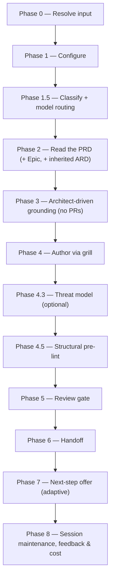

# /create-ard

Grounds on the mounted implementation repos it discovers and authors an Architecture Requirements/Decision Document (ARD) for a Product Requirements Document or one of its Epics, gated by an Opus review.

## Who runs it

`/create-ard` runs in the [pa](../roles-and-phases.md#pa--product-architecture) role, cost-attribution phase [architecture](../roles-and-phases.md#architecture) — an optional phase, since a simple single-repo PRD may genuinely not need an ARD at all (Phase 0 step 5 offers an "optionality advisory" for exactly that case, and lets the architect proceed anyway) — though in a repository of several modules the advisory adds that a PRD touching two of them is multi-component, and `/epics` will then ask for the ARD.

## Synopsis

```
/create-ard <ADDRESS> [--no-docs] [--docs <path>] [--no-arch] [--skip-costs] [--skip-feedback] [--enforce-model=<model>]
```

`/create-ard <PRD-KEY>` authors a **PRD-level** ARD. `/create-ard <EPIC-KEY>` authors an **Epic-level** ARD, which inherits the PRD-level ARD read-only and layers its own `[AD#N]` decisions on top (an Epic/area decision wins on conflict — a real contradiction is caught by `ard-reviewer` at authoring time, not left for a downstream consumer to resolve). A bare `<Epic-KEY>` also resolves, auto-finding its parent PRD. The folder's prefix sets the altitude, never the kind it asserts; a legacy folder with no prefix is placed by what it holds — a carrier asserting `kind: epic` as an Epic folder, one asserting `kind: prd` or a `brd-link.md` naming a `parent:` as a PRD folder. `--no-docs` turns off the optional Phase 3 documentation-grounding pass.

- **The BRD route** — detected from the resolved folder's `brd-link.md`, never declared. It authors an ARD into the `PRD-` slice folder [`/brd-split`](brd-split.md) carved, from that folder's `ard-seed.md`. A `BRD-` container is refused with `CREATE_ARD_BRD_NOT_SLICED`: a BRD holds `brd/`, `coverage-ledger.md` and `slices.md` (and at most a `grounding/` from the legacy two-level layout), and no ARD.

All three run flags apply to this command. `--skip-costs` (or `WORKFLOWS_SKIP_COSTS`) skips Phase 8's session-cost entry, still advancing the checkpoint and dropping any deferred cost record a [ceded](../reference/session-cost.md#ceded-runs) `/prompt-brainstorm` or `/prompt-grill-me` run left pending in this session — see [Session cost](../reference/session-cost.md). `--skip-feedback` (or `WORKFLOWS_SKIP_FEEDBACK`) narrows Phase 8's maintenance step to bugs-only, dispatching `defect-reporter` in place of `impl-maintenance` — see [Session feedback](../reference/session-feedback.md). `--enforce-model=<model>` (or `WORKFLOWS_ENFORCE_MODEL`) pins every dispatched agent in this run — `workflows-core:docs-grounder`, `workflows-core:code-scanner`, `ard-reviewer` (overriding its frontmatter Opus pin), `threat-modeler` (overriding its frontmatter Opus pin), `workflows-core:architecture-grounder`, `workflows-core:impl-maintenance`, and, under `--skip-feedback`, `defect-reporter` — to one model, and it is also the one flag that changes a *gate*: the tiered HARD model gate does not fire under it, since the user has already chosen the model — see [Model routing](../reference/model-routing.md).

## How it runs



Six subagents are dispatched: `workflows-core:docs-grounder` (Phase 3, read-only grounding on the shipped product docs — default ON when `$DOCS_PATH` resolves, advisory, never a gate), `workflows-core:architecture-grounder` (Phase 3, after the code scan, read-only grounding on the architecture repository, the team's harvested decisions and the weakness classes the security findings registers hold — run where either root resolves or a register holds a class, advisory, never a gate), `workflows-core:code-scanner` (Phase 3, one instance per confirmed repo, up to 4 concurrent per batch), `threat-modeler` (Phase 4.3, Opus-pinned, only where a threat model is added or refined; it calls no tool), `ard-reviewer` (Phase 5, Opus-pinned), and `workflows-core:impl-maintenance` (Phase 8, session lessons-learned).

The detection-tier agents run on the strongest Sonnet model available — or on the session's own model where no Sonnet is, which the run announces. `ard-reviewer` and `threat-modeler` run on the strongest Opus model available (each frontmatter-pinned, no override unless `--enforce-model`/`WORKFLOWS_ENFORCE_MODEL` enforces one), and so does `architecture-grounder`, pinned there by its dispatch rather than its frontmatter because a measurement found Sonnet missing binding standards Opus found. The interview and the ARD authoring itself run inline on the session's own model rather than through a delegated subagent.

### Multi-component PRDs

A **component** is a repository, or a module inside one — a Gradle or Maven module, a workspace package, a top-level directory with its own build file, or a deploy directory such as `k8s/`. At PRD level the run proposes the components the PRD's themes touch, reading each repository's own module declarations, and you confirm, correct, add or group them; the confirmed list becomes the ARD's `components:` frontmatter.

- **`## Contracts`.** With two or more code components (a deploy directory a module only rides along on does not count) the grill also writes `## Contracts`: one row per interface between components — its `[AD#N]`, producer, consumers, kind, status and, where the contract is a code file, its path — then schema ownership, versioning and compatibility, and the landing order.
- **What a new or changed interface's Rule states.** What either side may rely on beyond the shape, wherever the interface has it: what a caller gets on a failure, whether a repeated request or a redelivered message repeats a side effect, and ordering. A row an earlier version of the ARD already held keeps its Rule until a new decision supersedes it, since adding behaviour to a Rule in place changes what the decision requires.
- **The review.** `ard-reviewer` blocks a capability that lands in two or more code components with no interface row, and flags a new or changed interface, other than a shared schema, stated as a shape alone.
- **The next step.** With two or more code components and no Epics yet, the next-step offer recommends a PRD-level `/specify` before `/epics`.

## What it needs

- **The PRD on the specs repo's default branch** — gated via `require-on-main` against `specifications/<PRD>-<vslug>/`. An unmerged PRD is a hard stop, naming the branch and any open pull request. An **absent** PRD is not a stop: the run falls back to reading the resolved folder directly through and reports that it did so — `/specify` reports an absent PRD the same way, though it has no fallback to make: it reads the item from the specs tree on every run regardless, and it means `/create-ard` never requires `/create-prd` to have run first.
- **`$SPECS_PATH`** (required) — if unset, the run stops naming `SPECS_PATH` and offers to enter a path or cancel.
- **A specs checkout not behind for the PRD** — once the address resolves and the specs-repo preflight has run, the run checks the branch the specs checkout stands on, before the PRD gate above. Where it is a plugin branch the default branch has moved past under the address's top-level folder in `specifications/` — the PRD folder, or the `BRD-` folder above a slice — a document there added, changed or removed since that branch was cut, session files aside, the run stops, naming the paths and what to run: merge the default branch in, where this run builds on that branch — its own `ard/` branch, or an earlier phase's open branch it stacks on — or switch to the default branch, where it does not. Where the `ard/` branch this run's handoff would reuse is open and has changed something under that folder, it asks first whether to switch to that branch and continue there, or stop until its pull request is merged, or closed and the branch deleted.
- **The Epic on the specs repo's default branch**, when the run is Epic-level — gated via `require-on-main` against the Epic's `epic.md`, which the run reads for the Epic's goal, scope, acceptance criteria and target. An Epic on an unmerged `epics/` branch — the one [`/epics`](epics.md) hands its drafts off on — is a hard stop, naming the branch and any open pull request; an `epic.md` that is on no branch is not a stop: the run reads the Epic folder as it stands and reports it.
- **A prior PRD-level ARD**, when the run is Epic-level. One on the specs repo's default branch has its `[AD#N]` invariants inherited read-only; one on an unmerged branch, or in any other state the default-branch gate stops on, stops the run with `CREATE_ARD_ARD_NOT_ON_MAIN`, naming the state and its remedy; where there is none — no ARD file, or one that neither the default branch nor any plugin branch carries, which is then not read — the run proceeds unchanged (the common case for a first ARD).
- **Mounted repos under `$REPOS_PATH`** — `/create-ard`'s repo discovery (Phase 3) is **mandatory**, not opt-in: it always lists top-level directories under `$REPOS_PATH`, proposes a theme-to-component mapping — repositories, or modules inside them — from the PRD/Epic's capability themes, and asks the architect to confirm, correct, add to or group it. [`/idea`](idea.md)'s `--ground-code` runs the same cheap-discovery-then-propose-then-gate mechanism, but only behind that opt-in flag. Before the scan the run asks how to refresh each clone it scans — fetch and pull its default branch (recommended), fetch only, or no refresh. Where the repository the session runs in stands on a branch other than its default, that question says so, since a refresh would switch your checkout to its default branch — under *fetch only* even with uncommitted changes. Where the run knows that repository's default branch, it recommends reading the default branch's tip by ref instead — one fetch, your checkout left on its branch and its working tree unread — so the run is grounded in merged code rather than in the branch's unmerged work; scanning the branch as it stands stays an option, and *fetch only* may still be typed. Where the default branch is unknown there is no ref to read, so the question recommends scanning the branch as it stands instead. A read by ref whose fetch fails still reads the default branch as the clone last fetched it, never your working tree, and the final report says the read was stale and why.
  - A theme that maps to no obvious repository or module is asked about outright.
  - A repo the architect can't mount is neither invented nor silently dropped: it is escalated, with the choice of *Mount now & re-scan*, *Ground only the confirmed-mounted set (record the rest as open questions)*, *Specify an absolute path for this repo (you'll be prompted)* or *Cancel*, and, if descoped, recorded as an open question in the ARD rather than disappearing.
  - That gate is not put where `$REPOS_PATH` named no existing directory and the architect already took *Ground only the confirmed-mounted set* when Phase 1 asked for the path: that answer stands for the gate, and every component the architect confirms is recorded as an open question.
- **`$DOCS_PATH`** (optional, default `/workspace/docs`) — documentation grounding, consumed with grill-rank ranking. Turned off for a run with `--no-docs`, or pointed at another root with `--docs <path>`. Missing, unreadable, or carrying no markdown file is a silent, non-blocking skip. Turned off explicitly with `--no-docs`.
- **`$ARCHITECTURE_REPO_PATH`** (optional) — architecture grounding: a clone of your organisation's architecture repository (radar, standards, principles, patterns, ADRs). Phase 1 shows an `architecture grounding:` line with the clone's branch, commit, date, uncommitted changes and staleness; the clone is never fetched or pulled. Unset, or naming no architecture repository, it is OFF with a reason and the run proceeds as without it. Turned off explicitly with `--no-arch`, which turns off the team knowledge base and the security findings registers below as well ([Environment](../reference/environment.md)).
- **The team knowledge base** (optional) — `$SPECS_PATH/architecture/`, once [`/harvest-decisions`](harvest-decisions.md) has built it from merged ARDs: read as a second root, with a `team decisions:` line in Phase 1. Absent, the line says so and the run proceeds without it.
- **The security findings registers** (optional) — the registers `/security-workflows:scan` keeps under `$SPECS_PATH/security/`, one per code repository. Where that folder exists, Phase 1 shows a `security registers:` line; after the code scan the run reads, for the repositories you confirmed, the weakness classes their registers hold — a CWE with live findings in one repository — and `architecture-grounder` turns at most three of them into questions: how the architecture avoids adding to the class. Where risks of one class were accepted in two or more scan runs and no team decision prevents it, the question offers to record an `[AD#N]` whose **Prevents** names the CWE, or to leave it out of this ARD, which the final report then names; where a decision this ARD already holds prevents it, the run says so and offers nothing. The run reads only the classes, never a finding's text, and never waits on a register: one that is missing, unreadable or malformed costs only its own classes, a read that fails is one line in the final report, and that report names the registers it read — `none` where it read none, with the reason where no component of the work could be passed to the read — and counts any component whose id the run could not pass to the read.
- **`grounding/`, read wherever the PRD folder holds it, on either route** — the resolved folder on a PRD-level run, and on an Epic-level run the PRD folder above the Epic, since grounding is PRD-altitude and an `EPIC-` folder never holds a `grounding/` of its own; the idea-route PRD folder as readily as the BRD-route slice, since [`/prd-ground`](prd-ground.md) writes `grounding/code-grounding.md` and `grounding/design-grounding.md` from either. Where either file is present, its `[CG#n]`/`[DG#n]` findings **seed the Phase 3 theme set** before falling back to the PRD/Epic-derived themes — a finding whose verdict says a capability is absent is a theme worth scanning, one whose verdict says it is present names the code that already implements it, directing the scan rather than replacing it. A finding with no verifier outcome is never evidence and seeds nothing. Where the folder holds neither file, the run proceeds without them — grounding is optional to `/create-ard` and nothing in this run gates on it.

`/create-ard` never reads a pull request — there are no PRs yet at architecture time. It authors architecture only; it never writes code.

### The BRD route

With the BRD route the run is seeded by a BRD instead of a PRD, and what it needs changes accordingly:

- **No tracker is consulted.** A BRD key names a folder under `$SPECS_PATH` and nothing else, so there is nowhere outside the specs tree to look it up; the code this route reads is still reached through `$REPOS_PATH`, as on the idea route (repo discovery, below).
- **The same PRD gate as the idea route, and the same PRD read.** The route resolves a `PRD-` slice folder in every case — or an `EPIC-` folder inside one, whose PRD folder is that slice — so there is one folder to gate and one `prd.md` to look for in it. An **absent** PRD is reported and the run architects from the resolved folder — `/create-prd` is not a prerequisite here, and the gate's `absent` branch is what keeps that true. The hard stop is a `prd.md` that exists on an unmerged branch, which is as reachable on a slice as anywhere else.
- **The register is gated as well.** Before the run reads `decisions.md` it executes `require-on-main` on it. A register that is not on the default branch as it stands stops the run before it reads a line of it, naming the state and what resolves it: on a branch with its pull request still open, on no branch because its handoff was declined, edited in the working tree, or one that changed on the default branch after the run's own branch was cut, whatever that branch holds of it (merge the default branch into that branch). The stop is `CREATE_ARD_REGISTER_NOT_HANDED_OFF` for the declined handoff and `CREATE_ARD_REGISTER_NOT_ON_MAIN` otherwise. An **absent** register is reported and the run architects from what the slice does hold.
  - **Why it matters.** The usual writer of an unmerged register is the [`/brd-reconcile`](brd-reconcile.md) run that froze the customer's decisions, or a `/create-prd` that added an assumption to it, so the run never architects from customer decisions nobody has merged. `/brd-reconcile`'s offer of this command carries a note of what must reach the default branch first, naming that wait.
  - **The [`/brd-*` route](../brd-workflow.md)'s earlier handoffs are no substitute for the gate.** On the path that advances the slice, `/brd-reconcile` — or, for a slice that needs no customer review, [`/brd-interview`](brd-interview.md) — hands over to this command, directly or through [`/create-prd`](create-prd.md), which writes to the register too. Nothing on that path but this gate and the same gate in `/create-prd` and [`/specify`](specify.md) refuses to start on a register left unmerged. [`/brd-package`](brd-package.md) gates it as well, but a slice passes through that command again only when it goes back through the route — a question still held for the customer, a reopened decision's new round, or a re-grounded claim — and not on the path that advances it.
- **The BRD folder's seed, register and findings** — `ard-seed.md` (the architecture altitude of the router; `prd-seed.md` and `spec-seed.md` belong to [`/create-prd`](create-prd.md) and [`/specify`](specify.md) and are not read), `decisions.md`, and the `[CG#n]`/`[DG#n]` records in `grounding/`. Any of them being absent is reported, never a stop. **A seed file is normally absent**, because nothing on the route creates one: the one command that creates one is [`/brd-intake --sort-existing`](brd-intake.md), a migration path (`/brd-reconcile` only corrects an existing one's prose) for a package authored by hand outside the route. The register and the findings are what this route is really seeded from. A finding carrying no verifier outcome is not evidence: it seeds nothing and is never marked consumed.
- **A `PRD-` slice folder, and never a `BRD-` container.** The route is the slice [`/brd-split`](brd-split.md) carved — the folder carrying `brd-link.md` — because the artifact tree places `ard.md` only inside a PRD folder. A `BRD-` folder stops with `CREATE_ARD_BRD_NOT_SLICED` **on either route**, and the stop says where the ARD belongs instead.
  - **When it fires.** The moment the address resolves and the specs-repo preflight has settled the specs checkout's branch — so a stale plugin branch cannot hide a slice from the listing (save on a run that found `$SPECS_PATH` misplaced, where the preflight switches no branch and names a stale one it stays on).
  - **Why on either route.** The BRD route is detected from a `brd-link.md` and a root BRD folder need not carry one, so a route-conditioned refusal would let a container fall through.
  - **A legacy unprefixed folder** has no prefix to test and is answered by positive evidence instead — `coverage-ledger.md` or `brd/brd-inventory.md` present and no `brd-link.md` naming a `parent:` — so a legacy idea-route PRD folder, which carries neither file, proceeds.
  - **What the stop names.** The slices under it, one ARD each, or — where the BRD holds none — [`/brd-split`](brd-split.md) to carve one, with that command's own two conditions stated in the offer: it needs a slicing instruction, since a root is never ground and so has no findings to cluster slices from (`BRD_SPLIT_NEEDS_INSTRUCTION` without one), and it is a no-op on a ledger with no `unallocated` row.
- **No coverage-ledger check.** PRD eligibility and the allocation gate govern authoring a *PRD*; an ARD is not that artifact, so nothing this route reads to author with is a ledger row — the container refusal above is decided on the folder's prefix, not on any row. That is a decision, not an omission — [`/create-prd`](create-prd.md) is where the gate lives. The run does open the ledger in two places, and neither gates anything this run does: its next-step offer, which reads it only to decide whether [`/create-prd`](create-prd.md) can be *named* — that command refuses three BRD-route shapes, not one — and, report-only, its final report, which leaves out of the list of findings still `consumed_by: none` every finding about a requirement the slice's own ledger now shows as `covered-by`, since another BRD owns that requirement.
- **Repo discovery adds `grounding/baselines.md`** — the repositories `/prd-ground` already pinned — to the candidates the PRD themes propose, rather than replacing them. The architect still confirms, corrects and adds, and an unmounted repo still reaches the mount-or-descope gate, save on the run whose Phase 1 answer already descoped every repository (above).
- **A slice inherits its parent BRD's ARD** read-only, exactly as an Epic-level run inherits its PRD-level one. The parent comes from `brd-link.md`'s `parent:`, never from counting segments in the key — and on this route it is always there, since the container is refused. The slice's own `ard.md` is never inherited: a refine of it is this run's own prior ARD, whose decisions it may supersede. An Epic-level run under a slice inherits the slice's `ard.md` instead, as an idea-route Epic inherits its PRD's.
- **Decisions are frozen.** The grill fills what the seed leaves unstated and may not reopen a `[VD#n]` or `[CD#n]`; open decisions and open `[AS#n]` assumptions reach the ARD's `## Open questions` under their own ids. Architecture-altitude decisions seed `[AD#N]` — where they pass `ard-format.md`'s hard-to-reverse / surprising / real-trade-off test; where they do not, the run says where the content went instead.

## What it produces

**ard.md** for a PRD-level run, or the Epic folder's **ard.md** (or **ard-\<area\>.md** per area, when a Phase 4 per-area split is chosen for a large Epic spanning separable components) for an Epic-level run — written against the plugin's ARD format into the feature folder (`specifications/<PRD>-<vslug>/` or its `<EPIC>-<eslug>/` subfolder), applying the no-hard-wrap prose convention. Each `### [AD#N]` decision carries a `**Binds:**`, a `**Prevents:**`, a testable `**Rule:**`, and `**Alternatives:**` — the other options weighed and why each lost. Refining an ARD — or starting fresh over one already on the specs repo's default branch — never rewrites what an existing decision requires: a changed decision is a new `[AD#N]`, and the old one stays in place with a `**Superseded by:**` line, or `**Withdrawn:**` where nothing replaces it, because downstream artifacts cite decisions by ID. A superseded or withdrawn decision binds nothing. Behind Phase 6's consent choice, the ARD is committed, pushed, and a pull request opened against the specs repo's default branch.

Where architecture grounding ran, the ARD cites each architecture-repository artifact that binds a decision as a link, opens `## Stack & invariants` with the governance baseline it was grounded on, and records every departure — from an accepted ADR or an active standard, or onto a `hold`, `retire` or unlisted technology — as an open question. A decision whose **Prevents** names a CWE names it as a link to its CWE page, whether or not grounding ran. On the BRD route a frozen `[VD#n]`/`[CD#n]` that conflicts with the architecture repository is not re-grilled; the conflict is an open question naming both.

**Wherever the PRD folder holds `grounding/`, on either route** — the PRD folder above the Epic, on an Epic-level run — the run adds `ARD` to the `consumed_by` of every `[CG#n]`/`[DG#n]` finding it actually drew on — never a finding read for context and unused, and never one with no verifier outcome — and stages that folder's `grounding/code-grounding.md` and `grounding/design-grounding.md` alongside the ARD, since an uncommitted consumption record is one no later run can read.

**On the BRD route** the ARD is **ard.md**, written into the resolved `PRD-` slice folder beside the artifacts it was derived from, on an `ard/<SLICE-KEY>-<slug>` branch — or, on an Epic-level run under the slice, into that `EPIC-` subfolder on an `ard/<EPIC>-<eslug>` branch, the branch being named from the folder the ARD lands in. A slice's ARD carries the parent BRD's key as `prd:` with the slice's own as `epic:`; an Epic's ARD under it carries the slice as `prd:`, the Epic as `epic:`, `inherits:` the slice's `ard.md` and no `components:`, as any Epic-level ARD does. `derived_from` names the PRD in that folder when there is one, else the `ard-seed.md` the ARD was actually authored from. That run additionally adds `ARD` to the `consumed_by` of the architecture-altitude decisions in `decisions.md` the ARD drew on — the only other write it makes into any BRD file — and stages `decisions.md` alongside the grounding files. `ard-seed.md` is read but never written: `consumed_by` is a field of a decision or finding *record*, and the seed holds neither, so its consumption is reported at file granularity instead.

A decision that replaces a team record from another PRD carries `**Supersedes:**`, which the next `/harvest-decisions` applies; one that departs from a record only locally is an open question naming it. The team records harvested from the ARD the run rewrites, and on an Epic-level run from the PRD-level ARD it inherits, do not ground it; every other team record does, a sibling Epic's included. A departure from a record of this PRD (on the BRD route the slice, not the parent BRD its `prd:` names) — a sibling Epic's, or on a PRD-level run one of its Epics' — is an open question, settled by refining the ARD it came from: `**Supersedes:**` replaces only a record of another PRD.

**`[AD#N]` decisions bind seven downstream commands** once the ARD is merged: `/create-ard` itself (an Epic-level run inheriting its PRD-level ARD), `/dev-workflows:design`, `/dev-workflows:implement`, [`/specify`](specify.md), [`/epics`](epics.md), `/dev-workflows:ready`, and `/dev-workflows:conformance`, which traces each Rule against the merged code. An `[AD#N]` `Rule` violated downstream without a recorded "ARD deviation" is a reviewer BLOCKER in whichever of those commands hit it.

**Each ARD records its lineage**: the exact version (git blob id) of the PRD and, on an Epic, the `epic.md` and the inherited ARD it was built from, plus the register, seed and grounding files it read — never the Epic's specification or design, which are built on the ARD. Before its grounding, the run checks the PRD, the Epic, the decision register and the grounding files up the chain: where one was built from a document that has since changed, or carries no lineage record yet, it shows what moved and asks whether to revise the highest stale document first or proceed, recording your answer in the ARD.

**threat-model.md**, where you add a threat model — optional, offered at Phase 4.3 ([The threat model](#the-threat-model), below) — is written beside the ARD in the same feature folder, one model covering every ARD file there. It holds one numbered `[TH#N]` per concrete attack on a component the architecture names, or on an interface between two of them, each with exactly one disposition: mitigated by `[AD#N]` decisions, deferred to the detailed design, or accepted with an owner, a reason and a review date. A decision recorded for a threat is an ordinary `[AD#N]` in the ARD, held to the same format as every other. The model takes the ARD's own `status:`, and records its own lineage: the version of each ARD file in the folder as Phase 6 wrote it, and, on an Epic, the PRD folder's threat model as the run first read it. It rides in the ARD's handoff, on the same branch and pull request, and the ARD alone decides which consent choice that handoff presents. A new model whose walk records no threat is not written.

## The threat model

An optional companion to the ARD, recording how the architecture answers concrete attacks on what it builds. Phase 4.3 offers it once the grill has drafted the ARD, and a run that neither adds one nor finds one in the folder runs every later phase exactly as before.

### When it is offered

- **A component set must resolve.** On a PRD-level run, a BRD slice's included, it is the components you confirmed in Phase 3. On an Epic-level run it is the components the PRD-level ARD lists or, where it lists none, the targets the PRD's Epics name — and the Epic's own `target:` must be among them, since every threat on an Epic names its target. Where no set resolves, the run prints why and asks nothing. A model the folder already holds is then left as it stands, neither checked nor refined, and a printed line says so — save one *Start fresh* discarded (below): a printed line says that one is removed, and Phase 6 removes it.
- **A folder with no model** is asked *Add a threat model* or *Not this time*. *Add a threat model* is recommended where the run's classification is `HIGH-RISK`, or where architecture grounding raised a known weakness — a weakness class from the security findings registers (*What it needs*), whether or not it won a question slot in the grill — and the question says which; otherwise neither option is recommended.
- **A folder that holds one**, unless *Start fresh* discarded it (below), has it checked first (*The checks*, below). Where it passes, the run asks *Refine the threat model* (recommended) or *Leave it as it is*; where a threat is stale, *Leave it as it is* gives way to *Re-dispose only the stale threats*, since a stale model would send the design to decisions that no longer hold. *Leave it as it is* keeps the file as it stands, neither reviewed again nor re-stamped, save where Phase 6's second check finds a threat stale and re-disposes it there.

### What a threat holds

Each threat is a `### [TH#N]: <title>` heading followed by five fields, in this order:

- **Category** — one STRIDE letter (Spoofing, Tampering, Repudiation, Information disclosure, Denial of service, Elevation of privilege), or `—`: a prompt for completeness, never a score.
- **Where** — at least one component id of the run's component set and, where the threat crosses an interface, the contract row, named by its decision: the ARD file and the decision's id, as in `ard.md [AD#3]`, or `[[<PRD-KEY>]] ard.md [AD#4]` for a row of the PRD-level ARD an Epic inherits.
- **Threat** — `attacker: …; action: …; asset: …`: who attacks, what they do, and what is at stake.
- **CWE** — a link to the weakness's CWE page, or `—`.
- **Disposition** — exactly one of `Mitigated by <decision>[, <decision>…]`, optionally followed by `; the rest deferred to design: <what>`; `Deferred to design: <what the design must answer>`; or `Accepted — <owner>; <reason>; review by <YYYY-MM-DD>`.

A threat **already recorded** — one the specs repo's default branch holds, or, where that branch holds no copy of the model, one the folder's file holds — is never renumbered or deleted; any other, such as one this run drafted, is edited or dropped in the draft. A recorded threat whose Where changes, or whose Threat line comes to mean something else, becomes a new `[TH#N]` with a disposition of its own, and the old one gains a `**Superseded by:**` line; one that no longer applies gains `**Withdrawn:**` and its reason. The model also lists its `## Scope` — the components and contract rows it considered — and, under `## Not considered`, each one it leaves out with the reason. An Epic's model lists the PRD-level model's live threats under `## Inherited threats` — `_None._` where the PRD folder holds no model or one with no live threat — and adds only the threats its Epic's target raises; a BRD slice's model inherits none. A model holds no risk score, attack tree or data-flow diagram, and no mitigation id of its own: a mitigation is an `[AD#N]`.

### The walk

`threat-modeler` proposes up to 25 ranked candidates: threats on an interface first, then those matching a weakness class the security findings registers hold, then the rest. It reads no file and calls no tool. The run hands it everything in one brief — the component set, the contract rows, the live decisions, the ARD format's bar for a decision, the code scan's findings, and the weakness classes as counts and flags, never a finding's text — and it decides nothing. The run drops a candidate whose Where names a component outside the set, leaves out an Epic's target, or names a contract no row holds, and one carrying a security finding id or register path the brief did not give it; the final report lists each with why. Where the agent fails, or its dispatch is refused, no candidate is walked, the report says why, and you can still add threats of your own.

Each candidate is put to you as a question of its own, up to four at a time, with its Where, Threat, Category, CWE and proposed disposition, and four answers, the proposed one recommended:

- ***Record an [AD#N] for it*** — where the candidate names an existing live decision, or you name one, the threat is `Mitigated by` it and no decision is added. Otherwise the proposed decision is grilled as Phase 4 grills any, held to the ARD format's bar, its Prevents naming the threat's CWE, and written into the ARD as its next `[AD#N]` — on a per-area split, into the area file the grill settles. Where it does not earn an `[AD#N]`, nothing is written and the question comes back with *Defer to design* recommended. Where the threat's weakness class was answered *Not in this ARD* earlier in the run, only an existing decision may be named. On the BRD route, a decision that would reopen a `[VD#n]` or a `[CD#n]` goes to the ARD's `## Open questions` instead.
- ***Defer to design*** — `Deferred to design: <what the design must answer>`, as the candidate words it.
- ***Accept the risk*** — asks for the owner and the reason, then the review date: *90 days* (recommended), *30 days* or *180 days* from today, or a date you type. Only you, the architect, accept a risk; the run never accepts one for you.
- ***Not a threat — drop it*** — nothing is written.

A threat whose answer is a product requirement the PRD does not state is deferred to design, never answered by a decision, and the ARD's `## Open questions` gains a line naming the requirement the PRD needs, to be added through [`/update-prd`](update-prd.md).

**Your own threats.** After the candidates the run asks *Add a threat of my own* or *No more threats*, again after each one you add. You describe who attacks, what they do, to what, and where. An id outside the component set, or a contract no row holds, is named together with the set and asked for again, so it is never written. The run drafts the rest, plays it back and asks the four answers, none recommended.

**The confirmation gate.** The run checks its own draft (*The checks*), puts back to you any threat the walk itself made stale, then plays back the whole model with every change Phase 4.3 made to the ARD — each `[AD#N]` it added and each open question. Each component or contract row of the model's `## Scope` that no threat names and `## Not considered` does not already explain is asked about, and your reason goes into `## Not considered`. Then you confirm or correct the whole.

### A refine, and *Start fresh*

- **A refine** hands `threat-modeler` the current threats, and it proposes only what the changed architecture adds. Every existing `[TH#N]` keeps its number. Each stale one is put to you again — *Record an [AD#N] for it*, *Defer to design*, *Accept the risk*, or *Not a threat — withdraw it* with a reason, none recommended — and one stale on its Where is first asked for a new Where: a new threat carrying it supersedes the old, or the old is withdrawn. Each acceptance past its review date is listed: *Renew it — a new review date*, *Re-dispose it*, or *Keep it as it stands*.
- ***Re-dispose only the stale threats*** walks only the stale threats, that way, with no new candidates.
- ***Start fresh*** on the ARD keeps every `[TH#N]` wherever the specs repo's default branch carries one of the folder's ARD files or its `threat-model.md`. Where it carries neither, the old model is discarded, and the run says so — in the question it puts, or, where no component set resolves, in a printed line: the old file is not read, a new model numbers from `[TH#1]` and replaces it, and where no new model is written Phase 6 removes the old file, its deletion riding in the handoff where the branch the checkout stands on tracks it.

### The checks

A mechanical check, which asks nothing, finds a live threat **stale** where its Where names a component no longer in the set, where its contract row is gone or that row's decision is no longer live, or where its `Mitigated by` names a decision that is missing, superseded or withdrawn. An acceptance past its review date is not stale. Where a component set resolves, the run checks up to three times: the model the folder holds, to choose the question it puts; its own draft, before the playback, since a later answer can supersede a decision an earlier threat cites; and, at Phase 6, after the review, the model it writes or leaves in the folder, before stamping it.

**The second check** clears each stale threat without a new decision, since the ARD's review has passed: *Defer to design* (recommended), *Accept the risk*, or *Name a live decision that answers it*. A threat stale on its Where takes a new Where: an already recorded threat is superseded by a new one carrying it, or withdrawn, and any other takes it in place, or is dropped. A requirement gap found there still gains its open-question line in the ARD.

### Where it goes, and who reads it

The model reaches the structural pre-lint and `ard-reviewer` beside the ARD (*Gates*, below), then rides in the ARD's handoff, on the same branch and pull request. The pull request's description gives the model's state and counts and names each risk accepted, with its owner and review date, for its reviewer to check: the pull request is where a Security Engineer checks every disposition and each risk the architect accepted. A model the folder already held, left as it stands but not held as written on the default branch — an earlier run's handoff declined — rides in this handoff too.

A later `/create-ard` run on the same folder reads it, and `ard-reviewer` reads it within the run. No other command reads it as a threat model. Three read it as ordinary markdown in the trees they walk: on the BRD route, `/product-workflows:brd-reconcile`'s stale cross-reference sweep reads it as prose, where by that sweep's structured-record class a hit is `needs-a-human`, never corrected in place; `/product-workflows:harvest-decisions` takes from it only an `ARD deviation:` line; and `/product-workflows:promote-decisions` takes only a link to a team decision record or an `Architecture deviation:` line. The lineage checks `/docs-workflows:document` and `/docs-workflows:release-notes` run never read one either, so a threat model gives them no note, even where your checkout's copy differs from the default branch's.

## Gates

Phase 5 dispatches `ard-reviewer`, Opus-pinned by frontmatter (`model: opus`, no override unless `--enforce-model`/`WORKFLOWS_ENFORCE_MODEL` enforces one). It is given the commit Phase 3 scanned each repository at and how the scan read it, and checks each file an as-is claim cites where the scan read it — at that commit for a repository read by ref or on a read-only mount — so a file your checkout's branch lacks but the default branch holds is not taken for a fabricated one; a claim the ARD cites at a commit of its own, such as a grounding finding's evidence at its pinned commit on the BRD route, is checked at that commit. **One review covers the ARD and its threat model.** Where the run drafted, refined or re-disposed a model, it rides with the review of `ard.md` — on an Epic split by area with no `ard.md`, of the first area file by name — together with the model's prior copy, where there is one, the folder's other ARD files and the component set, and that one review, its one fix cycle and its one re-review cover both documents. `PASS` proceeds; `BLOCK` gets one inline fix cycle and one re-review, and a BLOCKER still standing after that is put to you — after the threat model's escape, below, where it applies. Each finding that needs an architectural decision is asked as a question of its own — save one still open when the re-review returns `BLOCK`, which goes straight into `## Open questions` without a question — and one you leave open goes into the ARD's `## Open questions` too.

- **What it checks.** Grounding integrity (every as-is claim cites a real `file:line`), `[AD#N]` well-formedness (Alternatives included), supersession — on a refine, or a fresh start over a merged ARD, it compares the ARD against a copy taken before the run, so a decision rewritten in place or dropped is caught — non-contradiction of inherited live PRD-level invariants, altitude purity (no per-repo solutions at PRD level), recorded open questions, and — with two or more code components — *Contract completeness*. On a threat model it blocks a live threat with no disposition or more than one, a Where naming a component outside the set, a decision or contract row cited that is not live, an acceptance missing its owner, reason or review date, and a `[TH#N]` renumbered or dropped against the prior copy; it raises a decision a threat cites that lacks a field the format requires, or a Threat line missing a part, as `MAJOR`, and a component or contract row of the model's scope that no threat names and nothing explains as `MINOR`.
- **A fix to the model never adds or changes a decision.** Whatever reaches a finding on the model — a fix, an applied finding, a decision question, your manual fix notes — re-disposes the threat (*Defer to design*, *Accept the risk*, or `Mitigated by` a decision the ARD files already hold), supersedes or withdraws it — or, where it is not already recorded, corrects it in place or drops it — or corrects the model's own text, so fixing the model never changes a decision the ARD's verdict passed. Every such fix but a correction — of the model's scope or what it leaves out, a restored `[TH#N]`, or a Threat line completed in place — is put to you as a question of its own before it is applied, in a `BLOCK`'s fix cycle too: the run never re-disposes, supersedes, withdraws, re-points or drops a threat for you. A note that would add or change an `[AD#N]` is not applied, and the BLOCKER's question is put again.
- **The threat model's escape — a new model only.** Where the re-review still returns `BLOCK`, every BLOCKER left is the model's, and the model is one this run added, the run asks once, before the escalation, *Hand off the ARD without the threat model* or *Settle the model's findings*, neither recommended. The first discards the draft, so no `threat-model.md` is written, and the ARD's verdict is reported as `BLOCK on the threat model only — the model was dropped`; an open question a requirement gap added stays in the ARD, naming the dropped threat by its title. The second goes on to the escalation below. Where the folder already held the model there is no escape: a blocking threat can always be re-disposed, superseded or withdrawn without a new decision.
- **A verdict that is not `BLOCK`.** After the first review and after the re-review alike, where it leaves findings open, the run offers to apply those whose fix is only an edit before going on; a finding not applied is listed in the final report and the pull request. Then — whatever you answered, and in place of the offer where nothing else is open — it puts each finding that needs an architectural decision to you as a question of its own: the reviewer's options for that decision, at most three, then *Leave it open*.
- **The re-review after those edits.** Where the first review's findings were applied, or its decisions settled, it offers the re-review the cap still holds once, after those questions — taken, it is the run's one re-review; declined, the final report says the verdict predates the edits.
- **`BLOCK`** triggers one inline fix cycle — the orchestrator/grill edits the ARD directly; there is no delegated fixer — and one re-review. Where the `BLOCK` review also leaves open findings, whose fix is only an edit or needs an architectural decision, the run first asks, listing them in the question, whether to fold them into the fix cycle so the one re-review covers them (each architectural decision then asked as a question of its own, ending in *Leave it open*). Otherwise they wait for the re-review, after which the offer and the decision questions above carry them — unless the re-review returns `BLOCK`, when a finding that needs an architectural decision goes into `## Open questions` as the last bullet says.
- **Still `BLOCK`.** Each unresolved BLOCKER is escalated individually. Manual fix notes there start, BLOCKER by BLOCKER, from notes the run drafts from the finding's suggested fix, which you apply or replace with your own; for a BLOCKER whose fix needs a decision the run drafts nothing and asks for your notes, naming the decision and the options the finding names. Cap: one fix cycle plus one re-review.
- **Every inline edit of the review phase** — a `BLOCK` fix, an applied finding, a settled decision, a manual fix note — is held to the format's citation rule like the draft: a claim it adds about the code cites the `file:line` a search found. It takes two steps more: a claim that something is the only one, or that every one does something, is first searched for counter-examples, and the edit is read against everything that overlaps it — the decisions, contract rows and scope lines that govern the same component or interface among them.
- **A finding left open** whose fix needs an architectural decision the run did not take — one you chose to leave open, a deferred BLOCKER, or one still open when the re-review returned `BLOCK` — is written into the ARD's `## Open questions` once the last review has returned. One on the threat model goes into the open questions of the ARD file the model was reviewed with, naming `threat-model.md` and the threat; a dropped model leaves none.
- **The second check.** After the last review, Phase 6 checks the model once more against the ARD files as written, before stamping it, and clears each stale threat without a new decision ([The checks](#the-checks)).

Before the review, Phase 4.5 runs a structural pre-lint — advisory only, never blocking — that inline-fixes mechanical issues (a duplicate `[AD#N]`, a stray placeholder) and leaves content gaps for the grill and the author to close. Where the run drafted a threat model, it lints that too, with the same general checks and the model's own — its headings, an unbroken `[TH#N]` series, each threat's fields and one disposition form, and that no threat of the prior copy is missing; of the model's own findings, it inline-fixes only a duplicate `[TH#N]` this run introduced.

**A stop ends the run short, not silently.** Every stop under *What it needs* and *The BRD route*, *Stop — no ARD needed* at the optionality advisory, a relaunch at the model gate, and each *Cancel* that ends the run — at the refine-or-fresh question, the repos question, the model gate, the mount-or-descope gate or the review escalation — still writes the session-cost entry and ends with the terminal commit of the specs repository and its `Specs repo:` line, with no session maintenance, follow-ups or resume pointer; *Cancel* at Phase 6's handoff choice only declines the handoff, and the run goes on. Where `SPECS_PATH` is unset or misplaced, the cost entry stays in the run's printed output and nothing is committed.

## Example

Author a PRD-level ARD, grounding on the two repos the PRD's themes point at:

```
/product-workflows:create-ard ACME-77
```

The run resolves the PRD from the merged PRD file where present, lists top-level directories under `$REPOS_PATH`, proposes a theme-to-component mapping — repositories, or modules inside them — and asks you to confirm it, scans the confirmed repos with `code-scanner`, grills you relentlessly through Context, Grounding findings, Architecture decisions, Cross-repo approach, Contracts (two code repositories make two components, so the section is written), Stack & invariants, Edge cases & risks, and Open questions, offers to add a threat model beside the ARD, runs the structural pre-lint, then `ard-reviewer`. On a passing verdict it offers to branch, commit, push, and open a pull request, then offers the adaptive next step — with two code components and no Epics yet, `/product-workflows:specify ACME-77` first (a single-component PRD with no Epics gets `/product-workflows:epics ACME-77`), or `/product-workflows:specify ACME-77` otherwise.

Author the ARD for a decided BRD slice instead:

```
/product-workflows:create-ard ACME-001-01
```

The run resolves `ACME-001-01`'s folder two levels under `specifications/`, inside its parent BRD's, reads `ard-seed.md`, the register and the verified findings, inherits the parent BRD's ARD if one is merged, proposes the repositories `grounding/baselines.md` already pinned, and grills **only the gaps** — every `[VD#n]` and `[CD#n]` the register holds as decided is an input the interview never reopens, because the customer signed it.

Its next-step offer names `/product-workflows:specify ACME-001-01`; the second option is `/product-workflows:epics ACME-001-01` **only where the slice already holds an authored `prd.md`**. Where it does not, the replacement is resolved from the slice's own coverage ledger, because [`/create-prd`](create-prd.md) refuses three BRD-route shapes and this run has cleared only the container one:

- `/product-workflows:create-prd ACME-001-01` where no claimed row is `unallocated` and at least one is `covered-here`;
- [`/brd-split`](brd-split.md) on the slice where a row is still `unallocated`;
- `/brd-split` on the parent where the slice claims nothing — with a slicing instruction, `/brd-split <PARENT-KEY> "<how to cut it>"`, where the parent's own ledger still holds an `unallocated` row (a bare run stops there with `BRD_SPLIT_NEEDS_INSTRUCTION`), bare where it holds none, and in neither form where that ledger cannot be read;
- **no second option at all** where the slice is fully allocated with no `covered-here` row, since `/create-prd`'s own branch for that state names no command either.

[`/epics`](epics.md) partitions a PRD and refuses a folder that holds none, and this route does not require one — `/create-prd` is not a prerequisite for `/create-ard` on it — so a slice carrying an ARD and no PRD is an ordinary state, not an error.

## What it offers next

Phase 7 adapts the offer to the ARD's level and runs nothing itself. An offer marked *after the merge* says what has to reach the specs repo's default branch first, worded for how this run's handoff ended. Each such command either gates a file this run hands off — this ARD, or the register or grounding file it stamped — and stops while that file is unmerged, or, as `/harvest-decisions` does, reads only the default branch and so does not see this ARD until it is merged.

- **PRD-level ARD on the idea route, no Epics yet** → [`/epics <PRD>`](epics.md) (PE, recommended) or [`/specify <PRD>`](specify.md) for a PRD-level specification (PE), both after the merge. Where this run recorded two or more code components, the two swap and `/specify` is recommended. Where the folder holds no authored `prd.md`, [`/create-prd <PRD>`](create-prd.md) (PM, recommended) takes `/epics`'s place, since `/epics` refuses a folder without one.
- **PRD-level ARD on the idea route, Epics already there** → `/specify <PRD>` (PE), after the merge.
- **Epic-level ARD** → `/specify <EPIC>` (PE, recommended), after the merge; `/dev-workflows:design <EPIC>` (Dev), also after the merge, beside it only where the Epic's `specification.md` is already on the default branch — otherwise the offer says it follows once it is. `/dev-workflows:design` reads this ARD and stops while it is unmerged. A sibling Epic's ARD, `/create-ard <SIBLING-EPIC>`, waits on nothing this run produced: it inherits the PRD-level ARD, not this one.
- **BRD slice** → `/specify <SLICE-KEY>` (PE, recommended), after the merge, and one second option read off the slice:
  - `/epics <SLICE-KEY>` (after the merge) where the slice holds an authored `prd.md`;
  - otherwise `/create-prd <SLICE-KEY>` (after the merge) where no claimed row is `unallocated` and at least one is `covered-here`;
  - [`/brd-split <SLICE-KEY>`](brd-split.md) (after the merge) where a claimed row is still `unallocated`;
  - `/brd-split <PARENT-KEY>`, to keep or remove the slice, where it claims nothing — with a slicing instruction where the parent's ledger still holds an `unallocated` row, bare where it holds none; this one waits on nothing this run wrote, since that root run reads none of it;
  - no second option where every claimed row is fully allocated with none `covered-here`, or the slice's or the parent's ledger cannot be read.
- **Every run** → a closing line naming [`/harvest-decisions`](harvest-decisions.md), to add this ARD's decisions to the team knowledge base, after the merge: the harvest reads only the default branch.
- **Where the PRD folder holds an authored `prd.md`** → [`/prd-proposal <PRD>`](prd-proposal.md), optional and waiting on nothing this run wrote: it gates `prd.md`, which this run does not write. On a PRD-level run on the BRD route this ARD takes the folder to tier 3 and a re-run narrows the range; on the idea route the folder stays at tier 1. Without a PRD, the offer says a proposal becomes available once `/create-prd` has written one.

## See also

- [Workflow overview](../workflow.md) — where this command sits among the plugin's others.
- The `document-lineage` reference (shipped in `workflows-core`, listed on its References page) — the lineage record each ARD carries, and the upstream check run on the PRD, the Epic, the decision register and the grounding files; a register or grounding change counts only where an architecture-level record moved.
- [Roles and phases](../roles-and-phases.md) — what the `pa` role owns, an optional phase in the pipeline.
- [`/create-prd`](create-prd.md) — the upstream command that authors the PRD `/create-ard` reads.
- [`/harvest-decisions`](harvest-decisions.md) — keeps every merged ARD's decisions in the team knowledge base this command grounds on; [`/promote-decisions`](promote-decisions.md) proposes organisation ADRs from them, which ground this command once accepted.
- The `threat-model-format` reference (shipped in `workflows-core` as `references/threat-model-format.md`, listed on its References page) — the threat model's format: its sections, a threat's fields and its one disposition, how a threat is superseded or withdrawn, and the check.
- [`/epics`](epics.md), [`/specify`](specify.md), and `/dev-workflows:design` — the downstream commands `/create-ard`'s Phase 7 offers, each of which consults the merged ARD once it lands.
- `/dev-workflows:ready` and `/dev-workflows:implement` — the two remaining consumers of `[AD#N]` invariants.
- [Model routing](../reference/model-routing.md) — the classification and Opus fallback chain `ard-reviewer` runs under, plus the tiered hard model gate `/create-ard` applies for `SIGNIFICANT`/`HIGH-RISK` runs.
- [Session cost](../reference/session-cost.md), [Session feedback](../reference/session-feedback.md), and [Resume and checkpoints](../reference/resume-and-checkpoints.md) — the terminal Phase 8 bookkeeping every run emits.
- [References](../reference/references.md) — `ard-format.md`, the canonical structure the ARD is authored and reviewed against.
- [`/prd-ground`](prd-ground.md) — the optional, ungated run, on either route, whose `[CG#n]`/`[DG#n]` findings this command reads and marks consumed, adding `ARD` to their `consumed_by` wherever the PRD folder holds them — on an Epic-level run, the one above the Epic.
- The `grounding-format` reference (shipped in `workflows-core`, listed on its References page) — the finding record, the six verdicts, and the two horizons this command reads a finding by.
- The `ard-resolution` reference (shipped in `workflows-core`, listed on its References page) — how the seven downstream commands resolve and inherit `[AD#N]` invariants.
- [The BRD-to-PRD route](../brd-workflow.md) — the `/brd-*` commands that produce the register and findings the BRD route reads, and the customer sign-off that makes those decisions unreopenable here. They produce no `ard-seed.md`: the one command that creates a seed file is `/brd-intake --sort-existing`, a migration path (`/brd-reconcile` only corrects an existing one's prose), so a reconciled BRD normally holds none and the architecture altitude arrives through the register and the findings.
