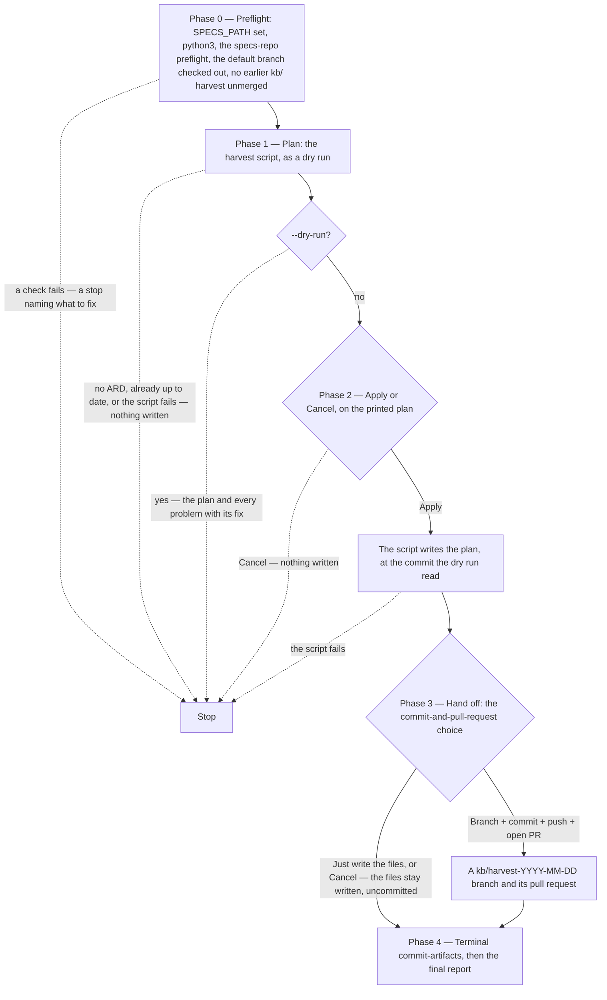

# /harvest-decisions

Harvests the architecture decisions of every ARD on the specs repository's default branch into the team knowledge base at `$SPECS_PATH/architecture/` — the records `/create-ard`, `/specify` and `/dev-workflows:design` ground on.

## Who runs it

The Product Architect, whenever ARDs have merged since the last harvest — [`/create-ard`](create-ard.md) offers it at the end of every run. Re-running it is safe: on an unchanged default branch it changes nothing.

## Synopsis

```
/product-workflows:harvest-decisions [--dry-run]
```

`--dry-run` prints the plan and stops.

## How it runs

Every step is the command or its bundled script: no agent, no model. A dotted edge ends the run.



## What it needs

- **`$SPECS_PATH`** — the specs repository. The harvest reads only its default branch, so an ARD on an open pull request is harvested once that pull request merges.
- **`python3`** — the harvest is product-workflows' bundled script `scripts/architecture-harvest.py`, run with `--layout prd` (ARDs are `ard.md` and `ard-<area>.md` in `PRD-` and `EPIC-` folders).
- **The default branch checked out** — the harvest branches from it, so a run on any other branch stops, naming it.
- **No earlier harvest left unmerged** — a `kb/` branch not yet merged stops the run, naming it; a squash- or rebase-merged one counts as merged.

## What it produces

`$SPECS_PATH/architecture/`: a `decisions/<id>.md` record per `[AD#N]` (id `<KEY>-AD<N>`), an `index.yaml` catalog and a `README.md`. Each record carries the decision's **Binds**, **Prevents**, **Rule** and **Alternatives** verbatim, its status (`accepted`, `superseded`, `withdrawn`), the designs that apply it and every `- ARD deviation:` line its own PRD's folder records against it. A later ARD of another PRD replaces a record with `**Supersedes:**`, and the next harvest marks the record superseded; a record of the same PRD changes only by refining the ARD it came from. Records are generated: to change one, refine its ARD and harvest again. Nothing is ever deleted.

## Gates

No reviewer and no model: the script is deterministic, and its self-test runs in CI. Two prompts — `Apply / Cancel` on the plan, then the usual commit-and-pull-request choice for a `kb/harvest-<date>` branch.

## Example

```
/product-workflows:harvest-decisions --dry-run
/product-workflows:harvest-decisions
```

The first shows what would change and every problem (an unparseable decision, a `Supersedes` naming no record) with its fix; the second applies it and opens the pull request.

## What it offers next

It asks no next-step question. The final report ends with one line: the next [`/create-ard`](create-ard.md), [`/specify`](specify.md) or `/dev-workflows:design` run grounds on the harvested records once they are on the default branch, which a declined handoff leaves to you. A `--dry-run`, a run with nothing to harvest and a run that finds the knowledge base up to date stop after their report, and name nothing.

## See also

- [`/promote-decisions`](promote-decisions.md) — a later step for the product architect, which this run does not offer: promotes the team's decisions this command harvests to organisation ADRs. It stops while the knowledge base has uncommitted changes.
- [`/create-ard`](create-ard.md) — grounds on the live records, and writes the `Supersedes` the next harvest applies.
- [`/specify`](specify.md) and `/dev-workflows:design` — ground on the live records too.
- [Architecture knowledge base](../workflow.md#architecture-knowledge-base) — the whole loop, from merged ARDs to organisation ADRs and back into grounding.
- The `architecture-kb` reference (shipped in `workflows-core`, listed on its References page) — the format: identity, statuses, citations and every problem kind with its fix.
