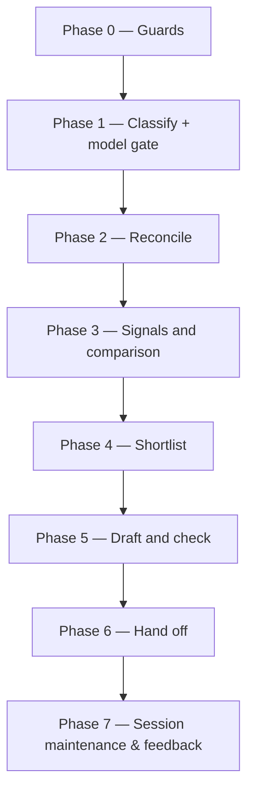

# /promote-decisions

Promotes the team's architecture decisions to organisation ADRs, and proposes superseding ADRs where teams keep departing from one. It is run inside the architecture repository and opens two pull requests.

## Who runs it

The product architect, after [`/harvest-decisions`](harvest-decisions.md) has built the team knowledge base. Start it in a session whose project is the architecture repository: where other repositories are mounted read-only, the run stops before writing anything.

## Synopsis

```
/product-workflows:promote-decisions [--reconsider] [--max <n>] [--skip-feedback] [--enforce-model=<model>]
```

- `--reconsider` proposes records marked `declined` or `rejected` again.
- `--max <n>` caps each shortlist (default 10).
- Run flags: `--skip-feedback` and `--enforce-model`. The command emits no cost entry, so `--skip-costs` does not apply.

## How it runs



1. **Reconcile.** Every ADR whose Context opens with `Origin: team decisions …` updates the records it names: `proposed`, then `accepted` or `rejected` as the ADR's status says.
2. **Signals.** A bundled script reads the knowledge base and the specs tree on the default branch, all but `security/`: the findings registers and the scan reports copied beside them are text a scanner wrote, so no line there counts. It finds how often each decision is cited from other PRDs, where it was departed from, and which ADRs designs and ARDs keep departing from.
   - **Weakness classes recurring across registers.** Where the specs repository keeps security findings registers — one per code repository, written by `/security-workflows:scan` — the run also reads, on the same default branch, each weakness class (a CWE) that two or more registers hold findings of that were judged real: a fix decided or under way, a finding reopened, a risk accepted, or a fix made in the last 180 days. A read-only script in `workflows-core` reads the registers and hands over checked fields only, never a finding's text, and neither the command nor its agents open a register.
   - **When they cannot be read.** A read that fails, or a default branch whose name holds a character the read does not pass, costs only those classes: the report says `weakness classes: not read` and why, and the run goes on as it would without them. A register that cannot be read is named in the report, so a run never reports no class because it saw nothing.
3. **Comparison.** `workflows-core:promotion-scout` (Opus, read-only) marks each candidate `covered`, `conflicts` or `new` against the architecture repository, and groups the records of different teams that decide the same thing. For each weakness class, it says whether an ADR or standard already covers it.
4. **Shortlist.** You get two ranked lists, promotions and superseding proposals, each row with its reasons. You answer by number: draft, decline (with a reason), or mark as already covered.
   - A decision that prevents a class recurring across registers, one no ADR or standard already covers, gains the reason `prevents CWE-89, which recurs in 3 registers (api, billing, web)`. On a promotion row it ranks on it, right after how many PRDs decided it; a decision listed as already covered or in conflict shows the reason too.
   - A class that no decision prevents and nothing covers is listed for information, with each register's last run date and a pointer to `/create-ard`. A class an ADR or standard already covers, or one whose preventing decision no row or entry on the lists names — a cluster's row names its members, and a superseding proposal may still name it among its evidence without counting as such a row — is counted in one line instead.
   - No ADR is ever drafted from a class alone. Where a run that holds a class would number no row, nothing is asked and the run records only what reconciliation found. A run that holds a class and has no candidate decision does the same where the comparison with the architecture repository fails — even one whose designs and ARDs depart from an ADR, which that run then proposes no superseding ADR for.
5. **Draft and check.**
   - **Scaffold.** The repository's own ADR template is followed: the next number, its file-name pattern, its catalog entry where it keeps one.
   - **Write.** `workflows-core:adr-drafter` (Opus) writes the body. The command adds the overview row.
   - **Check.** The repository's own decision tests run, where it has any.
6. **Hand off.** One pull request in the architecture repository with the drafts. One in the specs repository on `kb/promote-<date>`, recording `promotion`, `promoted_to` and `promotion_note` on each record.

## What it needs

- **A writable architecture repository**: the session's own project — one holding an ADR folder and a catalog or radar file — or `$ARCHITECTURE_REPO_PATH` where that clone is writable. Its checkout must be clean, on its default branch and not ahead of origin. A completed run returns it to that branch.
- **`$SPECS_PATH`**, with `architecture/index.yaml` on its default branch, no uncommitted change under `architecture/`, and no unmerged `kb/` branch.
- **`python3`** — the signals are product-workflows' bundled script `scripts/promotion-signals.py`, run with `--layout prd`. `uv` is optional: it runs the repository's decision tests from prebuilt wheels, which needs the network; without it the run says the tests did not run.
- **`gh`** (optional): it opens both pull requests, and checks whether a pending promotion's pull request was closed.
- **Security findings registers** (optional): the registers `/security-workflows:scan` keeps under `$SPECS_PATH/security/`, read on the default branch for the weakness classes that recur across them. None is required, and none ever stops the run.

## What it produces

- **In the architecture repository:** one `proposed` ADR per pick, its catalog entry where it keeps one and its overview row, on a branch, with a pull request. No existing ADR is edited: a superseding proposal changes the old ADR only when a human accepts it.
- **In the specs repository:** the promotion keys on each decided record, on a `kb/promote-<date>` pull request. The next harvest preserves them, and its README marks a record whose ADR was accepted.

## Gates

Each of these stops the run before anything is written:
- the architecture repository is read-only, dirty, off its default branch, or ahead of origin;
- the knowledge base is missing;
- an earlier `kb/` branch is unmerged, or records under `architecture/` are uncommitted;
- a session not on Opus, Fable or Mythos, unless you override.

A failing repository test, or a mark the script refuses, stops it before the commit, on the run's branch: the stop names it and how to go on. No secret scanner ships with product-workflows, and the final report says so.

Every stop still ends with the run's terminal commit of the specs repository, which commits what an earlier run left there and prints the `Specs repo:` line. A stopped run runs no session maintenance and writes no feedback.

## Example

```
/product-workflows:promote-decisions --max 5
```

## What it offers next

It asks no next-step question. The final report ends with the one step that follows: once the ADR pull request is decided, run `/promote-decisions` again — that run records the outcome on the team records. The report also says the architecture clone is back on its default branch, to pull once that pull request merges.

## See also

- [`/harvest-decisions`](harvest-decisions.md) — builds the records this command promotes.
- [`/create-ard`](create-ard.md), [`/specify`](specify.md) and `/dev-workflows:design` — ground on the records, and skip one once its ADR is accepted.
- [Architecture knowledge base](../workflow.md#architecture-knowledge-base) — the whole loop, from merged ARDs to organisation ADRs and back into grounding.
- The `architecture-promotion` reference (shipped in `workflows-core`, listed on its References page) — the procedure.
- The `architecture-kb` reference (shipped in `workflows-core`, listed on its References page) — the record format.
