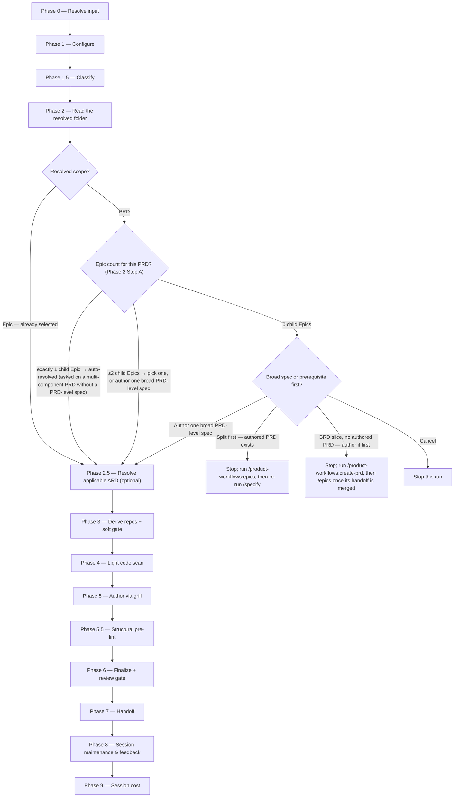

# /specify

Reads the resolved Epic or PRD folder, lightly grounds in code, and authors an org-standard `specification.md` through a relentless grill.

## Who runs it

`/specify` runs in the [pe](../roles-and-phases.md#pe--product-engineering) role, cost-attribution phase [specification](../roles-and-phases.md#specification) — being in this phase means an org-standard `specification.md` is being authored for one item, lightly grounded in code.

## Synopsis

```
/specify <ADDRESS> [--no-docs] [--docs <path>] [--no-arch] [--skip-costs] [--skip-feedback] [--enforce-model=<model>]
```

**The BRD route** — where the resolved folder is a `PRD-` folder carrying a `brd-link.md`, or an `EPIC-` folder inside one, the run authors the specification for a decided BRD slice — only where the slice's ledger tests pass, no row the slice claims still `unallocated` and at least one `covered-here`, stopping otherwise with `SPECIFY_BRD_UNALLOCATED` or `SPECIFY_BRD_NOT_ELIGIBLE` ([The BRD route](#the-brd-route)), on an Epic inside the slice too. It is detected, not declared: there is no flag. A `BRD-` container is refused (`SPECIFY_BRD_NOT_SLICED`). The address is then the slice's key (or an Epic's inside it), validated against `^[A-Z][A-Z0-9_]*(-\d+)+$` for shape only (so a slice key such as `ACME-001-01` is as valid as its parent BRD's `ACME-001` — the grammar fixes no depth) and resolved by a search of every level down to three below `specifications/`, plus the legacy unprefixed layout, so an `@<path>` is only for a folder outside the normal layout. It takes **one address**, like every other route: a second positional token stops the run (`SPECIFY_ONE_ADDRESS`), because a key encodes its own ancestry and no command takes a chain. The pickers, Epic counts and folder read described below run on this route too — a slice is a PRD folder, and [`/epics`](epics.md) can mint Epics inside it — and the route adds to them rather than replacing them: it also reads the slice's `spec-seed.md`, `decisions.md` and `brd-link.md`.

The folder's prefix sets the altitude — an `EPIC-` folder specifies that Epic, a `PRD-` folder the PRD — never the kind it asserts; a legacy folder with no prefix is placed by what it holds — a carrier asserting `kind: epic` as an Epic folder, one asserting `kind: prd` or a `brd-link.md` naming a `parent:` as a PRD folder.

Key distinction from [`/epics`](epics.md): `/epics` *splits* a PRD into Epic drafts; `/specify` *authors one specification* for a single item. **The PRD-level path is genuinely valid, not a fallback of last resort**: `/specify <PRD>` with no focus Epic stays in the PE lane and produces one broad `specification.md` at the PRD dir. What Phase 2 does with a bare PRD key depends on how many child Epics it has:

- **A PRD with exactly 1 Epic** — no picker; that Epic auto-resolves as the focus, with a one-line notice — save on a multi-component PRD with no PRD-level specification, where the run asks whether to author that broad spec first (recommended) or specify the Epic.
- **A PRD with ≥2 Epics** — Phase 2 renders a progress-aware picker: a row per child Epic (marked ○ not started / ◐ in progress / ● done), plus an explicit **"Author one broad PRD-level spec instead"** choice. That choice counts against the prompt's four options, so past three Epics the picker shows two Epic rows and an *Another Epic* option, which names under it every Epic left out and asks for the key you pick. The first Epic not yet done, in progress before not started, is marked recommended — save on a PRD with two or more code components and no PRD-level specification, where the broad spec is, as in the one-Epic and zero-Epic cases.
- **A PRD with 0 Epics and an authored `prd.md`** — offered *Split into Epics first with /product-workflows:epics* (recommended), *Author one broad PRD-level spec now* or *Cancel*. Choosing the split stops `/specify` and points at `/epics`; it does not continue authoring a specification. Re-run `/specify` after the Epics exist. On a PRD with two or more code components the first two options swap and the broad spec is recommended, since it is what `/epics` splits across them. On a folder whose `prd.md` asserts no `kind: prd`, on either route, the split is left out, and the question says that adding the `kind: prd` and `key:` its format carries is what lets `/epics` read the file. On a BRD slice with no `prd.md` — an idea-route folder without one stops in Phase 0, before this question — the split option — the first, or the second on a PRD with two or more code components — instead names [`/create-prd <PRD>`](create-prd.md) to author the PRD first, which `/epics` reads once that run's handoff is merged, wherever the specs tree is a git repository: the slice passed its ledger tests in Phase 0, and those are `/create-prd`'s own two tests on a slice. The broad-spec and Cancel choices remain available.

**There is no fourth case.** An Epic always has a PRD above it — [`/epics`](epics.md) is the only command that creates an `EPIC-` folder, and it writes every one of them under a PRD folder — so a top-level `EPIC-` folder with no PRD above it is not a shape `/specify` resolves. A per-Epic feature folder that does not exist is a stop (`SPECIFY_EPIC_NOT_FOUND`) naming `/product-workflows:epics <PRD>`, never a directory this command creates.

Addressing the Epic directly — `/specify <EPIC-KEY>`, or an `@<path>` to its folder — skips the picker entirely: the Epic is already chosen, and its parent PRD is the folder above it. There is no two-key form to skip the picker with; `/specify` takes **one** address and refuses a second positional token (`SPECIFY_ONE_ADDRESS`). `--no-docs` turns off the optional Phase 4 documentation-grounding pass.

All three run flags apply to this command. `--skip-costs` (or `WORKFLOWS_SKIP_COSTS`) skips Phase 9's session-cost entry, still advancing the checkpoint and dropping any deferred cost record a [ceded](../reference/session-cost.md#ceded-runs) `/prompt-brainstorm` or `/prompt-grill-me` run left pending in this session — see [Session cost](../reference/session-cost.md). `--skip-feedback` (or `WORKFLOWS_SKIP_FEEDBACK`) narrows Phase 8's maintenance step to bugs-only, dispatching `defect-reporter` in place of `impl-maintenance` — see [Session feedback](../reference/session-feedback.md). `--enforce-model=<model>` (or `WORKFLOWS_ENFORCE_MODEL`) pins every dispatched agent in this run — `workflows-core:docs-grounder`, `workflows-core:code-scanner`, `spec-reviewer` (overriding its frontmatter Opus pin), `workflows-core:architecture-grounder`, `workflows-core:impl-maintenance`, and, under `--skip-feedback`, `defect-reporter` — to one model, and it is also the flag that changes a degrade path: if no Opus resolves, Phase 1.5 otherwise degrades `spec-reviewer` to the Sonnet floor and records it, which does not happen under enforcement since the enforced model is used instead — see [Model routing](../reference/model-routing.md).

## How it runs



Six subagents are dispatched: `workflows-core:docs-grounder` (Phase 4, read-only grounding on the shipped product docs — default ON when `$DOCS_PATH` resolves, advisory, never a gate), `workflows-core:architecture-grounder` (Phase 4, after the code scan, read-only grounding on the architecture repository, the team's harvested decisions and the weakness classes the security findings registers hold — run where either root resolves or a register holds a class, advisory, never a gate; on the strongest Opus model available, pinned by its dispatch), `workflows-core:code-scanner` (Phase 4, one instance per mounted candidate repo, up to 4 concurrent per batch — deliberately **light** relative to `/epics`' scan, grounding for feasibility rather than a full reuse audit), `workflows-core:overlap-reader` (Phase 5, Opus-pinned, at two points: where an ARD applies, at the acceptance criteria's play-back, reading the inherited ARD Rules alone against that stage's draft; and once the last stage is written — the whole-specification overlap read before the play-back that precedes the first review — and once more in Phase 6, after the last review the cap allows, over the edits answering that review and the decisions settled at its questions), `spec-reviewer` (Phase 6, Opus-pinned), and `workflows-core:impl-maintenance` (Phase 8, session lessons-learned). The grill and the `specification.md` authoring itself run inline on the session's own model rather than through a delegated subagent.

### Multi-component PRDs

At PRD level on a PRD with two or more code components, the ARD's interfaces are ground truth: an acceptance criterion or test case that crosses components names the `[AD#N]` it crosses, so `/epics` can split it per side. At Epic level — on any PRD, multi-component or not — an Epic with a `target:` narrows the scan to its target's repository and paths; what it needs from another component is read from the ARD's `## Contracts`, not by scanning that component.

## What it needs

- **An Epic or PRD address** — a prompt with no address, or a token that is not a key, is rejected outright (`SPECIFY_NEEDS_KEY`); `/specify` has no direct-prompt behaviour. A folder with no prefix and nothing that places it stops with `SPECIFY_UNPLACED`, naming what it carries, and [`/create-prd`](create-prd.md) where it holds an `idea.md` and no `prd.md` — save where it holds its PRD under its file name from before the artifact filenames lost their keys, it prints the rename that places it — the commands, and the frontmatter fields the file then takes, with the ARD's own rename where that file is under its old name too — and never `/product-workflows:create-prd`, which would write a second PRD; on an `@<path>`, which gives no key to test that file's name with, the `/create-prd` it names carries that warning in words; and an existing specification that cannot be archived with `SPECIFY_ARCHIVE_FAILED`.
- **A specs checkout not behind for the PRD** — once the address resolves and the specs-repo preflight has run, the run checks the branch the specs checkout stands on, before the PRD gate below; on a PRD address it checks again once Phase 2 Step A has settled which Epic it specifies, or that it writes one broad PRD-level spec. Where it is a plugin branch the default branch has moved past under the address's top-level folder in `specifications/` — the PRD folder, or the `BRD-` folder above a slice — a document there added, changed or removed since that branch was cut, session files aside, the run stops, naming the paths and what to run: merge the default branch in, where this run builds on that branch — the `spec/` branch of the unit it specifies, or an earlier phase's open branch it stacks on — or switch to the default branch, where it does not. At Phase 0 on a PRD address, before Step A settles the unit, the run's own branch is the broad PRD-level spec's, and the open-branch question below waits for Step A. Where the `spec/` branch this run's handoff would reuse is open and has changed something under that folder, it asks — at Phase 0 on an Epic address, after Step A on a PRD address — whether to switch to that branch and continue there, or stop until its pull request is merged, or closed and the branch deleted.
- **The PRD on the specs repo's default branch** — gated via `require-on-main` against the `prd.md` of the PRD folder, `specifications/<PRD>-<vslug>/` (on an Epic address, the folder above the Epic). An unmerged PRD is a hard stop, naming the branch and any open pull request. Where the specs tree is not a git repository there is nothing to gate, and the folder's own `prd.md` decides. So it is for a PRD folder an `@<path>` names outside the specs repository's work tree — a second clone, say: the run gates nothing in it and reads that folder's own files, its ARD among them; no stop prints a git command for it; a command a stop names by its key — [`/create-prd <PRD>`](create-prd.md) among them — comes with a sentence saying that the command finds the folder by its key, so you run it with `SPECS_PATH` set to a specs tree that holds the folder; and the run records no lineage for what it writes, its report saying `Lineage: not checked — no specs repository`. Two more stops end the run in Phase 0, before Phase 1's configuration, the Epic picker, any scan and the grill — the same two [`/create-ard`](create-ard.md) makes:
  - **`SPECIFY_NEEDS_PRD`** — on the idea route (a PRD folder holding no `brd-link.md`), no `prd.md` in the folder at all: the stop names [`/create-prd <PRD>`](create-prd.md) to write it, or, where the folder holds the PRD under its old keyed file name (`<KEY>_<slug>.md`, never `<KEY>_ARD.md`), the rename to `prd.md`: the file also takes the `kind: prd` and `key:` frontmatter fields no file written under the old name carries, and, in a git repository, the stop prints the commands that commit the rename — with the old name's removal, where git tracked that file — on a new `prd/` branch for a pull request (a local merge where there is no `origin`). A BRD slice with no `prd.md` is not stopped for want of one (*The BRD route*, below).
  - **`SPECIFY_PRD_NOT_HANDED_OFF`** — on either route, a `prd.md` in the folder that neither the default branch nor any branch the plugin hands off carries: the stop prints the git commands that land that file — on a new `prd/` branch where it is uncommitted; where it is committed, on a branch of your own or on your local default branch, by pushing that branch, where `origin` does not already hold every commit of it, and, for one of your own, merging it, or, where the default branch is protected, a new `prd/` branch and a pull request — and never names `/create-prd`, which would write a second PRD.
- **Each Epic it reads on the specs repo's default branch** — gated via `require-on-main` against the Epic's `epic.md`, once the run knows which Epics it reads: in Phase 0 on an Epic address, and after the Phase 2 picker on a PRD address — the picked Epic, or every Epic under the PRD for a broad spec. An Epic on an unmerged `epics/` branch — the one [`/epics`](epics.md) hands its drafts off on — is a hard stop, naming the branch and any open pull request, so a specification never lands ahead of the Epic it specifies. An `epic.md` that is on no branch is not a stop: the run reads the Epic folder as it stands and reports it. A `[NEEDS CLARIFICATION]` marker in the Epic is a decision `/epics` left open, and the grill asks it.
- **`$SPECS_PATH`** (required) — `/specify` writes under `$SPECS_PATH/specifications/`, the specs repo; unset stops the run naming `SPECS_PATH`, with no fallback.
- **An optional ARD** for this item (Phase 2.5), resolved from the PRD and the resolved focus Epic. No ARD — or an ARD file that neither the default branch nor any plugin branch carries, which is then not read — skips silently; one on an unmerged branch stops, naming the branch and any pull request; one on the default branch keeps the spec's user stories and scope consistent with its `[AD#N]` invariants during the grill, and its invariants are passed to `spec-reviewer`; on a PRD-level spec of a multi-component PRD its `## Contracts` rows and components go with them, so the reviewer checks that a criterion crossing components names the `[AD#N]` it crosses.
- **Mounted repos under `$REPOS_PATH`** — for an Epic carrying a `target:`, the target's repository alone; otherwise candidates are auto-derived from the PRD's capability themes and from the `repo:` entries of the `implementation.md` records in the folders the run reads — the focus Epic's, or, for a broad PRD-level spec, the PRD folder's and every Epic's, since a record lives with the unit it implemented; there is no PR list to read. An *unresolved* repo slug (zero or ambiguous matches) hard-escalates before Phase 4 runs at all. A resolved-but-unmounted repo, by contrast, only **soft-gates**: it becomes an open question in `_session.md` and the run proceeds with the remaining mounted repos — the specification just can't cite the ungrounded one until it's mounted and the run is re-invoked. Before the scan the run asks how to refresh each clone it scans — fetch and pull its default branch (recommended), fetch only, or no refresh. Where the repository the session runs in stands on a branch other than its default, that question says so, since a refresh would switch your checkout to its default branch — under *fetch only* even with uncommitted changes. Where the run knows that repository's default branch, it recommends reading the default branch's tip by ref instead — one fetch, your checkout left on its branch and its working tree unread — so the run is grounded in merged code rather than in the branch's unmerged work; scanning the branch as it stands stays an option, and *fetch only* may still be typed. Where the default branch is unknown there is no ref to read, so the question recommends scanning the branch as it stands instead. A read by ref whose fetch fails still reads the default branch as the clone last fetched it, never your working tree, and the final report says the read was stale and why.
- **`$DOCS_PATH`** (optional, default `/workspace/docs`) — consumed with grill-rank ranking in Phase 4. Turned off for a run with `--no-docs`, or pointed at another root with `--docs <path>`. Missing, unreadable, or empty is a silent, non-blocking skip. Turned off with `--no-docs`.
- **`$ARCHITECTURE_REPO_PATH`** (optional) — architecture grounding, as in [`/create-ard`](create-ard.md): a clone of your organisation's architecture repository (radar, standards, principles, patterns, ADRs), shown on an `architecture grounding:` line in Phase 1 and never fetched or pulled. The team knowledge base `$SPECS_PATH/architecture/`, once [`/harvest-decisions`](harvest-decisions.md) has built it, is read as a second root on a `team decisions:` line. After the code scan, `workflows-core:architecture-grounder` returns what binds the work and what conflicts with it; the grill puts what binds to you as a confirmation, and a conflict it cannot settle becomes an open question in the stage it bears on, naming the decision, standard, radar entry or team record, or saying that the radar does not list the technology. Decisions the run already inherits from its ARD are not read again from their harvested copies; every other team record, a sibling Epic's included, is. Missing, it turns OFF with a reason and the run proceeds as without it; turned off with `--no-arch`, which turns off the security findings registers below as well ([Environment](../reference/environment.md)).
- **The security findings registers** (optional) — the registers `/security-workflows:scan` keeps under `$SPECS_PATH/security/`, one per code repository. Where that folder exists, Phase 1 shows a `security registers:` line; after the code scan the run reads, for the repositories the work touches, the weakness classes their registers hold — a CWE with live findings in one repository — and `architecture-grounder` turns at most three of them into questions: how the specification avoids adding to the class. One the grill cannot settle becomes an open question naming the CWE as a link to its CWE page and linking the register, settled by a Security / privacy acceptance criterion that prevents it — or, where risks of the class were accepted in two or more scan runs and no team decision prevents it, by an ARD decision made with [`/create-ard`](create-ard.md). The run reads only the classes, never a finding's text, and never waits on a register: one that is missing, unreadable or malformed costs only its own classes, a read that fails is one line in the final report, and that report names the registers it read — `none` where it read none, with the reason where no component of the work could be passed to the read — and counts any component whose id the run could not pass to the read.
- **A prior `_session.md`** (optional) — if one exists in the resolved feature folder, Phase 1 offers resume-vs-fresh; on resume, Phase 5 begins at the first unsettled stage instead of the header, once the environment check passes, or you choose to go on in the current one (see [Resume and checkpoints](../reference/resume-and-checkpoints.md#resuming-from-a-session-file)).
- **`grounding/`, read wherever the PRD folder holds it, on either route** — the resolved folder on a PRD address, and on an Epic address the PRD folder above the Epic, since grounding is PRD-altitude and an `EPIC-` folder never holds a `grounding/` of its own; the idea-route PRD folder as readily as the BRD-route slice, since [`/prd-ground`](prd-ground.md) writes `grounding/code-grounding.md` (plus any derivation matrix appended to it) and `grounding/design-grounding.md` from either. Where either file is present, its `[CG#n]`/`[DG#n]` findings **seed Phase 4's capability-theme extraction** before falling back to the PRD-derived themes — a finding whose verdict says a capability is absent is a theme worth scanning, one whose verdict says it is present names the code that already implements it, directing the scan rather than replacing it. A finding with no verifier outcome is never evidence and grounds nothing. Where the folder holds neither file, the run proceeds without them — grounding is optional to `/specify` and nothing in this run gates on it.

### The BRD route

On the BRD route the run is seeded by a decided BRD slice, and what it needs changes accordingly:

- **No tracker is consulted.** Nothing is dispatched against a tracker: a BRD key names a folder under `$SPECS_PATH` and was never checked against one. The code this route grounds on is still reached through `$REPOS_PATH`, as on the keyed route. `SPECIFY_NEEDS_KEY` is route-independent — the route is detected from the folder an address resolves to, so a prompt with no address stops there before any route exists to detect.
- **The PRD gate runs here too, and the same folder read — but a slice needs no PRD.** The route resolves a `PRD-` slice folder in every case — or an `EPIC-` folder inside one, whose PRD folder is that slice — so there is one folder to gate and one `prd.md` to look for in it. A slice with no `prd.md` that passed the slice's ledger tests (below) is reported and the run specifies from the resolved folder — `/create-prd` is not a prerequisite here, and `SPECIFY_NEEDS_PRD` is never raised on a slice. On a specs tree that is a git repository, a `prd.md` that exists and is not on the default branch stops the run as it does on the idea route — on an unmerged branch, naming the branch, or in the folder and on no branch the plugin hands off, with `SPECIFY_PRD_NOT_HANDED_OFF` — and either is as reachable on a slice as anywhere else; on one that is not, there is no default branch to test, and a `prd.md` in the folder is read and the run goes on. Where an uncommitted `prd.md` was left by a declined [`/create-prd`](create-prd.md) handoff that also left the slice's `decisions.md` changed or untracked, the stop still prints the commands for `prd.md` alone, and says that the register is not on the default branch either and that the re-run stops on it next, naming its own commands. **The register is gated as well.** Before the run reads `decisions.md` it executes `require-on-main` on it: a register that is not on the default branch as it stands — on a branch with its pull request still open, on no branch because its handoff was declined, edited in the working tree, or one that changed on the default branch after the run's own branch was cut, whatever that branch holds of it (merge the default branch into that branch) — stops the run before it reads a line of it, naming the state and what resolves it (`SPECIFY_REGISTER_NOT_HANDED_OFF` for the declined handoff, `SPECIFY_REGISTER_NOT_ON_MAIN` otherwise). `SPECIFY_REGISTER_NOT_HANDED_OFF` prints the git commands that land the register — on a new `brd/` branch where it is uncommitted; where it is committed, on a branch of your own or on your local default branch, by pushing that branch, where `origin` does not already hold every commit of it, and, for one of your own, merging it, or, where the default branch is protected, a new `brd/` branch and a pull request. The usual writer of an unmerged register is the [`/brd-reconcile`](brd-reconcile.md) run that froze the customer's decisions, or a `/create-prd` that added an assumption to it, so the run never specifies from customer decisions nobody has merged; an **absent** register is reported and the run specifies from what the slice does hold. `/brd-reconcile`'s offer of this command carries a note of what must reach the default branch first, naming that wait, and the [`/brd-*` route](../brd-workflow.md)'s earlier handoffs are no substitute for the gate: on the path that advances the slice, `/brd-reconcile` hands over to this command — directly, or through [`/create-prd`](create-prd.md) or [`/create-ard`](create-ard.md), each of which writes to the register too — and nothing on that path but this gate and the same gate in `/create-prd` and `/create-ard` refuses to start on a register left unmerged. [`/brd-package`](brd-package.md) gates it as well, but a slice passes through that command again only when it goes back through the route — a question still held for the customer, a reopened decision's new round, or a re-grounded claim — and not on the path that advances it.
- **The BRD folder's seed, register and findings** — `spec-seed.md` (the implementation altitude of the router; `prd-seed.md` and `ard-seed.md` belong to [`/create-prd`](create-prd.md) and [`/create-ard`](create-ard.md) and are not read), `decisions.md`, the `[CG#n]`/`[DG#n]` records in `grounding/`, and **the derivation matrix**, which lives appended to `grounding/code-grounding.md` rather than in a file of its own. Any of them being absent is reported, never a stop. **A seed file is normally absent**, because nothing on the route creates one: the one command that creates one is [`/brd-intake --sort-existing`](brd-intake.md), a migration path (`/brd-reconcile` only corrects an existing one's prose) for a package authored by hand outside the route. The register, the findings and the matrix are what this route is really seeded from. A finding carrying no verifier outcome is not evidence: it grounds nothing and is never marked consumed.
- **A `PRD-` slice folder, and never a `BRD-` container.** The route is the slice [`/brd-split`](brd-split.md) carved — the folder carrying `brd-link.md`. A `BRD-` folder stops with `SPECIFY_BRD_NOT_SLICED` **on either route**, the moment the address resolves and the specs-repo preflight has settled the specs checkout's branch, so a stale plugin branch cannot hide a slice from the listing (save on a run that found `$SPECS_PATH` misplaced, where the preflight switches no branch and names a stale one it stays on) — the BRD route is detected from a `brd-link.md` and a root BRD folder need not carry one, so a route-conditioned refusal would let a container fall through. A legacy unprefixed folder has no prefix to test and is answered by positive evidence instead — `coverage-ledger.md` or `brd/brd-inventory.md` present and no `brd-link.md` naming a `parent:` — so a legacy idea-route PRD folder, which carries neither file, proceeds. A BRD is a container, and its requirements are specified in the slices under it, one specification each. The stop names those slices, or — where the BRD holds none — [`/brd-split`](brd-split.md) to carve one, with that command's own two conditions stated in the offer: it needs a slicing instruction — a root is never ground, so it has no findings to cluster slices from and stops with `BRD_SPLIT_NEEDS_INSTRUCTION` where it has rows to place and was given none — and it is a no-op on a ledger with no `unallocated` row.
- **A slice whose `brd-link.md` names its `parent:`.** [`/brd-split`](brd-split.md) writes a `parent:` into every slice's `brd-link.md`; one a hand edit left with none stops the run with `SPECIFY_BRD_LINK_NO_PARENT` in Phase 0, before anything is read through it, and before the slice's ledger tests. The stop names the file, prints `git log -p` on it to find the commit that carried the line, and says to restore the line and land it — or, where no commit carried it, to write it by hand as the key of the BRD folder the slice sits in, or to report it. A legacy folder with no kind prefix whose `brd-link.md` names no `parent:` beside its ledger or inventory is read as a BRD container instead, as before (the [`coverage-ledger-format`](../reference/references.md) reference states the stop once).
- **The slice's ledger tests, before every gate.** Once the address has resolved and the container refusal and the branch check have run, and before the PRD gate, the register gate, the Epic gate and every question after them, the run reads the slice's `brd-link.md` and `coverage-ledger.md` — on an Epic address, the slice above the Epic — and stops unless the ledger can be read, no row the slice claims is still `unallocated`, and at least one is `covered-here`. These are [`/create-prd`](create-prd.md)'s two ledger tests, applied the same way, and each stop names the remedy `/create-prd`'s names for the same outcome — for a slice that claims nothing, with what to run once a row reaches it; an idea-route folder is never tested. They are read from the folder as it stands, whether or not the specs tree is a git repository, once per run: an Epic the picker or the *Next Epic* loop takes sits under the same slice and is not tested again. No stop they make carries a merge clause for this run's own handoff or a recommended option; the waits the stop names on a git tree, below, are for the named runs' own handoffs.
  - **`SPECIFY_BRD_UNALLOCATED`** — a claimed row still `unallocated`: the stop names [`/brd-split <SLICE-KEY>`](brd-split.md) to walk it, says that run stops, naming [`/prd-ground`](prd-ground.md), where the slice's grounding findings do not yet each carry a verifier verdict, and names the re-run.
  - **`SPECIFY_BRD_NOT_ELIGIBLE`** — where the slice claims rows and none is `covered-here`, the stop says what each resolved to and names no command, since nothing moves a settled row back and building a deferred requirement is a decision taken with the customer. Where the slice claims none, whatever its own ledger file's state, it names `/brd-split <PARENT-KEY>` to keep or remove the slice, in the form the parent's ledger decides. Where that ledger still holds an `unallocated` row, the form carries a slicing instruction, and, only where the slice's own ledger was read, the stop adds that that run's walk may place one of those rows on the slice. Where it holds none, the form is bare, and beside it, only where the slice's own ledger was read and a sibling has recorded `deferred-to` on a row the parent delegated to it, the stop names the instruction form that can re-cut that row onto a slice never interviewed. Either row reaches the slice only where the slice's own ledger and inventory can be read, and arrives `unallocated`, so the stop names the sequence after it, in the line the [`coverage-ledger-format`](../reference/references.md) reference states once for this stop, [`/create-prd`](create-prd.md)'s and [`/create-ard`](create-ard.md)'s: on a specs tree that is a git repository, once the parent run's handoff is merged, [`/prd-ground <SLICE-KEY>`](prd-ground.md) to ground it, and once that run's handoff is merged too, `/brd-split <SLICE-KEY>` to walk it, then the re-run — where this run could make no handoff from the checkout, its `.git` read-only or the run carrying `specs_git: misrooted` or `specs_git: blocked`, each wait is for what the run before it writes to reach the default branch instead, since that run's handoff is refused there too; on a specs tree that is no git repository, the same three runs with no wait between them. Where the parent's ledger cannot be read, the stop reports that file and names neither form. Where the slice claims rows and its ledger is missing or unreadable, it reports the file and names `/prd-ground <SLICE-KEY>`, which stops there by design, tells a carve interrupted before the ledger was written from a file lost after it, and names the repair.
  - **Every run on a slice takes them** — a resume, a run on a folder already holding a specification, and a slice whose `prd.md` is merged, included — since this command does not author a specification for a slice that holds no requirement of its own. [`/update-spec`](update-spec.md) takes no ledger test, and [`/update-prd`](update-prd.md) and [`/epics`](epics.md) take no such stop.
  - **Past the tests nothing the run authors is read from the ledger.** It opens the ledger once more, report-only, in its final report, which leaves out of the list of findings still `consumed_by: none` every finding about a requirement the slice's own ledger now shows as `covered-by`, since another BRD owns that requirement.
- **Repo candidates come from `grounding/baselines.md`** — the repositories `/prd-ground` already pinned, unless the Epic carries a `target:`, which narrows them as on the idea route — rather than from PRD themes and an implementation record, which this route has none of. The soft gate for an unmounted repo is unchanged.
- **The ARD is resolved from the folders, never from counting segments in the key.** A spec of the slice itself passes the parent's key (`brd-link.md`'s `parent:`) with the slice's own as the Epic, so the slice's ARD applies; a spec of an `EPIC-` folder inside the slice passes the slice with the Epic, so the Epic's own ARD applies on top of the slice's — in each case the pair `/create-ard` writes into that ARD's frontmatter. The *Next Epic* loop resolves it again for every Epic it takes.
- **Decisions are frozen.** The grill fills what the seed leaves unstated and may not reopen a `[VD#n]` or `[CD#n]`; open decisions and open `[AS#n]` assumptions reach the spec as `- [ ]` open questions under their own ids, which is also what keeps the header's count honest. A frozen decision that conflicts with an architecture-grounding reference is never re-grilled either: it becomes an open question naming both.

## What it produces

`specification.md` (`Published: no`), `_session.md` and `_glossary.md` — written into the feature folder: the Epic subfolder for a per-Epic spec, or the PRD dir itself for a broad PRD-level spec. **An existing specification is never overwritten silently**: before the run's first write to a folder, every existing copy of its `specification.md` — the merged one, and a working-tree one that differs from it — is archived under `revisions/` once you confirm, and a `Published: yes` copy stops the run instead (`SPECIFY_PUBLISHED`; its IDs are contracts). To revise a merged specification in place instead — keeping its IDs and its `Created` date, and asking only about what changed — run [`/update-spec`](update-spec.md). The specification's frontmatter records its **lineage** — the exact version (git blob id) of the PRD, ARDs, Epic, grounding and register it was built from — which is how `/update-spec` later finds what moved upstream. Before the code scan, the run also checks the PRD, the ARDs, the Epic it specifies (none on a PRD-level specification, where `epic.md` sits below the output in the lineage chain), and the decision register and grounding files it reads: where one of them was built from a document that has since changed, or carries no lineage record yet, it shows what moved and asks whether to revise the highest stale document first or proceed, recording your answer. `specification.md` is authored against the plugin's specification format through five ordered stages: Problem statement, Scope, User stories, Acceptance criteria (EARS phrasing), and Test cases — each stage's own numbered-ID scheme is the spec/design namespace that format defines, deliberately separate from a PRD's `[US#N]`-style grammar. It writes no `idea.md` on either route: the folders it reads already hold the record of what the spec is built from, and an `idea.md` already in the feature folder — such as [`/idea`](idea.md)'s, in a broad spec's PRD folder — is never touched. Behind Phase 7's consent choice, the spec's files are committed, pushed, and a pull request opened against the specs repo's default branch — **merged-to-main is what makes the spec visible to Devs and to `/dev-workflows:design`**, which reads it from `main` only, never from a branch. `Published: yes` is a separate, human-only freeze step outside this command's scope.

**Wherever the PRD folder holds `grounding/`, on either route** — the PRD folder above the Epic, on an Epic address — the run adds `specification` to the `consumed_by` of every `[CG#n]`/`[DG#n]` finding it actually drew on — never a finding read for context and unused, and never one with no verifier outcome — and stages that folder's `grounding/code-grounding.md` and `grounding/design-grounding.md` alongside the spec.

**On the BRD route** the same files land in the feature folder Phase 2 resolved — flat in the `PRD-` slice folder in the ordinary case, or in an `EPIC-` subfolder under it where the slice already holds Epics and the picker chose one or the Epic was addressed directly — on a branch named from that folder: `spec/<SLICE-KEY>-<slug>` for the flat case, `spec/<EPIC>-<eslug>` for an Epic subfolder. That run additionally adds `specification` to the `consumed_by` of the implementation-altitude decisions in the slice's `decisions.md` the spec drew on — the only other write it makes into any BRD file — and stages `decisions.md` alongside the grounding files. `spec-seed.md` is read but never written, and the derivation matrix is not a record either, so both are reported at file granularity rather than stamped. The next-step offer names `/dev-workflows:design` with a merge clause, since that command gates the specification this run wrote — save on a PRD-level spec of a multi-component slice whose folder already holds Epics, where `/dev-workflows:design` designs an Epic from that Epic's own merged specification, which predates this one, and is named without a merge wait — and [`/epics`](epics.md) **only where the PRD folder — the slice — holds an authored `prd.md`** — `/epics` refuses a folder that holds none. Where the slice's `prd.md` asserts no `kind: prd`, neither is offered (*What it offers next*); where it holds no `prd.md`, the offer becomes [`/create-prd`](create-prd.md) on the same address, after the merge: it refuses three BRD-route shapes, and a slice reaching the offer has cleared all three — the container one by being a `PRD-` folder, and the two on the slice's ledger by passing this run's own ledger tests in Phase 0, which are those same two tests.

**The report carries a `### Run details` block** — printed after the specs-repo commit as plain lines, whatever prose summary precedes it, and followed by the grounding and BRD-route additions and the *Next step* offer: `Feature folder:`, `Lineage:`, one `Read by ref:` line per repository read by ref, `PRD gate:` with its return value and whether an authored `prd.md` was read, the `architecture grounding:` line — naming the security registers it read, `none` where it read none, with the reason where no component of the work could be passed to the read, and counting any component whose id the run could not pass to the read — and an `architecture grounding: root not read` line where an architecture root could not be read, the `team decisions:` line, the `security registers:` line where Phase 1 showed one and a `security registers: not read` line where the registers could not be read, `Spec review:` with the verdict's version line, `Model routing:`, `Run flags:`, `Phase handoff:`, `Session feedback:`, `Session cost:` and `Specs repo:`. `Run flags:` appears only where Phase 0 printed one, `Session feedback:` only under `--skip-feedback` and `Session cost:` only under `--skip-costs`; `Phase handoff:` appears once per handoff the run offered.

## Gates

Before `spec-reviewer` runs, each trigger's outcomes and every criterion that applies another's rules by reference are listed — by the grill before the play-back that closes the acceptance criteria, and again over the whole specification before the first review by `workflows-core:overlap-reader`, an Opus agent, in place of a read by the session itself — so a new outcome cannot leave a sibling criterion on the old set, and a two-fault request has a stated winner. The agent lists the other kinds of overlap too, and reads each inherited ARD Rule's *every*, *once* or *within N seconds* against every criterion and scope line that touches what it binds, so a departure from a Rule reaches you before the review. At the acceptance criteria's play-back, where an ARD applies, the same agent reads those Rules alone, word for word, against the drafted criteria and every inference played back with them, which the run writes to a temporary file for it since the stage's section is written only after you confirm it; the grill keeps the rest of that read. So a departure from a Rule is put to you before you confirm the stage, rather than after you have confirmed an inference that breaks it. It settles nothing: each conflict it returns is put to you one question at a time before the play-back, a departure from an ARD Rule only as a recorded ARD deviation, and one already recorded as a deviation — by a record of that departure, not merely of its Rule — is named as settled rather than asked again. Each of those play-backs carries an `Overlap read:` line saying what the read covered and what it settled, in the question that asks you to confirm it, never only in narration before it.

Phase 6 dispatches `spec-reviewer`, Opus-pinned by frontmatter (`model: opus`, no override unless `--enforce-model`/`WORKFLOWS_ENFORCE_MODEL` enforces one), checking per-stage quality, cross-stage consistency, coverage, and identifier integrity. `BLOCK` fixes the BLOCKER findings inline — the orchestrator/grill edits `specification.md` directly; there is no delegated writer to re-dispatch — first asking, where the `BLOCK` review also leaves open findings whose fix is only an edit or needs a product decision, whether to fold them into that fix cycle so the one re-review covers them, the question listing each — on *Fold*, each product decision is put to you in the fix cycle as a question of its own; it reads the fix against everything that overlaps what it added or changed — the criteria and test cases whose trigger or precondition it meets, the trigger's other outcomes, the criteria that import its rules by reference, and the ARD Rules it inherits — so the re-review is not spent on a contradiction the fix itself wrote, and re-reviews once; an unresolved BLOCKER after that cycle is escalated individually with four choices — provide manual fix notes, defer to a follow-up issue, override and accept, or cancel — with "Defer" appending a `## Refinement notes` section to the spec itself, one plain bullet per finding, and manual fix notes (which start, BLOCKER by BLOCKER, from notes the run drafts from the finding's suggested fix, for you to apply or replace with your own, save for a BLOCKER whose fix needs a decision, where the run drafts nothing and asks for your notes, naming the decision and its options) read the same way as the fix. `MAJOR`/`MINOR`/`NIT`, under any verdict, carry no mandatory fix cycle: after the first review and after the re-review alike, the run offers to apply the ones a verdict that is not `BLOCK` leaves open whose fix is only an edit, and puts each whose fix needs a product decision to you as a question of its own — the reviewer's options for that decision, at most three, then *Leave it open* — whatever you answered the offer, and in its place where nothing else is open. Where the first review's findings were applied, or its decisions settled, the re-review the cap still holds is offered once, after those questions, before the handoff; a finding not applied is listed in the final report and the pull request. A finding left open whose fix needs a product decision the run did not take — one you chose to leave open, a deferred BLOCKER, or one still open when the re-review returned `BLOCK` — is written into the spec once the last review has returned, as a `- [ ]` open question under the stage it concerns that names the requirement it puts in doubt, so `/epics` and `/design` see it. Cap: one fix cycle plus one re-review. Once the cap is spent, an edit answering the last review's findings — one you apply at its offer, or your manual fix notes — and a decision you settle at its questions are read once more by `workflows-core:overlap-reader` before the handoff — the read after the last review, over those edits alone: each conflict it returns is put to you as a question, as at a play-back, and the final report and the pull request, which say the verdict predates those edits, also name the read and the number of conflicts it returned, zero included. The read is not a review and raises no cap, and an edit answering one of its conflicts is read by nothing further. Where you declined the re-review the cap still held, no such read follows.

Ahead of the review, Phase 5.5 runs a structural pre-lint — advisory only — checking the Universal checks and the spec block, including that the header's `Open questions` count matches the actual `- [ ]` count.

**A stop ends the run short, not silently.** Every stop under *What it needs* and on the BRD route, *Split into Epics first*, and each *Cancel* that ends the run — at the diagram's Epic-count question, a configuration or repository question, the archive question, or the review escalation — still writes the session-cost entry and ends with the terminal commit of the specs repository and its `Specs repo:` line, with no session maintenance, follow-ups or resume pointer; *Cancel* at Phase 7's handoff choice only declines the handoff, and the run goes on. Where `SPECS_PATH` is unset or misplaced, the cost entry stays in the run's printed output and nothing is committed.

## Example

Author a specification for a single Epic already selected:

```
/product-workflows:specify ACME-77-01
```

The run resolves the PRD and the named focus Epic (skipping the picker, since it was given explicitly), reads the full Epic subtree, resolves any applicable ARD, derives and lightly scans mounted repos, grills you relentlessly through Problem statement → Scope → User stories → Acceptance criteria → Test cases, runs the structural pre-lint, then `spec-reviewer`. On a passing verdict it offers to branch, commit, push, and open a pull request; if this Epic came from a multi-Epic PRD's picker, it then offers to loop straight into the next sibling Epic.

Author the specification for a decided BRD slice instead:

```
/product-workflows:specify ACME-001-01
```

The run resolves `ACME-001-01`'s folder two levels under `specifications/`, inside its parent BRD's, reads `spec-seed.md`, the register, the verified findings and any derivation matrix, resolves the ARD under the parent's key with this slice as the Epic, scans the repositories `grounding/baselines.md` pinned, and grills **only the gaps** — every `[VD#n]` and `[CD#n]` the register holds as decided is an input the interview never reopens, because the customer signed it. A `NEW-CAPTURE` matrix row is work this spec must deliver and lands in `## Scope` and an EARS acceptance criterion, not in a footnote.

## What it offers next

The final report ends with a *Next step* recommendation; nothing is run for you. An offer marked *after the merge* says what has to reach the specs repo's default branch first, worded for how this run's handoff ended.

- **The review blocked, or left `- [ ]` items open** → resolve those first.
- **An Epic chosen from a picker of two or more** → right after the handoff, the run asks whether to go on: *Next Epic* (recommended) or *Stop here*. *Next Epic* re-opens the picker without the Epic just specified and runs again for the one you choose — checking first the branch the specs checkout stands on, as for the first Epic, and offering that Epic's own handoff. A run that takes several Epics reports one handoff line per Epic, and names `/dev-workflows:design` for each Epic, each after its own merge.
- **Epic-level spec** → `/dev-workflows:design <EPIC>` (Dev), after the merge — it will not start until this spec is on the default branch; and `/specify <SIBLING-EPIC>` for a sibling Epic, which waits on nothing this run produced.
- **PRD-level spec** → [`/epics <PRD>`](epics.md) (PE), after the merge, where the folder holds an authored `prd.md`; and `/dev-workflows:design <PRD>` (Dev), after the merge, to design the spec whole rather than through Epics. On a multi-component PRD, `/dev-workflows:design <PRD>` designs it whole only as an override and only where no Epic folder exists; where Epics exist it is named instead as designing an Epic from that Epic's own older, merged specification, with no wait — and only where an Epic's specification is on the default branch.
- **PRD-level spec on a folder whose `prd.md` asserts no `kind: prd`**, on either route → neither `/epics`, which refuses that file, nor `/create-prd`, which counts it as found; in `/epics`' place the step says that adding the `kind: prd` and `key:` its format carries is what lets `/epics` read the file, once that edit is merged. Step A's *Split into Epics first* is left out on such a folder, and the question says the same.
- **PRD-level spec on a BRD slice with no `prd.md`** — an idea-route folder without one stops in Phase 0 → in place of `/epics`, [`/create-prd <SLICE-KEY>`](create-prd.md) (after the merge). The slice passed its ledger tests in Phase 0 — a slice failing them stopped there — so no ledger state is left for this offer to resolve.
- **Where the PRD folder holds a `prd.md`** → [`/prd-proposal <PRD>`](prd-proposal.md), optional and waiting on nothing this run wrote: it gates `prd.md`, which this run does not write. For a PRD-level spec on the BRD route with an `ard.md` in place, this specification takes the folder to tier 4; on the idea route it stays at tier 1. Without a `prd.md`, the step says a proposal becomes available once `/create-prd` has written one and, wherever the specs tree is a git repository, its handoff is merged.

## See also

- [Workflow overview](../workflow.md) — where this command sits among the plugin's others.
- [Roles and phases](../roles-and-phases.md) — what the `pe` role owns, including the gates it shares with [`/create-ard`](create-ard.md): on the PRD, which stops both where one was written and never landed, and, on the idea route, where none was written — a BRD slice needs none, where it passes the slice's ledger tests, which both apply to a slice first, stopping it where they fail; and at Epic altitude on the Epic, where an absent `epic.md` falls back and an unmerged one stops.
- [`/epics`](epics.md) — the upstream command that splits a PRD into the child Epics `/specify` is typically run once per; a PRD with 0 Epics is offered a link back here.
- [`/create-ard`](create-ard.md) — the optional upstream command whose `[AD#N]` invariants `/specify` inherits when present.
- `/dev-workflows:design` — the downstream command that refuses to start until this command's `specification.md` is merged to the specs repo's default branch — save, on a multi-component PRD whose folder already holds Epics, where `/dev-workflows:design <PRD>` designs an Epic from that Epic's own merged specification, which predates this PRD-level one; the next step names it there without a merge wait, and says so.
- [Model routing](../reference/model-routing.md) — the classification rules and the `spec-reviewer` Opus pin.
- [Session cost](../reference/session-cost.md), [Session feedback](../reference/session-feedback.md), and [Resume and checkpoints](../reference/resume-and-checkpoints.md) — the terminal Phase 8–9 bookkeeping every run emits.
- [References](../reference/references.md) — `specification-format.md`, the canonical structure `specification.md` is authored and reviewed against.
- The `ard-resolution` reference (shipped in `workflows-core`, listed on its References page) — how the optional ARD is resolved and inherited.
- The `document-lineage` reference (shipped in `workflows-core`, listed on its References page) — the lineage record this command stamps on the specification, and the upstream check it runs on the PRD, the ARDs, the Epic it specifies (none on a PRD-level specification, where `epic.md` sits below the output in the lineage chain), and the decision register and grounding files it reads; a register or grounding change counts only where an implementation-level record moved.
- [`/prd-ground`](prd-ground.md) — the optional, ungated run, on either route, whose `[CG#n]`/`[DG#n]` findings and derivation matrix this command reads and marks consumed, adding `specification` to their `consumed_by` wherever the PRD folder holds them — the folder above the Epic, on an Epic address.
- The `grounding-format` reference (shipped in `workflows-core`, listed on its References page) — the finding record, the six verdicts, and the derivation matrix classes this command reads.
- [The BRD-to-PRD route](../brd-workflow.md) — the `/brd-*` commands that produce the register, findings and derivation matrix the BRD route reads, and the customer sign-off that makes those decisions unreopenable here. They produce no `spec-seed.md`: the one command that creates a seed file is `/brd-intake --sort-existing`, a migration path (`/brd-reconcile` only corrects an existing one's prose), so a reconciled BRD normally holds none and the implementation altitude arrives through the register, the findings and the matrix.
