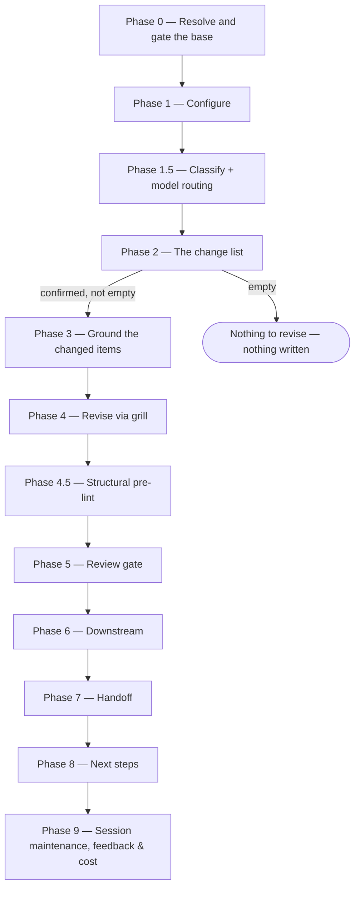

# /update-spec

Revises a merged `specification.md` in place — keeping its IDs and its `Created` date, and asking only about what changed — gated by the same Opus review as [`/specify`](specify.md).

## Who runs it

`/update-spec` runs in the [pe](../roles-and-phases.md#pe--product-engineering) role, cost-attribution phase [specification](../roles-and-phases.md#specification) — the same phase as [`/specify`](specify.md), since both keep one item's `specification.md`.

## Synopsis

```
/update-spec <ADDRESS> [<what is wrong>] [--no-docs] [--docs <path>] [--no-arch] [--skip-costs] [--skip-feedback] [--enforce-model=<model>]
```

- **`<ADDRESS>`** (mandatory) — the Epic or PRD whose specification to revise: a key, or an `@<path>` naming its folder, read as [`/specify`](specify.md) reads one. A PRD address revises the PRD folder's own specification; where it has none and its Epics do, the run stops and names `/update-spec <EPIC-KEY>` for each.
- **`[<what is wrong>]`** (optional) — every token from the first one after the address that is neither a flag nor a flag's value: free text saying what to correct, kept as typed. Without it, the run takes what moved upstream and the notes already in the specification, and asks for a correction only where those name nothing.
- **`[--no-docs]`**, **`[--docs <path>]`**, **`[--no-arch]`** — as [`/specify`](specify.md)'s: documentation and architecture grounding for the items that changed.

All three run flags apply to this command. `--skip-costs` (or `WORKFLOWS_SKIP_COSTS`) skips Phase 9's session-cost entry, still advancing the checkpoint — see [Session cost](../reference/session-cost.md). `--skip-feedback` (or `WORKFLOWS_SKIP_FEEDBACK`) dispatches `workflows-core:defect-reporter` in place of `impl-maintenance` and persists only defects. `--enforce-model=<model>` (or `WORKFLOWS_ENFORCE_MODEL`) runs every dispatched step on that model — see [Model routing](../reference/model-routing.md).

## How it runs



**The change list comes from three places, and you confirm it before anything is asked about content:**

- **Upstream** — what changed in the specification's inputs since it was written: the PRD, the ARDs, the Epic's `epic.md`, the grounding files and, on the BRD route, the slice's `decisions.md`, diffed from the commit the specification's `inputs_at` field records. Each change is mapped to the stories, criteria and test cases it bears on. A specification written before `inputs_at` existed has a **null baseline**: the run says it cannot tell what moved upstream, takes the other two sources, and the revision it writes records `inputs_at`, so the next one can.
- **Your correction** — the `<what is wrong>` text, resolved against the specification's own IDs and headings.
- **Notes other commands left** — open items under `## Engineering review` and the `Engineering proposal (/design): …` answers [`/dev-workflows:design`](../../../dev-workflows/docs/commands/design.md) writes, and the notes `/implement` and `/conformance` add.

**IDs never move.** For each item that changes, the first question is whether its meaning changed: a wording fix keeps its ID; a change of meaning takes the next free number and the old item stays, marked `Superseded by` it; a removal stays, marked `Withdrawn` with the reason. Nothing is renumbered or reused, so every design, conformance record or Epic that cites an ID still finds it, and no old citation silently changes meaning. Superseded and withdrawn items are skipped by every reader that counts, covers or traces requirements.

Five subagents can be dispatched, under the same rules as in [`/specify`](specify.md): `workflows-core:docs-grounder` and `workflows-core:architecture-grounder` (Phase 3, only where grounding resolves), `workflows-core:code-scanner` (Phase 3, only where a changed item bears on code), `workflows-core:overlap-reader` (Phase 4, the read of the changed items against what they overlap, before the review), and `product-workflows:spec-reviewer` (Phase 5, the gate) — plus `workflows-core:impl-maintenance` in Phase 9, or `workflows-core:defect-reporter` in its place under `--skip-feedback`.

## What it needs

- **`<ADDRESS>`** — mandatory; absent stops the run with `UPDATE_SPEC_NEEDS_KEY`, and an address that resolves no folder with `UPDATE_SPEC_NOT_FOUND`.
- **`$SPECS_PATH`** (required) — if unset, the run stops naming `SPECS_PATH` and offers to enter a path or cancel.
- **A specs checkout not behind for the folder** — once the address resolves and the specs-repo preflight has run, the run checks the branch the specs checkout stands on, before the base below is gated. Where it is a plugin branch the default branch has moved past under the address's top-level folder in `specifications/` — the PRD folder, or the `BRD-` folder above a slice — a document there added, changed or removed since that branch was cut, session files aside, the run stops, naming the paths and what to do — ordinarily, switch the specs checkout to its default branch and re-run. An open branch holding a change to the specification is the base gate's to stop on, below.
- **A merged, unpublished specification.** The base is the `specification.md` on the specs repo's default branch, never a working-tree copy:
  - not on the default branch → `UPDATE_SPEC_NO_BASE`, naming the merge it waits for or `/specify`;
  - a change no merge has carried — in the checkout (an interrupted `/specify` draft, a hand edit) or on an unmerged `spec/`, `design/` or `conformance/` branch that changed it since it forked, where `/design`, `/implement` and `/conformance` hand off their notes — a branch that only carries an older copy is not a pending change — → `UPDATE_SPEC_PENDING_CHANGE`: merge or discard it first, or delete a branch that was abandoned, since this run would otherwise overwrite it or build on what no reviewer saw;
  - `Published: yes` → `UPDATE_SPEC_PUBLISHED`: its IDs are contracts. To revise it anyway, set `Published: no` and land that edit on the default branch.
- **Its inputs on the default branch**, gated as [`/specify`](specify.md) gates them — the PRD, on the BRD route the slice's decision register, the Epic, and the applicable ARD, whose `[AD#N]` Rules every revised item keeps or records a deviation from.
- **Documentation and architecture grounding** (optional) — as in [`/specify`](specify.md), for the items that changed.

## What it produces

- The revised **`specification.md`**, in place: `Version` one higher, `Created`, `Author` and `Published` unchanged, `Open questions` recounted, and `inputs_at` set to the default-branch commit this run read its inputs at. Adopted notes are ticked `adopted in Version <N>`, declined ones ticked with the reason.
- An **archive of the base** under `revisions/specification_<YYYYMMDD>.md`, taken before the first write — a failed copy stops the run with `UPDATE_SPEC_ARCHIVE_FAILED` before anything is written.
- The same `consumed_by: specification` stamps [`/specify`](specify.md) writes, on the grounding findings and decision records this run newly drew on. No design, Epic, `_coverage.md`, PRD or ARD is ever written.
- **A downstream report**: every document that cites an ID this run superseded or withdrew — for an Epic-level specification, the Epic's `design.md`; for a PRD-level one, the PRD folder's own `design.md` where one exists, each Epic's `## Covers` and `_coverage.md` — with the IDs each cites.
- Behind Phase 7's consent choice, the files are committed, pushed, and a pull request opened against the specs repo's default branch on a `spec/` branch.

## Gates

- **Phase 4 — the overlap read**, `workflows-core:overlap-reader` on Opus, over the changed items against what they overlap, then the whole-artifact confirmation gate — as in [`/specify`](specify.md).
- **Phase 4.5 — Structural pre-lint** (`workflows-core:pre-lint`), advisory — it counts superseded and withdrawn items for contiguity and checks only live ones for coverage.
- **Phase 5 — `spec-reviewer`**, Opus-pinned, reviewing **the whole** revised specification, with the archived base and the change list in its brief: a change outside the list that alters a live item's meaning, a meaning change passed off as a wording fix, or a renumbered ID is a BLOCKER; a change outside the list that alters no meaning is a MINOR. Its verdict is acted on as [`/specify`](specify.md) acts on it.

## Example

The PRD was updated after the Epic's specification merged:

```
/product-workflows:update-spec EPIC-0042
```

The run diffs the PRD from the specification's `inputs_at` to now, proposes the two acceptance criteria the changed requirement touches, and asks you to confirm the list. One criterion's meaning changed, so it becomes `[AC04]` and `[AC02]` is marked `Superseded by [AC04]`; the other only needed clearer wording and keeps its ID. After the review, the run names the Epic's `design.md`, which cites `[U01]/[AC02]`, and offers `/dev-workflows:design EPIC-0042` to revise it.

## See also

- [`/specify`](specify.md) — authors a specification from scratch; on an existing one it archives and rewrites, and names this command for a revision instead.
- [`/update-prd`](update-prd.md) — the PRD's revision command, whose next step offers this one where a merged specification exists.
- [`/dev-workflows:design`](../../../dev-workflows/docs/commands/design.md) — revises a design this run named.
- [`/epics`](epics.md) — refines the Epics whose `## Covers` this run named.
- [Roles and phases](../roles-and-phases.md) — what the `pe` role owns.
- [Model routing](../reference/model-routing.md), [Session cost](../reference/session-cost.md), [Session feedback](../reference/session-feedback.md) and [Resume and checkpoints](../reference/resume-and-checkpoints.md).
- `product-workflows:specification-format` — the `inputs_at` field, the superseded and withdrawn markers, the live-items rule and the archive rule.
