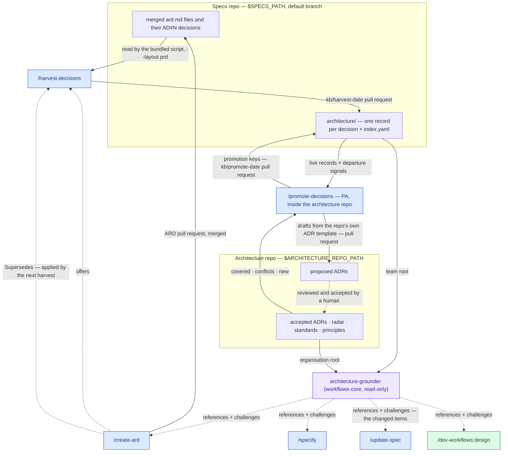

# Workflow overview

This is the `product-workflows` pipeline top to bottom — every command shown here, in the order the roles typically hand work to each other. `/idea → /create-prd` opens a Product Requirements Document; [`/specify`](commands/specify.md) is where this plugin's spine ends, handing `specification.md` to the companion `dev-workflows` plugin's `/dev-workflows:design`, which carries the pipeline the rest of the way to shipped code and, through the companion `docs-workflows` plugin, product documentation and release notes. A second route into a PRD exists alongside it: `/brd-intake → /brd-split → /prd-ground → /brd-split → /brd-interview → /brd-package → /brd-reconcile` — the second [`/brd-split`](commands/brd-split.md) running on each slice the first carved — turns a customer-supplied BRD into a grounded, allocated and decided requirement inventory — customer-reviewed wherever a decision is the customer's to make — instead of a PM-authored idea, then hands over to [`/create-prd`](commands/create-prd.md), [`/create-ard`](commands/create-ard.md) or `/specify` on the BRD route — see [BRD workflow](brd-workflow.md) for its own diagram and parameter table. [`/prd-ground`](commands/prd-ground.md) is one command serving both routes, drawn separately for each so an idea-route PRD cannot appear to enter `/brd-split`. Grounding a BRD slice is required before its allocation walk; grounding an idea-route PRD is optional, checking its own `[AC#n]`/`[FR#n]` rows to seed architecture and specification. BRD authoring also reads its slice's findings after the decision handoff; those additional input edges are not drawn.

```mermaid
flowchart TD
    subgraph PM["PM — ideation & framing"]
        idea["▶ start — /idea"]:::prod -->|idea.md| createvi["/create-prd"]:::prod
        createvi -.->|prd.md| rnpm["/docs-workflows:release-notes (PRD draft / refresh)"]:::docs
        createvi -.->|PRD exists| updatevi["/update-prd"]:::prod
        updatevi -.->|updated prd.md — existing release note| rnpm
        groundprd["/prd-ground (idea PRD)"]:::prod
    end
    subgraph BRD["PM — BRD-to-PRD route (alt. entry)"]
        brdintake["▶ start — /brd-intake"]:::prod -->|inventory + ledger| brdsplitroot["/brd-split (root)"]:::prod
        brdsplitslice["/brd-split (slice)"]:::prod -->|allocated ledger| brdinterview["/brd-interview"]:::prod
        brdinterview -->|"decisions.md + held [C] questions"| brdpackage["/brd-package"]:::prod
        brdreconcile["/brd-reconcile"]:::prod
        groundbrd["/prd-ground (BRD slice)"]:::prod
    end
    subgraph CUST["Off-platform — the customer, nothing installed"]
        brdreview["the customer reviews the bundle"]:::cust
    end
    subgraph PA["PA — architecture (optional)"]
        createard["/create-ard"]:::prod
        harvest["/harvest-decisions"]:::prod
        promote["/promote-decisions"]:::prod
    end
    subgraph PE["PE — breakdown & specification"]
        epics["/epics"]:::prod
        specify["/specify"]:::prod
        updatespec["/update-spec"]:::prod
        conformanceprd["/dev-workflows:conformance — the PRD, every Epic merged"]:::dev
    end
    subgraph EST["PM — effort proposals (optional, gates nothing on the build ladder)"]
        prdproposal["/prd-proposal"]:::prod
        brdproposal["/brd-proposal"]:::prod
    end
    subgraph DEV["Dev — build, verify & deliver (dev-workflows)"]
        design["/dev-workflows:design"]:::dev -->|design.md| implement["/dev-workflows:implement"]:::dev
        conformanceepic["/dev-workflows:conformance — an Epic, before its pull request merges, on its branch"]:::dev
        ready["/dev-workflows:ready"]:::dev
    end

    createvi -->|prd.md| createard
    rnpm -.->|"an earlier phase still pending — hand to PA"| createard
    rnpm -.->|"an earlier phase still pending — hand to PE"| epics
    createard -.->|merged ARD| harvest
    harvest -.->|team decisions| createard
    harvest -.->|team decisions| specify
    harvest -.->|team records| promote
    harvest -.->|team decisions| design
    promote -.->|"accepted org ADRs — grounding"| createard
    createvi -->|prd.md| epics
    createard -->|ard.md| epics
    createard -->|"ard.md — PRD-level, or an Epic's"| specify
    epics -->|epic.md| specify
    epics -.->|"optional — an Epic-level ARD"| createard
    createvi -->|prd.md| specify
    updatevi -.->|updated prd.md — existing ARD| createard
    updatevi -.->|updated prd.md — existing specification| updatespec
    specify -.->|merged specification.md — revise in place| updatespec
    updatespec -->|"revised specification.md — IDs kept"| design
    updatespec -.->|"superseded or withdrawn IDs an Epic covers"| epics
    design -.->|"Engineering review notes"| updatespec
    updatevi -.->|updated prd.md — existing Epics| epics
    specify -.->|PRD-level specification.md| epics
    specify -->|specification.md| design
    createard -.->|Epic-level ARD| design
    design -.->|design.md + specification.md| ready
    ready -.->|_readiness.md — advisory| implement
    ready -.->|"delivery not verified — the PE's PRD run"| conformanceprd
    conformanceprd -.->|"_conformance.md — the optional Delivery verified stage"| ready
    implement -->|"each Epic — the Dev"| conformanceepic
    conformanceepic -.->|"fix the code — a follow-up"| implement
    conformanceepic -.->|"the Dev's proposed decisions"| conformanceprd
    conformanceepic -.->|"Epic: then the security scan, in security-workflows"| secplugin["/security-workflows:scan — an Epic, before its pull request merges"]:::sec
    implement -.->|"each Epic, after its conformance check — before its pull request merges"| secplugin
    implement -.->|"every Epic implemented and merged — the PE's PRD run"| conformanceprd
    secplugin -.->|"fix — a follow-up, on the Epic's branch"| implement
    secplugin -.->|"nothing to fix — after the merge, every Epic merged: the PE's PRD run"| conformanceprd
    conformanceprd -.->|"fix the code — a follow-up"| implement
    conformanceprd -.->|"amend the specification"| updatespec
    conformanceprd -.->|"amend an epic.md"| epics
    conformanceprd -.->|"amend the PRD"| updatevi
    conformanceprd -.->|"amend the ARD — an [AD#n] Rule"| createard
    brdsplitroot -->|"each confirmed slice — claims are its [BR#n] rows"| groundbrd
    brdsplitroot -.->|"Ground now (operator-elected, after the split PR merges)"| groundbrd
    groundbrd -->|"verified [CG#n]/[DG#n] — required before the walk"| brdsplitslice
    createvi -.->|"idea route only — optional, PRD's own [AC#n]/[FR#n]"| groundprd
    groundprd -.->|"a claim came back CONFIRMED — recommended"| updatevi
    prdproposal -->|"BRD route — each included slice's proposal.md, rolled up for the BRD"| brdproposal
    prdproposal -.->|"tier 2 — raise the tier, then re-price"| createard
    prdproposal -.->|"tier 3 — raise the tier, then re-price"| specify
    brdproposal -.->|"a slice stale or excluded — re-price it"| prdproposal
    createard -.->|"a prd.md — price against the ARD"| prdproposal
    specify -.->|"a prd.md — price against the specification"| prdproposal
    brdreconcile -.->|"a [CD#n] frozen — price the slice once its prd.md is on the default branch"| prdproposal
    createard -.->|"no prd.md — author the PRD"| createvi
    specify -.->|"no prd.md — author the PRD"| createvi
    createard -.->|"BRD slice, no prd.md — a row still unallocated"| brdsplitslice
    specify -.->|"BRD slice, no prd.md — a row still unallocated"| brdsplitslice
    createard -.->|"an empty slice — keep or remove it"| brdsplitroot
    specify -.->|"an empty slice — keep or remove it"| brdsplitroot
    groundbrd -.->|"decide a prerequisite slice first"| brdinterview
    groundprd -.->|"verified [CG#n]/[DG#n]"| createard
    groundprd -.->|"verified [CG#n]/[DG#n]"| specify
    brdpackage -->|bundle sent| brdreview
    brdreview -->|answers come back as one file| brdreconcile
    brdreconcile -.->|"a decision reopened, a question askable again, or a dependent slice to re-decide"| brdinterview
    brdreconcile -.->|questions still held for the customer| brdpackage
    brdreconcile -.->|"the review challenged a code claim — --rebaseline, or a question needing grounding before its round resumes"| groundbrd
    brdinterview -.->|"a question no finding bears on yet, or a --rebaseline"| groundbrd
    brdreconcile -->|slice key + the BRD route — nothing left to re-enter for, fully allocated, one row covered-here| createvi
    brdreconcile -->|slice key + the BRD route — nothing left to re-enter for| createard
    brdreconcile -->|slice key + the BRD route — nothing left to re-enter for| specify
    brdinterview -.->|nothing for the customer to review, PRD-eligible — no reconciliation needed| createvi
    brdinterview -.->|nothing for the customer to review — no reconciliation needed| createard
    brdinterview -.->|nothing for the customer to review — no reconciliation needed| specify
    implement -.->|"code + implementation.md, in docs-workflows — every Epic merged, after the PE's PRD run"| docsplugin["/docs-workflows:document · /docs-workflows:release-notes"]:::docs
    conformanceprd -.->|"once settled, in docs-workflows"| docsplugin

    classDef prod fill:#dbeafe,stroke:#1d4ed8,color:#1e3a8a
    classDef dev fill:#dcfce7,stroke:#15803d,color:#14532d
    classDef docs fill:#fef3c7,stroke:#b45309,color:#78350f
    classDef cust fill:#f3f4f6,stroke:#6b7280,color:#1f2937
    classDef sec fill:#ccfbf1,stroke:#0f766e,color:#134e4a
    classDef entry stroke:#dc2626,stroke-width:3px
    class idea,brdintake entry
```

**Where to start.** The two ▶ nodes, outlined in red, are the ways work enters this plugin: [`/idea <PRD-KEY>`](commands/idea.md) for an idea of your own, which `/create-prd` turns into a PRD, and [`/brd-intake <BRD-KEY> @<brd-file>`](commands/brd-intake.md) for a customer's business requirements document, which the BRD route carries to the same PRD ladder.

The diagram draws the ARD reaching [`/epics`](commands/epics.md) and `/specify`, and an Epic-level ARD reaching `/dev-workflows:design`, because `/create-ard` offers each of them. More commands than those three read it: `/epics`, `/specify` and `/update-spec` here, and the companion `dev-workflows` plugin's `/dev-workflows:design`, `/dev-workflows:implement`, `/dev-workflows:ready` and `/dev-workflows:conformance`, all resolve the applicable ARD once it exists. The rest read it without `/create-ard` offering them, and the diagram draws offers, not reads — save the grounding edges, where team decisions and accepted organisation ADRs reach the commands that ground on them, and the `_conformance.md` edge from the PE's PRD-level `/dev-workflows:conformance` into `/dev-workflows:ready`, which reads it from the specs repo's default branch, beside when the implementation records were written, to decide the PRD's optional *Delivery verified* stage. The offer between those two runs the other way: whatever its verdict, `/dev-workflows:ready` offers the PE's PRD run where a PRD at *Implementation* or a later stage is not delivery verified — no settled record on the default branch, or work implemented after it. Accepted organisation ADRs also ground `/specify` and `/dev-workflows:design`; the knowledge-base loop is drawn in [Architecture knowledge base](#architecture-knowledge-base).

The dashed return paths from [`/update-prd`](commands/update-prd.md) refresh existing downstream artifacts, not artifacts that have never been authored. A changed requirement that invalidates one makes its rerun recommended; otherwise the existing artifact's rerun remains optional.

**Every offer one command makes of another command the diagram draws is an edge; a command offering itself again is not.** Those re-runs — another interview round, the next sibling Epic or slice, a re-run with a corrected source or after a fix — are listed, with every other offer and its condition, on each command's page under *What it offers next*. One offer has no node to land on: [`/prd-ground`](commands/prd-ground.md) on a slice with a design frame set that has no index offers `/workflows-core:frames`. A PRD-level ARD's two edges, into `/epics` and `/specify`, are alternatives while the PRD has no Epics: `/epics` is recommended, and the two swap where the ARD names two or more code components; once the PRD has Epics, only `/specify` is offered. On a BRD-route slice, `/specify` is recommended. An Epic-level ARD hands on to that Epic's `/specify`, recommended, or to `/dev-workflows:design` once the Epic's `specification.md` has merged. Where the folder holds no `prd.md`, `/create-ard` and `/specify` offer `/create-prd` in place of `/epics` — or, on a BRD-route slice that cannot take a PRD yet, `/brd-split` on the slice or on its parent — and they name `/prd-proposal` only where a `prd.md` exists.

The BRD-to-PRD route hands over at [`/brd-reconcile`](commands/brd-reconcile.md), and the diagram draws that handover as **three** edges rather than one, because `/create-prd`, `/create-ard` and `/specify` each run on a BRD slice and `/brd-reconcile`'s next-step phase offers all three against the same **slice** key **on a run that left nothing to re-enter for** — a reopened decision, a customer question still held, a finding left to re-derive, or a dependent it could only sweep on paper each drop all three: a reopened record may not be consumed downstream and all three consume the register, and a dependent swept only on paper still reads a position the customer has since settled. **A slice key and never a root BRD key**: a BRD is a container, its `prd.md`, `ard.md` and `specification.md` are authored in the `PRD-` slice folders under it, and each of the three refuses a `BRD-` folder in its own Phase 0 — moot in practice, since `/brd-reconcile` itself refuses a resolved root before this next-step phase can ever run (`BRD_RECONCILE_ROOT_LEVEL`), naming `/brd-split` as the way to carve a slice first. On an advancing slice run only the first carries a further condition: `/create-prd <SLICE-KEY>` is offered where the reconciled ledger leaves no row `unallocated` and at least one `covered-here`, which are the two refusals its own Phase 0 raises, both read over the slice's own claimed rows. `/create-ard <SLICE-KEY>` and `/specify <SLICE-KEY>` add none of their own, since neither reads the ledger as an authoring input, and the PRD gate both run reports an absent PRD rather than stopping on it. All three do gate the register — `require-on-main` on `decisions.md`, which stops on one `/brd-reconcile` handed off and nobody merged, and is why each of the three offers carries a merge clause — but that gate tests which ref the register is on and never what it holds, so none of them refuses a merged register carrying a reopened decision, and that judgement sits with the command that offers them — `/brd-reconcile` here, and [`/brd-interview`](commands/brd-interview.md) on a slice that needs no customer review. The three are alternatives, not a sequence — neither of the other two waits on the PRD — so `/brd-reconcile` is where the route hands over, not where it ends.

**The route also hands over one step earlier, on a slice that needs no customer review.** Where every question was settled from the findings and no reopened decision waits, `/brd-interview` offers the same three commands on the same conditions `/brd-reconcile` applies — `/create-ard` and `/specify` on the slice level alone, `/create-prd` only where the slice is PRD-eligible — because all three gate the slice's `decisions.md` and none reads a reconciliation record. The diagram draws each alternative as a dashed edge.

The `Off-platform` box is the one node in this diagram no command runs. It is the customer reviewing the bundle [`/brd-package`](commands/brd-package.md) built, with a vanilla agent and nothing installed, and the route waits there — which is why `/brd-reconcile` runs only once somebody says which file is the answer — by passing its path, or by confirming the one the customer's merged pull request committed beside the bundle.

The three dashed re-entry edges leaving `/brd-reconcile` go to different commands on purpose, and are drawn separately rather than merged under one label: a decision the review reopened is settled by another interview round; a question the customer left unanswered goes back out in the next package — unless it was raised only about the defects of a requirement the customer withdrew and carries no decision of its own, which closes it; and a code claim the review challenged leaves a finding that only a `/prd-ground --rebaseline` pass re-derives — the same edge carries the plain `/prd-ground` run named before another interview round, where the round it resumes holds a question that needs grounding. The fourth re-entry, `/brd-reconcile` again on the same review, is the command offering itself, so it is not drawn. Every BRD-route edge in [BRD workflow](brd-workflow.md) appears here in the same style, including the authoring alternatives from both `/brd-reconcile` and `/brd-interview`, and the edges from `/create-ard` and `/specify` back into the route. `/brd-reconcile`'s fourth dashed edge, into `/prd-proposal`, is not a re-entry: a run that froze a customer decision names it, because that decision can change the slice's price, and names it as pricing the slice once its `prd.md` is on the default branch — after `/create-prd`, where the slice holds none yet, which is the ordinary state there, since `/prd-proposal` stops on a folder with no PRD. The labels agree except on the edge from the root's `/brd-split` into `/prd-ground`, which names the slice's claimed `[BR#n]` rows here and its folder kind there.

Eight nodes in the diagram are not this plugin's commands and are drawn for continuity only: `/dev-workflows:design`, `/dev-workflows:implement`, and `/dev-workflows:ready` — where this plugin's spine hands off — and `/dev-workflows:conformance`, drawn once per role, whose PRD run, for a decision to amend a document, writes a note on the document holding the requirement and recommends the command that revises it — [`/update-spec`](commands/update-spec.md), [`/update-prd`](commands/update-prd.md), [`/epics`](commands/epics.md) or [`/create-ard`](commands/create-ard.md); `/security-workflows:scan`, which the Dev runs on each Epic after its `/dev-workflows:conformance` and before its pull request merges — a finding it marks fix goes back to `/dev-workflows:implement`, which continues on the Epic's branch, and where nothing is to fix the PE's PRD-level `/dev-workflows:conformance` follows once every Epic has merged; plus `/docs-workflows:release-notes` as the PM's PRD-driven draft or refresh, which hands on to `/create-ard` or `/epics` where an earlier phase is still pending, and the combined `/docs-workflows:document · /docs-workflows:release-notes` node, which reads what `/dev-workflows:implement` recorded. Two commands offer that node once every Epic has merged: `/dev-workflows:implement`, which names it next after the PE's PRD-level `/dev-workflows:conformance`, and that PRD run itself, once its decisions are settled. `/dev-workflows:design`, `/dev-workflows:implement`, `/dev-workflows:ready` and `/dev-workflows:conformance` ship in the companion `dev-workflows` plugin; `/security-workflows:scan` in the companion `security-workflows` plugin; `/docs-workflows:document` and `/docs-workflows:release-notes` in the companion `docs-workflows` plugin. All are documented there, not here.

The diagram above shows where each command sits in the pipeline; [Roles and phases](roles-and-phases.md) says what each role is accountable for and what it hands over at each seam.

**None of this plugin's own seventeen commands is known to collide with a Claude Code built-in today**, so every one of them works either way, bare or `product-workflows:`-qualified. Of the cross-plugin commands this diagram draws for continuity, `/docs-workflows:release-notes` collides, and `/dev-workflows:design` does on the accounts Claude Code's own `/design` is switched on for; both are qualified, as is every cross-plugin node, and they ship in the companion `docs-workflows` and `dev-workflows` plugins.

## Architecture knowledge base

The architecture decisions of merged ARDs do not stay in their ARDs. They become the team's records, the strongest of them become organisation ADRs, and both feed the next ARD, specification and design:

[`/harvest-decisions`](commands/harvest-decisions.md) is a deterministic script: it reads only the default branch, writes one record per `[AD#N]` of every `ard.md` and `ard-<area>.md` in the `PRD-` and `EPIC-` folders, marks a record superseded or withdrawn, and never deletes one. [`/promote-decisions`](commands/promote-decisions.md) runs inside the architecture repository, where the Product Architect picks from ranked shortlists; it drafts `proposed` ADRs from that repository's own template on a pull request there, and never edits or accepts an ADR itself. On its next run it reads each ADR's `Origin:` line and records `accepted` or `rejected` on the team records it named. From then on `architecture-grounder` skips a team record whose ADR was accepted, or which an ADR already covers, and cites that ADR instead. The organisation root is `$ARCHITECTURE_REPO_PATH` alone — nothing scans for a clone — while the team root is read wherever `$SPECS_PATH/architecture/` exists; `--no-arch` turns off both roots and the security findings registers, the third source the same commands read.

## Parameters at the BRD-to-PRD handoff

The three edges leaving `/brd-reconcile` into the PRD pipeline, as each command's own argument parsing defines them. [BRD workflow](brd-workflow.md#parameters) carries the same table for the six BRD-to-PRD route commands upstream of them.

| Command | Required | Optional | Offered from `/brd-reconcile` |
|---|---|---|---|
| `/create-prd` | `<SLICE-KEY>` | `--lean`/`--hybrid`/`--full` (defaults to `--full` here), `--no-docs`, `--docs <path>`, `@<path>` (extra grounding, never the seed) | Only on a slice, and only where no ledger row is `unallocated` and at least one is `covered-here` |
| `/create-ard` | `<SLICE-KEY>` | `--no-docs`, `--docs <path>` | On a slice, with no further condition — gates and reads `prd.md` as on the idea route, proceeding when there is none, and never authors from the ledger |
| `/specify` | `<SLICE-KEY>` | `--no-docs`, `--docs <path>` | On a slice, on exactly the same terms as `/create-ard` |

**The BRD route is detected, never declared.** There is no flag and no `<dir>` operand on any of the three rows: each takes one positional address, and where that address resolves to a `PRD-` folder carrying `brd-link.md`, the run is on the BRD route and says so before doing anything. A `BRD-` container resolves too, and is then refused — `CREATE_PRD_BRD_NOT_SLICED`, `CREATE_ARD_BRD_NOT_SLICED`, `SPECIFY_BRD_NOT_SLICED` — because a BRD holds no PRD, ARD or specification of its own. A flag that could disagree with the folder it names would be one more disagreement to have. `/create-prd` still takes `--from-prd` on the idea route, which is not the same thing — it names a *different* PRD to seed from, which no folder can decide on the operator's behalf — and refuses it on the BRD route (`CREATE_PRD_FROM_PRD_ON_BRD_ROUTE`), where a slice's PRD is seeded by its decision register and never by another PRD.

`<SLICE-KEY>` is `^[A-Z][A-Z0-9_]*(-\d+)+$` — **one or more numeric segments; the grammar fixes no depth**, so the slice `ACME-001-01` is as valid a key as its parent BRD's `ACME-001`, and all three commands resolve a folder at any of the three levels `resolve-address` searches before refusing a `BRD-` container. It is checked for shape only and never against a tracker: a BRD is a markdown file under `$SPECS_PATH`, not a ticket. Each of the three takes exactly **one** address; `/create-ard` and `/specify` stop on a second positional token (`CREATE_ARD_ONE_ADDRESS` / `SPECIFY_ONE_ADDRESS`) on every route, because a key encodes its own ancestry and no command takes a chain.

## Roles

| Role | Runs | Produces → lands at |
|---|---|---|
| **PM** | `/idea`, `/create-prd`, `/update-prd` (and an early `/docs-workflows:release-notes`); also `/brd-intake`, `/brd-split`, `/prd-ground` (either route), `/brd-interview`, `/brd-package`, `/brd-reconcile` | `idea.md`, then the PRD, in `$SPECS_PATH/specifications/PRD-<KEY>-<slug>/`; on the BRD route, the inventory, ledger, grounding findings, decision register, customer package and reconciliation record |
| **PM** *(effort proposals — optional, gates nothing on the build ladder)* | [`/prd-proposal`](commands/prd-proposal.md), [`/brd-proposal`](commands/brd-proposal.md) | `proposal.md` and its rationale brief: in the `PRD-` slice folder for one slice, and in the `BRD-` container above a set of priced slices for the programme umbrella |
| **PA** *(optional)* | `/create-ard`, then `/harvest-decisions` once ARDs have merged, and `/promote-decisions` inside the architecture repository; `/prd-ground` where the PM cannot clone the code repositories | the ARD, in the same specs feature folder as the PRD; the team's decision records under `$SPECS_PATH/architecture/`; proposed organisation ADRs on a pull request in the architecture repository |
| **PE** | `/epics`, `/specify`, `/update-spec`; once every Epic has merged, `/dev-workflows:conformance <PRD-KEY>`; `/prd-ground` where the PM cannot clone the code repositories | `epic.md` per `EPIC-` folder, `_coverage.md` in the PRD folder, `specification.md` there (PRD-level) or per `EPIC-` folder — each on the specs repo's default branch; the PRD-level `_conformance.md` |

See [Roles and phases](roles-and-phases.md) for what each role owns, consumes, and hands off — this table only shows where the commands sit. The Dev role, downstream of this plugin's spine, is documented on the companion `dev-workflows` plugin's own Roles and phases page.

## Artifact homes

- **`$SPECS_PATH/specifications/PRD-<KEY>-<slug>/`** — the shared, team-visible home for the PRD and the ARD, with `specification.md` in the PRD folder itself for a PRD-level specification, or in each `EPIC-` folder below it (a BRD route puts the same PRD folder one level down, inside `BRD-<KEY>-<slug>/`). Each authoring command lands its file here, then hands it onto the specs repo's default branch for the next command to find.
- **`$REPOS_PATH`** — the mounted code and design clones this plugin grounds against, read-only. Nothing in this plugin writes into a code repository; that starts downstream, in the companion `dev-workflows` plugin.
- **Plugin bookkeeping** — feedback, session-cost, and resume-pointer files — lives under `<PRD-dir>/dev-workflows/` inside `$SPECS_PATH`, committed and pushed alongside the specs artifacts it describes. That folder name is a fixed, family-wide constant shared by every plugin's own bookkeeping, not a `product-workflows`-specific path.

## Sources of truth

- **The artifacts** are the source of truth for workflow *status*. The companion `dev-workflows` plugin's `/dev-workflows:ready` derives the phase from what is on disk, reading the ARD and specification this plugin's PA and PE roles produce — save two stages: the optional *Delivery verified* stage, which it reads from the PE's `_conformance.md` of the PRD, taken from the specs repo's default branch and never your checkout, and from when the implementation records were written — by the moment each carries where both sides carry one, and by date otherwise — since work implemented after the record leaves the stage unreached; and *Release Preparation*, which it reads from the documentation run's pull-request draft and a release note drafted at the dev stage, both taken from the default branch too, and from the implementation records again, compared the same way, since work implemented after the pull-request draft, or after every dev-stage release-note draft, leaves the stage unreached.
- **The specs repo's default branch** is the source of truth for whether a phase's deliverable is actually *done*. A producing command lands its artifact there; the next command in the chain stops while the artifact sits on an unmerged branch the commands cut, and treats one no such branch carries — written only to disk, or committed only to a branch of your own — as absent, falling back from it or, for a few, stopping. See [Roles and phases](roles-and-phases.md) for what happens when the artifact is on an unmerged branch instead, or missing entirely.

## Cross-cutting commands

These ship in companion plugins and run against the same specs tree, outside this plugin's own role pipeline:

- **In `workflows-core`.** The specs-tree frame-set indexer, the plugin-feedback commands and the session diagnosis: `/workflows-core:frames`, `/workflows-core:feedback`, `/workflows-core:prompt`, `/workflows-core:prompt-brainstorm`, `/workflows-core:prompt-grill-me` and `/workflows-core:diagnose-session`, whose only write there is its cost entry. `/workflows-core:statusline` ships there too but meets no part of the criterion above — it configures your terminal status line and never touches the specs tree.
- **In `docs-workflows`.** What happens downstream of the `specification.md` this plugin's spine ends at — the documentation, the release note, and the cold-start scaffold that creates the repository both land in: `/docs-workflows:document`, `/docs-workflows:release-notes`, `/docs-workflows:docs-init`, and a standalone `/docs-workflows:docs-brand`, each emitting its own session bookkeeping here. That plugin's remaining two, `/docs-workflows:docs-profile` and `/docs-workflows:docs-serve`, act on a documentation repository alone and write nothing into the specs tree.
- **In `dev-workflows`.** Standalone maintenance outside the PRD pipeline — `/dev-workflows:vuln` (CVE remediation) and `/dev-workflows:upgrade` (dependency / runtime upgrades) — alongside the Dev-role commands this plugin's spine hands off to.
- **In `security-workflows`.** `/security-workflows:scan`, which records Claude Security's scans in a findings register in the specs repository: the Dev runs it on each Epic's branch before the pull request merges, as drawn above, and a Security Engineer runs it on a whole repository, outside any PRD.
