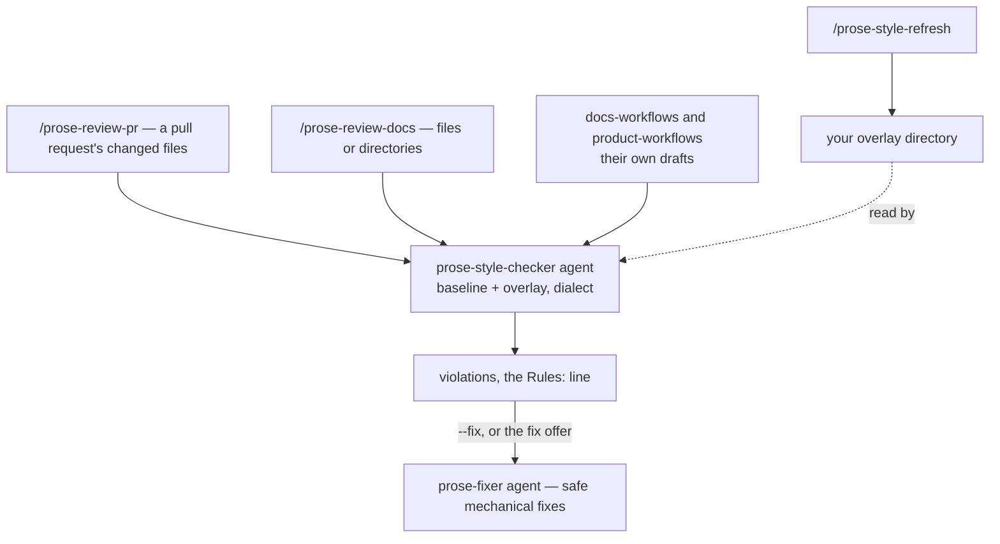

# Workflow

`prose-style` has one checker and three ways in: two review commands you run, and the other plugins that run the checker on their own drafts. The overlay is resolved the same way on every path.

- [`/prose-review-pr`](commands/prose-review-pr.md) finds the markdown files a pull request changed and reviews them, showing each violation in its diff context, then offers to fix what is safe to fix.
- [`/prose-review-docs`](commands/prose-review-docs.md) reviews the files or directories you name, and with `--fix` applies the safe fixes and checks again.
- [`/prose-style-refresh`](commands/prose-style-refresh.md) regenerates your overlay from the style-guide source you configure. It never writes into the shipped baseline.

**Where the family runs it.** `docs-workflows`' `docs-style-checker` runs `prose-style-checker` on every style check, beside a repository's own linter or in its place where the repository has none; its `/release-notes` runs the checker on its draft directly. `product-workflows`' `/epics`, `/create-prd` and `/update-prd` run it on their drafts, which live in a specs tree where no repository linter runs. Those runs take the same baseline and overlay as yours.

See the [documentation index](README.md) for everything else.
