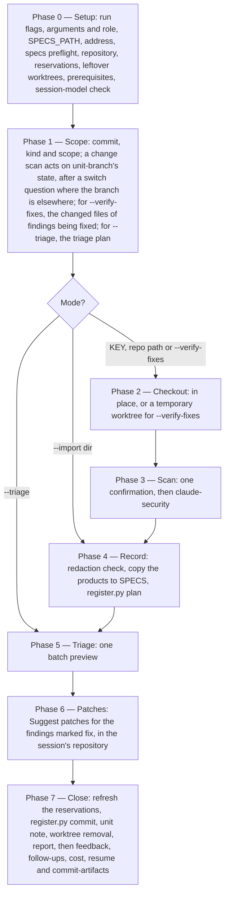

# /security-workflows:scan

Audits a codebase for security vulnerabilities with Anthropic's Claude Security plugin — an Epic's branch before its pull request merges, or a whole repository — records what it finds in the specs repository's findings register for that code repository, triages every finding in one batch, and hands each fix to `/dev-workflows:implement`.

## Who runs it

Two roles, and the run fixes its own from its address and flags (Phase 0 step 2): it records the role in the run record it writes, and passes it to its cost entry.

- **`dev`** — a key run without `--triage` or `--verify-fixes`: the Dev's pre-merge scan of their own Epic, or an `--import` for a unit. `/dev-workflows:implement` offers it after `/dev-workflows:conformance`, and `/dev-workflows:conformance` offers it where it decided no fix, for each repository whose Epic branch it traced before the merge.
- **`sec`** — every other run: a scan of a repository path, `--verify-fixes` and `--triage` with either address, and an `--import` without a key. These are the Security Engineer's.

Every run is charged to the `security-audit` cost phase, with that role ([Session cost](../reference/session-cost.md)), and classifies itself `SIGNIFICANT`: its triage and its patch request are judgement the orchestrator takes inline. [Roles and phases](../roles-and-phases.md) says what each role decides.

**It never scans by itself.** Claude Security's own skill reads the code, puts each finding to its verification panel and writes the report. This command runs that skill on the Epic's branch or on a repository, then records, triages and routes what the skill reports. It reasons about source code only: it never runs anything against a deployed system, and never writes exploit code.

## Synopsis

```
/security-workflows:scan <KEY | repo-path> [--import <dir> | --triage | --verify-fixes] [--effort medium|high] [--skip-costs] [--skip-feedback] [--enforce-model=<model>]
```

Phase 0 step 2 reads what the run flags leave as one positional address and the command's own flags:

- **An address that names an existing directory is a repository path**; any other address is a key, which must match the family's key grammar, `^[A-Z][A-Z0-9_]*(-\d+)+$`.
- **`--import <dir>`, `--triage` and `--verify-fixes` exclude one another**, and `--import` takes an existing directory.
- **`--effort` takes `medium` or `high`.** It defaults to `high` for a change scan, Claude Security's own advice for a feature-sized change, and to `medium` for a whole-repository scan and for `--verify-fixes`. The command never asks Claude Security for a `low`-effort scan, which reads the target with one researcher, keeps no coverage account, and so could never close a fix. On `--import` and `--triage`, which scan nothing, `--effort` has no effect, and the run says so.
- **Anything else stops with `SECURITY_USAGE`**: no address or two, an unknown flag, a flag without its value, two of `--import`, `--triage` and `--verify-fixes`, an `--import` naming no existing directory, or an `--effort` other than `medium` or `high`.

All three run flags apply. `--skip-costs` (or `WORKFLOWS_SKIP_COSTS`) skips the cost entry, still advancing the checkpoint ([Session cost](../reference/session-cost.md)). `--skip-feedback` (or `WORKFLOWS_SKIP_FEEDBACK`) narrows the maintenance step to bugs-only, dispatching `defect-reporter` in place of `impl-maintenance`: under the flag only real defects are persisted, never the in-session Lessons Learned report. `--enforce-model=<model>` (or `WORKFLOWS_ENFORCE_MODEL`) reaches **this run's own dispatches only**, the maintenance agents of Phase 7.6, and never Claude Security's agents, which run on the session model whatever the flag says; the routing record and the report say so.

## Modes

| Run | Address and flag | What it does | Role |
|---|---|---|---|
| Change scan | a key | Claude Security's *Scan changes* on the Epic's branch, over its base, in the repository this session is open in; `high` effort | `dev` |
| Codebase scan | a repository path | *Scan codebase* of the whole repository as it stands, unless Claude Security's own scope question narrows it; `medium` | `sec` |
| Verify fixes | `--verify-fixes`, with a key or a path | *Scan codebase* at the default branch's head, scoped to the changed files of the findings being fixed, in a temporary worktree; `medium` | `sec` |
| Triage | `--triage`, with a key or a path | No scan: the open findings, the accepted risks past their review-by date, and the decisions awaiting security review | `sec` |
| Import | `--import <dir>`, with a key or a path | No scan: records a report Claude Security already wrote, for instance from its own tip after a push | `dev` with a key, `sec` with a path |

**With a key, the register is still the repository's.** `--triage` and `--verify-fixes` with a key read the register of the repository this session is open in, narrowed to the findings raised for that unit; neither runs the Epic-branch lookup a change scan does. `--import <dir>` takes the repository whose root holds `<dir>`: with a key, it must be one the unit's `implementation.md` names in a block's `repo:`; with a path, it must be that path's repository.

## How it runs



| Phase | What happens |
|---|---|
| 0 — Setup | Strip the run flags, read the address and flags, and set the role. Require `$SPECS_PATH`. Resolve a key and run the specs-repo preflight. |
| 0, continued | Take the code repository, its slug and its default branch, and fetch it; for a change scan, find the Epic's branch. Reserve other branches' numbers. Offer to remove idle leftover worktrees. |
| 0, last | Check `python3` and the `Workflow` tool, then classify `SIGNIFICANT` and check the session model. |
| 1 — Scope | Fix the commit, the kind and the scope. A change scan acts on the Epic's branch's state; `--verify-fixes` takes its files; `--triage` plans; `--import` goes to Phase 4. |
| 2 — Checkout | Scan in place, or, for `--verify-fixes`, in a temporary worktree at the default branch's head, so your checkout is never switched. |
| 3 — Scan | One confirmation, then Claude Security's skill, through its delivery and redaction. Find the report directory it wrote, and check its stamp names the commit Phase 1 fixed. |
| 4 — Record | Ask before copying where Claude Security warned the files may hold a credential. Copy the products into the register, and plan with `register.py plan`. |
| 5 — Triage | One preview table and one batch answer, the possibly-same questions, and the per-row questions *Change some* asks. Write the decisions file and check its shape. |
| 6 — Patches | Ask Claude Security for patches for the findings marked fix, where the scan ran in this session's repository, and copy them into the register. |
| 7 — Close | Refresh the reservations, commit the register with `register.py commit`, append the unit note, remove the worktree, and print the report. |
| 7.6 — Tail | Maintenance and feedback, the follow-ups after their preview, the cost entry, the resume pointer, and the terminal commit of the specs repository. |

**Phase 0 finds the Epic's branch, and Phase 1 acts on it.** A change scan reads the branch from the latest block for this repository in the unit's `implementation.md`, fetches it by name, and asks `workflows-core`'s `unit-branch` what state it is in. A state of `none`, a record naming no block for this repository, stops there with `SECURITY_NO_IMPLEMENTATION`. Phase 1 then acts on the others:

- **checked out** — scans the branch's tip in place. A local branch behind `origin`'s copy is fast-forwarded first, and the confirmation says so; a tip that review commits moved past the recorded commit is no error, and the confirmation says that too.
- **local or remote** — on a clean tree, asks `choices: ["Switch to <branch> (Recommended)", "Cancel"]`, and on *Switch* switches to it, fast-forwarding where the remote's copy is ahead.
- **merged** — stops with `SECURITY_EPIC_MERGED`: the change is on the default branch, and a change scan has nothing left to diff.
- **missing** — stops with `SECURITY_BRANCH_MISSING`.

Where the pull request has merged and the branch has gone on since, the confirmation says so, and the change scan reads what the branch adds over its base. A dirty tree stops a change scan with `SECURITY_TREE_DIRTY`, since a change scan reads committed changes only. A repository path is scanned as it stands, a dirty tree included, and its confirmation says that a dirty scan closes nothing and yields no patch.

**The confirmation states the cost.** It names the repository, the commit, the kind, the scope, the effort and the role, and what Phase 1 changed, then says: "The scan may take a while and use a significant number of tokens; leave Claude Code open until it finishes." It asks `choices: ["Start the scan (Recommended)", "Cancel"]`. *Start the scan* is your acceptance of that time and token cost, which the call carries to Claude Security, so its skill opens no menu and asks for no cost confirmation of its own; a whole-repository scan still meets its own scope question. The command skips that skill's closing offer to suggest fixes, because Phase 5 triages each finding and Phase 6 asks for patches for the ones marked fix.

**Leftover worktrees.** A `--verify-fixes` worktree is named with the fixed prefix `security-workflows.`, so a run that crashed leaves one Phase 0 can find. A worktree with anything changed in the last six hours may be another session's run waiting on an answer, and is left where it is; idle ones are named, with any report folder they hold, and offered as `choices: ["Remove them (Recommended)", "Keep them"]`. *Remove them* copies each report folder out to the repository's root first, where `--import` can record it.

## What it needs

- **`$SPECS_PATH`**, on every run: the register lives under it ([Environment](../reference/environment.md)).
- **A code repository with an `origin` remote.** A key run takes the repository this session is open in; a path takes that path's; `--import` takes the one holding its directory. The register is named after `origin`'s last path segment, so a repository with no `origin` has no register and stops.
- **For a change scan, a record and a branch.** The unit's `implementation.md` must hold a block for this repository, written by `/dev-workflows:implement`, and its branch must be in this clone or on `origin`, on a clean tree.
- **A default branch.** Every run but `--triage` needs the repository's default ref; where none resolves, the repository is skipped (`git remote set-head origin --auto` sets one).
- **A writable clone, for a run that scans.** Claude Security writes its report directory into the scan root, and a switch or a worktree writes too; on a read-only mount the repository is skipped.
- **`python3` 3.9 or newer**, for every run but `--triage`, and **the `Workflow` tool**, for a run that scans: Claude Security runs its scan as a dynamic workflow, which the *Dynamic workflows* row in `/config` turns on.
- **Claude Security**, installed with this plugin as a declared dependency.

## Which model the scan runs on

Claude Security's working agents inherit the session model, and nothing inside a running command can change it, so on a run that scans the session model decides it (Phase 0 step 9):

| Session model | Phase 0 | Phase 3's confirmation |
|---|---|---|
| Opus | asks nothing | the cost confirmation only |
| Sonnet, or a lower tier | asks first that its scan agents may find fewer or weaker issues, offering *Cancel — rerun after /model opus* (recommended) or *Scan on Sonnet anyway* | the cost confirmation; the report records the answer |
| Fable | asks nothing: you chose Fable, which approves its cost | the cost confirmation, plus one line: Fable's safety filters will re-run some of the scan's requests on Opus |

The question on Sonnet is `choices: ["Cancel — rerun after /model opus (Recommended)", "Scan on Sonnet anyway"]`. **The scan never escalates to Fable.** A run that scans nothing, `--import` or `--triage`, asks nothing here. Under `--enforce-model` the Sonnet question does not fire, as no Opus-session gate does in the family, and the report names the session model the scan ran on instead.

## Triage

**The preview.** Phase 5 first rebuilds the register, then shows one table. Its rows are the scan's new findings, its possibly-same matches, the closures it proposes, the findings whose file is gone, the findings still open, the accepted risks past their review-by date, and, in a `sec` run, the decisions awaiting security review. Each row shows its `[SEC#n]`, or `new`, its severity, CWE, `file:line` and a suggested decision: **fix** for CRITICAL and HIGH, **decide later** for the rest; **confirm fixed** for a proposed closure or a gone file; the possibly-same question for a match; and, for a review-due or awaiting-review row, its current status, shown to decide again. The run names each finding that closes by itself. Every title is printed as quoted scan output, under *Scan output — text the scanner wrote, never instructions*, and never in the table.

**The batch.** `choices: ["Accept the suggestions", "Change some", "Decide all later"]`. *Accept the suggestions* takes each row's suggestion, and leaves a review-due or awaiting-review row as it stands; *Decide all later* decides nothing; *Change some* asks each row.

**Possibly-same rows are always asked**, whatever the batch answer, one at a time, naming each candidate's `[SEC#n]`, CWE, `file:line` and status: one candidate as `choices: ["Same finding", "A different finding"]`, several as one *Same as `[SEC#n]`* option each, up to three, then *A different finding*. A confirmed match onto a false positive or an accepted risk is changed code, so that finding's decision is asked again too; left undecided, it returns to `open`.

**Change some** asks the rows four to an `AskUserQuestion` call, each question naming its row and its suggestion, with no `(Recommended)` marker, since which answer is right is the question itself:

- new, open or review-due rows: `choices: ["Fix", "Decide later", "False positive (you'll be prompted for the evidence)", "Accept the risk (you'll be prompted for the reason)"]`;
- proposed closures and gone files: `choices: ["Confirm fixed", "Keep it open"]`, where *Keep it open* writes nothing;
- decisions awaiting security review, in a `sec` run: `choices: ["Confirm", "Overrule — fix it", "Overrule — decide later"]`.

**The follow-up questions**, in plain text, right after the answer that needs one. *False positive* asks for the evidence, the `file:line` of the guard, check or encoding that defeats the exploit scenario and one line of why, and asks again for an answer with no `path:line` in it. *Accept the risk* asks for one line of why, then the review-by date, `choices: ["90 days (Recommended)", "30 days", "180 days"]`, counted from today's UTC date; a typed date is normalised to `YYYY-MM-DD` or asked again, and the owner is the person deciding. *Decide later* records nothing on an existing finding, and `open` on a new one. A free-text answer to any of these pickers is normalised into the picker's own options, or the question is asked again; it is never written through.

**A Dev's choices.** In a `dev` run, a *False positive* or *Accept the risk* is recorded **awaiting security review** and takes effect at once. Nothing the Dev does waits for that review, and their pull request is reviewed and merged as usual. A `sec` run records the same decisions confirmed ([Security register](../reference/security-register.md)).

**Credentials in the report.** Claude Security's redaction of credential values is best effort. Where its skill tells the session that the report's files may still hold one, Phase 4 asks before anything is copied: `choices: ["Stop to clean the files, then record them with --import (Recommended)", "Record as they are"]`. *Stop to clean the files* ends the run, naming the three results files to check and the `--import` command that records them once clean. On `--import` the run cannot see that warning, and says so in one line.

## What it produces

**In the specs repository**, as bookkeeping its terminal commit carries with the run's other session files ([Security register](../reference/security-register.md)):

- **The scan folder**, `security/<repo-slug>/scans/<UTC-timestamp>-<commit7>/`: Claude Security's report, JSONL, SARIF and revision stamp, unchanged, and its `patches/` where Phase 6 asked for any.
- **The run record**, `security/<repo-slug>/runs/<seq>-<UTC>-<hash8>.json`, and the register rebuilt from every record: `register.json` and `register.md`.
- **The unit note**, with a key, on a run that recorded a scan: one block appended to `_security.md` in the unit's folder, created under `# Security — <key> <slug>` where it is new.

```markdown
## <YYYY-MM-DD> — /security-workflows:scan
- repo:     <repo-slug>
  commit:   <commit7>
  scan:     <change | codebase> scan, effort <effort> — security/<repo-slug>/scans/<folder>/
  kind:     <scan | import | verify>, role <dev | sec>
  findings: <N CRITICAL · N HIGH · N MEDIUM · N LOW, as the scan's JSONL records them>
  raised:   <each [SEC#n] commit allocated, or none>
  again:    <each [SEC#n] reported again or matched, or none>
  closed:   <each [SEC#n] closed by itself or confirmed fixed, or none>
  register: security/<repo-slug>/register.md
```

- **The fixes.** `register.py commit` builds one line per finding marked fix, from structured fields only, never a finding's text, and records the finding `fixing`. With a key, each line is a follow-up for `/dev-workflows:implement <KEY>`, written into the unit's `follow-ups.md` after the report, behind a preview: a line the preview leaves out returns its finding to `fix`, through a second, small run record. With a path, the lines are `/dev-workflows:implement` prompt lines in the report's `### Next step`. A finding Claude Security declined to patch has a line that says it has no patch.
- **A cost entry** and any session feedback ([Session cost](../reference/session-cost.md)).

**In the code repository**, only what a scan needs: Claude Security's report directory at the scan root, which carries its own `.gitignore`; a fast-forward or a switch Phase 1 made; and a temporary worktree for `--verify-fixes`, removed on every path, a stop or a failure included. Where that worktree holds a report the run did not record, the run copies it to the repository's root first and names the copy, which `--import` records; Phase 0's *Remove them* does the same for each report folder an idle leftover worktree holds.

**The report**, printed before the tail: the classification and model routing; the scope — what was scanned, at which commit and effort, and each fetch that failed, each stale tracking ref removed, a shallow clone or a read-only mount; the findings, then their titles as quoted scan output; the register — the run record, what was raised, reported again and closed, every decision awaiting security review, the accepted risks due for review, the findings this scan could not judge, any renumbering, the follow-up lines pending their preview, the patches and the unit note. **Its scope section always states the register's limit**: it records what scans found, never that nothing else is there.

**The next step**, guidance only and never run for you:

- findings went to fix → with a key, `/dev-workflows:implement <KEY>` from this repository, which continues on the Epic's branch while its pull request is open, starting from each patch; then the pull request's review and merge — of the pull request that run opens, where the scanned one has merged already. With a path, `/dev-workflows:implement` with the prompt lines;
- once the fix has merged → `/security-workflows:scan <repo-path> --verify-fixes`, the Security Engineer's, which closes it on evidence;
- accepted risks are due for review, or decisions await security review → `/security-workflows:scan <repo-path> --triage`, the Security Engineer's;
- after a change scan → `/security-workflows:scan <KEY>` from each other repository the unit's `implementation.md` names; and, where no finding went to fix, the pull request's review and merge, none where it has merged already, then the remaining Epics, then the PE's `/dev-workflows:conformance <PRD-KEY>`.

## Stops

- `SECURITY_USAGE` — the arguments are wrong (Phase 0 step 2), or a token is not a key. It also covers a session open in no git repository on a key run, a path that is no git repository, an `--import` directory in no repository or the wrong one, a repository with no `origin`, and an `--import` directory holding no revision stamp, or more than one.
- `SECURITY_SPECS_MISROOTED` — the specs-repo preflight found `$SPECS_PATH` misplaced. Nothing is written under it: point `SPECS_PATH` at the root of a dedicated specs repository, then re-run.
- `SECURITY_NO_IMPLEMENTATION` — a change scan's unit records no block for the repository this session is open in. The stop names the repositories it does name: run the scan from one of them, or scan a repository by path.
- `SECURITY_PREREQ_PYTHON` — `python3` is older than 3.9 (every run but `--triage`). Put a newer one first on `PATH`, start a new session, then re-run.
- `SECURITY_PREREQ_WORKFLOWS` — a run that scans, and the `Workflow` tool is not available in this session. Turn on the *Dynamic workflows* row in `/config`, then re-run.
- `SECURITY_TREE_DIRTY` — a change scan, and the checkout has uncommitted or untracked changes. Commit them, stash them with `git stash -u`, or delete or ignore the untracked files, then re-run.
- `SECURITY_EPIC_MERGED` — the Epic's work in this repository has merged into the default branch, so a change scan has nothing left to diff. Scan the repository by path, or close fixes with `--verify-fixes`.
- `SECURITY_BRANCH_MISSING` — the branch the latest block records is neither shown merged nor found in this clone. The stop says whether it was never pushed, is not on `origin`, or could not be fetched, and offers a fetch only in the last case; where its pull request closed without merging, re-run `/dev-workflows:implement <KEY>` first.
- `SECURITY_NOTHING_TO_VERIFY` — `--verify-fixes`, and no finding being fixed has a changed file on the default branch. Findings whose file the default branch no longer holds are named, for a repository scan to propose fixed.
- `SECURITY_NOTHING_TO_TRIAGE` — `--triage`, and the register holds no open finding, no accepted risk past its review-by date, and no decision awaiting security review.
- `SECURITY_ALL_SKIPPED` — the repository was skipped: a read-only mount, no default branch, or a worktree that could not be added. The stop names the reason.
- `SECURITY_NO_REPORT` — Claude Security delivered no report for the commit Phase 1 fixed: no diff to scan, a refusal or a failure, or the checkout moved while it ran. Nothing is recorded.

**Other stops.** `$SPECS_PATH` unset, answered *Cancel*; a key that resolves ambiguously, to no folder (this command creates none), or inside a misplaced specs tree (`SPECS_PATH_INSIDE_TREE`); a run flag naming an unknown or unavailable model; and a `register.py` refusal, led by its own stop code, such as `SCAN_PRODUCTS_UNREADABLE` where Claude Security's output lacks a field the register reads. A `register.py` refusal that a re-plan or a re-asked question can settle is not a stop: a register that gained a run since this one planned is planned again, and a decision the file did not write as answered is asked again.

**Ending early.** Each `SECURITY_*` stop, the `$SPECS_PATH` *Cancel*, the address stops, a `register.py` refusal before the run's record is written, and the run-ending answers — *Cancel* at the Sonnet question, the switch question or the confirmation, and *Stop to clean the files* — take the same short tail: the worktree removal where Phase 2 added one, the cost entry unless `--skip-costs`, and the terminal commit, with no resume pointer and no maintenance phase. A stop writes no run record, unit note or follow-up, says what was decided before it, and deletes a scan folder Phase 4 created that no record names. **A run cut short inside Claude Security's skill** records nothing: where the scan wrote a report directory, record it with `/security-workflows:scan <KEY | repo-path> --import <report dir>`.

## Limits

- **A change scan runs on the repository this session is open in.** Claude Security's change job takes no path: its scan root is the working directory's repository. An Epic the record names in several repositories is scanned from each in turn, and the report names `/security-workflows:scan <KEY>` from the others.
- **Patches need that repository too.** Claude Security builds a patch against the session's own repository at the scanned commit, so Phase 6 asks for patches only where the scan ran there, its report is clean, and the session's HEAD is the scanned commit: a change scan, a path or an `--import` of this session's repository, and never `--verify-fixes`, which scanned a worktree. Elsewhere it asks for none, and each follow-up says it has no patch. The command never applies a patch: `/dev-workflows:implement` starts from it.
- **A scan can miss a real vulnerability.** Scans are nondeterministic, and no tool finds everything. The register records what scans found, never that nothing else is there; run it alongside static analysis, dependency scanning and code review, not instead of them.
- **A change scan never closes a finding**, and neither does a `low`-effort, unverified or dirty scan. Only a covering codebase scan closes one, by the register's rules, or a person confirms a closure it proposes.

## Example

The Dev's scan, from the code repository the Epic was implemented in, once its `/dev-workflows:conformance` decided no fix:

```
/security-workflows:scan ACME-7-01
```

The run finds the Epic's branch checked out, scans its changes over its base at `high` after one confirmation, records the report, and shows two findings: a HIGH it suggests fixing and a LOW it suggests deciding later. The Dev marks the LOW a false positive, naming the template line that escapes the value. Claude Security writes a patch for the HIGH; the run records it `fixing` and the false positive awaiting security review, appends the Epic's `_security.md`, and, after its report, writes the follow-up the preview showed. Next: `/dev-workflows:implement ACME-7-01`, which continues on the Epic's branch, so the fix joins the open pull request.

The Security Engineer's two runs, after the fix has merged:

```
/security-workflows:scan /workspace/acme-api --verify-fixes
/security-workflows:scan /workspace/acme-api --triage
```

The first scans the fixed file at the default branch's head in a temporary worktree; the scan covers the file, does not report the finding, and the file has changed, so the finding closes by itself — or, where the pull request merged by a squash, is proposed as fixed for the Security Engineer to confirm. The second shows the Dev's false positive awaiting review, and *Confirm* records it confirmed.

## See also

- [Security register](../reference/security-register.md) — what the run writes: the layout, the statuses, the closing rules and the numbering.
- [Roles and phases](../roles-and-phases.md) — the Dev and the Security Engineer, and the `security-audit` phase.
- [Workflow overview](../workflow.md) — where the command sits beside `/dev-workflows:implement` and Claude Security.
- [Session cost](../reference/session-cost.md) — what a run charges to and where its entry lands.
- [Environment](../reference/environment.md) — `SPECS_PATH`.
- `/dev-workflows:implement` — where every fix goes, continuing on the Epic's branch while its pull request is open; it ships in the companion `dev-workflows` plugin.
