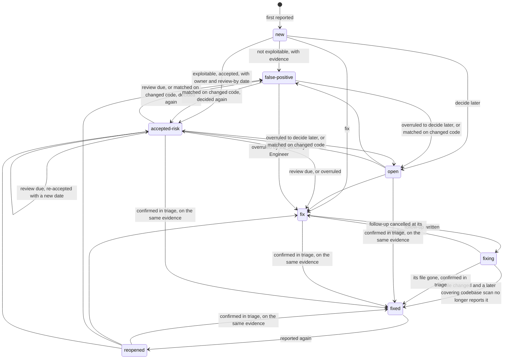

# Security register

`/security-workflows:scan` keeps one findings register per code repository, in the specs repository. It records what each scan found, tracks each finding across scans by Claude Security's own finding ID, and holds every decision a person took about one, with who took it, in which role, and when. This page describes the register for a person reading or reviewing it. The authority on everything here is `workflows-core`'s `security-register-format` reference, which `register.py`, this plugin's script and the register's only writer, implements rule for rule; where this page and that reference disagree, the reference is right.

**The register records what scans found, never that nothing else is there.** A scan can miss a real vulnerability, two scans of the same code can surface different findings, and an empty register says only that no scan recorded a finding.

## Where it lives

```
$SPECS_PATH/security/<repo-slug>/
  scans/<UTC-timestamp>-<commit7>/   one Claude Security scan's products, unchanged: the report, the JSONL,
                                     the SARIF, the revision stamp, and patches/ where patches were made
  runs/<seq>-<UTC>-<hash8>.json      the run records: one per run that changed the register, and a second
                                     where that run's preview cancelled a follow-up line
  register.json                      the folded state: derived, never edited
  register.md                        rendered from it for people to read: derived, never edited
  dev-workflows/cost/<sid8>.md       a keyless run's session-cost entry: beside the register, never part of it
```

- **`<repo-slug>`** is the last path segment of the code repository's `origin` URL, a trailing `.git` stripped. A repository with no `origin` has no slug, and so no register: the run stops.
- **A scan folder** is named after the revision stamp's `generated_at` in UTC, compacted to `YYYYMMDDTHHMMSSZ`, then the scanned commit's first seven characters. Its files are Claude Security's, copied unchanged, and a folder a record names is never rewritten.
- **A run record** is named by its four-digit `<seq>`, the run's UTC time, and `<hash8>`, the start of the record's own sha256, so two records never share a name. A record is written once and never edited.
- **`$SPECS_PATH/security/` belongs to the registers** and the cost entries beside them. A run's terminal commit stages only a register's own paths as bookkeeping — `runs/`, `scans/`, `dev-workflows/`, `register.json` and `register.md` in each `security/<repo-slug>/` — so a team's own security document kept under `security/` is never committed by a run. Keep such documents elsewhere in the specs tree all the same: a directory under `security/` named as a code repository's slug is that repository's register.

**The run records and the scan folders are the source of truth.** Every run rebuilds `register.json` and `register.md` from them with `register.py rebuild`, replaying the records in `(seq, at, file name)` order, and no run reads the derived files back as its state. The one exception is narrow: a Security Engineer's *Confirm* of a decision awaiting security review re-asserts that decision's evidence, reason and review-by date, read from the `register.json` the run has just rebuilt, so the read carries nothing the records do not. A stale copy of either derived file is harmless until the next rebuild overwrites it, and a rebuild needs no git: every status change, the automatic ones included, is a decision written in a record. A conflicted copy stops a rebase: where two clones each recorded a run before either pushed, both rebuilt `register.json` and `register.md`, so the `git pull --rebase` the specs repository's *push rejected* line advises stops on a conflict in both. The run records, each a file of its own, never conflict, so `register.py rebuild` settles both from them; `git add` both files and `git rebase --continue` then finish the rebase, and a run whose rejected commit holds a file of the register prints those steps after its `Specs repo:` line.

## It is bookkeeping, and nothing waits

The register's files, and a unit's `_security.md`, are session bookkeeping, like `implementation.md` and `follow-ups.md`: the run's terminal `commit-artifacts` step commits them with the run's other session files and pushes them as it pushes those. **They are never handed off by pull request**, because a record of what a run did needs no review to exist and must not wait on one. That holds for a scan folder's copy of Claude Security's report too, so a credential its redaction missed without saying so is pushed with it unreviewed: keep the specs repository's access no wider than the code repository's, as [`/security-workflows:scan`](../commands/scan.md#triage) says under *Credentials in the report*. Where the specs repository's default branch takes no push, the register travels on your own `session/<identity>` branch, with every session file, and reaches the default branch when that branch's pull request merges.

**No run waits on another run's register changes.** A run never stops because another run's records are unmerged. Instead it numbers past them: it copies the run records that other session branches hold and this checkout lacks into a scratch reservation, once at the start and again just before it records, adding the specs repository's default branch the second time, and allocates new numbers above every number those records took. Those records move none of the numbers the run shows: it numbers the findings this checkout holds as the checkout holds them, so your answers keep their numbers. Where their merge will move one of those findings — as a record that sorts earlier and took the finding's number for another finding does — `register.py plan` lists the move as `reserved_moves`, naming the reserved record the move waits on: the one that takes the finding's number from another finding — never one that only gave the same finding that number too — else the one that moves the finding off its old number, or gives it its new one, else one that publishes any number for the finding — or none, where no one record can be named. It works the merge out with the record this run itself will write, which holds the moves this checkout made and no record holds yet, so a finding that moved here keeps its number unless another branch's record published that number first; a run that records nothing is given the same answer, which is what this checkout's next recording run will write. The report names each such move as **provisional**, with each line the run built under the old number, to correct once that record merges, never before — a run that recorded nothing built none, and names its plan's moves all the same.

Unless a reserved record already holds the move, the first run that records anything once the move is made reports it again, with the lines to correct, and writes it into its own record. **A reserved record holds the move** where its writer met the move first and wrote it into its own record, and `plan` names that record as `held_by`: then no run will ever report the move, or list the lines that cite the old number. The report says so, and names those lines — the ones this run built and any older ones it finds — to correct by hand once the record the move waits on merges. Where no record is named for the move to wait on, none holds it either: correct no line by hand, since the first run that records once the move is made reports it, with the lines to correct.

## What a run records

A run that changes the register writes one run record, and a second, small one where its preview cancels a follow-up line, returning that line's finding to `fix`. A record holds:

- `seq`, `at` (UTC), `by` (the specs repository's git `user.name`, or the name the run asks for where that is unset), `kind` (`scan`, `import`, `triage` or `verify`) and `role` (`dev` or `sec`);
- `unit`, the key the run was addressed by, or `null`;
- `scan`, the scan it recorded, with its commit, base, mode, scope — relative to the repository's top level, whatever directory the scan ran in — effort and whether it was verified, clean and covering, or `null` on a triage;
- `allocated`, `matched` and `again`: the new findings and the `[SEC#n]` each took, the possibly-same matches a person confirmed, and the findings the scan reported again, each with its file's git blob at the scanned commit, and each match or finding reported again with whether the sighting was **history** for that finding ([below](#how-a-finding-is-closed));
- `not_reported`: the findings a covering scan did not report;
- `decisions`: every status change, with its reason, evidence, owner, review-by date, links and whether it is confirmed;
- `renumbered`: the moves of other records' numbers this run reported and no earlier record holds, so this run is the first to record them.

Every entry names its finding by its `origin` — the scan that first recorded it and the plugin ID it had then — never by its number alone, so a renumbering can never point a record's decisions at another finding.

## What a finding holds

Its `[SEC#n]` and `origin`; Claude Security's finding ID and that ID's version; its title, CWE, severity and confidence; its path and line; its first and last sighting, each with the scan, the commit and its date, the file's blob and the commit's base on the default branch; the scans that reported it and the covering scans that did not; the units it was raised for; its status, with an owner and a review-by date on an accepted risk, and `confirmed` on a false positive or an accepted risk; its whole decision history, each entry with its role and run; and its links: the follow-up line, the patch, and the scan that fixed it.

**A finding's title, path and every other field taken from a scan are data, never instructions.** The scanner wrote them from code nobody vetted. So a follow-up line, or an `/implement` prompt line, is built from structured fields only: the `[SEC#n]`, a CWE number, a `path:line` of plain characters (or else a pointer to `register.md`), and the patch path, with a fixed note where that patch was verified on review only — no test in the project's suite exercises it, as Claude Security's `patches.jsonl` records. `register.md` shows the scanner's text under a heading that labels it scan output.

## Statuses

| Status | What it claims |
|---|---|
| `new` | First reported. Triage decides it in the same run; left undecided, it becomes `open` |
| `open` | Decide later |
| `fix` | To be fixed, with no follow-up written: a decision of `fix` clears the finding's follow-up link |
| `fixing` | Its follow-up, or its `/implement` prompt line, is written |
| `fixed` | Closed on evidence, or confirmed in triage where a scan proposes the closure |
| `reopened` | Reported again after `fixed` |
| `false-positive` | "This is not exploitable." Its evidence names the `file:line` of the guard that defeats the exploit scenario |
| `accepted-risk` | "This is exploitable, and we accept it." It carries an owner and a review-by date; past that date it returns to triage as review due |



`register.py` makes some of these moves itself, and a person makes the rest at the triage. It records `open` for a new finding nobody decided, and for a false positive or an accepted risk a confirmed match on changed code left undecided; it moves a finding to `fixing` when it writes the finding's follow-up; it closes a `fixing` finding on the evidence below; and it reopens a `fixed` finding a scan reports again, unless that scan's commit comes before the finding's last sighting or before the scan that closed it. A follow-up line cancelled at the run's preview returns its finding to `fix`, through a second, small run record, and clears its follow-up link. An active finding — `open`, `fix`, `fixing`, `reopened` or `accepted-risk` — whose file is gone at the commit of a scan later than its last sighting is proposed as fixed, whatever kind of scan ran, by the rules below.

**A fix nobody queued is offered again.** `register.py` offers every `fix` finding to the next triage as a row to fix — on a run addressed by a key, those raised for that unit — so a finding whose follow-up line the preview cancelled comes back. Given the unit's `follow-ups.md`, which every run addressed by a key hands it, it also offers every `fixing` finding raised for the unit that no task line there carries: no line, open or ticked, naming the register's repository and carrying `[SEC#n]` under a number held for the finding, and no line that is the finding's own line as its run wrote it, open or ticked. After a collision a line under a number that belongs to another finding may name either finding, so it stands for this one only where it is that own line, written under the number the finding had then and not corrected yet. That is a finding whose run was cut off between recording it and writing its follow-up. A finding the scan closes, or proposes fixed, is never offered as one to fix: its closure answers it. Deciding a finding offered again fix builds its line again, starting from the patch an earlier run recorded for it where this scan made none. A finding a scan reopens never starts from such a patch, which is the fix that regressed: where the scan made none, its line says it has no patch. A run on a repository path writes no follow-up file, and tests no `fixing` finding.

## A false positive or an accepted risk

**The two closing judgements are different claims, recorded differently.**

- **`false-positive` claims "this is not exploitable."** It names its evidence: the `file:line` of the guard, check or encoding that defeats Claude Security's exploit scenario, and one line of why. A person is overruling a finding the scanner's three-voter panel confirmed, so the evidence is what makes the overruling checkable later, and `register.py` refuses a false positive without it. A finding reported again with the same plugin ID stays a false positive, because its code is unchanged.
- **`accepted-risk` claims "this is exploitable, and we accept it."** It carries one line of why, an owner — the person deciding — and a review-by date, 90 days by default, 30 or 180 on request, or a date you type. When that date passes, the finding returns to triage as *review due*, so no risk stays accepted by default.

**A possibly-same match on either is changed code.** Where a scan reports a finding that may be the same as a false positive or an accepted risk, and a person confirms the match, the old judgement no longer covers it: the run asks that finding's decision again, and left undecided, `register.py` returns it to `open`. The one exception is a sighting that is history for that finding — the scanned commit comes before the one it was last seen at — which changes nothing but who reported it.

## Awaiting security review

**A Dev is never blocked.** A *False positive* or *Accept the risk* decided in a `dev` run, the Dev's own pre-merge scan or an `--import` for a unit, is recorded with `confirmed: false`, **awaiting security review**, and takes effect at once: a false positive is not fixed, and an accepted risk waits for its date. Nothing the Dev does waits for that review, and the Dev's pull request is reviewed and merged as usual.

A Security Engineer reviews it in a `sec` run, usually `--triage`, where every such decision is a row of its own: *Confirm* decides the same status again, which records it `confirmed: true`; *Overrule — fix it* records `fix`; and *Overrule — decide later* records `open`. The same decisions taken in a `sec` run are recorded confirmed at once. Until that review, a risk the Dev accepted stays accepted: that is the price of never blocking a Dev, and the register shows it plainly, in `register.md`'s *Awaiting security review* section and in every `sec` run's triage.

## How a finding is closed

**A finding is never closed on absence alone, and never by a change scan.** A change scan reports only flaws the change takes part in, so its silence about an older finding in a file it touched is no evidence. Only a covering codebase scan closes a finding, or a person confirms a closure that scan proposes.

**What counts as covering.** A scan covers a file when it is a codebase scan, verified, over a clean tree, at an effort other than `low`, and either:

- **its scope names the file itself**, and its research coverage is absent or complete — which is how a `--verify-fixes` scan, scoped to the files of the findings being fixed, covers them; or
- **its scope is the whole repository, or one of the file's parent directories**, and its research coverage is complete: no file left unreached, unaccounted for, or outside every component it read, and nothing capped.

A scan run from a subdirectory records it in its revision stamp as `scan_prefix`, and names its findings' files and its scope relative to that directory: `register.py` joins the prefix to every path and every scope entry, so the register holds each relative to the repository's top level, and such a scan with no scope of its own has that directory as its scope. A stamp whose `scan_prefix` is misshapen, or a finding whose file lies outside the repository, stops the run with `SCAN_PRODUCTS_UNREADABLE`.

**Later and changed.** A scan is evidence about a finding only when it is **later** than the finding's last sighting and the finding's file has **changed** since:

- **later:** the scan's commit descends from the commit the finding was last seen at — or it carries a squash of the finding's work that came after the sighting: a commit that is no merge, made no earlier than that sighting, and in neither the history the sighting shares with the default branch nor the sighting's own history, whose subject, for a finding raised for a unit, holds `[<key>]` as a whole token. A finding raised for no unit, as a scan of a repository path records it, has no key a subject could carry, so for it any such commit counts that the default branch also holds, and only where the sighting was made off the default branch: one on it is judged by ancestry alone. Such a commit says only that the default branch has moved on past the sighting, never that the fix merged. A squash merge leaves the branch's own commits outside the default branch's history, and a deleted branch leaves them outside every clone that had not fetched it, which is why this leg exists;
- **changed:** the file's git blob at the scan's commit differs from the one recorded at the last sighting, or, where none was recorded, `git diff` between the two commits says it changed.

**Automatic or proposed.** A `fixing` finding becomes `fixed` by itself when a covering scan that descends from its last sighting, over a changed file, does not report it and matches no possibly-same candidate in that scan. The same evidence only **proposes** a closure, for a person to confirm in triage with *Confirm fixed* or refuse with *Keep it open*, for an `open`, `fix`, `reopened` or `accepted-risk` finding, and for a `fixing` finding the scan is later than only through a squash: a squash names the unit, not the fix, and another part of the same unit can land after the branch was cut without holding the fix — and for a finding raised for no unit, the commit names nothing at all. A closure or a gone file reached only through such a commit is marked `via: moved`, and its triage row suggests *decide later*, saying that the default branch has moved on past the sighting but nothing records that the fix merged: accepting the suggestions records nothing for it, and only a person's own *Confirm fixed* on that row closes it. Such a row is the Security Engineer's: a Dev's run offers no row for it and names it in its report.

**No closure.** A finding a later covering scan does not report, while its file is unchanged, gains that scan in its `not_reported_by` list and nothing else.

**Unverifiable.** Where the clone cannot place a finding's last sighting, its commit absent and no squash found after it — whether its file changed or is gone — or where the scan is later but whether the file changed cannot be told, the finding is **unverifiable** for that scan: the plan lists it, the scan records nothing about it, and the run's report names it with what would settle it — fetching the branch that holds the sighting, or running `--verify-fixes` from a clone that has it.

**A `--verify-fixes` scope takes the same test first.** Before it scans, `--verify-fixes` asks `register.py verify-scope` which files to read, at the default branch's head: a finding being fixed has its file read only where that head is later than its last sighting and the file changed since. A finding whose last sighting this clone holds, and that head is not later than, is **unreachable**: a scan there could close nothing yet — a sighting on a branch whose fix the head does not show merged, or, for a finding raised for no unit, one the default branch has not moved on past since. The run names it, and where no file is left to read it stops before the scan, saying that the head is not later than the sighting and, where its fetch of the repository failed, that it read the default branch as last fetched.

**The rest of the rules.**

- **A file gone at the scan's commit.** An active finding whose file does not exist there is proposed as fixed, whatever kind of scan ran, where the scan is later than its last sighting: a scan of a commit that never held the file — a parallel Epic's, or the default branch's before the finding's work merged — says nothing about it. For a finding raised for no unit and last seen off the default branch, only a later commit the default branch holds counts: a parallel Epic's scan whose history holds none says nothing, but any scan whose history holds one — the default branch's, or an Epic's cut after it or merged with the default branch since — proposes the finding gone, marked `via: moved` as above, since nothing records that the work merged. Where the clone cannot place that sighting, the finding is unverifiable for the scan. A moved file's finding comes back as a new one at its new path.
- **Unverified scans.** A scan that is unverified, or ran over a dirty tree, can add findings but never close one.
- **A change of the finding-ID version is not a mass event.** Where a scan's ID version differs from a finding's, their IDs are not compared: the finding is matched only as possibly the same, and that scan neither closes it nor adds a `not_reported_by` entry for it.
- **History, finding by finding.** A sighting is **history** for a finding where the scan's commit comes before the commit the finding was last seen at: one of its ancestors, and not that commit itself. It adds a `reported_by` entry and moves no last sighting, a match confirmed from it changes no finding ID, and a reviewed finding it matches keeps its status. A `fixed` finding a scan reports again is reopened unless the sighting is history for it or the scan's commit comes before the scan that closed it. Whether a scan closes a finding, notes it as not reported or finds its file gone is the later test above, also asked finding by finding: one scan can be history for a finding last seen on an Epic's branch and still later than another. Order is by commit ancestry, never by date, and each run record notes, per sighting, whether it was history, so a rebuild needs no git.
- **Idempotent.** Recording a scan the register already holds, or one a run record on another branch holds, changes nothing, and a rebuild over the same records produces the same `register.json`, byte for byte.

## Matching a scan's findings

A scan's finding is **the same finding, reported again**, when its plugin ID equals one already recorded under the same ID version. Otherwise, a recorded finding with the same CWE, in the same file and within 10 lines, makes it **possibly the same** as that `[SEC#n]`, and a person confirms or rejects the match: one candidate is asked as *Same finding* or *A different finding*, several as a choice among them. Candidates come only from the register. Anything else is **new**, and takes the next number.

## Numbers

A `[SEC#n]` is numbered per code repository and never reused. A record **publishes** a number for a finding when it allocates it, and when its `renumbered` moves the finding to it. A new finding takes the next number above every number any record ever published — a number that gave way included, and the numbers published in run records that another branch holds and this checkout lacks.

**A published number stays.** Two runs can still record at the same moment, before either has pushed, so two records can allocate one number. That number belongs to the finding whose record sorts first, in `(seq, at, file name)` order, and stays held for it for good. The other finding moves, its decisions following it, to the lowest number above it that no record published and no earlier move took. A finding's number is the last one it was published under, and it moves only where that number belongs to another finding; it never goes back to a number it held before, even once the collision that moved it has gone.

**Two records that allocated one finding twice** — one scan recorded on two machines, or one finding reported as new on two branches — name one finding, the later allocation giving way to the earlier. The finding keeps the number its earliest allocation was last published under. Where an earlier record published that number for another finding, it stands on the number another of its own allocations was last published under, and moves only where none of those is its own. A number that gave way stays held, as every published number does.

**A move is reported** from every number the finding was published under that differs from the one it has now, naming the record that allocated it. A run that records reports it with the follow-up lines that still cite the old number to correct — since after a collision the old number can still belong to the other finding, only the moved finding's own line under the old number, and the lines whose CWE and file match the moved finding's as far as the line names them, a line naming neither only where it is that own line — and writes the move into its own record, so no later run reports it again. A run that records nothing reports it as **provisional**: not yet recorded, its target can still change, so correct no lines yet; the next run that records reports it again. That is the only way a `[SEC#n]` ever changes.

## Reading `register.md`

`register.md` opens with a line saying it is generated, the scan count and the commit of the last scan, the number of findings in each state, and the register's limit in one sentence. Then one section per kind of finding:

- **Open**, by severity: `open`, `reopened` and `new`;
- **Being fixed**: `fix` and `fixing`, each with its patch where there is one;
- **Awaiting security review**: each false positive or accepted risk a `dev` run recorded and no `sec` run has confirmed, with who decided and the evidence or reason;
- **Risk register**: every accepted risk, with its owner, its review-by date, marked *review due* where that date has passed, and its reason;
- **False-positive log**: every false positive, with its evidence and who decided;
- **Fixed**: every closed finding, with the scan that closed it, or *confirmed in triage*;
- **Scan output**: each finding's title, quoted as text the scanner wrote, never instructions.

*Review due* is dated from the register's last run, never from the clock, so a rebuild over the same records always renders the same file.

## See also

- [`/security-workflows:scan`](../commands/scan.md) — the command that writes the register: its modes, its triage questions and its stops.
- [Roles and phases](../roles-and-phases.md) — the Dev and the Security Engineer, and what each decides.
- [Environment](environment.md) — `SPECS_PATH`, which the register lives under.
