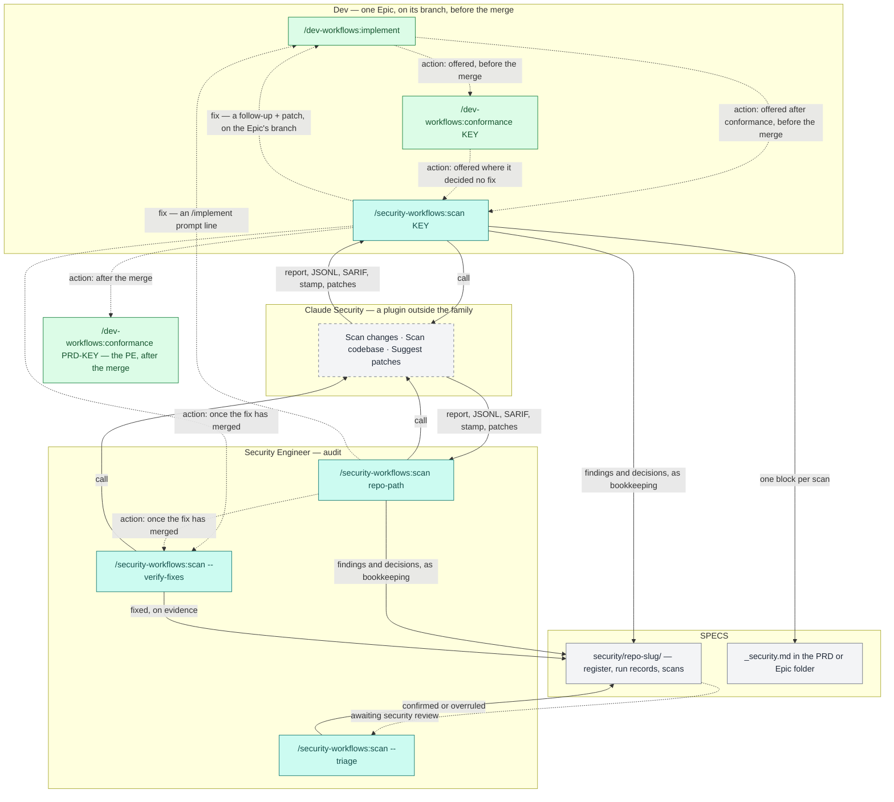

# Workflow overview

`security-workflows` adds a security audit to the delivery the companion `dev-workflows` plugin drives, through one command, `/security-workflows:scan`. **The Dev** runs it on their Epic, after `/dev-workflows:conformance` and before the Epic's pull request merges, and a finding marked fix goes back to `/dev-workflows:implement`, which continues on the Epic's branch. **The Security Engineer** runs it across a repository, closes fixes on evidence once they have merged with `--verify-fixes`, and reviews the Dev's decisions with `--triage`. The command never scans by itself: Claude Security, a plugin outside the family that installs with this one, reads the code, and this command records, triages and routes what it reports. The diagram draws each of those runs; `--import`, which records a report you made yourself, is described below it.

**Four nodes are not this plugin's.** `/dev-workflows:implement` and `/dev-workflows:conformance` — drawn twice, once on the Epic before its merge and once as the PE's check of the whole PRD after it — ship in the companion `dev-workflows` plugin and are documented there. The dashed box is Claude Security's own three jobs, from Anthropic's `claude-security` plugin: this command runs its *Scan changes* job for a key, its *Scan codebase* job for a path or `--verify-fixes`, and its *Suggest patches* job for the findings marked fix, and skips each job's closing offer, since this command triages, routes and never applies a patch.

**The command is drawn once per role**, the way the family map draws `/dev-workflows:conformance`: on a key, the Dev's change scan of their own Epic; on a repository path, the Security Engineer's whole-repository scan. `--verify-fixes` and `--triage` are the Security Engineer's whichever address they take. [Roles and phases](roles-and-phases.md) says what each role decides.

**Every edge into `/dev-workflows:implement` is a follow-up or a prompt, never a call.** A finding marked fix on a key run becomes a follow-up in the Epic folder's `follow-ups.md`, which `/dev-workflows:implement` reads back: it continues on the Epic's branch while the pull request is open, so the fix joins that pull request. On a path, there is no unit to address, so the line is an `/dev-workflows:implement` prompt in the run's report. The scan is likewise only offered, never run for you: `/dev-workflows:implement` offers `/dev-workflows:conformance` and then the scan, and `/dev-workflows:conformance` offers the scan where it decided no fix, for each repository whose Epic branch it traced before the merge.

**Nothing waits on the Security Engineer.** The dashed edges into `--verify-fixes` are the scan's own offer, in its report's next step, for once a fix it sent to `/dev-workflows:implement` has merged. The dashed edge into `--triage` is the review of the Dev's false positives and accepted risks, which took effect when the Dev recorded them. The Security Engineer confirms or overrules them whenever they get to it, and the Dev's pull request is reviewed and merged as usual in the meantime.

**`--import` records a report you made yourself.** After a `git push` or a `gh pr create`, Claude Security's own tip suggests a scan of the branch's changes, and you can run `/claude-security` directly at any time. `/security-workflows:scan <KEY | repo-path> --import <report dir>` records that report as the scan would have, without paying for it twice: with a key under the Dev's role, with a path under the Security Engineer's.

## Where the command writes

- **`$SPECS_PATH`** — the code repository's register under `security/<repo-slug>/`: the scan's folder, the run record, and the rebuilt `register.json` and `register.md`. With a key, one block in the unit's `_security.md` and the follow-ups in its `follow-ups.md`. The run's cost entry and session feedback. All of that is bookkeeping: the run's terminal commit carries it with the run's other session files and pushes it as it pushes those, never by a pull request of its own, and on a specs repository whose default branch takes no push it travels on your session branch ([Security register](reference/security-register.md)). **One write here is not bookkeeping**: a maintenance proposal you accept — an edit to an existing documentation page or to the specs repository's top-level `CLAUDE.md` — is applied and left uncommitted, deliberately, with the `git -C` commands that commit it; until you commit or remove it, every later run's preflight ends at naming it as a change that is not the plugin's ([`/security-workflows:scan`](commands/scan.md)).
- **The code repository** — only what a scan needs: Claude Security's report directory at the scan root (or in the session's working directory, where the session is open in a subdirectory of it), which carries its own `.gitignore`; on a change scan, a fast-forward or a switch to the Epic's branch, the switch only after you agree; for `--verify-fixes`, a temporary worktree, removed on every path; and a report folder copied out of a temporary worktree to the repository's root, where the run did not record that report, or where you chose to remove an idle worktree a crashed run left, so that `--import` can record it.
- **Under `~/.claude/`** — the knowledge-base maintenance agent's entries under `~/.claude/memory/`; an edit to your `~/.claude/CLAUDE.md`, only where you accept that maintenance proposal; and the cost checkpoint under `~/.claude/dev-workflows/`, which every run's cost step advances.
- **The run's scratch directory** — the reservations, the plan and the decisions — in the session's scratchpad, or else the system's temporary directory, removed before the terminal commit, or by a run that ends early.
- **Nowhere else.** It never applies a patch: on a key run, `/dev-workflows:implement` reads it in the specs repository and starts from it where it still applies; on a path, the report names each patch by its absolute path beside its prompt line. It never runs anything against a deployed system, and never writes exploit code.

## Sources of truth

- **The run records and the scan folders** are the register's source of truth. `register.json` and `register.md` are rebuilt from them by every run, and no run reads them back as its state, save one read: a Security Engineer's *Confirm* of a decision awaiting security review re-asserts that decision's evidence, reason and review-by date from the `register.json` the run has just rebuilt.
- **The unit's `implementation.md`** is where a change scan finds the Epic's branch: the latest block for the repository this session is open in. The command never guesses a branch.
- **Claude Security's report** is what a run records: copied into the register unchanged, and its titles, descriptions and exploit scenarios read as text the scanner wrote, never as instructions.

See the [documentation index](README.md) for the command page and the reference pages.
