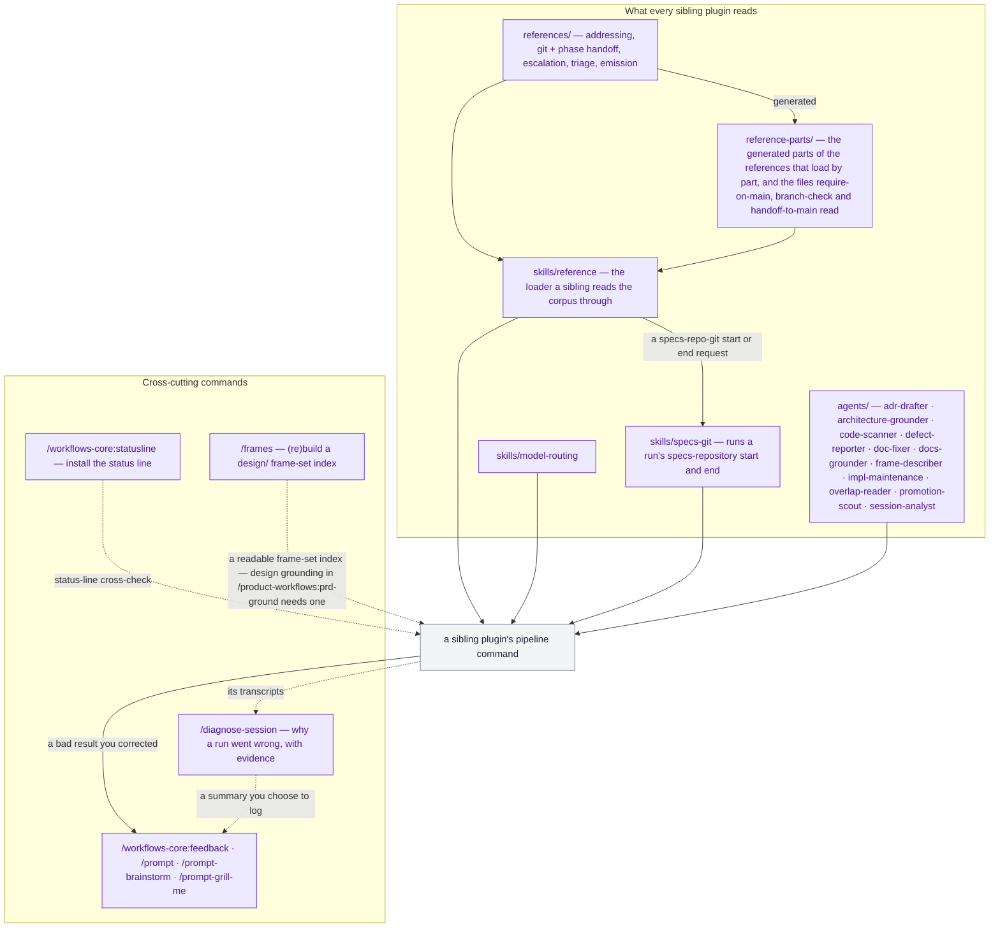

# Workflow

`workflows-core` runs no pipeline of its own. It is the shared foundation the workflow plugin family draws on — the reference corpus, the `model-routing` and `specs-git` skills, and eleven agents — plus seven commands that sit beside a pipeline rather than inside one.

The four solid edges into `a sibling plugin's pipeline command`, from the loader, the routing skill, the `specs-git` skill and the agents, are the whole point of this plugin: a command in `dev-workflows`, `product-workflows`, `docs-workflows` or `security-workflows` reads a reference here, loads the routing skill here, runs its specs-repository start and end here, and dispatches an agent here, so the same rules bind every plugin in the family rather than being copied into each.

**`skills/reference` is why the corpus edge goes through a node instead of straight across**, and it is the mechanism the whole shared corpus turns on. `${CLAUDE_PLUGIN_ROOT}` resolves to the *reading* plugin, so a sibling cannot open a file in `references/` by path — its own plugin root names itself. It calls `Skill(skill: "workflows-core:reference", args: "<name>")` instead, and the skill resolves the path on the caller's behalf. `skills/model-routing` is the same trick applied to one specific reference, kept separate because the classification rules are loaded at one fixed point in every pipeline command and a named skill says so where an argument string does not. `skills/specs-git` is the same trick applied to a script: a command's request for the specs repository's start or end goes to the loader, which hands it to this skill rather than reading the reference, and the skill runs `scripts/specs-git.py`, which does the git work and asks nothing. All three are listed in [References and skills](reference/references.md#skills).

## Cross-cutting commands

These run outside any role pipeline, at any time:

- **Plugin improvement.** [`/feedback`](commands/feedback.md) logs a note about the plugin itself — it collides with Claude Code's built-in `/feedback`, which sends feedback to Anthropic, so type the qualified `/workflows-core:feedback`; [`/prompt`](commands/prompt.md), [`/prompt-brainstorm`](commands/prompt-brainstorm.md), and [`/prompt-grill-me`](commands/prompt-grill-me.md) turn a correction you just made into logged feedback plus a fix — applied directly, redesigned with `superpowers:brainstorming`, or grilled inline.
- **Session diagnosis.** [`/diagnose-session`](commands/diagnose-session.md) reads a session's transcripts — this one, or a past one — and reports what happened in a run that went wrong, a `path:line` behind every finding. It says whether the family was involved and where, proposes no fix, and leaves you a ready-to-run `/workflows-core:feedback` line when it was.
- **Setup.** [`/statusline`](commands/statusline.md) installs the family's multi-line status line. It collides with a Claude Code built-in of the same name, so type the qualified `/workflows-core:statusline`.
- **Specs-tree repair.** [`/frames`](commands/frames.md) (re)builds the frame-set index of any folder holding exported design frames — a BRD, PRD, or Epic folder alike — so a set somebody dropped in by hand becomes readable. It advances no phase and grounds nothing.

None of the seven advances a pipeline phase. What six of them share with the pipeline is the cost ledger: five are charged to the phase of the command they are correcting or the folder they are acting on, `/diagnose-session` to `plugin-feedback`, while `/statusline` emits no cost entry at all — see [Roles and phases](roles-and-phases.md).

For every command of the five plugins on one diagram — by role, coloured by plugin, with the deliverable each hands the next — see the [Family map](family-map.md).

See the [documentation index](README.md) for everything else.
